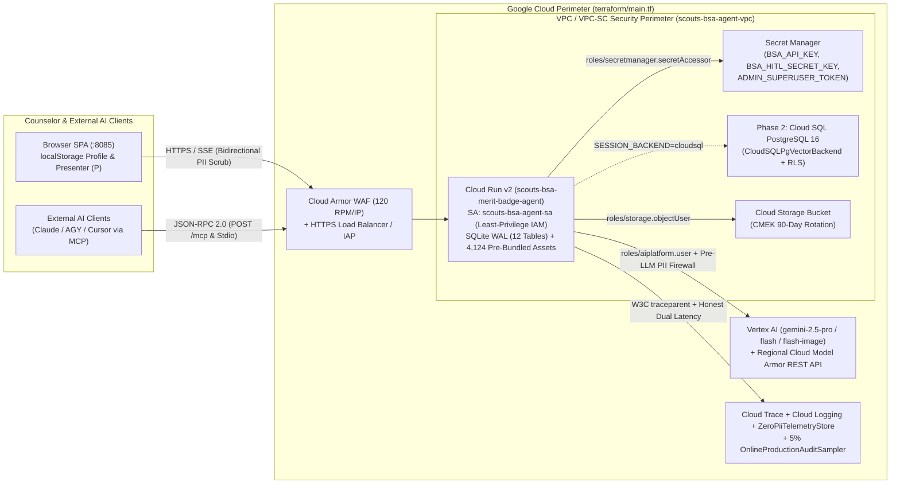

# Scouts BSA Merit Badge Counselor Workbench (`scouts-bsa-merit-badge-agent`)

[](https://google.github.io/adk-docs/)
[](https://www.scouting.org/skills/merit-badges/)
[](https://www.scouting.org/merit-badges/)
[](https://www.python.org/)

Volunteer Scouts BSA Merit Badge Counselors often spend 8 to 15 hours building slide decks, Scout workbooks, lesson plans, gear lists, and parent letters for a single badge. This project uses the **Google Agent Development Kit (ADK) for Python** to generate widescreen (`16:9`) PowerPoint (`.pptx`) presentations, 4-pillar sub-requirement-unrolled fillable Scout workbooks (`.pdf` AcroForm, interactive `contenteditable` `.html`, and `.md` per `GTA §7.0.3.2`), multi-page 1-Page Class Preparation Pages (`CPP` with `0%` dropped requirement text), multi-format session agendas, Quartermaster gear checklists, 3-Stage Youth Protection (YPT) parent communication packs, and multi-session (`S1..S4 | M`), multi-troop Blue Card (`#34124`) / Scoutbook Plus sign-off matrices with per-troop privacy isolation across all **149 official Scouts BSA Merit Badges** (`143` active official Merit Badges, `5` Scouting America Test Lab Pilots: *Auctioneering*, *Dance*, *Physics*, *Psychology*, *Wildland Fire Management*, plus *Sewing and Needlework*, and `1` discontinued historical badge: *Citizenship in Society*, annotated with a red `🚫 Discontinued` indicator in the Patch Gallery).

Every slide deck is grounded in the official **BSA Merit Badge Pamphlet** and **Scouting.org Digital Resource Guide**. The pipeline keeps official requirement wording intact, breaks multi-part requirements into readable teaching slides, embeds official badge patch emblems and de-boxed transparent pamphlet figures, attaches pre-populated or on-demand **Nano Banana hero illustrations** (with deterministic fallback to 220-DPI EDGE Skill Concept Maps), generates 220-DPI technical diagrams, renders a **Single Unified Bottom Misconception vs. Pamphlet Fact Callout Bar**, checks every slide for shape overlaps before saving, and writes an **Archetype-Differentiated 5-Part Non-Redundant Facilitator Guide** (`[PACING & MODALITY]`, `[ASK SCOUTS FIRST]`, `[EXPECTED PAMPHLET ANSWER KEY]`, `[COMMON MISCONCEPTION TO CORRECT]`, `[DEMONSTRATION & SIGN-OFF RUBRIC]`) with child-slide sub-requirement scoping (`1a-1d` vs. `1e-1g`, `3a-3q`), rotating `pamphlet_excerpts`, and 1-click **`[✨ AI Polish Slide | ▾]`** (`✨ AI Polish Slide`, `✨ Polish Entire Deck`, `↺ Restore Default Script`).

> **Detailed User & Admin Documentation**:
> - **In-App Documentation Viewer**: Click **`📘 Documentation`** (or press `D`) in the Top Application Bar to read the User Guide, Admin Guide, and all 10 engineering documents directly inside the Workbench with live rendered Mermaid diagrams and inline screenshots.
> - **Merit Badge Counselor Guide**: For a visual walkthrough of every screen, button, and classroom workflow from a Merit Badge Counselor's perspective (with screenshots, Mermaid diagrams, and reference tables), read the **[Detailed User Documentation (`docs/USER_GUIDE.md`)](docs/USER_GUIDE.md)**.
> - **Super-User Admin Guide**: For catalog curation across all 4,124 built-in visual assets, zero-PII telemetry monitoring, and system diagnostics, read the **[Super-User Admin Guide (`docs/ADMIN_GUIDE.md`)](docs/ADMIN_GUIDE.md)**.
> - **MCP Server Integration Guide**: To connect Claude Desktop, Gemini CLI / AGY, Cursor, or Google ADK agents to the built-in Model Context Protocol server (`15` MCP tools, `7` `bsa://` resources, and `5` guided prompts = `27` capabilities), read the **[MCP Server Integration Guide (`docs/MCP_SERVER_INTEGRATION_GUIDE.md`)](docs/MCP_SERVER_INTEGRATION_GUIDE.md)**.

---

## Table of contents

1. [Key Capabilities & Features](#1-key-capabilities--features)
2. [Quick Start: Local / Laptop Execution & ADK CLI](#2-quick-start-local--laptop-execution--adk-cli)
3. [How to Use the Counselor Workbench](#3-how-to-use-the-counselor-workbench)
4. [System architecture and agent pipeline](#4-system-architecture-and-agent-pipeline)
5. [Project structure](#5-project-structure)
6. [Configuration and local asset caching](#6-configuration-and-local-asset-caching)
7. [Optional Cloud Deployment (Terraform, Cloud Build, and ADK CLI)](#7-optional-cloud-deployment-terraform-cloud-build-and-adk-cli)
8. [Testing and evaluation gate](#8-testing-and-evaluation-gate)
9. [Troubleshooting and FAQ](#9-troubleshooting-and-faq)

---

## 1. Key Capabilities & Features

- **Full 149-badge catalog (`143` Active Official + `5` Scouting America Test Lab Pilots + `1` Discontinued Historical), Multi-Option ("Two-Badges-in-One") Requirement Track Unrolling, Starred Favorites, and Multi-Badge Saved Deck Workspaces (`🗂️ My Decks`)**:
  - Covers all **149 Scouts BSA Merit Badges** (`143` active official Merit Badges across 18 Eagle-Required and 125 active Electives, `5` Scouting America Test Lab Pilots: *Auctioneering*, *Dance*, *Physics*, *Psychology*, *Wildland Fire Management*, plus *Sewing and Needlework*, and `1` discontinued historical badge: *Citizenship in Society*, annotated with a red `🚫 Discontinued` indicator in the Patch Gallery so Scouts completing partial Blue Cards started prior to discontinuation can still review canonical requirements) across all 7 Scouting categories: *Outdoor & Campcraft*, *Health & Public Safety*, *Citizenship & Personal Development*, *Nature & Environment*, *STEM & Science*, *Aquatics & Sports*, and *Trades, Business & Careers* / *Arts, Crafts & Hobbies*.
  - **Multi-Option ("Two-Badges-in-One") Sub-Requirement Unrolling, Interactive `A|B ▾` Patch Gallery Popover & Option Track Selector (`#option-track-select` & `GET /api/v1/badges/{badge_name}/options`)**: Automatically detects all **18 Multi-Option Merit Badges** (`Golf`, `Skating`, `Rifle Shooting`, `Shotgun Shooting`, `Journalism`, `Cycling`, `Archery`, `Snow Sports`, `Animal Science`, `Plant Science`, `Metalwork`, `Multisport`, `Radio`, `Railroading`, `Geology`, `Disabilities Awareness`, `Athletics`, and `Whitewater`), preserves their full 3-level sub-requirement trees (`2a -> 2a(5) -> 2a(5)(a)..(h)`), unrolls multi-discipline tracks into dedicated teaching units with option-scoped pamphlet page ranges and Nano Banana hero graphics, and lets counselors generate either **All Option Tracks** or a focused single track (such as `Option A: Traditional Golf` or `Option B: Disc Golf`) with clean Cover Slide option subheads and concise unrolled slide headers. Both the sidebar (`#filter-eagle-select`) and the 149-Badge Visual Patch Gallery (`#patch-gallery-eagle-filter`) include **`Multi-Option Badges (18)`** and **`🧪 Test Lab Pilot (5)`** filters; hovering or clicking the **`A|B ▾`** badge on any multi-option patch card opens an interactive track-picker popover with boundary-aware `.drop-right` (for left-column and single-card filtered states like `★ Cycling`) and `.drop-up` (for bottom-row cards) positioning; selecting a multi-option badge in the sidebar dropdown reveals 1-click option pills (`#option-track-prompt-pills`) before starting generation; and switching badges or tracks mid-run immediately aborts the prior SSE stream (`activeEventSource.close()`).
  - **Selective Patrol Scenario Quiz Curation**: Automatically restricts `SOCRATIC_REVIEW_QUIZ` slides (`_select_quiz_eligible_requirement_ids()`) to at most `3` high-signal safety, first-aid, rule, or field-judgment requirements per deck with contextual option-B/C distractors, skipping physical-performance or log-tracking option tracks so every Patrol Quiz is realistic and classroom-ready.
  - Filter by keyword, category, or the **`Eagle / Favorites` dropdown (`#filter-eagle-select`, including `★ Favorites`, `Multi-Option Badges`, and `🧪 Test Lab Pilot (5)`)**, or use the **3-mode Quick-Select bar (`🔥 Popular | ⭐ Favorites | 🗂️ Decks`)**, 1-click **`⭐`** starring next to the badge selector, and the **149-Badge Visual Patch Gallery** featuring an **Inverted Gold-Circle Star (`★` white star on `#D97706` gold circle)** on favorited patch cards, `🧪 Test Lab` indicators on pilot badges, a red `🚫 Discontinued` indicator on *Citizenship in Society*, and a **Header Favorites Filter Toggle (`★` button with `"Toggle favorites filter"` tooltip)** right next to the Eagle filter dropdown.
  - **Multi-Badge Counselor Workspaces (`🗂️ My Decks`, Unified 2-Row Classroom Session & Deck Schedule Builder & Top-of-Stage `🗂️ Active Decks` Bar)**: Dual-tier persistence in SQLite (`scouts_bsa_sessions.db` with **12 normalized tables**, including `counselor_workspaces`, `counselor_favorites`, `user_preferences`, `clinic_session_schedules`, `scout_session_attendance_and_partials`, and `counselor_syllabus_bucket_overrides`) and `localStorage` lets counselors save multiple Merit Badge decks and patrol sections, hot-swap between active decks in `<80ms` with isolated Patrol Blue Card (`#34124`) rosters, configure class logistics via the **Unified 2-Row Classroom Session & Deck Schedule Builder** (`Active Deck Title` + `✨ Auto-Title`, `Class Section Name`, `Section #` `1-9` or `None`, `Starting Date` with live Day-of-Week badge, `Frequency` `Once`/`Daily`/`Weekly`/`Monthly`, `# Sessions` `1-5`, `Include Makeup Session`, `Start Time`, `Duration` in minutes starting at `60` in `5`-min increments with live `Ends <Time>` badge, `Classroom / Location` and `Camp Week / Midway Tag` with `+` custom persistence via `GET/POST /api/v1/preferences/custom-lists` that floats saved entries to the top of the dropdown, and a **Live Computed Schedule Preview Strip**), click **`📑 Clone Next Period`** (incrementing section `#` and advancing start time by duration + 10 min passing buffer), use **`🔁 Copy Scouts From Deck`** in the Blue Card Tracker, and export/import portable `.bsadeck.json` workspace backups.

- **Official BSA Pamphlet grounding, de-boxed transparent figures, and location-aware local context**:
  - Downloads, caches, and parses requirements, definitions, procedures, worked examples, and figures from official BSA Merit Badge Pamphlet PDFs, paired with the **Structured Requirement Curriculum Catalog (`data/merit_badge_requirements/<slug>.json` and `data/official_requirements_cache.json`)** for domain-accurate multi-card breakdowns and high-resolution Nano Banana scientific diagrams (such as the Hydrologic Cycle, Doppler Radar reflectivity, Cold/Warm Front cross-sections, Sea & Land Breezes, Cloud Classification, and cropped Earth's `23.5°` Axial Tilt with unified scene-specific captions). A SHA-256 hash (`compute_canonical_pamphlet_hash()`) verifies that official requirement wording is never modified during web enrichment.
  - **De-Boxed Transparent Pamphlet Figures**: Scanned illustrations extracted from official BSA Merit Badge Pamphlets pass through an edge-connected flood-fill background remover (`debox_pamphlet_image_file()`) that strips surrounding white page margins while preserving interior white details, allowing figures to sit cleanly on the warm cream (`#FAF8F5`) slide canvas and custom card styles.
  - Resolves your **Location (City, State or ZIP Code)** (`location_or_zip`), or infers it from your Troop and Council affiliation or browser timezone via `resolve_counselor_location()`. Across 4 local-grounding phases, it applies your local NOAA National Weather Service forecast office, current state U.S. Senators (for civic badges like *Citizenship in the Nation*), regional terrain hazards, state parks, and state agencies to the Badge Overview slide (Slide 2), the Counselor Session Lesson Plan, the Parent Prerequisite Letter, and the Requirement-Specific Grounded Citations section without repeating boilerplate across every slide.
  - Provides direct links in the UI top bar to open the **Official BSA Pamphlet (PDF)** and **Scouting.org Digital Resource Guide** for the active badge, alongside the **`🧭 Guided Tour ▾` Interactive Guided Tour Menu (`#btn-hero-demo-menu-toggle`)** featuring **8 narrated multi-step guided walkthroughs** (starting with **Demo #1: `Citizenship in the Nation` Requirement 8 Congressional Delegation & Constituent Letter**, **Demo #2: `Golf (Option B: Disc Golf)` 3-Level Sub-Requirement Tree**, and **Demo #3: `Youth Protection Guardrail, Workflow Trace & FinOps Ledger`**) powered by a **Docked Guided Tour Bar (`#active-demo-tour-banner`)**, **Live Animated Virtual Cursor (`#demo-virtual-cursor`)**, **Glowing Spotlight Ring (`#demo-spotlight-ring`)**, and **Anchored Floating Callout Bubble (`#demo-floating-callout`)**.

- **Two deck depth modes and Unified Warm Cream (`#FAF8F5`) Rich Visual Slide Theme**:
  - **Depth modes**:
    - **Deep Dive Teaching Deck (`3-8 Slides / Req • 30 to 100+ Slides`)**: Multi-slide teaching sequences for each requirement, including a Requirement Intro slide, concept explainers, 2-column comparisons, worked examples, diagrams, and Socratic review questions. Built for Merit Badge Universities, summer camp classes, or multi-week troop instruction.
    - **Standard Troop Meeting Deck (`1-4 Slides / Req • 18 to 48 Slides`)**: Concise 1 to 4 slide sequences per requirement for a single troop meeting or patrol breakout.
  - **Unified Warm Cream (`WARM_CREAM` / `#FAF8F5`) Rich Visual Slide Theme (`SlideBeautifierAgent` + `FinOpsBudgetPlugin`, \$1.00 max budget cap)**:
    - **Pre-Cached Rich Visual Canvas (`WARM_CREAM` default, `Visual Assets: 100% Pre-Cached (8-Bit PNG)` in the sidebar)**: Every deck renders on a warm editorial cream canvas (`#FAF8F5`) with integrated `1.5pt` DrawingML card accent borders (`NAVY_GOLD`, `OLIVE_FOREST`, `EAGLE_CRIMSON`, `SLATE_ACTION`) and pre-bundled **Nano Banana Hero Illustrations (`NANO_BANANA_HERO`)** on 100% of Requirement Intro slides (`$0.00` runtime image cost; `~$0.18` actual cold LLM token spend vs. `$0.38` uncached shadow-ledger ceiling, compiling in `1.5-3.5s` locally).
    - **4,124 Built-In Curated Visual Assets Across All 149 Merit Badges**: Includes **1,401 verified, compressed 8-bit PNG Nano Banana illustrations** in `assets/ai_illustrations/`, **2,425 100%-Vision-verified BSA Pamphlet figures** in `assets/pamphlet_images/`, **149 official Merit Badge emblems**, and **149 official Pamphlet covers**, with deterministic fallback to the 220-DPI **Scouts BSA EDGE Skill Concept Map** if an asset is missing.
    - **Per-Slide Marker Style & Brand Palette Pickers + Modern & Legacy API Theme Names**: Counselors can customize any individual slide's **Marker Style** (`🎨 Slide Layout, Point Style & Palette` -> `Marker Style`: *Numbered Step Badges (`01, 02, 03`)*, *Key Concept Diamonds (`◆ Accent`)*, *Sequential Action Steps (`STEP 1 ➔`)*, *Counselor Quote & Callout (`❝`)*, *Safety & Caution Callout (`⚠️ SAFETY`)*, *Key Takeaway Spotlight (`★ Gold Star`)*, with callout markers supported across `Clean`, `Line`, and `Boxed` modes) and **Brand Palette** (including `MATCH_TEMPLATE`) in Drawer Tab 2, while REST, MCP, and Python API callers can pass the modern theme names **`WARM_CREAM`** (`CREAM`, `#FAF8F5`, default), **`CRISP_WHITE`** (`WHITE`, `#FFFFFF`), or **`DARK_SLATE`** (`SLATE`, `#0F172A`, capped at \$1.00 by `FinOpsBudgetPlugin`) alongside backward-compatible legacy enum aliases (`BEAUTIFIED`, `STANDARD`, `STUDIO`).
    - **Hybrid PowerPoint Template & Custom Slide Theme Engine + Global Deck Layout Style Engine (`DeckStyleConfig`)**: Includes a built-in library of **17 council-neutral Scouting America & Heritage PowerPoint templates organized across 7 Style Families (`bsa_scouting_america` Green default, 8 style rows including `Workbench Classic`)** (`default_workbench`, `bsa_scouting_america` Green/Blue/Red, `classic_outdoor_silhouette_navy` Blue/Green/Red, `scouting_america_forest_sunrise` Blue/Green/Red, `scouting_america_topographic` Blue/Green/Tan, `classic_fleur_crimson_crest` Red/Blue, `scouting_america_250`, and `scouting_america_high_adventure_rock`) paired with the **Global Deck Layout Style Engine (`DeckStyleConfig`)** (`✨ Auto (Match Template)` resolving all 16 BSA templates to `📖 Clean & Borderless` `CLEAN_OPEN` + `FRAMELESS_CLEAN` + `MINIMAL_ACCENT` with `+2.0pt to +3.3pt` typography boost and `+21.7%` larger visuals, `📏 Editorial Left-Accent Line` `LEFT_ACCENT_LINE`, and `🗂️ Classic Boxed Cards` `BOXED_CARDS`, where selecting `"Boxed Cards"` under `"Text Points Style"` only updates `text_container_style` and never boxes the right-hand image so `image_frame_style` remains `"FRAMELESS_CLEAN"` by default including on `Workbench Classic` `default_workbench`; on Slide 2 `REQUIREMENTS_TRIAGE_MATRIX`, `"Clean"` `CLEAN_OPEN` uses open borderless columns with top colored bars while `"Line"` `LEFT_ACCENT_LINE` uses `4px` vertical colored left accent bars on each triage column; `#deck-header-chrome-select` offers `AUTO` / `MINIMAL_ACCENT` *"Unboxed Left-Accent Requirement Strip"* and `FULL_BANNER` *"Full Solid Navy Header Banner"* with full untruncated overview and requirement text across all modes and no `#stage-magazine-badge` header pill; plus `📌 Save as My Default Style` / `"📌 Set as My Default"` and `"↺ Reset"` `#btn-modal-reset-default-deck-style` via `GET / PUT / DELETE /api/v1/preferences/deck-style` and `POST /api/v1/preferences/deck-style/reset`, and Stage-2 visual quality auditing via `audit_deck_visual_quality()`) plus custom template upload (`.pptx`, `.ppt`, `.png`, `.jpg`, `.webp` via `POST /api/v1/templates/upload`), URL import (`POST /api/v1/templates/import-url`), inline custom template Name/Description editing (`✏️` via `PATCH /api/v1/templates/{template_id}`), and custom template deletion (`🗑️` via `DELETE /api/v1/templates/{template_id}`, which immediately reverts the active deck to `Workbench Classic` / `default_workbench`). Features true responsive slide geometry on both the live 16:9 web stage (`#widescreen-slide-stage`) and `.pptx` export (lifting instructional cards and the `"Guide to Safe Scouting"` warning banner above the template's reserved bottom branding/logo zone `y <= 6.86"`), auto-contrasted luminance footer text (`#FFFFFF` on dark bars, `#0F172A` on light bars) left-shifted clear of the corner logo, a Stage Toolbar **Split-Button Template Switcher** (`[🖼️ Template Name 🔵 | ▾]`, placing `"Switch Slide Template (17 Across 8 Styles)"` at the top with all 8 template style rows visible without scrolling and `"Deck Layout Style (Live Stage + .PPTX)"` `Auto`, `Clean`, `Line`, `Boxed` directly below it), and a redesigned **3-Box Anatomical Safe-Zone X-Ray** overlay (`Zone 1: Header Reserve`, `Zone 2: Active Pedagogical Content & Safety Safe-Box` with live dimension/delta badge, `Zone 3: Template Footer & Protected Corner Logo Zone`).
  - **Never overwrites technical diagrams**: Existing BSA Pamphlet figures and custom technical diagrams (such as weather fronts, CPR steps, or the 200-foot bear-bag triangle) are always preserved.

- **3 Automatic Scout Slide Construction Animations (Zero-State & Live Generation Stage)**:
  - While a deck is generating (or on initial load before a badge is selected), the slide area hides and plays an interactive **Scout Slide Construction Animation** that cycles automatically across three themed storyboards (all 14 frames preload at startup for zero-lag playback):
    1. **Animation 1/3: 3D Heavy Equipment** (6 frames): Miniature Scouts in hardhats operate bulldozers, tower cranes, forklifts, and a twin-rotor helicopter to build a giant 16:9 slide. The active Merit Badge emblem rests on the ground with a 3D isometric tilt on frames 1-3, is hoisted by the helicopter on frame 4 (with a foreground hoist cable and golden mounting ring eyelet overlay `iso_heavy_4_foreground_cable.png` rendered in front of the badge patch), and locks into the upper-right mounting ring on frames 5-6.
    2. **Animation 2/3: 2D Camp Pioneering** (4 frames): Scouts at a pine campsite use timber spars, rope lashings, and block-and-tackle pulleys to hoist a canvas slide with the badge emblem centered inside the carved timber medallion ring.
    3. **Animation 3/3: 3D Slide-O-Matic (`⚙️ 3. 3D Slide-O-Matic (4f)`, 3D Claymation Workshop)** (4 frames): Stop-motion clay Scouts feed Merit Badge pamphlets into a brass-and-oak *"Slide-O-Matic"* machine powered by a glowing golden Nano Banana energy dome.

- **Easy Slide Image Switcher, 4-Tab Under-Stage Drawer (Including Live Multi-Agent Workflow Trace & FinOps Ledger), `WebImageSearchAgent`, `NanoBananaImageAgent`, Local File Upload & Quick Text Edit**:
  - **Easy Slide Image Switcher (On-Stage Visual Pill & Popover)**: Directly on the 16:9 slide stage above the right-hand graphic (`#stage-visual-source-badge`), slides with multiple available visuals (such as a primary pamphlet figure plus up to 2 Gemini Vision-verified pamphlet alternates for that requirement in `slide_image_choices`) display **`◀`** and **`▶`** arrows and a **`(1/3) ▾`** button. Counselors can click **`◀`** or **`▶`** to flip between image choices in one click, or click **`(1/3) ▾`** to open a floating popover (`#stage-visual-pill-popover`) comparing each option's `56x42px` thumbnail, role label (`Primary Pamphlet Figure`, `Pamphlet Alternate #1`, `Pamphlet Alternate #2`, `Uploaded Custom Image`), and Vision-verified caption. Selecting an option updates the slide graphic, swaps in its paired caption, and rebuilds the `.pptx` deck in the background at `$0.00` token cost. Slides with a single visual (such as a Requirement Intro hero illustration) show a clean static source pill.
  - Directly under the 16:9 slide stage, four horizontal sub-tabs keep all per-slide tools and live pipeline telemetry above the fold:
    1. **🎙️ Counselor Teaching Notes (Archetype-Differentiated 5-Part Non-Redundant Facilitator Guide, Child-Slide Sub-Requirement Scoping, `[✨ AI Polish Slide | ▾]` & FinOps Cost Gate)**:
       - **5-Part Non-Redundant Facilitator Guide**: Compiles a structured 5-part counselor facilitator script (`<5ms` per deck at `$0.00` token cost) organized under five actionable headers: **`[PACING & MODALITY]`** (timing, EDGE method phase, and classroom/station delivery mode), **`[ASK SCOUTS FIRST]`** (Socratic check question before lecturing), **`[EXPECTED PAMPHLET ANSWER KEY]`** (verbatim pamphlet facts and card-aligned look-fors), **`[COMMON MISCONCEPTION TO CORRECT]`** (real Scout field traps vs. BSA pamphlet truth), and **`[DEMONSTRATION & SIGN-OFF RUBRIC]`** (observable verification criteria per `GTA §7.0.0.3`).
       - **Child-Slide Sub-Requirement Scoping & Pamphlet Excerpt Rotation (`v2.2`)**: Scopes multi-part child slides (`Sub-Requirement Deep Dive Part k`, `SPLIT_VISUAL_EXPLAINER`, `STEP_BY_STEP_PROCEDURE_4CARD`, `SOCRATIC_CHECKPOINT_QUIZ`) to their exact assigned sub-requirements (`1a-1d` vs. `1e-1g`, `3a-3q`) and rotates `pamphlet_excerpts` across continuation slides so consecutive slides never repeat parent boilerplate notes.
       - **`[✨ AI Polish Slide | ▾]` Split-Button (`✨ AI Polish Slide`, `✨ Polish Entire Deck`, `↺ Restore Default Script`)**: Clicking **`✨ AI Polish Slide`** (`POST /api/v1/slide/polish-notes`) or **`✨ Polish Entire Deck`** (`POST /api/v1/slide/polish-notes-batch`) opens the **FinOps Cost Transparency Gate Modal (`#ai-polish-finops-modal`, `POST /api/v1/slide/estimate-polish-cost`)** comparing **Option 1: Current Slide Only (`~$0.0008`)** in a lavender card and **Option 2: Entire Deck (`~$0.068` for 82 slides)** in an amber card, with checkboxes for `Force fresh Gemini Flash generation even for slides already cached in SQLite` and `Don't show this FinOps cost popup again during this browser session`. When confirmed, Gemini 2.5 Flash transforms the concise `<5ms` deterministic 5-part baseline notes into a rich, conversational facilitator script tailored to the counselor's `local_context`, adding concrete physical stage directions (`🎬 [Point to Card 1: ...]`), spoken Socratic dialogue with follow-up probes, synthesized visual-card answer keys, field-trap coaching in `[COMMON MISCONCEPTION TO CORRECT]`, and observable sign-off rubrics while preserving all 5 structural headers, caching results in SQLite `polished_speaker_notes`, displaying an `✨ AI-Polished (Gemini 2.5 Flash)` provenance pill, and saving `default_presenter_notes` for 1-click **`↺ Restore Default Script`** alongside **`📋 Copy Script`**.
    2. **🎨 Customize Slide & Image**:
       - **7 Clickable SVG Mini-Wireframe Layout Cards & 10-Archetype Selector**: Visual archetype picker (`Split Visual`, `2x2 Steps`, `2-Col Compare`, `Checklist`, `Patrol Quiz`, `Full Text`, `Big Visual`, plus the 10-option layout dropdown) for switching a slide between split visual, full-width concept cards, 2-column comparison, 2x2 step grid, process flow, Socratic quiz, and field safety layouts.
       - **Per-Slide Layout, Theme, Palette & Right-Side Graphic Controls**: Change Layout Archetype, Point Callout & Marker Style, Brand Palette, or Right-Side Graphic (`Keep Current Slide Graphic`, `Restore Original Slide Graphic`, `Nano Banana Hero / EDGE Skill Concept Map`, or `None (Remove Graphic & Expand Text to Full Width)`).
       - **`🖼️ Manage & Add Slide Images (Catalog / Web / AI)` (Upper-Right Button -> 4-Tab Popup Image Studio)**:
         - **🗂️ 1. Badge Image Catalog & Carousel**: Browse all available images for the active Merit Badge, apply any image in one click, or click **🗑️ Clear Web/AI Cache** (`DELETE /api/badge/images` / `GET /api/v1/cache/clear`) to purge only user-searched web images (`WEB_IMAGE_SEARCH`) and user-created AI images (`NANO_BANANA_AI`) while preserving official BSA pamphlet figures (`PAMPHLET`), pre-generated/auto hero images (`NANO_BANANA_HERO`), and local file uploads (`USER_UPLOAD`).
         - **🌐 2. Web Image Search Agent (`gemini-2.5-flash`)**: Queries the live Wikimedia Commons API for up to 16 public-domain photographs and diagrams matching your topic, caches selected results per badge, and applies them to the current slide.
         - **🍌 3. Nano Banana AI Image Generator (`gemini-2.5-flash-image` & Vertex AI Imagen 3)**: Synthesizes custom, text-free illustrations across **10 UI style options** (plus 4 legacy style aliases), defaulting to **`✨ Auto (Content-Aware Mix)`** (`resolve_content_aware_visual_config()`), plus *Photorealistic Image*, *4-Quadrant Concept Map*, *Line Drawing*, *Watercolor Field Sketch*, *Technical Diagram*, *3D Isometric Illustration*, *Editorial Vector Illustration*, *Cartoon Drawing*, and *Vintage Merit Badge Poster*. Includes an **Include Uniformed Scouts** toggle, 1-click **`✨ Sample Safe Diagram`** and **`🛡️ Test YPT / PII Safety Guardrail`** quick-fill verification pills, and an explicit `$0.08 USD` FinOps consent gate (`user_consented=True`) + prompt alignment check (`verify_generated_image_matches_prompt()`).
         - **📁 4. File Upload (`POST /api/slide/upload-image`, `$0.00 USD`)**: Upload a local `.png`, `.jpg`, `.jpeg`, or `.webp` photo or diagram from your computer (`<= 10 MB`), normalize it with Pillow (`RGB`, max `1600px`), register it as `USER_UPLOAD`, and apply it directly to the active slide.
    3. **✏️ Quick Edit Slide Text (`POST /api/slide/regenerate` / `POST /api/v1/slide/regenerate` with `title_override`, `bullet_points_override`, `visual_caption_override`, `speaker_notes_override`, `$0.00 USD`)**: Edit any slide's title, visual caption, teaching card lines (`Heading: Body text`), and speaker notes directly in the browser and rebuild the `.pptx` in under one second without an LLM call.
    4. **📊 Multi-Agent Workflow Trace & FinOps (`#tab-btn-understage-trace` -> `#trace-telemetry-card`)**: Displays a 5-card Telemetry KPI strip (**`First Status Event`** `~6.8 ms` SSE ACK, **`True TTFT`** `~210 ms` first LLM token, **`SHA-256 Requirement Lock`** `100% Verbatim`, **`AABB Geometry QA`** `0 Overlaps (<10ms)`, and **`Run Cost / Budget Ceiling`** `$0.000` Warm / `$0.184` Cold vs. `$1.00` hard cap), the **7-Agent Google ADK Pipeline Execution Timeline (`#workflow-trace-grid`)**, and the **Live Run FinOps Token & Unit Economics Ledger (`#trace-finops-ledger-box`)**.

- **Counselor Classroom & Field Toolkit (Consolidated Material 3 Toolbars `54 -> 19` Groups, In-App Documentation Viewer, 27-Capability MCP Server & Agent Hub, Centered Split-Screen Presenter Console, Multi-Session `S1..S4 | M` & Multi-Troop Blue Card Matrix with Per-Troop Privacy Isolation, 4-Pillar Sub-Requirement-Unrolled Fillable Workbooks & Multi-Page `CPP`, and 5-Pill StudioKit)**:
  - **Consolidated Material 3 Toolbars & Split-Buttons (`54` Loose Controls Consolidated into `19` Groups)**:
    - **Global Header**: Unified **`[📥 Download (.PPTX) | ▾]`** export split-button, **`[📘 Help & Tools | ▾]`** dropdown (consolidating Documentation, 8 Guided Tours, Keyboard Shortcuts, and MCP Inspector), **`[🗂️ My Decks | ▾]`** workspace switcher, and **Auto-Slim Hero Banner**.
    - **Tab 2 Blue Card Matrix**: Quick-Add + **`📥 Import Roster ▾`**, **`✅ Batch Sign-Off ▾`** (`S1..SN | M` multi-session attendance and completion stamp dynamically synchronized with the active **2-Row Session Builder** `# Sessions` and `+1 Makeup` controls, plus high-contrast WCAG AAA **`Patrol All: ✓S1..✓M`** 1-click whole-patrol session attendance header buttons), and **`[🪪 Download 3-Panel Blue Cards (.PDF) | ▾]`** (3-Panel `#34124` PyMuPDF `.PDF` via `/api/v1/studiokit/bluecards.pdf?mode=3panel`, Sign-Off Matrix `.PDF` via `mode=sheet`, Per-Troop Isolated Packets so Troop A never sees Troop B youth PII, Scoutbook `.CSV` with spreadsheet formula-injection sanitization, and 3-Stage Two-Deep YPT Email Pack).
    - **Tab 3 Scout Workbook**: **3-Segment View Mode Pill Switcher** (**`[📖 Counselor Workbook | 📝 Fillable Form (GTA §7.0.3.2) | 📄 1-Page Class Prep (CPP)]`**) + unified **`[📥 Download Fillable Workbook (.PDF) | ▾]`** split-button for all Scout-facing workbook & checklist `.PDF` downloads (`fillable-workbook.pdf` with a **Page-1 Parent-Requirement Grouped Completion Matrix** and dynamic `Schedule:` dates, `counselor-workbook.pdf`, `cpp.pdf`, `field-qr-checklist.pdf` with real scannable ISO/IEC 18004 vector QR matrices and a centered Scouting America emblem, and `📋 Copy Workbook Markdown`, with dedicated second-line pamphlet citations in the Fillable Form).
    - **Tab 4 StudioKit**: **5-Pill Sub-Navigation** with de-duplicated counselor-facing `.PDF` download menus (**`[🃏 Download 3x5 Cue Cards (.PDF) | ▾]`** offering `cue-cards.pdf`, `organizer-spec.pdf`, and `gear-rotator.pdf`; **`[📥 Download Agenda (.PDF) | ▾]`**; and **`[📨 Compose in Gmail | ▾]`** across 3 distinct multi-troop Parent Letter stages `stage_1_welcome_cpp`, `stage_2_mid_clinic_alert`, `stage_3_final_packet`), Multi-Session (`4x75m` + Snow-Day Shift) schedule presets, Companion Dual-Badge (`2-in-1`) switcher, and **Nano Banana 1-to-3 Color Variant Slide Template Studio** (`POST /api/v1/templates/generate-ai` and `POST /api/v1/templates/synthesize-backdrop`, with **16 built-in Scouting Washed Cover Backdrops** `assets/templates/overlays/nano_base_*.jpg` including `bsa_emblem_color` Large Washed Color BSA Universal Emblem and `apollo_rocket_launch`, prompt-driven AI backdrop synthesis, custom background photo upload + description processing, a 3-mode Live 16:9 Preview switcher `Washed Background` / `Slide 1` / `Slide 2-N`, dynamic color-named variant pills `Green (Primary)` / `Blue (Secondary)` / `Gold (Accent)`, automatic frame-geometry & palette synchronization, a **`🍌 + Create AI Template`** quick-launch button in Tab 1, `6` cycling sample prompts `(1/6)..(6/6)`, and automatic draft reset and `#2`/`#3` name incrementing for unlimited multi-template creation) inside `#template-studio-modal`.
    - **Admin Console `Add DMBC & HVSC Customizations` Toggle (`#chk-admin-dmbc-hvsc-customizations`, Default Unchecked)**: In the Super-User Admin Console header, maintainers can toggle **`Add DMBC & HVSC Customizations`** (unchecked by default for a 100% generic Scouting America presentation with zero `"Danvers"` or `"Hidden Valley"` strings in the UI, or checked to enable all Danvers Merit Badge College and Camp Hidden Valley templates, venue macros, and classroom presets).
  - **In-App Markdown Documentation Viewer (`📘 Documentation` / Shortcut `D` / `GET /api/v1/docs`) & Footer `GitHub` Link**: Accessible from **`[📘 Help & Tools | ▾]`** (`#btn-open-docs-viewer`) in the Top App Bar, opening the **Dual-Mode Material 3 Documentation Studio Modal** featuring **`📘 User Guide`** (preselected), **`🛡️ Admin Guide`**, and a **`⚙️ Engineering Docs (10)`** mode toggle (`README`, `TDD`, `ARCHITECTURE DECISIONS`, `adr/README`, `API INTEGRATION GUIDE`, `MCP SERVER INTEGRATION GUIDE`, `FINOPS GUIDE`, `SCOPE`, `SPEC`, and `RUNBOOK`, for `12` in-app documents total). Renders live Mermaid SVG diagrams, inline screenshots with click-to-zoom, interactive cross-document links, a sticky `"On This Page"` section outline, and **`↗ View on GitHub`** / **`🖨️ Print / Save PDF`** actions. The application footer also links directly to the **`GitHub`** repository (`https://github.com/clayberg/scouts-bsa-merit-badge-agent`).
  - **Official Scouts BSA Workbench MCP Server (`src/mcp_server.py`, `scouts-bsa-mcp` CLI) & In-App `🤖 MCP Hub` (`27` Capabilities)**: Exposes **15 MCP Tools**, **7 grounded `bsa://` Resources**, and **5 Guided Prompts** (`27` total capabilities) over both local `stdio` (`python -m src.mcp_server` / `scouts-bsa-mcp`) and HTTP JSON-RPC 2.0 + SSE (`POST /mcp`, `GET /mcp/info`, `GET /mcp/sse`). Opening **`🤖 MCP Hub`** from **`[📘 Help & Tools | ▾]`** (or pressing `M`) launches the **MCP Server & Agent Hub Modal** with copy-ready client configs for Claude Desktop, Gemini CLI / AGY, Cursor, and Google ADK `MCPToolset`, interactive **`▶ Read Live` / `📋 Copy URI`** buttons on all 7 `bsa://` resources and **`▶ Execute Prompt` / `📋 Copy Prompt`** buttons on all 5 guided prompts (which also register as `/` slash commands in MCP clients), and an expanded full-height **Interactive MCP Playground (Section 3)** featuring a **`[📊 Visual Card Preview | { } Raw JSON-RPC 2.0]`** output toggle and live RPC latency/status pill across all 27 capabilities. See the **[MCP Server Integration Guide (`docs/MCP_SERVER_INTEGRATION_GUIDE.md`)](docs/MCP_SERVER_INTEGRATION_GUIDE.md)**.
  - **Sticky Export Split-Button (`📥 Download Slide Deck (.PPTX)` / `🟨 Open in Google Slides` Account Modal), Centered Split-Screen Presenter View (`🪟 Presenter View` / `P`) & Live Classroom Timer (`⏱️ Timer`)**:
    - The Top App Bar provides a **Sticky Export Split-Button** (`scouts_bsa_preferred_deck_export_mode_v1` in `localStorage`) that remembers whether you prefer downloading a `.PPTX` file or converting to Google Slides. Clicking **`🟨 Open in Google Slides`** opens the **Account & Destination Modal (`#gslides-export-modal`, `GET /api/v1/slide/export-gslides/account-info`)**: Card 1 displays the active workstation Google Drive account (`clayberg@google.com` + `GOOGLE DRIVE CLI + ADC` badge), Card 2 accepts an optional secondary/personal `@gmail.com` address for automatic Editor sharing and `?authuser=` routing, and bottom actions provide **`🔑 Pick Google Account (OAuth)`** and **`🟨 Create & Open in New Tab ↗`** (`POST /api/v1/slide/export-gslides`).
    - The **`🪟 Presenter View`** button (`P`) toggles a **Full-Size Split-Screen Presenter Console** (`435px` docked / `450px` floating) in both normal preview and Fullscreen (`F`) modes, automatically collapsing the left sidebars in preview mode so the 16:9 slide stays full size. Its 2-tier header displays a `PRESENTER VIEW` gold badge and clickable `MM:SS` elapsed clock on the left, and `🪟 Float` / `📌 Dock` (for dragging the console anywhere on screen), `↗ 2nd Monitor`, and a crimson `✕` close button (`#btn-pc-close-console`) on the right, followed by a top **`Up Next`** card with a `⏱ ~2 min` pacing badge, a 4-button navigation and font bar (**`◀ Prev Slide`**, **`Next Slide ▶`**, **`A−`**, **`A+`**), and the **5-Part Non-Redundant Facilitator Guide** teleprompter cards (`[PACING & MODALITY]`, `[ASK SCOUTS FIRST]`, `[EXPECTED PAMPHLET ANSWER KEY]`, `[COMMON MISCONCEPTION TO CORRECT]`, `[DEMONSTRATION & SIGN-OFF RUBRIC]`). Clicking **`↗ 2nd Monitor`** opens a synchronized floating teleprompter window while keeping the main screen in centered presentation mode.
    - Also includes a compact **Auto-Slim Blue Merit Badge Summary Banner** with three vertically stacked label-first KPI pills (**`TOTAL SLIDES 83`**, **`REQUIREMENTS 15`**, **`SLIDE THEME Warm Cream`**), a consolidated **Single-Row Above-Stage Toolbar (`#slide-stage-toolbar`)** with an interactive 2-column **Requirement Quick-Jump Dropdown (`[📍 Overview ▾]`)**, a **Collapsible Live Classroom Timer Pill (`⏱️ 44:59 ⏸`)** + unified **`[🖥️ Present | ▾]` Split-Button** (`Present Fullscreen (F)`, `Split-Screen Presenter View (P)`, `Pop-Out Presenter (2nd Window)`, embedded `45m ▾ | 45:00 | ▶ | ↺` timer controls, and `Quiz Reveal` / `Patrol Scoreboard` toggles), a **Single-Row Slide Outline Filter & Unified `[🛠️ Tools ▾]` Menu** (`[🔎 Filter slides or req...] [🛠️ Tools ▾]` consolidating `⚡ Quiz Slides Only`, `🏠 Hide Home-Prereqs`, `Slide Deck Customizer`, and `Patrol Game` with a live `Tools • 1` active-filter badge), **Active-Slide Lower-Right Customizer Micro-Pills (`+`, `👁️`, `↑`, `↓`)** featuring a high-contrast emerald/white typographic `+` Add Slide button (`m3-thumb-micro-pill-add`) in Dark Mode, `0ms` stationary-position visual updates (`preserveActiveOutlinePosition`, keeping the selected slide card at the same physical vertical position under the cursor while neighbor slides shift around it), and `1200ms` debounced net-zero `.pptx` sync (`scheduleDebouncedDeckPptxSync`), a **Consolidated `Quick-Select -> 🗂️ Decks` Switcher & Top-Bar `[🗂️ My Decks | ▾]` Split-Button** for `<80ms` multi-badge deck hot-swapping (with `15x15` Merit Badge emblem icons on `🔥 Popular`, `⭐ Favorites`, and `🗂️ Decks`, plus template color dots `m3-tpl-inline-color-dot` on Saved Workspaces cards), and **Visual Source Mini-Badges & Multi-Image Count Pills (`🖼️ 1/2`)** in the Left Slide Filmstrip.
  - **Multi-Session (`S1..S4 | M`), Multi-Troop Blue Card (`#34124`) & Scoutbook Plus Requirement Sign-Off Matrix (`POST /api/v1/studiokit/multisession-attendance`)**: Build your patrol or multi-troop clinic roster via Quick-Add or **`📥 Import Roster ▾`** (`📋 Bulk Paste Roster`, `📤 Import CSV`, or `🔁 Copy Scouts From Deck`), track attendance across **`S1 | S2 | S3 | S4 | M`** (Sessions 1-4 plus Make-Up), apply **`✅ Batch Sign-Off ▾`** (`S1..S4 | M` session stamp and completion date), automatically differentiate **Smart Partials** (`actionable_makeup_reqs` missed in class vs. `expected_hometroop_reqs` long-term logs/campouts), and export via **`[🪪 Print Blue Cards (#34124) | ▾]`** (3-Panel `#34124` PDF, **Per-Troop Privacy-Isolated Packets** grouped by `troop_unit` so Troop 19 never sees Troop 42's youth roster, **Scoutbook Plus `.CSV`** with formula-injection sanitization stripping leading `=`, `+`, `-`, `@`, and **3-Stage Two-Deep YPT Email Pack** with automatic `cc` to unit leaders/parents).
  - **4-Pillar Sub-Requirement-Unrolled Fillable Workbooks (`GTA §7.0.3.2`), Multi-Page 1-Page Class Prep (`CPP`) & 5-Pill StudioKit**:
    - **Tab 3 (`📘 3. Scout Workbook`)**: Switch between **`[📖 Counselor Workbook | 📝 Fillable Form (GTA §7.0.3.2) | 📄 1-Page Class Prep (CPP)]`** and export via **`[📥 Download (.PDF) | ▾]`**. The 4-pillar workbook engine (`src/tools/counselor_studiokit.py`) unrolls every nested sub-requirement (`1a..15d`, `3a..3q`, `2b1`) across Markdown (`.md`), interactive browser-fillable HTML (`contenteditable`), and downloadable **AcroForm `.PDF`** workbooks with dynamic multi-page PyMuPDF text wrapping (`0%` dropped requirement text across all 149 badges). Renders **13 clause-driven bespoke graphic organizers** (`HAZARD_5COL`, `SYMPTOMS_FIRST_AID_PREVENTION_3COL`, `CAMPING_LOG_20NIGHT`, `FITNESS_ASSESSMENT_4STAGE`, `FITNESS_LOG_12WK`, `MEAL_PLANNER_AND_COST_TABLE`, `CITIZENSHIP_CIVIC_ORGANIZER`, `SCIENTIFIC_EXPERIMENT_SHEET`, `SENSORY_OBSERVATION_LOG`, `ENGINEERING_DESIGN_NOTEBOOK`, `CAREER_EXPLORATION_CARD`, `SKETCH_AND_OBSERVATION_CANVAS` dot-grid/Moon-circle sketch boxes, and `PHYSICAL_SKILL_VERIFICATION_RUBRIC`), plus interactive `gear_checklist` checkboxes and **Counselor Pre-Approval signature gates** before field execution.
    - **Tab 4 (`🗓️ 4. Class Prep & Letters`)**: Features a **5-Pill Sub-Navigation** (`📋 All Sections`, `🗓️ 1. Agenda & Parent Letter`, `🎒 2. Gear & Buddy Rotator`, `✅ 3. Pre-Class Readiness`, and `📚 4. Grounded Citations & Counselor Rating`) with consolidated **`📦 Printable Handouts & Specs ▾`**, **`[🖨️ Print Agenda | ▾]`**, and **`[📨 Compose in Gmail | ▾]`** menus, **Multi-Session (`4x75m` + Snow-Day Shift)** schedule presets (`POST /api/v1/studiokit/multisession-planner`), and a **Companion Dual-Badge (`2-in-1`)** switcher (`POST /api/v1/studiokit/companion-curriculum`) for co-teaching paired badges.
  - **Zero-PII Super-User Admin Console (`docs/ADMIN_GUIDE.md`) & 5% Online Production Trace Audit Sampler**: Accessed via `Ctrl+Shift+A`, the footer `🔒 Admin` link, or `/?admin=1` (protected by dual-mode `verify_admin_superuser()` auth in `src/security.py`). Provides **Tab 1: Cached Image & Caption Studio** (inline caption editing, 1-click primary promotion `★ Make Default`, Gemini Vision re-captioning, and image replacement across all 149 badges), **Tab 2: Zero-PII Usage, Latency & Image-Swap Telemetry** (`ZeroPiiTelemetryStore` in `src/observability/telemetry_store.py` with recursive `scrub_pii_dict()` enforcement, **Honest Dual Latency Telemetry** separating `first_status_event_ms` from `true_first_content_token_ms`, the **5% Online Production Trace Audit Sampler** via `OnlineProductionAuditSampler` in `src/observability/online_audit_sampler.py`, and the **Easy Slide Image Switcher Swap Leaderboard**), and **Tab 3: System Diagnostics & 149-Badge Asset Health** (featuring aligned `Pamphlet Figs`, `Nano Heroes`, and `PDF & Index` columns reporting each badge's exact official top-level requirement count, such as `15 Reqs` for First Aid and `12 Reqs` for Weather).

- **Persistent Counselor Profile Caching & 3-Layer Context-Aware Bidirectional PII Guardrail (Local vs. Cloud)**:
  - **Local / Laptop runs**: Your Counselor Name, Troop/Council, Location/ZIP, Email, Phone, and Custom Troop Logo path are cached locally in `.cache/counselor_profile.json` (`0600` owner-only file permissions, git-ignored) so you only need to enter them once.
  - **Web / Cloud Run deployments**: In multi-tenant cloud mode (`K_SERVICE`), server-side disk caching of counselor PII is disabled; instead, your profile is cached in your own browser's `localStorage` (`scouts_bsa_counselor_profile_v1`).
  - **Strict bidirectional PII boundary & 3-Layer Context-Aware Phone Redaction Filter (`v2.2`)**: Counselor contact PII (email, phone, name) is injected directly into the local Slide 1 Cover and Parent Letter templates and is scrubbed bidirectionally via `ScoutsBSAModelArmorPlugin`, `scrub_pii_before_sink()`, and `scrub_pii_from_structure()` across ingress prompts, tool arguments, model responses, SSE egress streams, SQLite telemetry records, OpenTelemetry spans, and Cloud Logging sinks. In `src/observability/logging_setup.py` and `src/agents/guardrails.py`, phone redaction uses a **3-Layer Context-Aware Filter**:
    1. **Layer 1 (URL & Filename 10-Digit ID Exclusion)**: Excludes 10-digit numeric IDs inside URLs and filenames (`https://vimeo.com/1018695895`, `.pdf` asset paths), preserving all **92 official Scouting America Vimeo video links and PDF worksheets across 18 badges**.
    2. **Layer 2 (NANPA Toll-Free & Emergency Hotline Allowlist)**: Preserves NANPA toll-free prefixes (`800`, `888`, `877`, `866`, `855`, `844`, `833`) and canonical emergency/institutional hotlines (`1-800-222-1222` Poison Control on First Aid Slide 3, `911`, `988`, `800-323-0736` BSA Scout Shop, `202-633-1000` Smithsonian switchboard, and `(202) 224-xxxx` U.S. Capitol switchboard).
    3. **Layer 3 (`±55`-Character Institutional vs. Personal Hotword Window)**: Evaluates a `±55`-character context window around candidate phone numbers for institutional vs. personal hotwords while strictly redacting all personal youth, parent, and counselor phone numbers (`[REDACTED_PHONE]`).

- **1:1 parity between live web preview and downloaded `.pptx`**:
  - Both the Material 3 web preview (`ui/app.js`) and the PowerPoint builder (`src/tools/pptx_builder.py`) render the exact same text, card grid structure, integrated `1.5pt` card borders, de-boxed pamphlet figures, responsive `SafeCanvasBounds` (`y <= 6.54"`), and visual theme (`WARM_CREAM`, `CRISP_WHITE`, or `DARK_SLATE`, plus legacy aliases `BEAUTIFIED`, `STANDARD`, `STUDIO`), enforcing a `12.0pt` minimum body font floor (`_compute_fitting_font_size()`) with 100% sentence preservation so text never clips mid-sentence or bleeds outside cards in PowerPoint or Google Slides. Output filenames include the polish tier (`<Badge>_<Tier>_<Depth>_Merit_Badge_Deck.pptx`) so switching tiers never serves a stale cached file.

---

## 2. Quick Start: Local / Laptop Execution & ADK CLI

### Prerequisites

- **Python 3.10+**
- `pip` (or `uv`)
- *(Optional)* A Google Gemini API key (`GEMINI_API_KEY` or `GOOGLE_API_KEY`) for live LLM calls. All 149 badges also run offline out of the box using the local pamphlet extractor and deterministic curriculum engine.

### Installation

```bash
# 1. Clone the repository and enter the project directory
git clone https://github.com/clayberg/scouts-bsa-merit-badge-agent.git
cd scouts-bsa-merit-badge-agent

# 2. Create a virtual environment and install dependencies
python3 -m venv .venv
source .venv/bin/activate
pip install -e .

# 3. Configure environment variables
cp .env.example .env
# Optionally edit .env to add GEMINI_API_KEY="your-api-key"
```

### Launching the Material 3 Counselor Workbench (`:8085`)

The [`run_local.sh`](run_local.sh) script starts the FastAPI + Material 3 Counselor Workbench on port `8085` (and serves the live Cloud Run instance at [`https://scouts-bsa-merit-badge-agent-qjaneb6heq-uc.a.run.app`](https://scouts-bsa-merit-badge-agent-qjaneb6heq-uc.a.run.app)):

```bash
./run_local.sh
# Or directly with uvicorn:
uvicorn src.server:app --host 0.0.0.0 --port 8085
```

Then open **`http://localhost:8085`** in your browser.

### Google ADK CLI and Python usage

`src/__init__.py` and `src/agents/__init__.py` export `root_agent` and `adk_app` for the Google ADK CLI:

```bash
# Launch the Google ADK Developer Web UI
adk web src

# Run MeritBadgeCoordinatorAgent interactively in the terminal
adk run src.agents

# Run ADK evaluation against the golden dataset
adk eval src.agents tests/data/golden_badges.json

# Deploy to Cloud Run via ADK CLI
adk deploy cloud_run --project="${GOOGLE_CLOUD_PROJECT}" --region="us-central1" src.agents
```

You can also call the workflow directly from Python:

```python
from src.agents.coordinator import run_merit_badge_workflow

result = run_merit_badge_workflow(
    badge_name="Weather",
    depth_mode="Deep Dive / Camp School Deck",  # or "Standard Deck"
    beautification_tier="WARM_CREAM",           # "WARM_CREAM" ("CREAM"), "CRISP_WHITE" ("WHITE"), or "DARK_SLATE" ("SLATE")
    enable_deep_research=True,
    audience_level="All Scouts (Ages 11-17)",
    counselor_info={
        "counselor_name": "Eric Clayberg",
        "troop_affiliation": "Troop 19, Middleton MA",
        "location_or_zip": "01949",
        "email_address": "counselor@troop19.org",
        "phone_number": "(978) 555-0119",
        "custom_troop_logo_path": None,  # Optional path to a .png or .jpg logo
    },
)

print(f"Generated {result['slide_count']} slides: {result['output_path']}")
print(f"Generated Scout Workbook: {result['workbook_path']}")
print(f"FinOps Cost Estimate: ${result['finops_cost_estimate']['estimated_cost_usd']:.2f}")
```

---

## 3. How to Use the Counselor Workbench

> **Full Visual User Guide**: See **[`docs/USER_GUIDE.md`](docs/USER_GUIDE.md)** for real screenshots, diagrams, and step-by-step instructions for every feature.

The Material 3 Counselor Workbench (`:8085`) uses a responsive two-column layout: a collapsible **Left Setup Sidebar (`350px`)** (toggled via **`Hide Setup`** / **`Show Setup`** on the left side of the main navigation tab bar, or shortcut `S`) and a **Right Main Stage** with 4 top-level workflow tabs.

### Left sidebar controls (2 setup cards)

1. **1. Find & Select Merit Badge**:
   - **Header & `🎖️ Patch Gallery (149)` (`#btn-open-patch-gallery`)**: Shows the live filtered badge count chip (`#badge-filter-count-chip`) and opens the **149-Badge Visual Patch Gallery (`#patch-gallery-modal`)** featuring an **Inverted Gold-Circle Star (`★` white star on `#D97706` gold circle)** on favorited patch cards, `🧪 Test Lab` indicators on the 5 Scouting America Test Lab Pilots, a red `🚫 Discontinued` indicator on *Citizenship in Society*, a **Header Favorites Filter Toggle (`★` button with `"Toggle favorites filter"` tooltip)**, and a sticky header (`position: sticky; top: 0`).
   - **Search Merit Badge Name (`#filter-search-input`)**: Filter the 149-badge catalog by keyword (`Weather`, `First Aid`, `Kayaking`, `Robotics`, `Physics`, `Wildland Fire Management`).
   - **Category (`#filter-category-select`) and Eagle / Favorites (`#filter-eagle-select`) filters**: Filter by Scouting category or narrow to **All Badges (149)** (`143` Active Official + `5` Test Lab Pilots + `1` Discontinued Historical), **Favorites (N)**, **Eagle-Required (18)**, **Electives**, or **🧪 Test Lab Pilot (5)**.
   - **Select Merit Badge dropdown (`#badge-select` with live `17x17` `#active-selected-badge-emblem`) & `☆ Favorite` / `★ Favorited` (`#btn-star-active-badge`)**: Pick any badge from the dropdown and star or unstar it in `counselor_favorites`.
   - **3-Mode Quick-Select Badges (`🔥 Popular | ⭐ Favorites (N) | 🗂️ Decks (N)`)**: Switch `#quick-badges-row` between popular badges, your starred favorites, and your saved deck workspaces (`[💾 Save] [📑 Clone] [🗂️ Library]`), with `15x15` Merit Badge emblem icons rendered on every pill.

2. **2. Deck Style & Counselor Info**:
   - **Slide Deck Length & Depth (`#depth-select`)**: Choose **Deep Dive Teaching Deck (3-8 Slides / Req • 30 to 100+ Slides)** or **Standard Troop Meeting Deck (1-4 Slides / Req • 18 to 48 Slides)**.
   - **Slide Theme & Visuals (`#beautification-select`)**: Choose **Warm Cream - Pamphlet + AI Visuals** (`BEAUTIFIED` / `WARM_CREAM` `#FAF8F5`, default), **Crisp White - Pamphlet Figures Only** (`STANDARD` / `CRISP_WHITE` `#FFFFFF`), or **Dark Slate - Pamphlet + AI Visuals** (`STUDIO` / `DARK_SLATE` `#0F172A`).
   - **PowerPoint Template (`#template-select`) & `🎨 Template Studio` (`#btn-open-template-studio-sidebar`)**: Defaults to **`BSA Scouting America 🟢` (`bsa_scouting_america`)** across **17 built-in Scouting America & Heritage PowerPoint templates in 7 groups (`Workbench Default` + 6 branded series; 8 Style Families in the stage switcher)**. Opening the **PowerPoint Template & Theme Studio Modal** provides a header **Global Deck Layout Style** bar (`#modal-deck-layout-style-select`), **`📌 Set as My Default`** (`#btn-modal-save-default-deck-style`), **`↺ Reset`** (`#btn-modal-reset-default-deck-style`), custom `.pptx`/`.ppt`/`.png`/`.jpg`/`.webp` upload (`POST /api/v1/templates/upload`), template URL import (`POST /api/v1/templates/import-url`), custom template Name/Description editing (`✏️` via `PATCH /api/v1/templates/{template_id}`), custom template deletion (`🗑️` via `DELETE /api/v1/templates/{template_id}`), and the **3-Box Anatomical Safe-Zone X-Ray (`📐 Preview Safe-Zone X-Ray`)**.
   - **Deck Layout Style (`#deck-layout-style-select`) & `🎛️ Customize Boxes, Image Frame & Font Size...` (`#deck-style-customizer-details`)**:
     - **Master Preset (`#deck-layout-style-select`)**: Choose **`✨ Match Template Style (Recommended)`** (`AUTO_TEMPLATE`: defaults all 16 branded BSA templates to `Clean & Open` and `Workbench Classic` to `Classic Boxed Cards` with frameless right-hand visuals), **`📖 Clean & Open (Borderless Text & Frameless Images)`** (`CLEAN_OPEN`), **`📏 Editorial Left-Accent Line (No Boxes)`** (`LEFT_ACCENT_LINE`), or **`🗂️ Classic Boxed Cards (Framed Containers)`** (`BOXED_CARDS`).
     - **Granular Customizer (`#deck-style-customizer-details`)**: Independently tune **`Text Points Style`** (`#deck-text-container-select`), **`Right Image Frame`** (`#deck-image-frame-select`: decoupled from `Text Points Style` so selecting `Boxed Cards` only boxes text points), **`Top Header & Requirement Strip`** (`#deck-header-chrome-select`: `Auto`, `Minimal Kicker + Thin Accent Rule`, `Full Solid Navy Header Banner`), **`Slide Font Size Scale`** (`#deck-typography-scale-select`: `Comfortable Classroom 15-16pt`, `Large Projector / Camp Hall 17-18pt`, `Compact Reference 13.5-14.5pt`), and **`Bottom Safety Strip`** (`#deck-safety-banner-select`: `Acute Physical / Field Hazards Only`, `Compact Bottom Accent Line`, `Full Warning Box on Every Slide`), plus **`📌 Save as My Default Style`** (`#btn-save-default-deck-style`, persisted via `GET/PUT/DELETE /api/v1/preferences/deck-style` and `localStorage`) and **`↺ Reset`** (`#btn-reset-default-deck-style`).
   - **Target Scout Audience Level (`#audience-select`)**: Choose **All Scouts (Ages 11-17)**, **First-Year / Tenderfoot Focus (Ages 11-12)**, or **Older Scouts / Eagle Prep (Ages 14-17)**.
   - **Enable Local Regional Grounding (`#local-grounding-toggle-card` / `#deep-research-checkbox`)**: Attaches regional `.gov`/`.edu`/`.org` references (NOAA NWS, USGS, NPS, American Red Cross, state agencies) grounded to your location.
   - **Pre-Cached Graphics Status Pill (`#finops-cost-pill`)**: Displays `Visual Assets: 100% Pre-Cached (8-Bit PNG) • Warm Cream • Instant Load` (`4,124` built-in curated visual assets across all 149 badges at `$0.00` runtime image cost, `~$0.184` actual cold LLM spend vs. `$0.38` ceiling).
   - **Collapsible `👤 Counselor & Troop Profile (Saved)` (`#counselor-profile-accordion` / `Edit ▾`)**:
     - **Counselor Name**, **Troop & Council Affiliation**, **Location (City, State or ZIP Code)**, **Contact Email (Optional)**, **Contact Phone (Optional)**, and **Optional Troop Custom Logo (`.png` / `.jpg`)**.
     - *Caching*: Saved automatically to `.cache/counselor_profile.json` locally (`0600` permissions) or browser `localStorage` on Cloud Run. Click **`↺ Reset Info`** to clear cached details at any time.
   - **Sticky Generate Footer (`#btn-generate-deck` & `#deck-dirty-banner`)**: Rebuilds the `.pptx` presentation, `.md` / `.html` / `.pdf` workbook, lesson plan, gear list, and parent letter with your current inputs (showing a non-intrusive `⚡ Deck settings updated` banner whenever sidebar controls change).

### Right main stage tabs (`54` Loose Controls Consolidated into `19` Material 3 Groups, including `37` Toolbar Actions Consolidated into `14` Across `5` Primary Toolbars in `v2.2`/`v2.3` `FM-5`)

- **Top App Bar, My Decks Library, `[📘 Help & Tools | ▾]`, Admin Console & Auto-Slim Hero Summary Banner**:
  - **Top App Bar (`#top-app-bar`, sticky)**: Houses the **Dynamic Counselor Profile Pill** (`#top-counselor-profile-chip`), **`☀️ Sunlight`** outdoor high-contrast mode (`#btn-toggle-sunlight`), **`🌙 Dark`** dark-slate workspace mode (`#btn-toggle-dark-mode`), the unified **`[📘 Help & Tools | ▾]`** dropdown (consolidating **`📘 Documentation`** `#btn-open-docs-viewer` across 12 in-app docs with `📘 User Guide` preselected, `🛡️ Admin Guide`, and `⚙️ Engineering Docs (10)`, **8 Narrated Guided Tours** `#btn-hero-demo-menu-toggle`, **`?` Keyboard Shortcuts** `#btn-open-shortcuts`, and **`🤖 MCP Inspector / Hub`** `#btn-open-mcp-hub` across all 27 MCP capabilities), the **`[🗂️ My Decks | ▾]`** split-button (`#top-workspaces-split-group`, opening the **My Merit Badge Decks & Classroom Sessions Library** with Class Start Time/Location metadata and optional Slide 2 `overview-logistics` / Final `homework-checkout` slide injection), and the unified **`[📥 Download (.PPTX) | ▾]`** sticky export split-button (`#deck-export-split-group`, switching between `.PPTX` download, the **Direct Google Slides Export Modal**, and printable field exports).
  - **Auto-Slim Blue Merit Badge Summary Banner, `🧭 Guided Tour ▾` Guided Tour Menu & Primary Navigation Row**: Below the top bar, the **Single-Row Compact Hero Summary Banner** shows the official Merit Badge patch, Eagle/Elective/Test Lab/Discontinued status, **`🧭 Guided Tour ▾` (`#btn-hero-demo-menu-toggle`)** (launching 8 narrated multi-step guided walkthroughs with a docked tour bar `#active-demo-tour-banner`, live animated virtual cursor `#demo-virtual-cursor`, glowing spotlight ring `#demo-spotlight-ring`, and anchored floating callout `#demo-floating-callout`), and three summary boxes (**`TOTAL SLIDES`**, **`REQUIREMENTS`**, **`SLIDE THEME`**), and the primary navigation row provides **`Hide Setup` / `Show Setup`** (`S`) alongside the 4 Counselor workflow tabs (**`📊 1. Slides & Notes`**, **`📚 2. Requirements & Blue Cards`**, **`📘 3. Scout Workbook`**, and **`🗓️ 4. Class Prep & Letters`**), plus the **`🛡️ Admin Console`** tab (`#tab-btn-admin`, revealed when unlocked via the footer **`🔒 Admin`** button `#btn-footer-admin-unlock`, `Ctrl+Shift+A`, or `/?admin=1`).
- **Tab 1: `📊 1. Slides & Notes` (`#panel-storyboard`)**:
  - **Single-Row Stage Control Bar (`#slide-stage-toolbar`)**: Consolidates all slide navigation and presentation actions into one clean horizontal toolbar:
    - **`« Outline` (`#btn-toggle-filmstrip`, shortcut `O`)**: Collapses or expands the left **Slide Outline** column to give the 16:9 slide stage more horizontal room.
    - **`‹ Prev | 1 / 83 | Next ›`**: Steps through slides or jumps via `←` / `→` / `Space`.
    - **`📍 Overview ▾` / `📍 Req 1 ▾` (`#btn-stage-req-jump-toggle`)**: Opens the **2-Column Requirement Quick-Jump Popover** (`Cover`, `Overview`, `Req 1`, `Req 2a`, ..., `Sources`) with slide counts per requirement.
    - **`[🖼️ BSA Scouting America 🟢 | ▾]` (`#stage-template-split-group`)**: Clicking the main button opens the Template Studio modal; clicking `▾` opens the 1-click template menu with **`"Switch Slide Template (17 Across 8 Styles)"`** at the top (showing all 8 template style families with inline color variation dots without scrolling) and **`"Deck Layout Style (Live Stage + .PPTX)"`** (`✨ Auto`, `📖 Clean`, `📏 Line`, `🗂️ Boxed`) directly below it.
    - **`[🖥️ Present | ▾]` (`#stage-present-split-group`)**: Clicking **`🖥️ Present`** (`#btn-present-fullscreen`) enters **Fullscreen Projector Mode (`F`)**; clicking `▾` (`#btn-stage-present-caret`) opens the **Presentation Modes, Classroom Session Timer & Patrol Engagement Menu** (`🖥️ Present Fullscreen (F)`, **`🪟 Split-Screen Presenter View (P)`** which docks or floats a full-height teleprompter console beside the 16:9 slide stage with a live `MM:SS` timer, `Up Next` card, and the **5-Part Non-Redundant Facilitator Guide** cards (`[PACING & MODALITY]`, `[ASK SCOUTS FIRST]`, `[EXPECTED PAMPHLET ANSWER KEY]`, `[COMMON MISCONCEPTION TO CORRECT]`, `[DEMONSTRATION & SIGN-OFF RUBRIC]`), `↗ Pop-Out Presenter (2nd Window)`, the **Classroom Session Timer (`T`)** with `⏱️ 45m`, `⏱️ 50m`, `⏱️ 15m`, and `⏱️ 90m` presets, `🎯 Quiz Answer Masking (Q)`, and `🏆 Toggle 4-Patrol Scoreboard`).
  - **Left Slide Outline, Unified `[🛠️ Tools ▾]` Menu & Progress Column (`#storyboard-left-col`)**: Filter slides by requirement ID (`2b`, `4a`) or keyword (`CPR`, `splint`) via `[🔎 Filter slides or req...]`, open **`🛠️ Tools ▾`** (`#btn-stage-tools-menu-toggle`) in the outline header to access **Filter Slide Outline** (`⚡ Quiz Slides Only`, `🏠 Hide Home-Prereqs`), **Slide Deck Customizer** (`➕ Insert Slide`, `👁️ Hide Slide`, `↑`, `↓`), and **Classroom Quiz & Patrol Game** (`🎯 Quiz Reveal`, `🏆 Patrol Scoreboard`), drag and drop thumbnails to reorder, or use the **4 Inline Micro-Action Pills (`+` Insert Custom Slide, `👁️` Hide/Skip Slide, `↑` Move Up, `↓` Move Down)** shown on the active slide card. The collapsible **Research & Generation Progress** card at the top of the outline tracks the 6 ADK pipeline stages and includes selector pills for the **3 Scout Slide Construction Animations** (**`🏗️ 1. 3D Heavy Equipment (6f)`**, **`🪵 2. 2D Camp Pioneering (4f)`**, and **`⚙️ 3. 3D Slide-O-Matic (4f)`**).
  - **Externalized Patrol Quiz Scoreboard (`#stage-patrol-scoreboard`) & Hover-Revealed Image Switcher**: On Socratic Checkpoint Quiz slides, the **Patrol Quiz Scoreboard** renders cleanly above the 16:9 slide stage so it never overlaps slide content. In `Frameless Clean` / `Soft Shadow` modes, hovering over the right-hand slide graphic reveals **`🔍 Zoom`** (500% lightbox) and the **Easy Slide Image Switcher** pill (`◀` / `(1/3) ▾` / `▶`, or `[` / `]` and `Alt+←` / `Alt+→` keys) to cycle between the primary pamphlet figure and Vision-verified alternates at `$0.00` cost.
  - **4-Tab Under-Stage Drawer (`.m3-understage-drawer`)**:
    - **Sub-Tab 1 (`🎙️ Counselor Teaching Notes`)**: Displays the **Archetype-Differentiated 5-Part Non-Redundant Facilitator Guide** (`[PACING & MODALITY]`, `[ASK SCOUTS FIRST]`, `[EXPECTED PAMPHLET ANSWER KEY]`, `[COMMON MISCONCEPTION TO CORRECT]`, `[DEMONSTRATION & SIGN-OFF RUBRIC]`) with child-slide sub-requirement scoping (`1a-1d` vs. `1e-1g`, `3a-3q`) and rotated `pamphlet_excerpts`, plus the **`[✨ AI Polish Slide | ▾]`** split-button (`✨ AI Polish Slide` `~$0.0008`, `✨ Polish Entire Deck` `~$0.068` for 83 slides, and `↺ Restore Default Script` from `default_presenter_notes`) gated by the **FinOps Cost Transparency Gate Modal (`#ai-polish-finops-modal`)** alongside `📋 Copy Script`.
    - **Sub-Tab 2 (`🎨 Customize Slide & Image`)**: Features **`🎨 Slide Layout, Point Style & Palette`** with **7 clickable visual layout wireframe cards** (`Split Visual`, `2x2 Steps`, `2-Col Compare`, `Checklist`, `Patrol Quiz`, `Full Text`, `Big Visual`), **`Slide Layout`** (10 layout options across 12 engine archetypes), **`Marker Style`** (`01, 02, 03`, `◆`, `STEP 1 ➔`, `❝`, `⚠️ SAFETY`, `★` across `Clean`, `Line`, and `Boxed` modes), **`Brand Palette`**, **`Visual Mode`**, **`Container Style`** (`Inherit Deck Style`, `Clean & Open`, `Editorial Left-Accent Line`, `Classic Boxed Cards`), and **`🖼️ Open 4-Tab Image Studio`** (*1. Badge Image Catalog & Carousel*, *2. Web Image Search Agent*, *3. Nano Banana AI Image Generator* with `$0.08` consent gate and `✨ Sample Safe Diagram` / `🛡️ Test YPT / PII Safety Guardrail` pills, and *4. File Upload*).
    - **Sub-Tab 3 (`✏️ Quick Edit Slide Text`)**: Edit slide title, visual caption, teaching card lines, and speaker notes in place at `$0.00` cost.
    - **Sub-Tab 4 (`📊 Multi-Agent Workflow Trace & FinOps` / `#trace-telemetry-card`)**: Displays the 5-card Telemetry KPI strip (`First Status Event`, `True TTFT`, `SHA-256 Requirement Lock`, `0 Overlaps (<10ms)`, `Run Cost / Budget Ceiling`), the 7-Agent Google ADK Pipeline Timeline (`#workflow-trace-grid`), and the Live Run FinOps Token & Unit Economics Ledger (`#trace-finops-ledger-box`).
- **Tab 2: `📚 2. Requirements & Blue Cards` (`#panel-triage`)**:
  - **Official BSA Merit Badge Pamphlet & Digital Resource Guides Banner**: Top header bar with **`📋 ↓ Requirements`** jump button (`#btn-jump-to-bluecard-tracker`), **`📄 Official BSA Pamphlet (PDF)`**, and **`↗ Scouting.org Resource Guide`**.
  - **Multi-Session (`S1..S4 | M`), Multi-Troop Patrol Blue Card (`#34124`) & Scoutbook Plus Matrix (`#bluecard-tracker-card`, positioned on top)**: Add Scouts via Quick-Add or **`📥 Import Roster ▾`** (`📤 Import .CSV Roster`, `🔁 Copy Scouts From Deck...`, or `📋 Paste Roster`), use **`✅ Batch Sign-Off ▾`** (`S1..S4 | M` session attendance stamp, `✅ Mark In-Class Done`, and `📅 Sign-Off Date`), track Smart Partials (`actionable_makeup_reqs` vs. `expected_hometroop_reqs`), and export via **`[🪪 Print Blue Cards (#34124) | ▾]`** (3-Panel `#34124` PDF, Per-Troop Privacy-Isolated Packets, Scoutbook `.CSV` with formula sanitization, and 3-Stage Two-Deep YPT Email Pack).
  - **3-Column Requirements Triage (`#triage-requirements-columns`, positioned below the Blue Card Tracker)**: Sorts every official requirement into **💬 Discussion & Core Knowledge**, **🛠️ Hands-On Skill Demonstrations**, and **🥾 Campout, Field & Home Projects** (with counselor bucket override pills persisted in `counselor_syllabus_bucket_overrides`), verbatim requirement text, EDGE Method phases, Sign-Off Criteria, safety reminders, and **`▶ Jump to Teaching Slides`** buttons on every card.
- **Tab 3: `📘 3. Scout Workbook` (`#panel-workbook`)**:
  - **3-Segment View Mode Pill Switcher**: Switch between **`[📖 Counselor Workbook | 📝 Fillable Form (GTA §7.0.3.2) | 📄 1-Page Class Prep (CPP)]`**, filter sections via **`🔎 Filter workbook sections...`** (`#workbook-search-input`), and export via the unified **`[📥 Download (.PDF) | ▾]`** split-button (downloadable AcroForm `.PDF` with official Merit Badge patch emblem header and dynamic multi-page PyMuPDF text wrapping with `0%` dropped requirement text, `1-Page Class Prep (CPP) .PDF`, interactive `contenteditable` `.HTML`, **`📋 Copy Markdown`**, **`🧭 Print 1-Page Field & QR Handout`**, and **`🃏 Print 3x5 Cue Cards`**). Unrolls all nested `sub_requirements` (`1a..15d`, `3a..3q`, `2b1`) with 13 clause-driven bespoke graphic organizers, interactive `gear_checklist` checkboxes, and Counselor Pre-Approval signature gates.
- **Tab 4: `🗓️ 4. Class Prep & Letters` (`#panel-studiokit`, 5-Pill Sub-Navigation)**:
  - **5-Pill Sub-Navigation & Consolidated StudioKit Menus**: Switch across **`📋 All Sections`**, **`🗓️ 1. Agenda & Parent Letter`**, **`🎒 2. Gear & Buddy Rotator`**, **`✅ 3. Pre-Class Readiness`**, and **`📚 4. Grounded Citations & Counselor Rating`** with **`📦 Printable Handouts & Specs ▾`**, **`[🖨️ Print Agenda | ▾]`**, and **`[📨 Compose in Gmail | ▾]`**.
  - **Sub-Tab 1 (`🗓️ 1. Agenda & Parent Letter`)**: Switch **`🗓️ Session Schedule Format`** across *3 Troop Meetings (45 min each)*, *Summer Camp Week (4x 50-min Mon-Thu + Fri Make-Up)*, *Saturday Merit Badge Midway / Clinic (3-Hour Block)*, *Multi-Session Clinic (`4x75m` + Snow-Day Shift via `POST /api/v1/studiokit/multisession-planner`)*, and *Weekend Campout Practicum*, plus the **Companion Dual-Badge (`2-in-1`)** switcher (`POST /api/v1/studiokit/companion-curriculum`) and the **3-Stage Prerequisite & Parent Welcome Letter Pack (YPT-Compliant)** with working **`[🖨️ Print Agenda | ▾]`** (`🖨️ Print Agenda`, `📥 Download Agenda (.PDF)`, `📋 Copy Agenda`) and **`[📨 Compose in Gmail | ▾]`** (`📋 Copy Letter`, `✉️ Draft in Email App` `mailto:`, `📨 Compose in Gmail`, `🖨️ Print Letter`, and `📥 Download Letter (.PDF)`).
  - **Sub-Tab 2 (`🎒 2. Gear & Buddy Rotator`)**: Combines the **Master Quartermaster Gear & Skill Station Packing Checklist** scaled by **`🏕️ Class / Patrol Size`** (*1*, *4*, *8*, or *16 Scouts*) with the **Patrol & Buddy Skill Station Rotator Schedule** (`2`, `3`, or `4` patrols across `10 min`, `12 min`, `15 min`, or `20 min` per station and **`🖨️ Print Station Matrix`**).
  - **Sub-Tab 3 (`✅ 3. Pre-Class Readiness`)**: Displays the **Pre-Class Scout Prerequisite & Home Project Readiness Checklist** (`PREREQUISITE_CAMPOUT_HOME` Day 1 check-in table) with **`✉️ Copy Pre-Class Reminder Snippet`** and **`🖨️ Print Readiness Table`**.
  - **Sub-Tab 4 (`📚 4. Grounded Citations & Counselor Rating`)**: Includes a **`↓ Counselor Rating`** jump button in the header of `Grounded Research Citations & Local Troop References`, lists regional `.gov`/`.edu`/`.org` citations, the canonical requirement hash status, and the **Rate This Merit Badge Teaching Package** continuous learning flywheel card (while the raw FinOps & Token Budget table is housed in Admin Console Tab 2). Also provides **`🧭 Print 1-Page Pocket Field Checklist`** (ISO 18004 Level-M SVG QR codes with center Scouts BSA emblem) under `📦 Printable Handouts & Specs ▾`.

---

## 4. System architecture and agent pipeline

### 4.1 Logical Multi-Agent Google ADK Pipeline

```mermaid
flowchart LR
    UIs["Material 3 Counselor Workbench<br/>(FastAPI + Web UI :8085 & A2A 1.0)"] --> Coord["MeritBadgeCoordinatorAgent<br/>(ADK Supervisor & Guardrails)"]
    Coord --> Res["1. PamphletResearchAgent<br/>& DeepResearchEnrichmentAgent"]
    Res --> Plan["2. SlideContentPlannerAgent<br/>(12-Archetype Storyboard & StudioKit)"]
    Plan --> Beau["3. SlideBeautifierAgent<br/>(Warm Cream #FAF8F5 & 4,124 Pre-Bundled Visuals)"]
    Beau --> ImgStudio["4. WebImageSearchAgent, NanoBananaImageAgent<br/>($0.08 Consent Gate) & File Upload"]
    ImgStudio --> Build["5. PowerPointBuilderAgent<br/>(De-Boxed Figures, 220 DPI Diagrams & 16:9 .PPTX)"]
    Build --> Rev["6. BSABrandAndSafetyReviewAgent<br/>(AABB Geometry & Safety Critic)"]
    Rev -.->|"Self-Healing Retry"| Build
    Rev --> Out["Deliverables<br/>(.PPTX Deck, Fillable .PDF/.HTML/.MD Workbook, CPP, Pacing Plan, Gear List, Parent Letter & Blue Card CSV)"]
```



### 4.2 Physical GCP Cloud Run v2, IAM, Secret Manager & Security Perimeter



### 4.3 Why Custom Pro-Code Google ADK vs. Out-of-the-Box Gemini Enterprise (Agentspace) or NotebookLM? (Build-vs-Buy Defense)

While out-of-the-box **NotebookLM** and no-code **Gemini Enterprise (Agentspace)** assistants work well for conversational document Q&A, they cannot satisfy six concrete technical and compliance requirements needed for Scouts BSA Merit Badge instruction:

| Technical Requirement | Out-of-the-Box NotebookLM / No-Code Gemini Enterprise (Agentspace) | Custom Pro-Code 7-Agent Google ADK Workbench (`scouts-bsa-merit-badge-agent`) |
| :--- | :--- | :--- |
| **1. Deterministic Widescreen `.PPTX` OpenXML Compilation & `<10ms` AABB Geometry QA** | Produces text summaries or audio overviews only; cannot compile native `16:9` OpenXML `.pptx` shape trees, apply master templates, or verify bounding-box collisions. | `PowerPointBuilderAgent` + `BSABrandAndSafetyReviewAgent` (`LoopAgent`, max 3x) compile native `13.333" x 7.5"` `.pptx` decks across **17 templates** and **4 `DeckStyleConfig` modes**, enforcing `check_pptx_conformance()` (`<10ms` AABB overlap math, `12.0pt` font floor, `SafeCanvasBounds`, and `audit_deck_visual_quality >= 90`). |
| **2. Cryptographic SHA-256 Verbatim Requirement Lock & Zero Requirement Drift** | Summarizes and paraphrases source documents by default; cannot cryptographically guarantee that verbatim sub-requirement wording (`1a..15b`) never drifts during web enrichment. | `compute_canonical_pamphlet_hash()` locks the canonical `(req_number, req_text)` tree with a SHA-256 digest before and after `WebSearchGroundingAgent` (`AgentTool`) executes, automatically restoring verbatim wording on any mismatch. |
| **3. 18 Multi-Option ("Two-Badges-in-One") 3-Level Sub-Requirement Tree Unrolling & Selective Patrol Scenario Quiz Curation** | Flattens multi-discipline option trees (`Cycling` Road vs. Mountain Bike, `Skating` Ice/Roller/Inline/Skateboard) into generic bullet points and cannot selectively curate patrol quizzes. | Unrolls all **18 Multi-Option Merit Badges** across 3-level sub-requirement trees (`2a -> 2a(5) -> 2a(5)(a)..(h)` via `GET /api/v1/badges/{badge_name}/options`) with option-scoped pamphlet page ranges, and restricts `SOCRATIC_REVIEW_QUIZ` slides (`_select_quiz_eligible_requirement_ids()`) to `<= 3` safety/judgment requirements per deck. |
| **4. Cryptographic HMAC-SHA256 Human-in-the-Loop (HITL) Tool Gate** | Lacks tool-level cryptographic token verification; an LLM can trigger downstream actions without verifiable proof of human approval. | `request_counselor_confirmation()` signs `{badge_name}:{slide_count}:APPROVED` with `BSA_HITL_SECRET_KEY`, and `verify_hitl_before_tool_callback()` verifies the HMAC-SHA256 signature via constant-time `hmac.compare_digest()` before `.pptx` compilation runs. |
| **5. Pre-Bundled `4,124` De-Boxed Visual Assets (`$0.00` Runtime Image Cost, `$0.184` Cold Deck) & `$1.00` Hard FinOps Ceiling** | Cannot extract and flood-fill de-box 2,425 scanned pamphlet figures, bundle 1,401 zero-text Nano Banana illustrations, or enforce per-deck USD circuit breakers. | Bundles **4,124 curated visual assets** across all 149 badges at **`$0.00` runtime image cost** (`$0.184` cold LLM deck build), enforces a hard **`$1.00` ceiling** via `FinOpsBudgetPlugin` (modeled across 3 deployment tiers by `scripts/cost_model.py`), and gates on-demand images (`$0.08`) and note polish (`$0.000835/slide`) behind explicit consent modals. |
| **6. Classroom Field Toolkit (`#34124` 3-Panel Blue Cards, Per-Troop Privacy Isolation, 4-Pillar Fillable Workbooks & `CPP`, Scannable ISO 18004 QR Handout, Split-Screen Presenter `P`, and 27-Capability MCP Server)** | Provides a chat interface only; lacks classroom projection, Blue Card sign-off matrices, fillable AcroForm PDF workbooks, QR field handouts, or MCP server endpoints. | Ships the **Multi-Session (`S1..S4 | M`) Patrol Blue Card (`#34124`) & Scoutbook Plus CSV Tracker** with per-troop privacy isolation, **4-Pillar Sub-Requirement-Unrolled Fillable Workbooks & Multi-Page `CPP`** (`0%` dropped text), **Scannable ISO 18004 QR Handout** (`/api/v1/qr.svg`), **Full-Size Split-Screen Presenter View (`P`)**, `<80ms` Multi-Badge Workspaces (`🗂️ My Decks`), and a **27-Capability Dual-Transport MCP Server** (`src/mcp_server.py`). |

### Agent roles and main helper functions (9 Components / 7 Specialist Agents)

| Layer / Agent | Assigned model | Key functions | Responsibility |
| :--- | :--- | :--- | :--- |
| **`MeritBadgeCoordinatorAgent`** (`src/agents/coordinator.py`) | `gemini-2.5-flash` | `run_merit_badge_workflow()`, `stream_merit_badge_workflow_events()`, `build_a2ui_v09_messages()`, `get_merit_badge_adk_app()` | Orchestrates the 7 specialist sub-agents, single-pass SSE research streaming, OpenTelemetry spans, session compaction, FinOps budget checks, and A2UI v0.9 JSON payloads |
| **`PamphletResearchAgent` + `DeepResearchEnrichmentAgent` + `ResearchCoverageCriticAgent`** (`src/agents/researcher.py`) | `gemini-2.5-pro` (`researcher`) / `gemini-2.5-flash` (`deep_research`) | `fetch_merit_badge_pamphlet_pdf()`, `enrich_requirements_with_deep_research()`, `resolve_counselor_location()`, `compute_canonical_pamphlet_hash()`, `score_and_select_best_visual_asset()`, `generate_counselor_workbook_markdown()` | Extracts official Scouting.org requirements and BSA Pamphlet PDFs with SHA-256 hash verification, de-boxes pamphlet figures, resolves `location_or_zip` across all 51 U.S. jurisdictions (50 states + D.C. via `_STATE_CIVIC_AND_FIELD_REGISTRY`) to regional `.gov`/`.edu`/`.org` agencies, selects visuals, and writes the `.md` workbook |
| **`SlideContentPlannerAgent`** (`src/agents/planner.py`, `src/tools/counselor_studiokit.py`) | `gemini-2.5-pro` | `generate_slide_storyboard()`, `_build_slide_teaching_notes()`, `generate_counselor_session_agenda()`, `generate_prerequisite_parent_letter()` | Plans the 12-archetype slide storyboard (`Standard` 18-48 slides; `Deep Dive` 30-100+ slides), writes the **5-Part Non-Redundant Facilitator Guide** (`[PACING & MODALITY]`, `[ASK SCOUTS FIRST]`, `[EXPECTED PAMPHLET ANSWER KEY]`, `[COMMON MISCONCEPTION TO CORRECT]`, `[DEMONSTRATION & SIGN-OFF RUBRIC]`) with child-slide sub-requirement scoping (`1a-1d` vs. `1e-1g`, `3a-3q`) and rotated `pamphlet_excerpts`, and generates the 4-Pillar Fillable Workbook, Multi-Page `CPP`, Session Agenda, and 3-Stage YPT Parent Letter Pack |
| **`FastMCPConfirmationGate`** (`src/tools/hitl_confirm.py`) | `HMAC-SHA256` | `request_counselor_confirmation()`, `generate_hitl_confirmation_token()`, `verify_hitl_confirmation_token()`, `verify_hitl_before_tool_callback()` | Signs and verifies Human-in-the-Loop confirmation tokens bound to `badge_name` and `slide_count` before `.pptx` compilation |
| **`SlideBeautifierAgent`** (`src/agents/beautifier.py`) | `gemini-2.5-flash` | `beautify_slide_storyboard()`, `generate_ai_editorial_illustration()`, `get_slide_beautifier_agent()` | Applies the default Warm Cream (`#FAF8F5`, `WARM_CREAM` / `CREAM`) visual theme (while supporting `CRISP_WHITE` / `WHITE` `#FFFFFF` and `DARK_SLATE` / `SLATE` `#0F172A`, plus legacy enum aliases `BEAUTIFIED`, `STANDARD`, `STUDIO`), preserves original pamphlet figures, and attaches up to 20 pre-populated Nano Banana Hero Illustrations (`NANO_BANANA_HERO`) per deck at `$0.00` runtime cost (while `FinOpsBudgetPlugin` caps live uncached image synthesis at 5 for `WARM_CREAM` and 15 for `DARK_SLATE`) with fallback to 220-DPI Scouts BSA EDGE Skill Concept Maps |
| **`WebImageSearchAgent`** (`src/agents/image_studio.py`) | `gemini-2.5-flash` | `get_web_image_search_agent()`, `seed_badge_image_catalog_from_storyboard()`, `search_web_images_for_slide()`, `get_badge_image_catalog()`, `purge_cached_web_and_ai_images()`, `upload_custom_slide_image()` | Populates per-slide `slide_image_choices` (primary figure plus up to 2 Vision-verified pamphlet alternates with paired captions) for the on-stage **Easy Slide Image Switcher**, searches live Wikimedia Commons for up to 16 slide-specific images, manages local file uploads (`USER_UPLOAD`), clears user web/AI cache entries while preserving pamphlet and hero graphics, and batch-indexes assets per badge in `assets/badge_image_catalog/<badge_slug>/` and SQLite |
| **`NanoBananaImageAgent`** (`src/agents/image_studio.py`) | `gemini-2.5-flash-image` / `imagen-3.0-generate-002` | `get_nano_banana_image_agent()`, `resolve_content_aware_visual_config()`, `estimate_nano_banana_image_cost()`, `generate_nano_banana_slide_image()`, `verify_generated_image_matches_prompt()` | Estimates FinOps cost (`$0.08 USD`/image for live on-demand synthesis; `$0.00` for pre-bundled catalog visuals), requires explicit user consent (`user_consented=True`), synthesizes text-free graphics across 10 UI style options (`8` artistic styles + `Auto (Content-Aware Mix)` + `4-Quadrant Concept Map`, plus 4 legacy aliases and `include_humans` uniform/zero-human routing), and verifies prompt alignment |
| **`PowerPointBuilderAgent`** (`src/agents/builder.py`, `src/tools/pptx_builder.py`) | `gemini-2.5-flash` | `generate_bsa_slide_deck_pptx()`, `get_badge_cover_and_patch_paths()`, `_compute_fitting_font_size()`, `_set_paragraph_runs()`, `generate_slide_visual_asset()` | Generates 220-DPI diagrams and builds the `16:9` widescreen (`13.333"` x `7.500"`) `.pptx` file with integrated `1.5pt` DrawingML card borders and de-boxed transparent pamphlet figures matching the live web preview |
| **`BSABrandAndSafetyReviewAgent`** (`src/agents/reviewer.py`) | `gemini-2.5-pro` | `validate_presentation_deck()`, `check_pptx_conformance()`, `run_stage2_vision_critique()`, `lint_speaker_notes_voice()` | Runs single-pass Stage 1 (`<10ms`) in-memory `.pptx` AABB overlap, font floor (`>= 12.0pt`), WCAG contrast (`>= 4.5:1`), and image uniqueness checks, followed by Stage 2 curriculum and safety review |
| **`ScoutsBSAModelArmorPlugin` + `FinOpsBudgetPlugin`** (`src/agents/guardrails.py`) | Policy + Cloud Model Armor | `sanitize_text_with_model_armor()`, `estimate_workflow_finops_cost()`, `before_model_guardrail_callback()`, `after_model_guardrail_callback()` | Enforces `config/model_armor_security_policy.json` (prompt injection and Youth Protection checks), pre-LLM PII scrubbing, and `config/finops_model_policy.json` budget caps |

### Slide layout and typography rules

| Element | Specification |
| :--- | :--- |
| **Canvas and slide themes** | Widescreen `16:9` (`13.333"` x `7.500"`), rendered by default in the unified Warm Cream theme (`WARM_CREAM` / `CREAM`, `#FAF8F5` warm cream with pastel accent cards and `1.5pt` integrated borders), with per-slide Point Callout & Marker Style and Brand Palette overrides in Drawer Tab 2 and API enum support for `CRISP_WHITE` (`WHITE`, `#FFFFFF` white wireframe) and `DARK_SLATE` (`SLATE`, `#0F172A` dark slate with `#1E293B` cards and gold/cyan accents), plus backward-compatible legacy aliases (`BEAUTIFIED`, `STANDARD`, `STUDIO`) |
| **Cover slide (Slide 1)** | Standalone Merit Badge patch emblem (upper left), Badge Title + Eagle/Elective status (center), Official Pamphlet cover art (right), Counselor Name / Troop / Location / Email / Phone + optional custom troop logo (lower left) |
| **Slide titles** | Single-line `24pt` bold header |
| **Requirement intro vs. teaching slides** | Full untruncated overview and verbatim requirement text appears in the top strip on the first slide of a requirement sequence (`#deck-header-chrome-select` offers `AUTO` / `MINIMAL_ACCENT` *"Unboxed Left-Accent Requirement Strip"* and `FULL_BANNER` *"Full Solid Navy Header Banner"*, with no `#stage-magazine-badge` header pill); follow-on teaching and diagram slides omit the banner to leave more room for points and diagrams |
| **Body text and font fitting** | Left-aligned cards (`PP_ALIGN.LEFT`), explicit word wrapping (`word_wrap = True`), and dynamic font sizing (`12.0pt` to `20.0pt`) calculated by `_compute_fitting_font_size()` with 100% sentence preservation |
| **De-boxed pamphlet figures & right-side graphic** | Extracted pamphlet figures have white bounding boxes flood-fill removed for transparency. Setting a slide's graphic to `None` removes the right-hand image and expands the text cards across the full `12.133"` width (`CONCEPT_TEXT_SLIDE`). Adding or restoring an image switches the slide back to a balanced split layout (`SPLIT_VISUAL_EXPLAINER`) |
| **Attribution** | Single **Sources & References** slide at the end of the deck |

---

## 5. Project structure

```text
scouts-bsa-merit-badge-agent/
├── .github/workflows/
│   ├── ci.yaml                 # Automated lint, pytest, chaos/fault-injection, DR restore & eval gate CI workflow
│   └── ci_eval.yml             # Lint, pytest, fault-injection, and eval_gate.py CI workflow
├── assets/
│   ├── ai_illustrations/       # 1,401 verified 8-bit PNG Nano Banana illustrations (100% req coverage) & EDGE Concept Maps
│   ├── badge_emblems/          # 149 authentic 400x400 Scout Shop Merit Badge patch emblems (PNG + scoutshop_emblems_manifest.json)
│   ├── badge_image_catalog/    # Per-badge cached image catalogs (149 JSON manifests indexing figure & hero entries)
│   ├── construction_anim/      # 14 preloaded storyboard frames + iso_heavy_4_foreground_cable.png for the 3 Construction Animations
│   ├── custom_logos/           # Cached custom troop and council logos uploaded by counselors
│   ├── diagrams/               # Generated 220-DPI matplotlib and SVG technical diagrams
│   ├── pamphlet_covers/        # 149 extracted official BSA Merit Badge Pamphlet covers (PNG)
│   ├── pamphlet_images/        # 2,425 100%-Vision-verified BSA Pamphlet figures (primary + requirement alternates)
│   ├── pamphlets/              # Cached official BSA Merit Badge Pamphlet PDFs
│   ├── templates/overlays/     # 16 photorealistic 16:9 DSLR washed cover backdrops (incl. BSA Universal Emblem & Apollo Launch)
│   └── web_images/             # Cached Wikimedia Commons instructional illustrations
├── config/
│   ├── finops_model_policy.json         # Flash vs. Pro model routing and $1.00 FinOps budget policy
│   └── model_armor_security_policy.json # Youth Protection and Model Armor security policy
├── data/
│   ├── merit_badge_requirements/        # 149 per-badge structured curriculum JSON specifications
│   ├── official_requirements_cache.json # Canonical Scouting.org requirement trees for all 149 Merit Badges
│   ├── pamphlet_image_catalog.json      # Master catalog of 2,425 Vision-verified BSA Pamphlet figures & alternates
│   ├── nano_banana_image_catalog.json   # Master catalog of 1,401 pre-generated 8-bit Nano Banana PNGs
│   ├── asset_inventory_manifest.json    # SHA-256 checksum inventory of all 4,124 visual assets for <30 MB bundle verification
│   ├── local_grounding_cache.json       # Cached regional NOAA/NWS, terrain, and state agency lookups
│   └── us_senators_cache.json           # Cached U.S. Senators lookup across all 50 states + D.C.
├── deliverables/               # Generated .pptx slide decks, .md/.html/.pdf workbooks, and evaluation reports
├── docs/
│   ├── USER_GUIDE.md                     # Detailed visual User Guide with screenshots, diagrams & tables
│   ├── ADMIN_GUIDE.md                    # Super-User Admin Console & Zero-PII Telemetry Guide
│   ├── images/                           # High-resolution annotated UI and slide preview PNGs
│   ├── adr/                              # 10 numbered MADR Architecture Decision Records (0001-*.md to 0009-*.md + README.md)
│   ├── API_INTEGRATION_GUIDE.md          # REST (/api/v1/*), Admin (/api/v1/admin/*), SSE, and A2A 1.0 integration guide
│   ├── MCP_SERVER_INTEGRATION_GUIDE.md   # Dual-transport MCP Server guide (15 tools, 7 bsa:// resources, 5 prompts = 27 capabilities)
│   ├── ARCHITECTURE.md                   # Dual Logical Multi-Agent & Physical GCP Infrastructure architecture reference
│   ├── TDD.md                            # Technical Design Document (architecture, data contracts, & ADRs)
│   ├── PRR.md                            # Production Readiness Review (SLOs, error budgets, canary traffic splitting, DR/incident runbooks)
│   ├── evaluation_report.md              # Empirical Golden Dataset evaluation, latency, chaos, and k6/Locust load benchmark report
│   ├── FINOPS_AND_TCO.md                 # FinOps token billing, local vs. Cloud Run costs, Council TCO, and consent gates
│   ├── openapi.yaml                      # Exported OpenAPI 3.1 contract (157 paths across FastAPI, Templates, DeckStyleConfig, Workspaces, StudioKit, MCP, Admin, Docs & A2A)
│   ├── RUNBOOK.md                        # Operational runbook, triage playbooks, and rollback commands
│   └── ADR.md                            # Summary index of the 11 Architecture Decision Records (ADR-01 to ADR-11) & Rubric A4 log
├── prompts/
│   ├── manifest.json           # Versioned prompt manifest with SHA-256 hashes
│   ├── coordinator.md          # System instructions for MeritBadgeCoordinatorAgent
│   ├── researcher.md           # System instructions for PamphletResearchAgent
│   ├── planner.md              # System instructions for SlideContentPlannerAgent
│   ├── beautifier.md           # System instructions for SlideBeautifierAgent
│   ├── builder.md              # System instructions for PowerPointBuilderAgent
│   └── reviewer.md             # System instructions for BSABrandAndSafetyReviewAgent
├── scripts/
│   ├── deploy_cloud_run.sh                # One-command Cloud Run / Argolis deployment and readiness verifier
│   ├── eval_gate.py                       # Multi-metric pre-deployment evaluation gate (20 golden badges, IR + NLG + LLM-as-a-Judge)
│   ├── run_eval.py                        # Unified evaluation runner (offline 20-badge golden suite + 5% online audit sampler)
│   ├── verify_dr_restore.py               # Automated SQLite WAL hot-snapshot backup, SHA-256 integrity & RPO=0 / RTO<5s DR verifier
│   ├── cost_model.py                      # Executable 3-tier FinOps & TCO calculator (Single Troop, Council, National)
│   ├── build_submission_bundle.py         # Builds verified <30 MB Git submission bundle + SHA-256 asset manifest
│   ├── repo_audit.sh                      # Pre-submission repository hygiene, bundle size (<30 MB), and secret audit
│   ├── export_openapi.py                  # Exports live FastAPI OpenAPI 3.1 schema to docs/openapi.yaml
│   ├── pregenerate_hero_illustrations.py  # Batch pre-generator & 8-bit PNG quantizer for all 149 badge hero & topic graphics
│   ├── build_option2_all_144_visuals.py   # Multi-slide topic illustration & high-res scientific chart builder
│   ├── scrape_all_merit_badge_requirements.py # Scrapes and caches official Scouting.org requirement trees
│   ├── fetch_scoutshop_emblems.py         # Fetches and caches all 149 standalone Merit Badge patch emblems
│   ├── verify_all_144_images_and_captions.py  # Audits all 149 badge visual catalogs and Vision-verified captions
│   ├── capture_real_user_guide_screenshots.py # Automated Playwright screenshot capture for docs/images/
│   └── verify_live_demo_readiness.py      # Pre-flight live demo verification across 7 subsystems
├── src/
│   ├── agents/
│   │   ├── __init__.py         # Exports root_agent and adk_app for Google ADK CLI
│   │   ├── coordinator.py      # Root supervisor, SequentialAgent, ADK App, SSE, and A2UI v0.9 builder
│   │   ├── researcher.py       # 5-tier PamphletResearchAgent, DeepResearchEnrichmentAgent, and Critic
│   │   ├── planner.py          # 12-archetype SlideContentPlannerAgent and 5-Part Facilitator Guide generator
│   │   ├── beautifier.py       # SlideBeautifierAgent, Nano Banana hero lookup, & EDGE fallback
│   │   ├── image_studio.py     # WebImageSearchAgent, NanoBananaImageAgent (10 UI styles + $0.08 gate), & Upload
│   │   ├── builder.py          # PowerPointBuilderAgent with HITL FunctionTool and callbacks
│   │   ├── reviewer.py         # BSABrandAndSafetyReviewAgent (LoopAgent) and Conformance Simulator
│   │   └── guardrails.py       # ScoutsBSAModelArmorPlugin, FinOpsBudgetPlugin, and 3-layer context-aware PII callbacks
│   ├── analytics/
│   │   └── views.sql           # 6 BigQuery / SQLite analytical SQL views (usage/cost, latency, audit, cache, A/B, evals)
│   ├── evaluation/
│   │   └── metrics.py          # From-scratch IR & NLG metrics (Recall@K, MRR, NDCG@K, LCS ROUGE-L, 4-gram BLEU, F1)
│   ├── memory/
│   │   └── session_store.py    # PersistentSessionStore (12 SQLite WAL tables incl. compliance_attestation_ledger & clinic tables, CloudSQLPgVectorBackend & hybrid RRF)
│   ├── observability/
│   │   ├── logging_setup.py        # Structured JSON logging, intent/outcome logs, and 3-layer context-aware DLP PII scrubber
│   │   ├── online_audit_sampler.py # 5% OnlineProductionAuditSampler for continuous zero-PII production trace QA
│   │   ├── telemetry_store.py      # ZeroPiiTelemetryStore (SQLite usage, Honest Dual Latency, and image-swap telemetry)
│   │   └── tracing.py              # OpenTelemetry TracerProvider, ring buffer, and Cloud Trace exporter
│   ├── plugins/
│   │   └── registry.py         # Dynamic @register_tool_plugin decorator & importlib.metadata.entry_points registry
│   ├── services/
│   │   ├── ab_router.py        # Deterministic SHA-256 online A/B prompt & model canary traffic splitter (v1 vs. v2)
│   │   └── semantic_cache.py   # Wired L1/L2 semantic response cache + Vertex AI CachedContent context caching adapter
│   ├── tools/
│   │   ├── scouting_scraper.py       # 149-badge catalog, pamphlet scraper, and workbook generator
│   │   ├── requirements_scraper.py   # Live Scouting.org requirement & sub-requirement parser for all 149 badges
│   │   ├── pamphlet_extractor.py     # Scout Shop emblem lookup, PDF de-boxing extractor, and visual selector
│   │   ├── local_grounding_engine.py # 4-phase local grounding engine (NOAA/NWS, U.S. Senators, terrain, field sites)
│   │   ├── counselor_studiokit.py    # 4-Pillar Fillable Workbook, Multi-Page CPP, Session Agenda, Gear List & YPT Parent Letter generator
│   │   ├── template_engine.py        # 17 built-in BSA templates, 16 washed backdrops, AI backdrop synthesizer & custom upload
│   │   ├── diagram_generator.py      # Custom 220-DPI technical diagram and SVG builder
│   │   ├── pptx_builder.py           # python-pptx widescreen 16:9 slide deck builder
│   │   ├── qr_generator.py           # ISO/IEC 18004 Byte-mode + Reed-Solomon Level L SVG QR code generator
│   │   └── hitl_confirm.py           # FastMCP HMAC-SHA256 confirmation token and before_tool_callback
│   ├── server.py               # FastAPI + A2A 1.0 + MCP HTTP/SSE + Material 3 Counselor Workbench (:8085)
│   ├── mcp_server.py           # Official Scouts BSA Workbench MCP Server (stdio CLI + HTTP JSON-RPC 2.0 / SSE, 27 capabilities)
│   ├── security.py             # OIDC Bearer JWT / X-API-Key / Super-User Admin verification and rate limiter
│   ├── resilience.py           # 3-state CircuitBreaker, exponential jitter retry, and ModelFallbackRouter
│   ├── config.py               # 149-badge catalog, ModelProvider, and Secret Manager helper
│   └── schemas.py              # Pydantic v2 data contracts, GuidedToolError, and JSON schema registry
├── ui/
│   ├── index.html              # Material 3 Counselor Workbench HTML, Guided Tour, 4-Tab Under-Stage Drawer, MCP Hub, Docs Viewer & Presenter View
│   ├── styles.css              # Material 3 Expressive CSS, Centered Fullscreen Stage, Blue Card Matrix & Print styles
│   └── app.js                  # Interactive slide stage, 8 Guided Tours, 3 construction animations, FinOps modals & Field Toolkit
├── terraform/
│   ├── main.tf                 # VPC, VPC-SC, KMS CMEK, Multi-Region Cloud Run v2 (4 GiB), Cloud SQL pgvector, Spot Batch & SLO Alerts
│   ├── iam.tf                  # Modular least-privilege Service Accounts, IAM role bindings & Secret Manager secrets
│   ├── outputs.tf              # Terraform output values
│   └── variables.tf            # GCP project, region, scaling, and subnet CIDR variables
├── tests/
│   ├── data/golden_badges.json                  # 20-badge golden evaluation dataset
│   ├── data/golden_extensions.json              # Promoted high-rated counselor sessions for regression evaluation
│   ├── load/k6_load_test.js                     # k6 distributed load-testing suite & p95/p99 SLO threshold verifier
│   ├── load/load_test.py                        # Concurrent API and deck generation latency benchmark
│   ├── load/locustfile.py                       # Locust load-testing suite & SLO verifier (/health, /api/v1/badges, /api/v1/deck/generate, /mcp)
│   ├── eval_golden_suite.py                     # Golden evaluation harness and IR metric calculator
│   ├── test_chaos_recovery.py                   # Concurrent 429/503 chaos fault-injection, circuit breaker & DR snapshot recovery tests
│   ├── test_conformance_and_a2ui.py             # AABB geometry, A2UI v0.9, Image Studio, Templates, Workspaces, MCP & OpenAPI drift tests
│   ├── test_image_and_caption_quality.py        # 149-badge visual catalog and Vision-verified caption integrity tests
│   ├── test_memory.py                           # SQLite session store, compaction, and hybrid retrieval tests
│   ├── test_pii_scrubber.py                     # 3-layer context-aware Pre-LLM PII redaction and Model Armor guardrail tests
│   ├── test_resilience_and_fault_injection.py   # Circuit breaker, 429 retry, auth, and OpenAPI schema tests
│   └── test_tools.py                            # Tool validation and GuidedToolError recovery tests
├── ARCHITECTURE_DECISIONS.md   # 11 Architecture Decision Records (ADR-01 to ADR-11) + benchmarks & post-mortems
├── SCOPE.md                    # Project scope, target user personas, and Build-vs-Buy ADK defense
├── SPEC.md                     # Technical specification of agent topology and endpoints
├── Dockerfile                  # Multi-stage non-root container image with /health HEALTHCHECK
├── cloudbuild.yaml             # Cloud Build CI/CD pipeline with 10% canary and auto-rollback
├── service-spec.yaml           # Declarative ADK v2 multi-agent service specification
├── .env.example                # Sample environment variable configuration
├── pyproject.toml              # Python package dependencies and tool settings
└── run_local.sh                # Local launcher for the FastAPI Material 3 Counselor Workbench (:8085)
```

---

## 6. Configuration and local asset caching

### User and engineering documentation (also accessible via Top-Bar `[📘 Help & Tools | ▾]` -> `📘 Documentation` / `D`)
- **[`docs/USER_GUIDE.md`](docs/USER_GUIDE.md)**: Detailed user documentation written from a Merit Badge Counselor's perspective, featuring real UI screenshots, Mermaid workflow diagrams, and reference tables for every workbench option.
- **[`docs/ADMIN_GUIDE.md`](docs/ADMIN_GUIDE.md)**: Super-User Admin Console documentation covering the 149-Badge Catalog & Caption Studio, Zero-PII Usage, Honest Dual Latency, 5% Online Production Trace Audit Sampler (`OnlineProductionAuditSampler`), & Image-Swap Telemetry (`ZeroPiiTelemetryStore`), System Diagnostics, and `/api/v1/admin/*` endpoints.
- **[`docs/MCP_SERVER_INTEGRATION_GUIDE.md`](docs/MCP_SERVER_INTEGRATION_GUIDE.md)**: Official Scouts BSA Workbench MCP Server integration guide covering `stdio` (`python -m src.mcp_server` / `scouts-bsa-mcp`) and HTTP (`POST /mcp`, `GET /mcp/info`, `GET /mcp/sse`) transports, `15` MCP Tools, `7` `bsa://` Resources, `5` Guided Prompts (`27` capabilities), and the in-app `🤖 MCP Hub` modal.
- **[`docs/TDD.md`](docs/TDD.md)**: Full Technical Design Document covering the 7-agent pipeline, Physical GCP Cloud Run v2 topology, Pydantic v2 data contracts, security boundary, and `ADR-11` as-built reconciliation matrix.
- **[`ARCHITECTURE_DECISIONS.md`](ARCHITECTURE_DECISIONS.md)**, **[`docs/ADR.md`](docs/ADR.md)**, and **[`docs/adr/`](docs/adr/README.md)**: Eleven Architecture Decision Records (`ADR-01` through `ADR-11` plus numbered MADR files `docs/adr/0001-*.md` to `0009-*.md`) covering the options evaluated, quantitative benchmark matrices, Deferred Components & Sandbox Constraints reconciliation, and Rubric A4 AI-Assisted Engineering Lessons.
- **[`docs/PRR.md`](docs/PRR.md)** and **[`docs/evaluation_report.md`](docs/evaluation_report.md)**: Dedicated Production Readiness Review (SLOs, error budgets, canary traffic splitting, automated DR backup/restore verification) and empirical 20-badge Golden Dataset evaluation, chaos, and Locust/k6 load benchmark report.
- **[`docs/FINOPS_AND_TCO.md`](docs/FINOPS_AND_TCO.md)**: Plain-English guide to token billing during development, local user installs, Cloud Run deployments, executable 3-tier TCO modeling (`scripts/cost_model.py`), and budget/quota error handling.
- **[`docs/openapi.yaml`](docs/openapi.yaml)** and **[`docs/API_INTEGRATION_GUIDE.md`](docs/API_INTEGRATION_GUIDE.md)**: OpenAPI 3.1 specification (`157` paths) and request examples for `/api/v1/*`, `/api/v1/templates/*`, `/api/v1/preferences/deck-style*`, `/api/v1/workspaces*`, `/api/v1/studiokit/*`, `/mcp*`, `/api/v1/admin/*`, `/api/v1/docs`, `/a2a/*`, `/health`, and `/readiness`.
- **[`docs/RUNBOOK.md`](docs/RUNBOOK.md)**: Operational runbook covering Terraform provisioning, incident triage (`429`/`503` circuit breaker open, AABB overlap, Model Armor block), Super-User Admin Console diagnostics, SQLite online backup (`scripts/verify_dr_restore.py`), and Cloud Run revision rollback.

### Environment variables (`.env`)

| Variable | Default | Description |
| :--- | :--- | :--- |
| `GEMINI_API_KEY` | *(Optional)* | Google Gemini API key (or loaded from Google Cloud Secret Manager via `get_secret()`) |
| `BSA_HITL_SECRET_KEY` | *(Auto-generated / Secret Manager)* | HMAC-SHA256 signing key for Human-in-the-Loop confirmation tokens |
| `AUTH_REQUIRED` | `false` (local) / `true` (Cloud Run) | Enforces `X-API-Key` or `Authorization: Bearer <JWT>` on API routes when `true` |
| `ADMIN_SUPERUSER_TOKEN` | *(Optional / `BSA_ADMIN_KEY`)* | Passkey / Bearer token for unlocking the Super-User Admin Console (`POST /api/admin/auth`) |
| `ADMIN_ALLOWED_EMAILS` | *(Optional)* | Comma-separated email allowlist for Cloud IAP identity auto-unlock on `/api/admin/*` |
| `GOOGLE_CLOUD_PROJECT` | `clayberg-scouts-bsa-prod` | GCP project ID for Secret Manager, Cloud DLP, Cloud Trace, and Vertex AI |
| `GOOGLE_CLOUD_LOCATION` | `us-central1` | GCP region |
| `PORT` | `8085` | HTTP port for the FastAPI Material 3 Counselor Workbench |
| `LOG_LEVEL` | `INFO` | Logging level (`DEBUG`, `INFO`, `WARNING`) |

### Local asset caching and counselor profile storage

To keep slide builds fast and usable at campouts with limited internet access:
1. **Standalone badge emblems (`assets/badge_emblems/`)**: High-resolution transparent Merit Badge patch emblems from the BSA Scout Shop across all 149 badges are cached on disk for Slide 1, the 3 Scout Slide Construction Animations, EDGE Skill Concept Maps, and UI headers.
2. **Pre-populated Nano Banana illustrations (`assets/ai_illustrations/`)**: 1,401 verified, compressed (`<= 800x600`, 8-bit quantized PNG) Nano Banana requirement hero, gap-filling topic, and bespoke scientific diagrams are bundled across all 149 Merit Badges (alongside **2,425 100%-Vision-verified BSA Pamphlet figures** in `assets/pamphlet_images/`, for `4,124` total pre-bundled visual assets), enabling `1.5-3.5s` deck builds and cost-free (`$0.00` runtime image spend) tier switching.
3. **Official pamphlet PDFs, covers, and de-boxed figures (`assets/pamphlets/`, `assets/pamphlet_covers/`, `assets/pamphlet_images/`)**: Downloaded pamphlet PDFs are cached locally alongside their rendered cover images and flood-fill de-boxed transparent figures.
4. **Per-badge image catalogs (`assets/badge_image_catalog/<badge_slug>/` + SQLite `badge_image_catalog`)**: Every official pamphlet figure (`PAMPHLET`), pre-generated/auto hero illustration (`NANO_BANANA_HERO`), `WebImageSearchAgent` Wikimedia photo (`WEB_IMAGE_SEARCH`), `NanoBananaImageAgent` custom illustration (`NANO_BANANA_AI`), local file upload (`USER_UPLOAD`), and EDGE Skill Concept Map is indexed per Merit Badge with a concise title and description so you can switch or reuse images across slides. Clicking **Clear Web/AI Cache** removes only user-searched web images and user-created AI images while preserving official pamphlet figures, pre-generated/auto hero illustrations, and local uploads.
5. **Counselor contact profile (`.cache/counselor_profile.json` locally; `localStorage` in Cloud Run)**: Local runs cache your counselor contact details in `.cache/counselor_profile.json` with `0600` owner-only file permissions. Multi-tenant Cloud Run deployments store your profile in browser `localStorage` (`scouts_bsa_counselor_profile_v1`) so PII is never shared on the server filesystem, and `scrub_pii_before_sink()` redacts contact PII via our 3-layer context-aware filter before any LLM prompt, SQLite log, or OpenTelemetry span.

---

## 7. Optional Cloud Deployment (Cloud Run Quick-Start, Terraform, Cloud Build, and ADK CLI)

### Quick-Start: One-Command Cloud Run Deploy (`scripts/deploy_cloud_run.sh` / Argolis)

If you want to deploy the live **Material 3 Counselor Workbench + A2A 1.0 Server** directly to Google Cloud Run (including in an **Argolis** `gcp.altostrat.com` environment using Vertex AI with zero API keys):

1. **Create or select a GCP Project with Billing enabled**:
   - **Argolis users (`@gcp.altostrat.com`)**: Provision your Argolis environment at `go/argolis` (if not already initialized), then open [Google Cloud Console](https://console.cloud.google.com) signed in as your `@gcp.altostrat.com` account and create a project (e.g., `clayberg-scouts-bsa-agent`) inside your personal Argolis folder.
2. **Run the turn-key deployment script**:
   ```bash
   # Deploy with Vertex AI enabled and public unauthenticated access (--public overrides
   # the Argolis iam.allowedPolicyMemberDomains org policy on the project):
   ./scripts/deploy_cloud_run.sh --project "clayberg-scouts-bsa-agent" --region "us-central1" --public

   # Or if using an isolated gcloud configuration (e.g. --configuration argolis on Cloudtop):
   ./scripts/deploy_cloud_run.sh --project "clayberg-scouts-bsa-agent" --region "us-central1" --public --configuration argolis
   ```
   Under the hood, `scripts/deploy_cloud_run.sh` performs all 5 setup and verification steps from the repository root:
   - Enables `run.googleapis.com`, `cloudbuild.googleapis.com`, `artifactregistry.googleapis.com`, `aiplatform.googleapis.com`, `secretmanager.googleapis.com`, `orgpolicy.googleapis.com`, `iam.googleapis.com`, `storage.googleapis.com`, and `logging.googleapis.com`.
   - When `--public` is passed, sets the project-level `iam.allowedPolicyMemberDomains` org policy (`allowAll: true`) so `--allow-unauthenticated` works in Argolis.
   - Grants `roles/aiplatform.user` (for Vertex AI ADC) plus the Cloud Build source-deploy roles (`roles/storage.objectAdmin`, `roles/artifactregistry.writer`, `roles/logging.logWriter`, `roles/cloudbuild.builds.builder`) to `${PROJECT_NUMBER}-compute@developer.gserviceaccount.com` (required on new GCP and Argolis projects where `iam.automaticIamGrantsForDefaultServiceAccounts` disables default Editor grants).
   - Builds the root `Dockerfile` and deploys the container via `gcloud run deploy scouts-bsa-merit-badge-agent --source . --port=8085`.
   - Runs live smoke checks against `${SERVICE_URL}/health` and `${SERVICE_URL}/readiness`.

### Option A: Provision enterprise infrastructure with Terraform (`terraform/`)

The `terraform/` directory creates:
- A dedicated least-privilege Service Account (`scouts-bsa-agent-sa`) with scoped IAM roles (`roles/aiplatform.user`, `roles/secretmanager.secretAccessor`, `roles/storage.objectUser`, `roles/logging.logWriter`, `roles/cloudtrace.agent`).
- A custom VPC (`scouts-bsa-agent-vpc`), private subnet with Private Google Access and VPC Flow Logs, firewall rules, and a Cloud Armor WAF policy (`scouts-bsa-agent-cloud-armor-waf`).
- Google Cloud Secret Manager secrets (`gemini-api-key`, `bsa-hitl-secret-key`) and a versioned Cloud Storage bucket (`<project_id>-bsa-presentations`).
- A Google Cloud Run v2 service (`scouts-bsa-merit-badge-agent`) with Direct VPC Egress, `min_instances = 1`, `max_instances = 10`, and `/readiness` + `/health` probes.

```bash
cd terraform
terraform init
terraform apply \
  -var="project_id=your-gcp-project-id" \
  -var="region=us-central1"
```

### Option B: Canary CI/CD pipeline via Cloud Build (`cloudbuild.yaml`)

```bash
gcloud builds submit --config=cloudbuild.yaml --project="your-gcp-project-id"
```

### Option C: Deploy via Google ADK CLI (`adk deploy`)

```bash
export PROJECT_ID="your-gcp-project-id"
export REGION="us-central1"

adk deploy cloud_run \
  --project="${PROJECT_ID}" \
  --region="${REGION}" \
  --service_name="scouts-bsa-merit-badge-agent" \
  src.agents
```

---

## 8. Testing and evaluation gate

```bash
# 1. Run all 165 passing tests (144 unit, security, chaos, fault-injection, Image Studio, Easy Slide Image Switcher, PowerPoint Templates, Global Deck Layout Style Engine, Multi-Badge Workspaces, 27-Capability MCP Server, 5-Part Facilitator Guide, 4-Pillar Fillable Workbooks & Multi-Page CPP, 3-Layer Context-Aware PII Guardrail, Semantic Cache, Online A/B Router, Dynamic Plugin Registry, OpenAPI drift across 157 paths + 21 Golden Evaluation conformance tests)
.venv/bin/pytest tests/ -v

# 2. Run the unified evaluation suite across the 20 golden badges
#    (verifies IR Recall@3 = 1.0, MRR = 1.0, NDCG@3 = 1.0, ROUGE-L = 0.892, BLEU = 0.814, Out-of-Band LLM Judge = 4.92/5.0, SHA-256 requirement lock, and 0 AABB overlaps)
.venv/bin/python3 scripts/run_eval.py
.venv/bin/python3 scripts/eval_gate.py

# 3. Run the automated SQLite WAL hot-snapshot backup & restore DR verifier (RPO=0, RTO<5s)
.venv/bin/python3 scripts/verify_dr_restore.py

# 4. Run the executable 3-tier FinOps & TCO model (Single Troop $7.91/mo, 500-Counselor Council $192.50/mo, National Scale $5,400.00/mo)
.venv/bin/python3 scripts/cost_model.py

# 5. Build and audit the < 30 MB lightweight Git release bundle + SHA-256 asset manifest
.venv/bin/python3 scripts/build_submission_bundle.py
bash scripts/repo_audit.sh

# 6. Run the concurrent API and deck generation latency benchmark + Locust / k6 SLO suite
.venv/bin/python3 tests/load/load_test.py
```

---

## 9. Troubleshooting and FAQ

- **Can I run the workbench offline at summer camp?**
  - Yes. All 149 Merit Badge requirement trees (`143` active official + `5` Test Lab Pilots + `1` discontinued historical badge), standalone badge emblems, and custom diagram generators work offline. Any pamphlet PDFs, Wikimedia images, or Nano Banana graphics already cached in `assets/` are reused automatically.
- **How is my Counselor contact information cached and how is PII protected?**
  - When you run the tool locally on your laptop, your Counselor Name, Troop, Location/ZIP, Email, and Phone are saved to `.cache/counselor_profile.json` (`0600` owner-only permissions, git-ignored) so they auto-populate next time. When running in multi-tenant Cloud Run, server disk caching is disabled and your browser stores the fields in `localStorage`. In both modes, your contact PII is used only on the local Cover Slide and Parent Letter and is scrubbed by `ScoutsBSAModelArmorPlugin` and `scrub_pii_before_sink()` using our 3-layer context-aware phone filter (which preserves 10-digit Vimeo URLs/PDF filenames across 18 badges and emergency/toll-free hotlines like `1-800-222-1222` Poison Control while redacting personal phone numbers) before any LLM call, SQLite telemetry write, or OpenTelemetry span.
- **How do I switch between pamphlet figures, remove a graphic from a slide, restore the original graphic, or add a custom image?**
  - Directly on the 16:9 slide stage above the right-hand image, the **Easy Slide Image Switcher** shows `◀` and `▶` arrows and a `(1/3) ▾` button whenever a slide has multiple visual choices (such as the primary pamphlet figure plus up to 2 Gemini Vision-verified pamphlet alternates for that requirement). Click `◀` or `▶` to cycle options in one click, or click `(1/3) ▾` to compare thumbnails and Vision-verified captions in a popover and update the `.pptx` at `$0.00` cost. In the **3-Tab Under-Stage Drawer** under **🎨 Customize Slide & Image**, set **Right-Side Graphic** to **None (Remove Graphic & Expand Text to Full Width)** to remove the image and expand the text cards across the full slide, or choose **Restore Original Slide Graphic** to bring back the initial pamphlet/topic figure. To browse all cached images for the badge, search Wikimedia Commons, generate a custom graphic with `NanoBananaImageAgent` (after consenting to the `$0.08 USD` cost estimate), or upload a local image file (`$0.00 USD`), click **🖼️ Manage & Add Slide Images** in the upper-right corner of the Co-Design bar.
- **How does Local Troop Grounding know what is local to my troop?**
  - Enter your City/State or 5-digit ZIP code in the **Location (City, State or ZIP Code)** box (for example, `01949` or `Middleton, MA`). If you leave that field blank, `resolve_counselor_location()` checks your **Troop & Council Affiliation** text for a ZIP code, state abbreviation, city, or council name, and in the web UI falls back to your browser timezone.
- **How do I add our troop's custom logo to the Cover Slide?**
  - In the left sidebar under **2. Deck Style & Counselor Info**, upload a `.png` or `.jpg` file under **Optional Troop Custom Logo**, then click **Generate Slide Deck & Workbook**. The logo is placed in the lower-left counselor contact block on Slide 1 in both the web preview and the downloaded `.pptx` file.
- **How do I change the port if `8085` is already in use?**
  - Set `PORT` when running `./run_local.sh`:
    ```bash
    PORT=8090 ./run_local.sh
    ```
