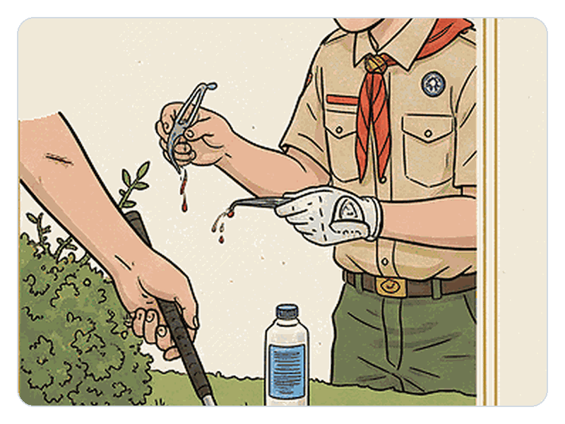
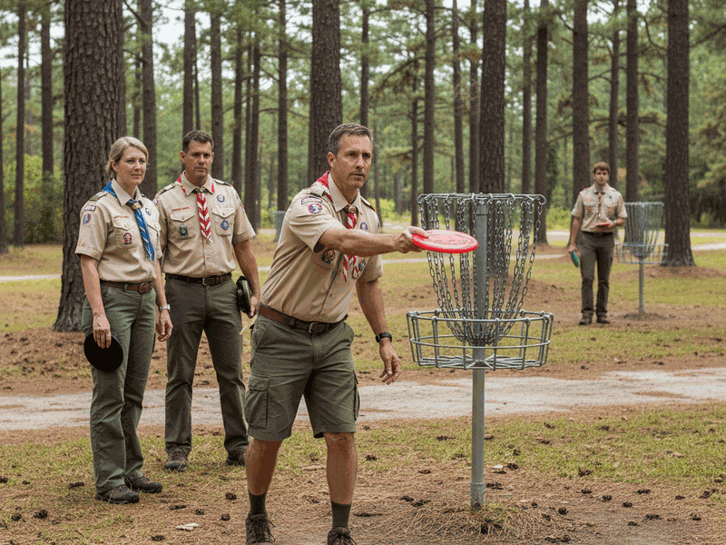
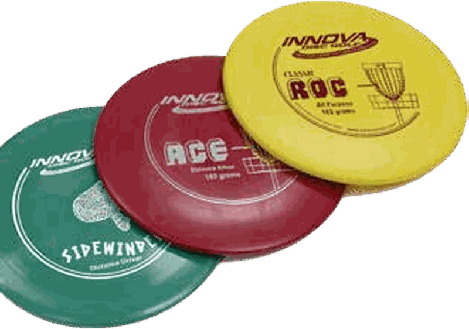

# Golf Merit Badge - Counselor Facilitation Guide & Class Preparation Workbook
**Classification:** ELECTIVE MERIT BADGE  
**Counselor:** Merit Badge Counselor (Scouts BSA Unit / Council)
**Official Pamphlet PDF:** https://www.scouting.org/merit-badges/golf/  
**Digital Resource Guide (DRG):** https://www.scouting.org/merit-badges/golf/

> **Guide to Advancement §7.0.3.2 Compliance Notice:** This Counselor Workbook provides Socratic prompts, official pamphlet summaries, expected answer keys, and sign-off verification standards for instructors. Scouts use the companion Fillable Scout Workbook as an optional organizational study aid and are never required to submit a written worksheet when a requirement specifies oral *Explain*, *Discuss*, or *Show* mastery.

---

## 1. Requirement Execution-Mode & 5-Tier Syllabus Triage Matrix

| Req # | Topic | Action Verb | Execution Mode | Syllabus Bucket | Pamphlet Reference | Counselor Sign-Off Date & Initials |
| :--- | :--- | :--- | :--- | :--- | :--- | :--- |
| **1** | Req 1: Course Safety and First Aid | Discuss | `Hands-On Skill Station` | **In-Class Demonstration** | Official Scouting America Golf Merit Badge Pamphlet (p. 53, p. 55) | `[ ____ / ____ / 2026 ]  Init: ____` |
| **2b(1)** | Disc Golf: PDGA Rules, Courtesy (812) & Scoring (808) | Explain | `In-Class Discussion` | **In-Class Demonstration** | Official Scouting America Golf Merit Badge Pamphlet (p. 50, p. 80) | `[ ____ / ____ / 2026 ]  Init: ____` |
| **2b(3)** | Disc Golf: Ed Headrick, Disc Design Evolution & Fitness | Explain | `In-Class Discussion` | **In-Class Demonstration** | Official Scouting America Golf Merit Badge Pamphlet (p. 50, p. 80) | `[ ____ / ____ / 2026 ]  Init: ____` |
| **2b(5)** | Disc Golf: Grips, X-Step, Backhand, Forehand, Roller & Putting | Demonstrate | `Hands-On Skill Station` | **In-Class Demonstration** | Official Scouting America Golf Merit Badge Pamphlet (p. 50, p. 80) | `[ ____ / ____ / 2026 ]  Init: ____` |
| **2b(6)** | Disc Golf: 18-Hole Round, Park Stewardship & Careers | Demonstrate | `Prerequisite / Home & Troop Prep` | **Pre-Class Prerequisite** | Official Scouting America Golf Merit Badge Pamphlet (p. 50, p. 80) | `[ ____ / ____ / 2026 ]  Init: ____` |

## 2. Pre-Class Prerequisite Checklist ('Bring Proof to Class')

- [ ] **Req 2b(6) (Demonstrate):** Disc Golf: (a) Follow the PDGA Official Rules of Disc Golf. (b) Practice good disc golf etiquette. (c) Show respect to fellow disc golfers and other people in the park along with any wildlife, trees, and plants on the property. (7) Find out about three careers related to disc golf. Pick one and identify the education, training, and experience required for this profession. Discuss this with your counselor, and explain why this interests you.

## 3. Hands-On Skill Station Verification Rubric

- [ ] **Station Req 1:** Scout must individually discuss mastery of Requirement 1 to the Merit Badge Counselor.
- [ ] **Station Req 2b(1):** Scout must individually explain mastery of Requirement 2b(1) to the Merit Badge Counselor.
- [ ] **Station Req 2b(3):** Scout must individually explain mastery of Requirement 2b(3) to the Merit Badge Counselor.
- [ ] **Station Req 2b(5):** Scout must individually demonstrate mastery of Requirement 2b(5) to the Merit Badge Counselor.

## 4. Counselor Facilitation Guide, Expected Answer Keys & Verification Rubrics

### Req 1: Course Safety and First Aid
**Official Requirement 1:** Discuss safety on the golf course. Show that you know first aid for injuries or illnesses that could occur while golfing, including lightning, heat reactions, sunburn, dehydration, blisters, animal or bug bites, poison ivy exposure, sprains, and strains.
**Source:** *Official Scouting America Golf Merit Badge Pamphlet (p. 53, p. 55)* • **Scout Workbook Organizer (Concept & Examples Notes):** Req 1 Structured Technical Study & Explanation Matrix
> **Guide to Safe Scouting Warning:** Clear the course immediately when thunder sounds or lightning detection sirens activate, never seeking shelter under isolated trees.
- **Socratic Prompt (Ask Scouts First):** Why does holding a graphite or steel golf club during an incoming storm drastically heighten strike risks?
- **Official Pamphlet Summary & Expected Answer Key:**
  - Lightning Evacuation Protocol: Sirens mandate instant clearing of fairways to reach designated grounded lightning storm shelters.
  - Heat Exhaustion Response: Move overheated players into shaded areas while loosening garments and providing cool water.
  - Blister Prevention Strategy: Friction on walking heels requires prompt application of adhesive moleskin patches before irritation.
  - Severe Weather Stance: Avoid isolated tall trees and metal flagsticks during rapid thunderstorm development on fairways.
- **Step-by-Step Facilitation & Station Procedure:**
  - Step 1 - Sound Assessment: Check local course weather sirens and scan horizon clouds before teeing off.
  - Step 2 - Shelter Relocation: Evacuate exposed hilltops immediately and enter fully enclosed clubhouses or maintenance sheds.
  - Step 3 - Equipment Grounding: Drop metal clubs and golf bags far away from your direct location.
  - Step 4 - Physical First Aid: Administer water and apply cold packs to soothe acute golfer heat cramps.
- **Common Myth:** Golf carts provide complete protection from lightning strikes during sudden thunderstorms on open fairways.
- **Pamphlet Fact:** Golf carts lack rubber enclosed insulation and offer zero protection against direct lightning strikes.

| Req 1 Study Prompt | Key Pamphlet Facts & Definitions | Field Example & Counselor Conference Notes |
| :--- | :--- | :--- |
| **1. Discuss safety on the golf course** | Lightning Evacuation Protocol: Sirens mandate instant clearing of fairways to reach designated grounded lightning storm shelters. | Verify specific field notes / demonstration |
| **2. Show that you know first aid for injuries or illnesses that could occur while golfing** | Heat Exhaustion Response: Move overheated players into shaded areas while loosening garments and providing cool water. | Verify specific field notes / demonstration |

**Counselor Verification Standard (Req 1):** Scout must individually discuss mastery of Requirement 1 to the Merit Badge Counselor.

### Requirement 2b(1) Section: Disc Golf: PDGA Rules, Courtesy (812) & Scoring (808)
**Parent Directive (2b(1)):** Disc Golf:
**Source:** *Official Scouting America Golf Merit Badge Pamphlet (p. 50, p. 80)* • **Section Organizer:** Career & Profession Exploration Card

#### Req 2b(1)(a): PDGA Courtesy Section Standards Review
**Official Requirement 2b(1)(a):** Tell about the six areas of Courtesy (812)
**Source:** *Official Scouting America Golf Merit Badge Pamphlet (p. 50, p. 80)* • **Scout Workbook Organizer (Concept & Examples Notes):** Req 2b
- **Socratic Prompt (Ask Scouts First):** Which specific actions on a disc golf course could result in a courtesy violation warning from your group?
- **Official Pamphlet Summary & Expected Answer Key:**
  - PDGA Courtesy Section Standards Review: PDGA Rule 812 outlines courtesy obligations including refraining from distracting movements or noises, making prompt throws within thirty seconds, and verifying clear landing areas before throwing. Players must also keep parks clean, assist in searching for lost discs, and accept courtesy warnings issued by the group (p. 67).
- **Step-by-Step Facilitation & Station Procedure:**
  - Step 1 - Option Selection: Choose between traditional ball golf and disc golf based on local facilities.
  - Step 2 - Rulebook Consultation: Read defined competition rules regarding out of bounds markers and hazard penalties.
- **Common Myth:** A disc golf player may take as much time as desired to line up and execute any throw on the course.
- **Pamphlet Fact:** PDGA courtesy rules require players to throw within thirty seconds once they reach their lie and the area is clear.

| Req 2b(1)(a) Study Prompt | Key Pamphlet Facts & Definitions | Field Example & Counselor Conference Notes |
| :--- | :--- | :--- |
| **1. Req 2b(1)(a) Core Concept, Definition & Pamphlet Standard** | PDGA Courtesy Section Standards Review: PDGA Rule 812 outlines courtesy obligations including refraining from distracting movements or noises, making prompt throws within thirty seconds, and verifying clear landing areas before throwing. Players must also keep parks clean, assist in searching for lost discs, and accept courtesy warnings issued by the group (p. 67). | Verify specific field notes / demonstration |
| **2. Req 2b(1)(a) Step-by-Step Procedure, Safety & Equipment Criteria** | Step 1 - Option Selection: Choose between traditional ball golf and disc golf based on local facilities. | Verify specific field notes / demonstration |
| **3. Req 2b(1)(a) Practical Example & Counselor Conference Verification** | Step 2 - Rulebook Consultation: Read defined competition rules regarding out of bounds markers and hazard penalties. | Verify specific field notes / demonstration |

**Counselor Verification Standard (Req 2b(1)(a)):** Scout must individually explain Requirement 2b(1)(a) (Tell about the six areas of Courtesy (812)) to the Counselor.

#### Req 2b(1)(b): PDGA Scoring Rules and Procedures
**[Parent Directive]:** *Disc Golf*
**Official Requirement 2b(1)(b):** Describe the seven areas of Scoring (808)
**Source:** *Official Scouting America Golf Merit Badge Pamphlet (p. 50, p. 80)* • **Scout Workbook Organizer (Concept & Examples Notes):** Req 2b
- **Socratic Prompt (Ask Scouts First):** What problems happen during a tournament when players fail to verify scores at the end of each hole?
- **Official Pamphlet Summary & Expected Answer Key:**
  - PDGA Scoring Rules And Procedures: PDGA Rule 808 specifies that players record strokes and penalty throws after each hole, compare scores periodically, and resolve any tally discrepancies before moving on. The complete group must review, verify, and submit official scorecards promptly after the round concludes (p. 69).
- **Common Myth:** A disc golfer can wait until the entire round is finished to write down scores for all eighteen holes from memory.
- **Pamphlet Fact:** PDGA rules mandate recording scores hole by hole immediately upon completing each basket.

| Req 2b(1)(b) Study Prompt | Key Pamphlet Facts & Definitions | Field Example & Counselor Conference Notes |
| :--- | :--- | :--- |
| **1. Req 2b(1)(b) Core Concept, Definition & Pamphlet Standard** | PDGA Scoring Rules And Procedures: PDGA Rule 808 specifies that players record strokes and penalty throws after each hole, compare scores periodically, and resolve any tally discrepancies before moving on. The complete group must review, verify, and submit official scorecards promptly after the round concludes (p. 69). | Verify specific field notes / demonstration |
| **2. Req 2b(1)(b) Step-by-Step Procedure, Safety & Equipment Criteria** | Scout must individually explain Requirement 2b(1)(b) (Describe the seven areas of Scoring (808)) to the Counselor. | Verify specific field notes / demonstration |
| **3. Req 2b(1)(b) Practical Example & Counselor Conference Verification** | PDGA Scoring Rules And Procedures: PDGA Rule 808 specifies that players record strokes and penalty throws after each hole, compare scores periodically, and resolve any tally discrepancies before moving on. The complete group must review, verify, and submit official scorecards promptly after the round concludes (p. 69). | Verify specific field notes / demonstration |

**Counselor Verification Standard (Req 2b(1)(b)):** Scout must individually explain Requirement 2b(1)(b) (Describe the seven areas of Scoring (808)) to the Counselor.

#### Req 2b(2): Disc Golf History and Accessibility
**Official Requirement 2b(2):** Tell about the history of disc golf and why it is an inclusive game.
**Source:** *Official Scouting America Golf Merit Badge Pamphlet (p. 50, p. 80)* • **Scout Workbook Organizer (Concept & Examples Notes):** Req 2b
- **Socratic Prompt (Ask Scouts First):** What factors make disc golf one of the most accessible and affordable sports for people in local communities?
- **Official Pamphlet Summary & Expected Answer Key:**
  - Disc Golf History And Accessibility: Disc golf evolved from informal pie tin games into a worldwide sport after Ed Headrick invented the modern pole hole catching basket and organized the PDGA in the 1970s. The game promotes inclusivity because public courses are typically free to play, equipment is affordable, and players of all ages and athletic backgrounds can participate (p. 72).
- **Common Myth:** Disc golf originated as an exclusive country club sport requiring expensive specialized gear and costly memberships.
- **Pamphlet Fact:** Disc golf grew in public community parks to make sport accessible to players of all financial and physical levels.

| Req 2b(2) Study Prompt | Key Pamphlet Facts & Definitions | Field Example & Counselor Conference Notes |
| :--- | :--- | :--- |
| **1. Req 2b(2) Core Concept, Definition & Pamphlet Standard** | Disc Golf History And Accessibility: Disc golf evolved from informal pie tin games into a worldwide sport after Ed Headrick invented the modern pole hole catching basket and organized the PDGA in the 1970s. The game promotes inclusivity because public courses are typically free to play, equipment is affordable, and players of all ages and athletic backgrounds can participate (p. 72). | Verify specific field notes / demonstration |
| **2. Req 2b(2) Step-by-Step Procedure, Safety & Equipment Criteria** | Scout must individually explain Requirement 2b(2) (Tell about the history of disc golf and why it is an inclusive game) to the Counselor. | Verify specific field notes / demonstration |
| **3. Req 2b(2) Practical Example & Counselor Conference Verification** | Disc Golf History And Accessibility: Disc golf evolved from informal pie tin games into a worldwide sport after Ed Headrick invented the modern pole hole catching basket and organized the PDGA in the 1970s. The game promotes inclusivity because public courses are typically free to play, equipment is affordable, and players of all ages and athletic backgrounds can participate (p. 72). | Verify specific field notes / demonstration |

**Counselor Verification Standard (Req 2b(2)):** Scout must individually explain Requirement 2b(2) (Tell about the history of disc golf and why it is an inclusive game) to the Counselor.

### Requirement 2b(3) Section: Disc Golf: Ed Headrick, Disc Design Evolution & Fitness
**Parent Directive (2b(3)):** Disc Golf:
**Source:** *Official Scouting America Golf Merit Badge Pamphlet (p. 50, p. 80)* • **Section Organizer:** Career & Profession Exploration Card

#### Req 2b(3)(a): Disc Golf Origins and Inclusivity
**Official Requirement 2b(3)(a):** Tell about the history of disc golf and why it is an inclusive game.
**Source:** *Official Scouting America Golf Merit Badge Pamphlet (p. 50, p. 80)* • **Scout Workbook Organizer (Concept & Examples Notes):** Req 2b
- **Socratic Prompt (Ask Scouts First):** What features of disc golf courses and equipment make the sport welcoming to families, beginners, and players with diverse physical abilities?
- **Official Pamphlet Summary & Expected Answer Key:**
  - Disc Golf Origins and Inclusivity: Early players threw tin lids and plastic platters at natural targets until standardized rules and courses emerged in the 1970s. Free access at municipal public parks and low starter equipment costs allow people of diverse ages, backgrounds, and physical conditioning to participate (p. 50).
- **Step-by-Step Facilitation & Station Procedure:**
  - Step 1 - Option Selection: Choose between traditional ball golf and disc golf based on local facilities.
  - Step 2 - Rulebook Consultation: Read defined competition rules regarding out of bounds markers and hazard penalties.
- **Common Myth:** Participating in disc golf requires expensive club memberships and strict physical athletic prerequisites similar to private ball golf clubs.
- **Pamphlet Fact:** Most disc golf courses reside in free public parks where individuals of any age or fitness level can play with an inexpensive starter disc.

| Req 2b(3)(a) Study Prompt | Key Pamphlet Facts & Definitions | Field Example & Counselor Conference Notes |
| :--- | :--- | :--- |
| **1. Req 2b(3)(a) Core Concept, Definition & Pamphlet Standard** | Disc Golf Origins and Inclusivity: Early players threw tin lids and plastic platters at natural targets until standardized rules and courses emerged in the 1970s. Free access at municipal public parks and low starter equipment costs allow people of diverse ages, backgrounds, and physical conditioning to participate (p. 50). | Verify specific field notes / demonstration |
| **2. Req 2b(3)(a) Step-by-Step Procedure, Safety & Equipment Criteria** | Step 1 - Option Selection: Choose between traditional ball golf and disc golf based on local facilities. | Verify specific field notes / demonstration |
| **3. Req 2b(3)(a) Practical Example & Counselor Conference Verification** | Step 2 - Rulebook Consultation: Read defined competition rules regarding out of bounds markers and hazard penalties. | Verify specific field notes / demonstration |

**Counselor Verification Standard (Req 2b(3)(a)):** Scout must individually explain Requirement 2b(3)(a) (Tell about the history of disc golf and why it is an inclusive game) to the Counselor.

#### Req 2b(3)(b): Pioneering Contributions of Ed Headrick
**Official Requirement 2b(3)(b):** Discuss with your counselor the contributions Ed Headrick made to the sport of disc golf.
**Source:** *Official Scouting America Golf Merit Badge Pamphlet (p. 50, p. 80)* • **Scout Workbook Organizer (Concept & Examples Notes):** Req 2b
- **Socratic Prompt (Ask Scouts First):** Why did Ed Headrick find it necessary to patent a metal pole hole with hanging chains instead of continuing to use trees and light posts as targets?
- **Official Pamphlet Summary & Expected Answer Key:**
  - Pioneering Contributions of Ed Headrick: Ed Headrick formalized modern disc golf by patenting the chain-equipped Disc Golf Pole Hole target and founding the Professional Disc Golf Association. He also established the first permanent target course at Oak Grove Park in Pasadena, California (p. 51).
- **Common Myth:** Ed Headrick simply invented plastic throwing discs for recreational beach games rather than developing competitive disc golf.
- **Pamphlet Fact:** Ed Headrick engineered the standardized metal basket target with catching chains, laid out the first permanent course, and founded the Professional Disc Golf Association.

| Req 2b(3)(b) Study Prompt | Key Pamphlet Facts & Definitions | Field Example & Counselor Conference Notes |
| :--- | :--- | :--- |
| **1. Req 2b(3)(b) Core Concept, Definition & Pamphlet Standard** | Pioneering Contributions of Ed Headrick: Ed Headrick formalized modern disc golf by patenting the chain-equipped Disc Golf Pole Hole target and founding the Professional Disc Golf Association. He also established the first permanent target course at Oak Grove Park in Pasadena, California (p. 51). | Verify specific field notes / demonstration |
| **2. Req 2b(3)(b) Step-by-Step Procedure, Safety & Equipment Criteria** | Scout must individually explain Requirement 2b(3)(b) (Discuss with your counselor the contributions Ed Headrick made to the sport of disc golf) to the Counselor. | Verify specific field notes / demonstration |
| **3. Req 2b(3)(b) Practical Example & Counselor Conference Verification** | Pioneering Contributions of Ed Headrick: Ed Headrick formalized modern disc golf by patenting the chain-equipped Disc Golf Pole Hole target and founding the Professional Disc Golf Association. He also established the first permanent target course at Oak Grove Park in Pasadena, California (p. 51). | Verify specific field notes / demonstration |

**Counselor Verification Standard (Req 2b(3)(b)):** Scout must individually explain Requirement 2b(3)(b) (Discuss with your counselor the contributions Ed Headrick made to the sport of disc golf) to the Counselor.

#### Req 2b(3)(c): Evolution of Modern Disc Aerodynamics
**[Parent Directive]:** *Disc Golf*
**Official Requirement 2b(3)(c):** Describe the evolution of disc design.
**Source:** *Official Scouting America Golf Merit Badge Pamphlet (p. 50, p. 80)* • **Scout Workbook Organizer (Concept & Examples Notes):** Req 2b
- **Socratic Prompt (Ask Scouts First):** How does narrowing and sharpening the outer rim of a disc change its speed, lift, and distance through the air?
- **Official Pamphlet Summary & Expected Answer Key:**
  - Evolution of Modern Disc Aerodynamics: Flying discs transitioned from blunt-rimmed recreational frisbees to dense, beveled-edge aerodynamic drivers engineered to generate lift and predictable flight paths. Manufacturers continually refine rim widths, weight distributions, and specialized plastic polymers to suit different stability profiles and throwing conditions (p. 52).
- **Common Myth:** Professional golf discs are identical in shape and aerodynamic flight characteristics to regular beach frisbees.
- **Pamphlet Fact:** Modern golf discs feature beveled rims, higher mass densities, and specialized flight profiles that generate aerodynamic penetration far beyond blunt recreational frisbees.

| Req 2b(3)(c) Study Prompt | Key Pamphlet Facts & Definitions | Field Example & Counselor Conference Notes |
| :--- | :--- | :--- |
| **1. Req 2b(3)(c) Core Concept, Definition & Pamphlet Standard** | Evolution of Modern Disc Aerodynamics: Flying discs transitioned from blunt-rimmed recreational frisbees to dense, beveled-edge aerodynamic drivers engineered to generate lift and predictable flight paths. Manufacturers continually refine rim widths, weight distributions, and specialized plastic polymers to suit different stability profiles and throwing conditions (p. 52). | Verify specific field notes / demonstration |
| **2. Req 2b(3)(c) Step-by-Step Procedure, Safety & Equipment Criteria** | Scout must individually explain Requirement 2b(3)(c) (Describe the evolution of disc design) to the Counselor. | Verify specific field notes / demonstration |
| **3. Req 2b(3)(c) Practical Example & Counselor Conference Verification** | Evolution of Modern Disc Aerodynamics: Flying discs transitioned from blunt-rimmed recreational frisbees to dense, beveled-edge aerodynamic drivers engineered to generate lift and predictable flight paths. Manufacturers continually refine rim widths, weight distributions, and specialized plastic polymers to suit different stability profiles and throwing conditions (p. 52). | Verify specific field notes / demonstration |

**Counselor Verification Standard (Req 2b(3)(c)):** Scout must individually explain Requirement 2b(3)(c) (Describe the evolution of disc design) to the Counselor.

#### Req 2b(3)(d): Accomplishments of Top Disc Golfers
**Official Requirement 2b(3)(d):** Tell about the accomplishments of a top disc golfer of your choice.
**Source:** *Official Scouting America Golf Merit Badge Pamphlet (p. 50, p. 80)* • **Scout Workbook Organizer (Concept & Examples Notes):** Req 2b
- **Socratic Prompt (Ask Scouts First):** Which achievements and habits of a championship disc golfer stand out to you as models for improving your own play?
- **Official Pamphlet Summary & Expected Answer Key:**
  - Accomplishments of Top Disc Golfers: Scouts research elite competitors such as Ken Climo, Ricky Wysocki, Paige Pierce, or Paul McBeth to analyze their tournament titles and scoring records. Studying professional careers demonstrates the discipline, mental composure, and technical consistency required to compete at the world championship level (p. 53).
- **Common Myth:** Elite tournament disc golfers rely solely on natural throwing power rather than structured shot planning and repetitive practice routines.
- **Pamphlet Fact:** Top disc golfers build championship careers through dedicated field work, putting consistency, smart course management, and mental discipline under tournament pressure.

| Req 2b(3)(d) Study Prompt | Key Pamphlet Facts & Definitions | Field Example & Counselor Conference Notes |
| :--- | :--- | :--- |
| **1. Req 2b(3)(d) Core Concept, Definition & Pamphlet Standard** | Accomplishments of Top Disc Golfers: Scouts research elite competitors such as Ken Climo, Ricky Wysocki, Paige Pierce, or Paul McBeth to analyze their tournament titles and scoring records. Studying professional careers demonstrates the discipline, mental composure, and technical consistency required to compete at the world championship level (p. 53). | Verify specific field notes / demonstration |
| **2. Req 2b(3)(d) Step-by-Step Procedure, Safety & Equipment Criteria** | Scout must individually explain Requirement 2b(3)(d) (Tell about the accomplishments of a top disc golfer of your choice) to the Counselor. | Verify specific field notes / demonstration |
| **3. Req 2b(3)(d) Practical Example & Counselor Conference Verification** | Accomplishments of Top Disc Golfers: Scouts research elite competitors such as Ken Climo, Ricky Wysocki, Paige Pierce, or Paul McBeth to analyze their tournament titles and scoring records. Studying professional careers demonstrates the discipline, mental composure, and technical consistency required to compete at the world championship level (p. 53). | Verify specific field notes / demonstration |

**Counselor Verification Standard (Req 2b(3)(d)):** Scout must individually explain Requirement 2b(3)(d) (Tell about the accomplishments of a top disc golfer of your choice) to the Counselor.

#### Req 2b(4)(a): Physical and Mental Health Contributions
**Official Requirement 2b(4)(a):** Tell how disc golf can contribute to a healthy lifestyle, mentally and physically.
**Source:** *Official Scouting America Golf Merit Badge Pamphlet (p. 50, p. 80)* • **Scout Workbook Organizer (Concept & Examples Notes):** Req 2b
- **Socratic Prompt (Ask Scouts First):** In what ways does navigating natural terrain and focusing on target execution benefit your mind as well as your body?
- **Official Pamphlet Summary & Expected Answer Key:**
  - Physical and Mental Health Contributions: Traversing outdoor park courses provides moderate-intensity cardiovascular exercise that builds stamina and burns calories over several miles of walking. Navigating woodland settings and managing shot selection also reduces stress, encourages outdoor recreation, and sharpens analytical problem-solving skills (p. 54).
- **Common Myth:** Disc golf offers only casual recreational leisure without measurable mental health or aerobic fitness rewards.
- **Pamphlet Fact:** A standard round of disc golf delivers several miles of low-impact aerobic walking while concentration on shot execution relieves mental fatigue and builds emotional resilience.

| Req 2b(4)(a) Study Prompt | Key Pamphlet Facts & Definitions | Field Example & Counselor Conference Notes |
| :--- | :--- | :--- |
| **1. Req 2b(4)(a) Core Concept, Definition & Pamphlet Standard** | Physical and Mental Health Contributions: Traversing outdoor park courses provides moderate-intensity cardiovascular exercise that builds stamina and burns calories over several miles of walking. Navigating woodland settings and managing shot selection also reduces stress, encourages outdoor recreation, and sharpens analytical problem-solving skills (p. 54). | Verify specific field notes / demonstration |
| **2. Req 2b(4)(a) Step-by-Step Procedure, Safety & Equipment Criteria** | Scout must individually explain Requirement 2b(4)(a) (Tell how disc golf can contribute to a healthy lifestyle, mentally and physically) to the Counselor. | Verify specific field notes / demonstration |
| **3. Req 2b(4)(a) Practical Example & Counselor Conference Verification** | Physical and Mental Health Contributions: Traversing outdoor park courses provides moderate-intensity cardiovascular exercise that builds stamina and burns calories over several miles of walking. Navigating woodland settings and managing shot selection also reduces stress, encourages outdoor recreation, and sharpens analytical problem-solving skills (p. 54). | Verify specific field notes / demonstration |

**Counselor Verification Standard (Req 2b(4)(a)):** Scout must individually explain Requirement 2b(4)(a) (Tell how disc golf can contribute to a healthy lifestyle, mentally and physically) to the Counselor.

#### Req 2b(4)(b): Conditioning Exercises for Throwing
**Official Requirement 2b(4)(b):** Tell how a disc golf exercise plan can help you play better. Show two exercises that would help improve your game.
**Source:** *Official Scouting America Golf Merit Badge Pamphlet (p. 50, p. 80)* • **Scout Workbook Organizer (Concept & Examples Notes):** Req 2b
- **Socratic Prompt (Ask Scouts First):** Which specific muscle groups initiate your throwing motion, and what exercises strengthen their ability to generate controlled power?
- **Official Pamphlet Summary & Expected Answer Key:**
  - Conditioning Exercises for Throwing Performance: Developing core strength and shoulder mobility protects throwing joints from repetitive strain and transfers mechanical energy smoothly from the hips to the hand. Demonstrating exercises like resistance band rotational pulls and lunges targets the exact muscle groups used during the runup and release (p. 55).
- **Common Myth:** Throwing distance depends exclusively on forearm snap rather than overall core and leg conditioning.
- **Pamphlet Fact:** Throwing velocity originates in the legs and core muscles before transferring through the torso and arm into the disc.

| Req 2b(4)(b) Study Prompt | Key Pamphlet Facts & Definitions | Field Example & Counselor Conference Notes |
| :--- | :--- | :--- |
| **1. Tell how a disc golf exercise plan can help you play better.** | Conditioning Exercises for Throwing Performance: Developing core strength and shoulder mobility protects throwing joints from repetitive strain and transfers mechanical energy smoothly from the hips to the hand. Demonstrating exercises like resistance band rotational pulls and lunges targets the exact muscle groups used during the runup and release (p. 55). | Verify specific field notes / demonstration |
| **2. Show two exercises that would help improve your game.** | Scout must individually explain Requirement 2b(4)(b) (Tell how a disc golf exercise plan can help you play better. Show two exercises that would help improve your g) to the Counselor. | Verify specific field notes / demonstration |

**Counselor Verification Standard (Req 2b(4)(b)):** Scout must individually explain Requirement 2b(4)(b) (Tell how a disc golf exercise plan can help you play better. Show two exercises that would help improve your g) to the Counselor.

### Requirement 2b(5) Section: Disc Golf: Grips, X-Step, Backhand, Forehand, Roller & Putting
**Parent Directive (2b(5)):** Disc Golf:
**Source:** *Official Scouting America Golf Merit Badge Pamphlet (p. 50, p. 80)* • **Section Organizer:** Career & Profession Exploration Card

#### Req 2b(5)(a): Proper Disc Golf Throwing Grips
**[Parent Directive]:** *Disc Golf*
**Official Requirement 2b(5)(a):** A good throwing grip.
**Source:** *Official Scouting America Golf Merit Badge Pamphlet (p. 50, p. 80)* • **Scout Workbook Organizer (Concept & Examples Notes):** Req 2b
- **Socratic Prompt (Ask Scouts First):** When would you choose a fan grip with fingers spread across the flight plate instead of a tight power grip against the rim?
- **Official Pamphlet Summary & Expected Answer Key:**
  - Proper Disc Golf Throwing Grips: A power grip locks all four fingertips firmly against the inner rim and places the thumb pressed securely on the flight plate for maximum distance and snap. For shorter fairway shots and touch approaches, a fan grip spreads the middle and ring fingers across the bottom flight plate to enhance control (p. 57).
- **Step-by-Step Facilitation & Station Procedure:**
  - Step 1 - Option Selection: Choose between traditional ball golf and disc golf based on local facilities.
  - Step 2 - Rulebook Consultation: Read defined competition rules regarding out of bounds markers and hazard penalties.
- **Common Myth:** Gripping the disc loosely with the fingertips along the outer edge produces the cleanest and most powerful release.
- **Pamphlet Fact:** A secure power grip tucks the fingers firmly against the inside rim while the thumb presses down directly opposite the index finger to generate necessary rotational spin.

| Req 2b(5)(a) Study Prompt | Key Pamphlet Facts & Definitions | Field Example & Counselor Conference Notes |
| :--- | :--- | :--- |
| **1. Req 2b(5)(a) Core Concept, Definition & Pamphlet Standard** | Proper Disc Golf Throwing Grips: A power grip locks all four fingertips firmly against the inner rim and places the thumb pressed securely on the flight plate for maximum distance and snap. For shorter fairway shots and touch approaches, a fan grip spreads the middle and ring fingers across the bottom flight plate to enhance control (p. 57). | Verify specific field notes / demonstration |
| **2. Req 2b(5)(a) Step-by-Step Procedure, Safety & Equipment Criteria** | Step 1 - Option Selection: Choose between traditional ball golf and disc golf based on local facilities. | Verify specific field notes / demonstration |
| **3. Req 2b(5)(a) Practical Example & Counselor Conference Verification** | Step 2 - Rulebook Consultation: Read defined competition rules regarding out of bounds markers and hazard penalties. | Verify specific field notes / demonstration |

**Counselor Verification Standard (Req 2b(5)(a)):** Scout must individually demonstrate Requirement 2b(5)(a) (A good throwing grip) to the Counselor.

#### Req 2b(5)(b): Coordinated Runup and Footwork Techniques
**[Parent Directive]:** *Disc Golf*
**Official Requirement 2b(5)(b):** A good runup (X-step) when throwing a disc.
**Source:** *Official Scouting America Golf Merit Badge Pamphlet (p. 50, p. 80)* • **Scout Workbook Organizer (Concept & Examples Notes):** Req 2b
- **Socratic Prompt (Ask Scouts First):** Why does crossing your trailing foot behind your lead foot generate more throwing power than running straight forward toward the target?
- **Official Pamphlet Summary & Expected Answer Key:**
  - Coordinated Runup and Footwork Techniques: The X-step footwork sequence crosses the rear foot behind the plant foot to turn the hips away from the target and load rotational power. Planting the lead foot perpendicular to the target line establishes a firm brace that transfers kinetic energy up through the core and into the throwing arm (p. 58).
- **Common Myth:** Sprinting rapidly toward the front of the tee pad generates maximum disc velocity regardless of foot placement or balance.
- **Pamphlet Fact:** A controlled, rhythmic footwork sequence loads the hips and allows the front foot to brace cleanly without sacrificing balance or release accuracy.

| Req 2b(5)(b) Study Prompt | Key Pamphlet Facts & Definitions | Field Example & Counselor Conference Notes |
| :--- | :--- | :--- |
| **1. Req 2b(5)(b) Core Concept, Definition & Pamphlet Standard** | Coordinated Runup and Footwork Techniques: The X-step footwork sequence crosses the rear foot behind the plant foot to turn the hips away from the target and load rotational power. Planting the lead foot perpendicular to the target line establishes a firm brace that transfers kinetic energy up through the core and into the throwing arm (p. 58). | Verify specific field notes / demonstration |
| **2. Req 2b(5)(b) Step-by-Step Procedure, Safety & Equipment Criteria** | Scout must individually demonstrate Requirement 2b(5)(b) (A good runup (X-step) when throwing a disc) to the Counselor. | Verify specific field notes / demonstration |
| **3. Req 2b(5)(b) Practical Example & Counselor Conference Verification** | Coordinated Runup and Footwork Techniques: The X-step footwork sequence crosses the rear foot behind the plant foot to turn the hips away from the target and load rotational power. Planting the lead foot perpendicular to the target line establishes a firm brace that transfers kinetic energy up through the core and into the throwing arm (p. 58). | Verify specific field notes / demonstration |

**Counselor Verification Standard (Req 2b(5)(b)):** Scout must individually demonstrate Requirement 2b(5)(b) (A good runup (X-step) when throwing a disc) to the Counselor.

#### Req 2b(5)(c): Fundamental Backhand Throwing Mechanics
**[Parent Directive]:** *Disc Golf*
**Official Requirement 2b(5)(c):** Backhand shot.
**Source:** *Official Scouting America Golf Merit Badge Pamphlet (p. 50, p. 80)* • **Scout Workbook Organizer (Concept & Examples Notes):** Req 2b
- **Socratic Prompt (Ask Scouts First):** How does pulling the disc on a flat line close to your chest improve accuracy compared to swinging your arm in a wide arc?
- **Official Pamphlet Summary & Expected Answer Key:**
  - A backhand shot draws the disc across the chest on a flat, level plane while rotating the shoulders and uncoiling the hips toward the target. Releasing with a brisk snap of the wrist imparts spin and allows the disc aerodynamics to dictate a stable, predictable flight path (p. 59).
- **Common Myth:** A backhand throw should swing the arm in a wide circular arc around the body like swinging a baseball bat.
- **Pamphlet Fact:** Proper backhand mechanics pull the disc in a straight linear path tight against the chest before unleashing the forearm and wrist at release.

| Req 2b(5)(c) Study Prompt | Key Pamphlet Facts & Definitions | Field Example & Counselor Conference Notes |
| :--- | :--- | :--- |
| **1. Req 2b(5)(c) Core Concept, Definition & Pamphlet Standard** | A backhand shot draws the disc across the chest on a flat, level plane while rotating the shoulders and uncoiling the hips toward the target. Releasing with a brisk snap of the wrist imparts spin and allows the disc aerodynamics to dictate a stable, predictable flight path (p. 59). | Verify specific field notes / demonstration |
| **2. Req 2b(5)(c) Step-by-Step Procedure, Safety & Equipment Criteria** | Scout must individually demonstrate Requirement 2b(5)(c) (Backhand shot) to the Counselor. | Verify specific field notes / demonstration |
| **3. Req 2b(5)(c) Practical Example & Counselor Conference Verification** | A backhand shot draws the disc across the chest on a flat, level plane while rotating the shoulders and uncoiling the hips toward the target. Releasing with a brisk snap of the wrist imparts spin and allows the disc aerodynamics to dictate a stable, predictable flight path (p. 59). | Verify specific field notes / demonstration |

**Counselor Verification Standard (Req 2b(5)(c)):** Scout must individually demonstrate Requirement 2b(5)(c) (Backhand shot) to the Counselor.

#### Req 2b(5)(d): Forehand Sidearm Throwing Mechanics
**[Parent Directive]:** *Disc Golf*
**Official Requirement 2b(5)(d):** Forehand shot.
**Source:** *Official Scouting America Golf Merit Badge Pamphlet (p. 50, p. 80)* • **Scout Workbook Organizer (Concept & Examples Notes):** Req 2b
- **Socratic Prompt (Ask Scouts First):** Why is keeping your elbow close to your hip and leading with your elbow essential for generating forehand spin and preventing arm strain?
- **Official Pamphlet Summary & Expected Answer Key:**
  - The forehand or sidearm throw places the index and middle fingers against the inside rim with the palm facing upward and the elbow tucked near the hip. Leading forward with the elbow and finishing with an explosive wrist snap produces high rotational spin for shots curving opposite to a backhand (p. 60).
- **Common Myth:** Throwing a forehand requires swinging the entire straight arm over the shoulder like an outfielder throwing a baseball.
- **Pamphlet Fact:** Effective forehand throws keep the elbow tucked close to the torso and rely on a compact forward hinge followed by a crisp wrist snap.

| Req 2b(5)(d) Study Prompt | Key Pamphlet Facts & Definitions | Field Example & Counselor Conference Notes |
| :--- | :--- | :--- |
| **1. Req 2b(5)(d) Core Concept, Definition & Pamphlet Standard** | The forehand or sidearm throw places the index and middle fingers against the inside rim with the palm facing upward and the elbow tucked near the hip. Leading forward with the elbow and finishing with an explosive wrist snap produces high rotational spin for shots curving opposite to a backhand (p. 60). | Verify specific field notes / demonstration |
| **2. Req 2b(5)(d) Step-by-Step Procedure, Safety & Equipment Criteria** | Scout must individually demonstrate Requirement 2b(5)(d) (Forehand shot) to the Counselor. | Verify specific field notes / demonstration |
| **3. Req 2b(5)(d) Practical Example & Counselor Conference Verification** | The forehand or sidearm throw places the index and middle fingers against the inside rim with the palm facing upward and the elbow tucked near the hip. Leading forward with the elbow and finishing with an explosive wrist snap produces high rotational spin for shots curving opposite to a backhand (p. 60). | Verify specific field notes / demonstration |

**Counselor Verification Standard (Req 2b(5)(d)):** Scout must individually demonstrate Requirement 2b(5)(d) (Forehand shot) to the Counselor.

#### Req 2b(5)(e): Overhand Tomahawk and Thumber Deliveries
**[Parent Directive]:** *Disc Golf*
**Official Requirement 2b(5)(e):** Overhand shot.
**Source:** *Official Scouting America Golf Merit Badge Pamphlet (p. 50, p. 80)* • **Scout Workbook Organizer (Concept & Examples Notes):** Req 2b
- **Socratic Prompt (Ask Scouts First):** When you are trapped behind a wall of tall trees, how does an overhand tomahawk or thumber provide an escape route that a backhand cannot?
- **Official Pamphlet Summary & Expected Answer Key:**
  - Overhand Tomahawk and Thumber Deliveries: Overhand shots like the tomahawk and thumber release the disc vertically on an overhead path to clear tall trees and dense fairway obstacles. As the disc climbs, aerodynamic forces cause it to roll laterally upside down and pan out into a steep, predictable descent (p. 61).
- **Common Myth:** Overhand throws fly along straight horizontal trajectories identical to standard backhand drives.
- **Pamphlet Fact:** Overhand shots rotate vertically through an inverted corkscrew flight pattern to navigate over tall obstacles before dropping sharply to the ground.

| Req 2b(5)(e) Study Prompt | Key Pamphlet Facts & Definitions | Field Example & Counselor Conference Notes |
| :--- | :--- | :--- |
| **1. Req 2b(5)(e) Core Concept, Definition & Pamphlet Standard** | Overhand Tomahawk and Thumber Deliveries: Overhand shots like the tomahawk and thumber release the disc vertically on an overhead path to clear tall trees and dense fairway obstacles. As the disc climbs, aerodynamic forces cause it to roll laterally upside down and pan out into a steep, predictable descent (p. 61). | Verify specific field notes / demonstration |
| **2. Req 2b(5)(e) Step-by-Step Procedure, Safety & Equipment Criteria** | Scout must individually demonstrate Requirement 2b(5)(e) (Overhand shot) to the Counselor. | Verify specific field notes / demonstration |
| **3. Req 2b(5)(e) Practical Example & Counselor Conference Verification** | Overhand Tomahawk and Thumber Deliveries: Overhand shots like the tomahawk and thumber release the disc vertically on an overhead path to clear tall trees and dense fairway obstacles. As the disc climbs, aerodynamic forces cause it to roll laterally upside down and pan out into a steep, predictable descent (p. 61). | Verify specific field notes / demonstration |

**Counselor Verification Standard (Req 2b(5)(e)):** Scout must individually demonstrate Requirement 2b(5)(e) (Overhand shot) to the Counselor.

#### Req 2b(5)(f): Fairway Roller Execution and Angles
**[Parent Directive]:** *Disc Golf*
**Official Requirement 2b(5)(f):** Rolling shot.
**Source:** *Official Scouting America Golf Merit Badge Pamphlet (p. 50, p. 80)* • **Scout Workbook Organizer (Concept & Examples Notes):** Req 2b
- **Socratic Prompt (Ask Scouts First):** What course conditions or fairway obstacles would lead you to deliberately roll a disc along the ground rather than flying it through the air?
- **Official Pamphlet Summary & Expected Answer Key:**
  - Fairway Roller Execution and Angles: A roller shot lands the disc on its rim at an intentional angle, allowing ground friction and rotational momentum to propel it beneath low branches or across long fairways. Selecting an understable disc and angling the disc edge relative to the turf governs whether the roller curls left, tracks straight, or finishes right (p. 62).
- **Common Myth:** A rolling shot is an accidental misthrow that occurs only when a player shanks an airborne drive into the ground.
- **Pamphlet Fact:** A roller is an intentional, highly controlled shot designed to travel underneath low foliage or gain ground distance on open fairways.

| Req 2b(5)(f) Study Prompt | Key Pamphlet Facts & Definitions | Field Example & Counselor Conference Notes |
| :--- | :--- | :--- |
| **1. Req 2b(5)(f) Core Concept, Definition & Pamphlet Standard** | Fairway Roller Execution and Angles: A roller shot lands the disc on its rim at an intentional angle, allowing ground friction and rotational momentum to propel it beneath low branches or across long fairways. Selecting an understable disc and angling the disc edge relative to the turf governs whether the roller curls left, tracks straight, or finishes right (p. 62). | Verify specific field notes / demonstration |
| **2. Req 2b(5)(f) Step-by-Step Procedure, Safety & Equipment Criteria** | Scout must individually demonstrate Requirement 2b(5)(f) (Rolling shot) to the Counselor. | Verify specific field notes / demonstration |
| **3. Req 2b(5)(f) Practical Example & Counselor Conference Verification** | Fairway Roller Execution and Angles: A roller shot lands the disc on its rim at an intentional angle, allowing ground friction and rotational momentum to propel it beneath low branches or across long fairways. Selecting an understable disc and angling the disc edge relative to the turf governs whether the roller curls left, tracks straight, or finishes right (p. 62). | Verify specific field notes / demonstration |

**Counselor Verification Standard (Req 2b(5)(f)):** Scout must individually demonstrate Requirement 2b(5)(f) (Rolling shot) to the Counselor.

#### Req 2b(5)(g): In-Line Disc Golf Putting Stance
**[Parent Directive]:** *Disc Golf*
**Official Requirement 2b(5)(g):** A good (in-line) putting stance.
**Source:** *Official Scouting America Golf Merit Badge Pamphlet (p. 50, p. 80)* • **Scout Workbook Organizer (Concept & Examples Notes):** Req 2b
- **Socratic Prompt (Ask Scouts First):** How does staggering your feet in an in-line stance help you transfer weight toward the basket compared to standing squared up?
- **Official Pamphlet Summary & Expected Answer Key:**
  - In-Line Disc Golf Putting Stance: An in-line putting stance aligns the dominant foot directly behind the lie pointing toward the target basket with the rear foot staggered behind for balance. Weight shifts smoothly from the back foot to the front foot during the release to generate forward momentum without stepping past the marker (p. 59).
- **Common Myth:** An in-line putting stance requires keeping all body weight stationary on the front foot throughout the stroke.
- **Pamphlet Fact:** An in-line stance relies on shifting weight from the rear foot to the front foot toward the basket to produce controlled power and a balanced follow-through.

| Req 2b(5)(g) Study Prompt | Key Pamphlet Facts & Definitions | Field Example & Counselor Conference Notes |
| :--- | :--- | :--- |
| **1. Req 2b(5)(g) Core Concept, Definition & Pamphlet Standard** | In-Line Disc Golf Putting Stance: An in-line putting stance aligns the dominant foot directly behind the lie pointing toward the target basket with the rear foot staggered behind for balance. Weight shifts smoothly from the back foot to the front foot during the release to generate forward momentum without stepping past the marker (p. 59). | Verify specific field notes / demonstration |
| **2. Req 2b(5)(g) Step-by-Step Procedure, Safety & Equipment Criteria** | Scout must individually demonstrate Requirement 2b(5)(g) (A good (in-line) putting stance) to the Counselor. | Verify specific field notes / demonstration |
| **3. Req 2b(5)(g) Practical Example & Counselor Conference Verification** | In-Line Disc Golf Putting Stance: An in-line putting stance aligns the dominant foot directly behind the lie pointing toward the target basket with the rear foot staggered behind for balance. Weight shifts smoothly from the back foot to the front foot during the release to generate forward momentum without stepping past the marker (p. 59). | Verify specific field notes / demonstration |

**Counselor Verification Standard (Req 2b(5)(g)):** Scout must individually demonstrate Requirement 2b(5)(g) (A good (in-line) putting stance) to the Counselor.

#### Req 2b(5)(h): Straddle Disc Golf Putting Stance
**[Parent Directive]:** *Disc Golf*
**Official Requirement 2b(5)(h):** A good straddle putting stance.
**Source:** *Official Scouting America Golf Merit Badge Pamphlet (p. 50, p. 80)* • **Scout Workbook Organizer (Concept & Examples Notes):** Req 2b
- **Socratic Prompt (Ask Scouts First):** Why might an experienced disc golfer choose a straddle putting stance even on a completely open fairway?
- **Official Pamphlet Summary & Expected Answer Key:**
  - Straddle Disc Golf Putting Stance: A straddle putting stance positions both feet equidistant from the target on either side of the lie with knees bent and shoulders squared to the basket. This stance provides maximum stability and allows a clear release path when trees or brush obstruct a conventional staggered footing (p. 60).
- **Common Myth:** A straddle putting stance produces inferior accuracy and should only be attempted when trees physically block a forward step.
- **Pamphlet Fact:** A straddle stance establishes a balanced base with squared shoulders that minimizes lateral sway and delivers reliable accuracy on both open and obstructed lies.

| Req 2b(5)(h) Study Prompt | Key Pamphlet Facts & Definitions | Field Example & Counselor Conference Notes |
| :--- | :--- | :--- |
| **1. Req 2b(5)(h) Core Concept, Definition & Pamphlet Standard** | Straddle Disc Golf Putting Stance: A straddle putting stance positions both feet equidistant from the target on either side of the lie with knees bent and shoulders squared to the basket. This stance provides maximum stability and allows a clear release path when trees or brush obstruct a conventional staggered footing (p. 60). | Verify specific field notes / demonstration |
| **2. Req 2b(5)(h) Step-by-Step Procedure, Safety & Equipment Criteria** | Scout must individually demonstrate Requirement 2b(5)(h) (A good straddle putting stance) to the Counselor. | Verify specific field notes / demonstration |
| **3. Req 2b(5)(h) Practical Example & Counselor Conference Verification** | Straddle Disc Golf Putting Stance: A straddle putting stance positions both feet equidistant from the target on either side of the lie with knees bent and shoulders squared to the basket. This stance provides maximum stability and allows a clear release path when trees or brush obstruct a conventional staggered footing (p. 60). | Verify specific field notes / demonstration |

**Counselor Verification Standard (Req 2b(5)(h)):** Scout must individually demonstrate Requirement 2b(5)(h) (A good straddle putting stance) to the Counselor.

#### Req 2b(5)(i): Proper Disc Golf Putting Grip
**[Parent Directive]:** *Disc Golf*
**Official Requirement 2b(5)(i):** A good putting grip.
**Source:** *Official Scouting America Golf Merit Badge Pamphlet (p. 50, p. 80)* • **Scout Workbook Organizer (Concept & Examples Notes):** Req 2b
- **Socratic Prompt (Ask Scouts First):** How does spreading your fingers under the flight plate change your touch and control compared to tucking them tight against the rim?
- **Official Pamphlet Summary & Expected Answer Key:**
  - Proper Disc Golf Putting Grip: A sound putting grip rests the index finger along the outer rim of the disc while the remaining fingers fan out across the flight plate underneath. The thumb presses firmly on the upper flight plate directly above the rim crease to control disc angle and ensure a smooth release (p. 58).
- **Common Myth:** Clenching a putter with a tight four-finger power grip delivers the best control and consistency inside the circle.
- **Pamphlet Fact:** A modified fan grip with the index finger supporting the rim provides the touch, angle control, and clean release needed for accurate putting.

| Req 2b(5)(i) Study Prompt | Key Pamphlet Facts & Definitions | Field Example & Counselor Conference Notes |
| :--- | :--- | :--- |
| **1. Req 2b(5)(i) Core Concept, Definition & Pamphlet Standard** | Proper Disc Golf Putting Grip: A sound putting grip rests the index finger along the outer rim of the disc while the remaining fingers fan out across the flight plate underneath. The thumb presses firmly on the upper flight plate directly above the rim crease to control disc angle and ensure a smooth release (p. 58). | Verify specific field notes / demonstration |
| **2. Req 2b(5)(i) Step-by-Step Procedure, Safety & Equipment Criteria** | Scout must individually demonstrate Requirement 2b(5)(i) (A good putting grip) to the Counselor. | Verify specific field notes / demonstration |
| **3. Req 2b(5)(i) Practical Example & Counselor Conference Verification** | Proper Disc Golf Putting Grip: A sound putting grip rests the index finger along the outer rim of the disc while the remaining fingers fan out across the flight plate underneath. The thumb presses firmly on the upper flight plate directly above the rim crease to control disc angle and ensure a smooth release (p. 58). | Verify specific field notes / demonstration |

**Counselor Verification Standard (Req 2b(5)(i)):** Scout must individually demonstrate Requirement 2b(5)(i) (A good putting grip) to the Counselor.

#### Req 2b(5)(j): Disc Golf Putting Stroke Technique
**[Parent Directive]:** *Disc Golf*
**Official Requirement 2b(5)(j):** A good putting motion and follow.
**Source:** *Official Scouting America Golf Merit Badge Pamphlet (p. 50, p. 80)* • **Scout Workbook Organizer (Concept & Examples Notes):** Req 2b
- **Socratic Prompt (Ask Scouts First):** Where should your throwing hand and fingers point at the completion of your putting stroke?
- **Official Pamphlet Summary & Expected Answer Key:**
  - Disc Golf Putting Stroke Technique: The putting motion hinges at the shoulder while extending the throwing arm straight toward the target chains in a smooth upward line. The follow-through finishes with the hand pointing directly at the target pole and the body balanced behind the lie until the disc comes to rest (p. 61).
- **Common Myth:** Snapping the wrist aggressively provides the necessary spin to keep a close-range putt on a direct line to the chains.
- **Pamphlet Fact:** Consistent putting relies on smooth arm extension and leg drive toward the basket rather than an excessive wrist snap that destabilizes the disc flight.

| Req 2b(5)(j) Study Prompt | Key Pamphlet Facts & Definitions | Field Example & Counselor Conference Notes |
| :--- | :--- | :--- |
| **1. Req 2b(5)(j) Core Concept, Definition & Pamphlet Standard** | Disc Golf Putting Stroke Technique: The putting motion hinges at the shoulder while extending the throwing arm straight toward the target chains in a smooth upward line. The follow-through finishes with the hand pointing directly at the target pole and the body balanced behind the lie until the disc comes to rest (p. 61). | Verify specific field notes / demonstration |
| **2. Req 2b(5)(j) Step-by-Step Procedure, Safety & Equipment Criteria** | Scout must individually demonstrate Requirement 2b(5)(j) (A good putting motion and follow) to the Counselor. | Verify specific field notes / demonstration |
| **3. Req 2b(5)(j) Practical Example & Counselor Conference Verification** | Disc Golf Putting Stroke Technique: The putting motion hinges at the shoulder while extending the throwing arm straight toward the target chains in a smooth upward line. The follow-through finishes with the hand pointing directly at the target pole and the body balanced behind the lie until the disc comes to rest (p. 61). | Verify specific field notes / demonstration |

**Counselor Verification Standard (Req 2b(5)(j)):** Scout must individually demonstrate Requirement 2b(5)(j) (A good putting motion and follow) to the Counselor.

#### Req 2b(5)(k): Mini Marking Disc Placement Rules
**[Parent Directive]:** *Disc Golf*
**Official Requirement 2b(5)(k):** The proper use of a mini-marking disc.
**Source:** *Official Scouting America Golf Merit Badge Pamphlet (p. 50, p. 80)* • **Scout Workbook Organizer (Concept & Examples Notes):** Req 2b
- **Socratic Prompt (Ask Scouts First):** Why does the rule book require you to place your mini marker against the leading edge of your disc before picking it up?
- **Official Pamphlet Summary & Expected Answer Key:**
  - Mini Marking Disc Placement Rules: A mini-marking disc is placed on the playing surface touching the front edge of the thrown disc along the line of play before lifting the original disc. Marking the lie with a mini disc allows the player to throw the same disc again and establishes an exact legal stance behind the marker (p. 62).
- **Common Myth:** A thrown disc can be lifted immediately and replaced by tossing a mini marker anywhere near the original landing area.
- **Pamphlet Fact:** Official rules require placing the mini marker directly against the leading edge of the thrown disc along the line of play before removing the disc.

| Req 2b(5)(k) Study Prompt | Key Pamphlet Facts & Definitions | Field Example & Counselor Conference Notes |
| :--- | :--- | :--- |
| **1. Req 2b(5)(k) Core Concept, Definition & Pamphlet Standard** | Mini Marking Disc Placement Rules: A mini-marking disc is placed on the playing surface touching the front edge of the thrown disc along the line of play before lifting the original disc. Marking the lie with a mini disc allows the player to throw the same disc again and establishes an exact legal stance behind the marker (p. 62). | Verify specific field notes / demonstration |
| **2. Req 2b(5)(k) Step-by-Step Procedure, Safety & Equipment Criteria** | Scout must individually demonstrate Requirement 2b(5)(k) (The proper use of a mini-marking disc) to the Counselor. | Verify specific field notes / demonstration |
| **3. Req 2b(5)(k) Practical Example & Counselor Conference Verification** | Mini Marking Disc Placement Rules: A mini-marking disc is placed on the playing surface touching the front edge of the thrown disc along the line of play before lifting the original disc. Marking the lie with a mini disc allows the player to throw the same disc again and establishes an exact legal stance behind the marker (p. 62). | Verify specific field notes / demonstration |

**Counselor Verification Standard (Req 2b(5)(k)):** Scout must individually demonstrate Requirement 2b(5)(k) (The proper use of a mini-marking disc) to the Counselor.

### Requirement 2b(6) Section: Disc Golf: 18-Hole Round, Park Stewardship & Careers
**Parent Directive (2b(6)):** Disc Golf:
**Source:** *Official Scouting America Golf Merit Badge Pamphlet (p. 50, p. 80)* • **Section Organizer:** Career & Profession Exploration Card

#### Req 2b(6)(a): Official Disc Golf Tournament Rules
**[Parent Directive]:** *Disc Golf*
**Official Requirement 2b(6)(a):** Follow the PDGA Official Rules of Disc Golf.
**Source:** *Official Scouting America Golf Merit Badge Pamphlet (p. 50, p. 80)* • **Scout Workbook Organizer (Concept & Examples Notes):** Req 2b
- **Socratic Prompt (Ask Scouts First):** Why is throwing order based strictly on distance from the target rather than score on the previous hole?
- **Official Pamphlet Summary & Expected Answer Key:**
  - Official Disc Golf Tournament Rules: Players must adhere to established regulations governing throwing orders, mandatory doglegs, out-of-bounds penalties, and supported lie restrictions. The player farthest from the target throws first, and each subsequent stance must have at least one supporting point in contact with the lie (p. 64).
- **Step-by-Step Facilitation & Station Procedure:**
  - Step 1 - Option Selection: Choose between traditional ball golf and disc golf based on local facilities.
  - Step 2 - Rulebook Consultation: Read defined competition rules regarding out of bounds markers and hazard penalties.
- **Common Myth:** Any player in the group may throw whenever they feel ready regardless of which lie is farthest from the basket.
- **Pamphlet Fact:** Official PDGA rules mandate that the player whose lie is farthest from the target throws first to ensure player safety and orderly play.

| Req 2b(6)(a) Study Prompt | Key Pamphlet Facts & Definitions | Field Example & Counselor Conference Notes |
| :--- | :--- | :--- |
| **1. Req 2b(6)(a) Core Concept, Definition & Pamphlet Standard** | Official Disc Golf Tournament Rules: Players must adhere to established regulations governing throwing orders, mandatory doglegs, out-of-bounds penalties, and supported lie restrictions. The player farthest from the target throws first, and each subsequent stance must have at least one supporting point in contact with the lie (p. 64). | Verify specific field notes / demonstration |
| **2. Req 2b(6)(a) Step-by-Step Procedure, Safety & Equipment Criteria** | Step 1 - Option Selection: Choose between traditional ball golf and disc golf based on local facilities. | Verify specific field notes / demonstration |
| **3. Req 2b(6)(a) Practical Example & Counselor Conference Verification** | Step 2 - Rulebook Consultation: Read defined competition rules regarding out of bounds markers and hazard penalties. | Verify specific field notes / demonstration |

**Counselor Verification Standard (Req 2b(6)(a)):** Scout must individually demonstrate Requirement 2b(6)(a) (Follow the PDGA Official Rules of Disc Golf) to the Counselor.

#### Req 2b(6)(b): Disc Golf Course Etiquette Standards
**[Parent Directive]:** *Disc Golf*
**Official Requirement 2b(6)(b):** Practice good disc golf etiquette.
**Source:** *Official Scouting America Golf Merit Badge Pamphlet (p. 50, p. 80)* • **Scout Workbook Organizer (Concept & Examples Notes):** Req 2b
- **Socratic Prompt (Ask Scouts First):** What safety hazards can occur on a public course if golfers fail to practice proper course etiquette?
- **Official Pamphlet Summary & Expected Answer Key:**
  - Disc Golf Course Etiquette Standards: Proper etiquette includes remaining silent and motionless while others prepare to throw, watching all group members' discs, and clearing discs from the basket promptly. Golfers must never throw until the fairway and landing zones ahead are completely clear of other park users (p. 66).
- **Common Myth:** Course etiquette guidelines are merely casual recommendations that have no bearing on tournament rules or official penalties.
- **Pamphlet Fact:** Observing proper etiquette prevents distracting other players, protects bystanders, and avoids courtesy violations that carry official stroke penalties.

| Req 2b(6)(b) Study Prompt | Key Pamphlet Facts & Definitions | Field Example & Counselor Conference Notes |
| :--- | :--- | :--- |
| **1. Req 2b(6)(b) Core Concept, Definition & Pamphlet Standard** | Disc Golf Course Etiquette Standards: Proper etiquette includes remaining silent and motionless while others prepare to throw, watching all group members' discs, and clearing discs from the basket promptly. Golfers must never throw until the fairway and landing zones ahead are completely clear of other park users (p. 66). | Verify specific field notes / demonstration |
| **2. Req 2b(6)(b) Step-by-Step Procedure, Safety & Equipment Criteria** | Scout must individually demonstrate Requirement 2b(6)(b) (Practice good disc golf etiquette) to the Counselor. | Verify specific field notes / demonstration |
| **3. Req 2b(6)(b) Practical Example & Counselor Conference Verification** | Disc Golf Course Etiquette Standards: Proper etiquette includes remaining silent and motionless while others prepare to throw, watching all group members' discs, and clearing discs from the basket promptly. Golfers must never throw until the fairway and landing zones ahead are completely clear of other park users (p. 66). | Verify specific field notes / demonstration |

**Counselor Verification Standard (Req 2b(6)(b)):** Scout must individually demonstrate Requirement 2b(6)(b) (Practice good disc golf etiquette) to the Counselor.

#### Req 2b(6)(c): Park Stewardship and Course Respect
**Official Requirement 2b(6)(c):** Show respect to fellow disc golfers and other people in the park along with any wildlife, trees, and plants on the property.
**Source:** *Official Scouting America Golf Merit Badge Pamphlet (p. 50, p. 80)* • **Scout Workbook Organizer (Concept & Examples Notes):** Req 2b
- **Socratic Prompt (Ask Scouts First):** In what ways do Leave No Trace principles apply when your disc lands deep in native vegetation or delicate park flora?
- **Official Pamphlet Summary & Expected Answer Key:**
  - Park Stewardship and Course Respect: Disc golfers share public park facilities with walkers, wildlife, and natural plant communities, necessitating careful stewardship and Leave No Trace outdoor principles. Players must avoid bending or breaking branches to create a throwing lane, pack out all trash, and yield right of way to non-golfers (p. 67).
- **Common Myth:** Breaking small tree limbs or bending branches is permitted if those obstacles interfere with an intended throwing motion.
- **Pamphlet Fact:** PDGA rules and environmental guidelines strictly forbid moving or breaking natural obstacles to improve a lie or clear a throwing lane.

| Req 2b(6)(c) Study Prompt | Key Pamphlet Facts & Definitions | Field Example & Counselor Conference Notes |
| :--- | :--- | :--- |
| **1. Req 2b(6)(c) Core Concept, Definition & Pamphlet Standard** | Park Stewardship and Course Respect: Disc golfers share public park facilities with walkers, wildlife, and natural plant communities, necessitating careful stewardship and Leave No Trace outdoor principles. Players must avoid bending or breaking branches to create a throwing lane, pack out all trash, and yield right of way to non-golfers (p. 67). | Verify specific field notes / demonstration |
| **2. Req 2b(6)(c) Step-by-Step Procedure, Safety & Equipment Criteria** | Scout must individually demonstrate Requirement 2b(6)(c) (Show respect to fellow disc golfers and other people in the park along with any wildlife, trees, and plants on) to the Counselor. | Verify specific field notes / demonstration |
| **3. Req 2b(6)(c) Practical Example & Counselor Conference Verification** | Park Stewardship and Course Respect: Disc golfers share public park facilities with walkers, wildlife, and natural plant communities, necessitating careful stewardship and Leave No Trace outdoor principles. Players must avoid bending or breaking branches to create a throwing lane, pack out all trash, and yield right of way to non-golfers (p. 67). | Verify specific field notes / demonstration |

**Counselor Verification Standard (Req 2b(6)(c)):** Scout must individually demonstrate Requirement 2b(6)(c) (Show respect to fellow disc golfers and other people in the park along with any wildlife, trees, and plants on) to the Counselor.

#### Req 2b(7): Disc Golf Industry Career Exploration
**Official Requirement 2b(7):** Find out about three careers related to disc golf. Pick one and identify the education, training, and experience required for this profession. Discuss this with your counselor, and explain why this interests you.
**Source:** *Official Scouting America Golf Merit Badge Pamphlet (p. 50, p. 80)* • **Scout Workbook Organizer (Career & Profession Exploration Card):** Req 2b
- **Socratic Prompt (Ask Scouts First):** What specialized technical skills beyond playing disc golf would someone need to design a safe municipal disc golf course?
- **Official Pamphlet Summary & Expected Answer Key:**
  - Disc Golf Industry Career Exploration: The disc golf industry encompasses specialized vocations such as course designer, equipment design engineer, tournament director, and retail manufacturer representative. Investigating these roles reveals how educational backgrounds in landscape architecture, polymer engineering, or sports management translate into active careers (p. 71).
- **Common Myth:** Playing as a sponsored touring competitor is the only viable professional career path in the disc golf industry.
- **Pamphlet Fact:** The disc golf industry offers diverse professional careers in course architecture, aerodynamic engineering, event administration, and sales that demand specialized educational credentials.

| Career Research Dimension | Pamphlet & Industry Findings | Professional Interview / Source Notes |
| :--- | :--- | :--- |
| **1. Find out about three careers related to disc golf.** | Disc Golf Industry Career Exploration: The disc golf industry encompasses specialized vocations such as course designer, equipment design engineer, tournament director, and retail manufacturer representative. Investigating these roles reveals how educational backgrounds in landscape architecture, polymer engineering, or sports management translate into active careers (p. 71). | Verify specific field notes / demonstration |
| **2. Pick one and identify the education, training, and experience required for this profession.** | Scout must individually demonstrate Requirement 2b(7) (Find out about three careers related to disc golf. Pick one and identify the education, training, and experien) to the Counselor. | Verify specific field notes / demonstration |
| **3. Discuss this with your counselor, and explain why this interests.** | Disc Golf Industry Career Exploration: The disc golf industry encompasses specialized vocations such as course designer, equipment design engineer, tournament director, and retail manufacturer representative. Investigating these roles reveals how educational backgrounds in landscape architecture, polymer engineering, or sports management translate into active careers (p. 71). | Verify specific field notes / demonstration |

**Counselor Verification Standard (Req 2b(7)):** Scout must individually demonstrate Requirement 2b(7) (Find out about three careers related to disc golf. Pick one and identify the education, training, and experien) to the Counselor.
