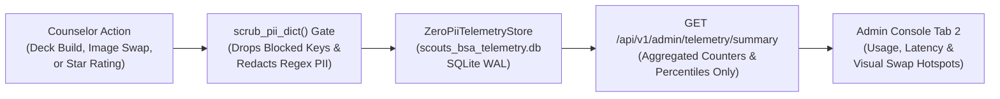
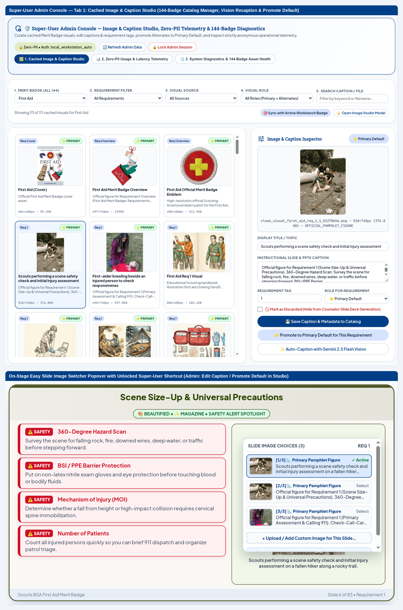
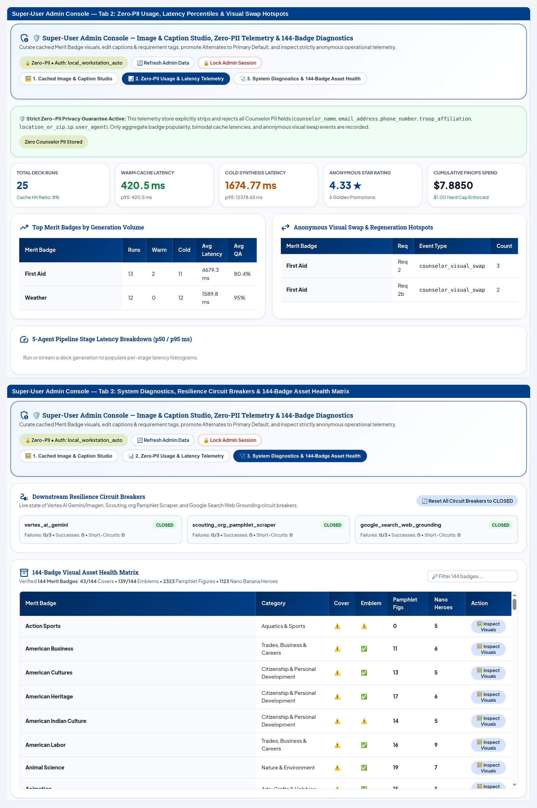

# Scouts BSA Merit Badge Counselor Workbench: Super-User Admin Guide

This guide explains how system administrators and curriculum maintainers unlock and operate the **Super-User Admin Console** built into the Scouts BSA Merit Badge Counselor Workbench.

While the standard Counselor Workbench interface (`docs/USER_GUIDE.md`) stays focused on preparing classes, presenting slides, and tracking Blue Card requirements for Scouts, the **Super-User Admin Console** gives authorized maintainers a dedicated control center to:

- Browse and curate the **3,917 built-in visual assets** (**2,323 100%-Vision-verified BSA Pamphlet figures** [`1,009` primary active + `1,314` requirement alternates], **1,306 pre-generated Nano Banana requirement hero & topic illustrations**, **144 badge emblems**, and **144 pamphlet covers**) across all **144 official Merit Badges**.
- Edit image titles, Vision-verified captions, and requirement mappings in place, with automatic synchronization to both the per-badge catalog (`assets/badge_image_catalog/<slug>/catalog.json`) and the master pamphlet image catalog (`data/pamphlet_image_catalog.json`).
- Promote a preferred `Pamphlet Alternate #1` or `Pamphlet Alternate #2` image to become the default **Primary** visual for a requirement in one click.
- Re-run multimodal **Gemini 2.5 Flash Vision** captioning on individual catalog figures or upload replacement graphics that are quantized to 8-bit PNGs (`<= 800x600`) automatically.
- Monitor **Zero-PII Aggregated Telemetry**, including deck generation counts by badge and polish tier, cache hit rates, FinOps cost averages, per-stage `p50` / `p95` build latency, counselor star ratings, and the **Anonymous Visual Swap & Regeneration Hotspots** table (showing which default slide images counselors replace most frequently).
- Run **System Diagnostics & 144-Badge Asset Health** audits, inspect downstream resilience circuit breakers, and reset circuit breakers or reload in-memory caches without restarting the server.

---

## Table of Contents

1. [Zero-PII Architecture & Security Boundary](#1-zero-pii-architecture--security-boundary)
2. [Accessing & Unlocking the Super-User Admin Console](#2-accessing--unlocking-the-super-user-admin-console)
3. [Tab 1: Cached Image & Caption Studio (144-Badge Catalog Manager)](#3-tab-1-cached-image--caption-studio-144-badge-catalog-manager)
4. [Inline Stage-Popover Shortcut (`Admin: Edit Caption / Promote Default in Studio`)](#4-inline-stage-popover-shortcut-admin-edit-caption--promote-default-in-studio)
5. [Tab 2: Zero-PII Usage, Latency & Visual Swap Telemetry](#5-tab-2-zero-pii-usage-latency--visual-swap-telemetry)
6. [Tab 3: System Diagnostics & 144-Badge Asset Health](#6-tab-3-system-diagnostics--144-badge-asset-health)
7. [Environment Variables & Deployment Configuration](#7-environment-variables--deployment-configuration)
8. [Admin REST API Reference (`/api/v1/admin/*` & `/api/admin/*`)](#8-admin-rest-api-reference-apiv1admin--apiadmin)

---

## 1. Zero-PII Architecture & Security Boundary

Volunteer Merit Badge Counselors enter personal contact details (name, troop and council affiliation, city/state or ZIP code, email address, and phone number) so those details appear on their local Cover Slide (Slide 1), Parent Welcome Letter, and Blue Card Sign-Off Sheet.

To protect counselor and youth privacy under Scouting America Youth Protection rules, the Admin Console telemetry pipeline enforces a strict architectural boundary in `src/observability/telemetry_store.py` (`ZeroPiiTelemetryStore`):

1. **Key-Level Blocklist (`_PII_KEY_PATTERNS`)**: Before any event is written to `scouts_bsa_telemetry.db`, `scrub_pii_dict()` recursively strips any dictionary key matching `counselor_name`, `email`, `phone`, `troop`, `council`, `location`, `zip`, `address`, `ip_address`, `client_ip`, `user_agent`, `scout_name`, or `roster`.
2. **Value-Level Regex Redaction**: Every remaining string field is passed through `scrub_pii_before_sink()` (`src/observability/logging_setup.py`) plus email, phone, and SSN regular expressions so accidental free-text PII is replaced with `[REDACTED]` before disk persistence.
3. **Schema-Level Isolation**: The three SQLite WAL tables in `scouts_bsa_telemetry.db` (`telemetry_deck_runs`, `telemetry_image_swaps`, and `telemetry_stage_latencies`) contain columns only for badge names, requirement identifiers, polish tiers, depth modes, millisecond durations, token counts, boolean cache-hit flags, and catalog image identifiers. No columns exist for user identifiers, troop numbers, locations, or network addresses.

---

## 2. Accessing & Unlocking the Super-User Admin Console

Regular counselors using the Workbench never see administrative buttons or menus in the main workflow tabs. Maintainers can open the Admin Console in three ways:

1. **Keyboard Shortcut**: Press **`Ctrl + Shift + A`** (or **`Cmd + Shift + A`** on macOS) from anywhere in the Workbench (when not typing inside an input field).
2. **Subtle Footer Link**: Scroll to the bottom-right corner of the application footer and click **`🔒 Admin`** (which reveals the **`🛡️ Admin Console`** main tab once authenticated).
3. **URL Query Parameter**: Open the Workbench with **`/?admin=1`** appended to the URL (for example, `http://localhost:8085/?admin=1`).

### Dual-Mode Authentication Hierarchy (`verify_admin_superuser`)

The backend authentication gate (`verify_admin_superuser()` in `src/security.py`) supports both zero-friction local workstation development and locked-down cloud deployments:

| Deployment Mode | How Authentication Works | Configuration Required |
| :--- | :--- | :--- |
| **1. Local Workstation Auto-Unlock** | When the server runs locally (`IS_CLOUD_RUN=false`) and no custom `ADMIN_SUPERUSER_TOKEN` is set, requests originating from `localhost`, `127.0.0.1`, or an authorized internal developer workstation domain unlock automatically. | None required for local laptop or workstation runs (`./run_local.sh`). |
| **2. Google Cloud IAP Identity Header** | When deployed on Cloud Run behind Google Cloud Identity-Aware Proxy (IAP), `verify_admin_superuser()` inspects the `X-Goog-Authenticated-User-Email` header. If the signed-in email matches an address listed in `ADMIN_ALLOWED_EMAILS`, the console unlocks automatically without prompting for a password. | Set `ADMIN_ALLOWED_EMAILS="admin@example.org,maintainer@example.org"` on the Cloud Run service. |
| **3. Admin Passkey / Session Cookie (`bsa_admin_session`)** | When `ADMIN_SUPERUSER_TOKEN` (or `BSA_ADMIN_KEY`) is configured, opening the Admin Console prompts for the passkey. Submitting the passkey to `POST /api/v1/admin/unlock` (`POST /api/admin/auth`) verifies it in constant time (`hmac.compare_digest`) and sets an `HttpOnly`, `SameSite=Lax` cookie (`bsa_admin_session`, valid for 12 hours). API callers can also pass `X-Admin-Token: <token>` or `Authorization: Bearer <token>`. | Set `ADMIN_SUPERUSER_TOKEN="your-secret-passkey"` in `.env` or Google Cloud Secret Manager. |

To end an administrative session at any time, click **`🔒 Lock Admin Session`** in the top-right corner of the Admin Console (`POST /api/v1/admin/lock`).

---

## 3. Tab 1: Cached Image & Caption Studio (144-Badge Catalog Manager)

**Tab 1 (`🖼️ 1. Cached Image & Caption Studio`)** lets you inspect, edit, promote, re-caption, or discard any cached visual asset across all 144 Merit Badges.

### Filtering & Inspecting Badge Visuals

At the top of Tab 1, use the 5-control filter toolbar to narrow the catalog grid:
- **1. Merit Badge (All 144)**: Select any of the 144 official Merit Badges from the dropdown list (or click **🎯 Sync with Active Workbench Badge**).
- **2. Requirement Filter**: Filter to a specific requirement number (such as `1`, `2a`, or `6b`) or view **All Requirements**.
- **3. Visual Source**: Filter between **All Sources**, **📐 Official Pamphlet Figure (`OFFICIAL_PAMPHLET_FIGURE`)**, **🍌 Nano Banana Hero (`NANO_BANANA_HERO`)**, **🍌 Custom Nano Banana AI (`NANO_BANANA_AI`)**, **🌐 Web Image Search (`WEB_IMAGE_SEARCH`)**, **📁 Uploaded Image (`USER_UPLOAD`)**, and **⚜️ Official Emblem / Cover (`OFFICIAL_BADGE_ASSET`)**.
- **4. Visual Role**: Filter between **All Roles (Primary + Alternates)**, **⭐ Primary Default Visuals**, and **🔄 Requirement Alternates**.
- **5. Search Caption / File**: Type any keyword or filename substring to filter the thumbnail grid immediately.

### Image & Caption Inspector Actions (Right Column)

Clicking any thumbnail card in the left grid loads that visual into the sticky **Image & Caption Inspector** on the right, displaying the high-resolution image preview, dimensions, file size, and editable metadata fields:

| Control / Action Button | Endpoint Called | What It Does |
| :--- | :--- | :--- |
| **💾 Save Caption & Metadata to Catalog** | `PATCH /api/v1/admin/catalog/image` (`PUT /api/admin/catalog/image`) | Saves your edits to **Display Title / Topic**, **Instructional Slide & PPTX Caption**, **Requirement Tag**, **Role for Requirement** (`⭐ Primary Default` vs. `🔄 Alternate Visual`), and **🚫 Mark as Discarded**. Writes atomically (`os.replace`) to both `assets/badge_image_catalog/<slug>/catalog.json` and `data/pamphlet_image_catalog.json`, updates SQLite, and invalidates in-memory `mtime_ns` caches. |
| **⭐ Promote to Primary Default for This Requirement** | `POST /api/v1/admin/catalog/promote-primary` | Promotes the selected alternate or custom image to become the default **Primary (`is_alternate=False`)** visual for that `[badge_name, req_number]` pair and demotes the previous primary image to `Alt #1` (`is_alternate=True, alternate_rank=1`). |
| **✨ Auto-Caption with Gemini 2.5 Flash Vision** | `POST /api/v1/admin/catalog/recaption-vision` | Runs a single-image multimodal **Gemini 2.5 Flash Vision** pass over the PNG file on disk (falling back to a structured curriculum caption if offline) to generate a concise, domain-accurate instructional caption (`<= 180` characters) and saves it to both catalog JSON files. |
| **🍌 Open Image Studio Modal** | Opens `#image-studio-modal` | Opens the 4-Tab Image Studio modal so you can upload a new local image file (`USER_UPLOAD`), search Wikimedia Commons, or generate a new Nano Banana AI graphic for the active badge. |

---

## 4. Inline Stage-Popover Shortcut (`Admin: Edit Caption / Promote Default in Studio`)

When you are reviewing a slide deck on the **16:9 Slide Stage** while an Admin Session is active (`state.isAdminSession === true`), you can jump directly from any slide's image pill into the Admin Catalog Studio:

1. Click the **Easy Slide Image Switcher** pill (`◀ (1/3) ▾ ▶`) above the right-hand slide graphic to open the thumbnail and caption comparison popover (`#stage-visual-pill-popover`).
2. At the bottom of the popover (directly below **`+ Upload / Add Custom Image for This Slide...`**), click the super-user button:
   **`🛡️ Admin: Edit Caption / Promote Default in Studio...`**
3. The Workbench switches straight to the **Super-User Admin Console (`Tab 1: Cached Image & Caption Studio`)** with that exact Merit Badge and visual pre-selected in the **Image & Caption Inspector**.

---

## 5. Tab 2: Zero-PII Usage, Latency & Visual Swap Telemetry

**Tab 2 (`📊 2. Zero-PII Usage & Latency Telemetry`)** visualizes aggregated operational metrics from `ZeroPiiTelemetryStore` (`GET /api/v1/admin/telemetry/summary`).

### 1. Telemetry KPI Row (5 Summary Cards)

- **Total Deck Runs & Cache Hit Ratio**: Total slide decks built across all badges and the percentage of runs served from warm pre-bundled caches (`$0.00` runtime image cost).
- **Warm Cache Latency (`p50` / `p95` ms)**: Median and 95th-percentile build latency for cached Merit Badge runs.
- **Cold Synthesis Latency (`p50` / `p95` ms)**: Median and 95th-percentile build latency for uncached runs.
- **Anonymous Star Rating & Golden Promotions**: Average counselor star rating (`1` to `5` stars) and count of sessions promoted to `tests/data/golden_extensions.json`.
- **Cumulative FinOps Spend**: Total estimated token and image spend (`$ USD`) governed by the `$1.00` per-deck hard cap.

### 2. Top Merit Badges & Anonymous Visual Swap Hotspots

- **Top Merit Badges by Generation Volume**: Table ranking the most frequently generated Merit Badges with total runs, warm vs. cold run split, average build latency (`ms`), and average QA conformance score (`%`).
- **Anonymous Visual Swap & Regeneration Hotspots**: Whenever a counselor uses the **Easy Slide Image Switcher** or Co-Design bar to replace a slide's default graphic, the Workbench records an anonymous swap event (`badge_name`, `req_number`, `event_type`). This table highlights the exact `[Badge + Requirement]` pairs where counselors most frequently swap images so maintainers can inspect those requirements in Tab 1 and promote a stronger default visual.

### 3. 5-Agent Pipeline Stage Latency Breakdown (`p50` / `p95` ms)

Horizontal bar chart reporting `p50` and `p95` execution time in milliseconds across each stage of the ADK pipeline (`research`, `planning`, `beautifier`, `builder`, and `reviewer`).

---

## 6. Tab 3: System Diagnostics & 144-Badge Asset Health

**Tab 3 (`🩺 3. System Diagnostics & 144-Badge Asset Health`)** provides live resilience monitoring and a searchable asset audit across all 144 Merit Badges (`GET /api/v1/admin/diagnostics/assets`).

### 1. Downstream Resilience Circuit Breakers

- Displays the real-time state (`CLOSED`, `OPEN`, `HALF_OPEN`), failure count vs. threshold, total successes, and total short-circuits for each downstream circuit breaker (Vertex AI Gemini/Imagen, Scouting.org Pamphlet Scraper, and Google Search Web Grounding).
- Click **`🔄 Reset All Circuit Breakers to CLOSED`** (`POST /api/v1/admin/circuit-breakers/reset`) to reset all circuit breakers after resolving a transient upstream outage.

### 2. 144-Badge Visual Asset Health Matrix

Below the circuit breaker cards sits a searchable table auditing all **144 official Scouts BSA Merit Badges**:
- Type any badge name or category into **🔎 Filter 144 badges...** to filter the matrix in real time.
- For each badge, the matrix reports:
  - **Cover (`assets/pamphlet_covers/`)**: `✅` Present (`144/144`)
  - **Emblem (`assets/badge_emblems/`)**: `✅` Present (`144/144`)
  - **Pamphlet Figs (`assets/pamphlet_images/`)**: Count of active Vision-verified primary and alternate figures (`2,323` total)
  - **Nano Heroes (`assets/ai_illustrations/`)**: Count of pre-bundled requirement hero illustrations (`1,306` total Nano Banana PNGs)
- Click **`🖼️ Inspect Visuals`** on any row to jump directly to **Tab 1 (`Cached Image & Caption Studio`)** pre-filtered to that Merit Badge.

---

## 7. Environment Variables & Deployment Configuration

Configure the following environment variables in `.env` (for local runs) or in your Cloud Run service / Secret Manager configuration:

| Environment Variable | Default | Purpose |
| :--- | :--- | :--- |
| `ADMIN_SUPERUSER_TOKEN` | *(Unset locally)* | Secret passkey required to unlock the Admin Console (`POST /api/v1/admin/unlock`) or authenticate `/api/v1/admin/*` calls via `X-Admin-Token` / `Authorization: Bearer`. (Alias: `BSA_ADMIN_KEY`.) |
| `ADMIN_ALLOWED_EMAILS` | *(Empty)* | Comma-separated allowlist of administrator email addresses verified via Google Cloud IAP (`X-Goog-Authenticated-User-Email`). |
| `AUTH_REQUIRED` | `false` (local) / `true` (Cloud Run) | Enforces caller authentication on general API routes in Cloud Run while keeping `/api/v1/admin/*` protected by `verify_admin_superuser()`. |

---

## 8. Admin REST API Reference (`/api/v1/admin/*` & `/api/admin/*`)

All administrative endpoints are defined in `src/server.py` and exported in `docs/openapi.yaml` (part of the `67` total OpenAPI 3.1 paths). Both `/api/v1/admin/*` and `/api/admin/*` route aliases are supported:

| Method & Path | Request Payload / Query Params | Response Summary |
| :--- | :--- | :--- |
| `GET /api/v1/admin/status` (`GET /api/admin/status`) | None | Returns `{"is_admin": bool, "unlocked": bool, "auth_mode": str}`. |
| `POST /api/v1/admin/unlock` (`POST /api/admin/auth`) | `{"token": "<ADMIN_SUPERUSER_TOKEN>"}` | Verifies the passkey in constant time and sets the `HttpOnly` `bsa_admin_session` cookie (`max_age=43200`). |
| `POST /api/v1/admin/lock` (`POST /api/admin/logout`) | None | Clears the `bsa_admin_session` cookie and locks the Admin Console. |
| `GET /api/v1/admin/catalog` (`GET /api/admin/catalog/{badge_name}`) | Query: `badge_name`, `req_number` *(optional)*, `source_type` *(optional)*, `role` *(optional)* | Returns all catalog entries (`items`) and summary counts (`counts`) for the specified Merit Badge. |
| `PATCH /api/v1/admin/catalog/image` (`PUT /api/admin/catalog/image`) | `{"badge_name": str, "image_id": str, "caption": str, "title": str, "req_number": str, "is_alternate": bool, "discard": bool}` | Updates metadata atomically in both `assets/badge_image_catalog/<slug>/catalog.json` and `data/pamphlet_image_catalog.json`. |
| `POST /api/v1/admin/catalog/promote-primary` (`POST /api/admin/catalog/promote-primary`) | `{"badge_name": str, "image_id": str, "req_number": str}` | Promotes the specified alternate or custom image to Primary (`is_alternate=False`) for that requirement and demotes the prior primary to `Alt #1`. |
| `POST /api/v1/admin/catalog/recaption-vision` (`POST /api/admin/catalog/recaption-vision`) | `{"badge_name": str, "image_id": str, "req_number": str}` | Runs a Gemini 2.5 Flash Vision pass on the image file and saves the new caption (`<= 180` chars) to both catalog JSON files. |
| `GET /api/v1/admin/telemetry/summary` (`GET /api/admin/telemetry/summary`) | None | Returns aggregated zero-PII counters, `p50`/`p95` warm and cold build latencies, stage latency histograms, top generated badges, and visual swap hotspots. |
| `GET /api/v1/admin/diagnostics/assets` (`GET /api/admin/diagnostics`) | None | Returns the 144-badge asset health matrix, cover/emblem/figure/hero totals, and circuit breaker states. |
| `POST /api/v1/admin/circuit-breakers/reset` (`POST /api/admin/cache/reload`) | None | Resets all downstream circuit breakers to `CLOSED` and reloads in-memory caches. |
