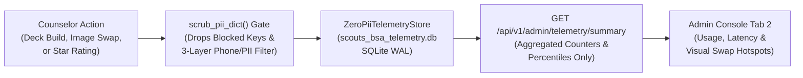
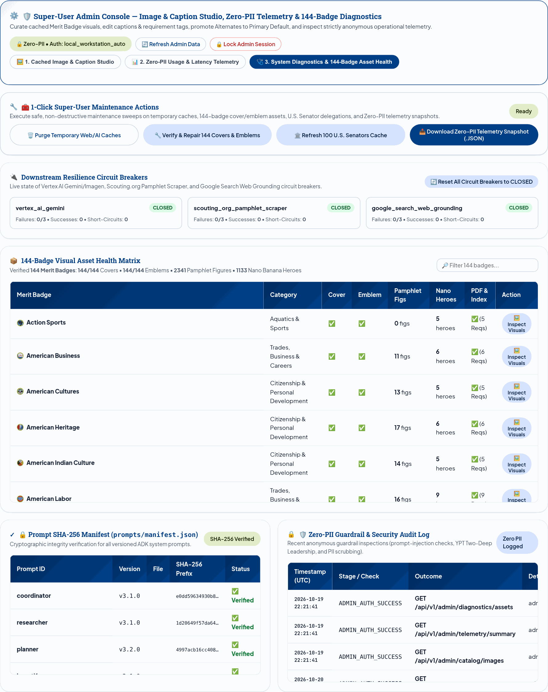

# Scouts BSA Merit Badge Counselor Workbench: Super-User Admin Guide

This guide explains how system administrators and curriculum maintainers unlock and operate the **Super-User Admin Console** built into the Scouts BSA Merit Badge Counselor Workbench.

While the standard Counselor Workbench interface (**[User Guide (`docs/USER_GUIDE.md`)](USER_GUIDE.md)**) and the built-in Model Context Protocol server (**[MCP Server Integration Guide (`docs/MCP_SERVER_INTEGRATION_GUIDE.md`)](MCP_SERVER_INTEGRATION_GUIDE.md)**) stay focused on preparing classes, applying PowerPoint templates, managing multi-badge deck workspaces, presenting slides, and tracking Blue Card requirements for Scouts, the **Super-User Admin Console** gives authorized maintainers a dedicated control center to:

- Browse and curate the **5,607 cataloged curriculum visual assets (6,064 total visual files on disk)** (**2,815 100%-Vision-verified BSA Pamphlet figures**, **2,792 pre-generated Nano Banana requirement hero, child-slide topic, multi-option & workbook reference illustrations**, **149 badge emblems**, and **149 pamphlet covers**) across all **149 Merit Badges** (`143` Active Official Merit Badges including *Wildland Fire Management*, `5` Scouting America Test Lab Pilots: *Auctioneering*, *Dance*, *Physics*, *Psychology*, and *Sewing and Needlework*, and `1` Discontinued Historical badge: *Citizenship in Society* annotated with a red `🚫 Discontinued` indicator in the Patch Gallery).
- Edit image titles, Vision-verified captions, and requirement mappings in place, with automatic synchronization to both the per-badge catalog (`assets/badge_image_catalog/<slug>/catalog.json`) and the master pamphlet image catalog (`data/pamphlet_image_catalog.json`).
- Promote a preferred `Pamphlet Alternate #1` or `Pamphlet Alternate #2` image to become the default **Primary** visual for a requirement in one click.
- Re-run multimodal **Gemini 2.5 Flash Vision** captioning on individual catalog figures, replace a built-in catalog asset on disk (`📤 Replace / Upload Built-In Asset`, quantized to an 8-bit PNG with an automatic `.bak.<timestamp>` backup), or regenerate a Nano Banana illustration in place (`🍌 Regenerate AI Image In-Place`).
- Monitor **Zero-PII Aggregated Telemetry**, including deck generation counts across **24h / 7d / All-Time** windows, tier and depth breakdowns, cache hit rates, FinOps Spend vs. Estimated Saved (`$ USD`), per-stage `p50` / `p95` / `p99` build latency with 5-bucket histograms, counselor star ratings, and the **Anonymous Visual Swap & Regeneration Hotspots** table (with **`🔍 Open in Studio`** jump links).
- Run **System Diagnostics & 149-Badge Asset Health** audits across a 5-column sticky matrix (`Cover`, `Emblem`, `Pamphlet Figs`, `Nano Heroes`, and `PDF & Index` with true per-badge official requirement counts like `15 Reqs` for First Aid and `12 Reqs` for Weather), inspect the **Prompt SHA-256 Manifest & Guardrail Audit Log**, and execute **1-Click Maintenance Actions** (`🧹 Purge Temp Web/AI Cache`, `🖼️ Verify & Repair Covers/Emblems`, `🔄 Reset All Circuit Breakers to CLOSED`, and `📥 Download Zero-PII Snapshot JSON`).

---

## Table of Contents

1. [Zero-PII Architecture & Security Boundary](#1-zero-pii-architecture--security-boundary)
2. [Accessing & Unlocking the Super-User Admin Console](#2-accessing--unlocking-the-super-user-admin-console)
3. [Tab 1: Cached Image & Caption Studio (149-Badge Catalog Manager)](#3-tab-1-cached-image--caption-studio-149-badge-catalog-manager)
4. [Inline Stage-Popover Shortcut (`Admin: Edit Caption / Promote Default in Studio`)](#4-inline-stage-popover-shortcut-admin-edit-caption--promote-default-in-studio)
5. [Tab 2: Zero-PII Usage, Latency & Visual Swap Telemetry](#5-tab-2-zero-pii-usage-latency--visual-swap-telemetry)
6. [Tab 3: System Diagnostics & 149-Badge Asset Health](#6-tab-3-system-diagnostics--149-badge-asset-health)
7. [Environment Variables & Deployment Configuration](#7-environment-variables--deployment-configuration)
8. [Admin REST API Reference (`/api/v1/admin/*` & `/api/admin/*`)](#8-admin-rest-api-reference-apiv1admin--apiadmin)

---

## 1. Zero-PII Architecture & Security Boundary

Volunteer Merit Badge Counselors enter personal contact details (name, troop and council affiliation, city/state or ZIP code, email address, and phone number) so those details appear on their local Cover Slide (Slide 1), Parent Welcome Letter, and Blue Card Sign-Off Sheet.

To protect counselor and youth privacy under Scouting America Youth Protection rules, the Admin Console telemetry pipeline enforces a strict architectural boundary in `src/observability/telemetry_store.py` (`ZeroPiiTelemetryStore`), `src/observability/logging_setup.py`, and `src/agents/guardrails.py`:

1. **Key-Level Blocklist (`_PII_KEY_PATTERNS`)**: Before any event is written to `scouts_bsa_telemetry.db`, `scrub_pii_dict()` recursively strips any dictionary key matching `counselor_name`, `email`, `phone`, `troop`, `council`, `location`, `zip`, `address`, `ip_address`, `client_ip`, `user_agent`, `scout_name`, or `roster`.
2. **Value-Level Regex Redaction & 3-Layer Context-Aware Phone Filter (`V36`)**: Every remaining string field is passed through `scrub_pii_before_sink()` (`src/observability/logging_setup.py`) and `src/agents/guardrails.py`. In addition to email and SSN regex redaction, `V36` applies a **3-Layer Context-Aware Phone Redaction Filter**:
   - **Layer 1 (URL & Asset Path Exclusion)**: Skips 10-digit numeric identifiers inside `http://`, `https://`, `vimeo.com/`, `scouting.org/`, and `.pdf`/`.png` filenames so all 92 official Scouting America Vimeo educational video IDs and PDF worksheet links across 18 badges remain intact.
   - **Layer 2 (NANPA Toll-Free & Emergency Hotline Allowlist)**: Preserves standard NANPA toll-free area codes (`800`, `888`, `877`, `866`, `855`, `844`, `833`) and canonical emergency and institutional hotlines (`1-800-222-1222` America's Poison Control Centers on *First Aid* Slide 3, `911`, `988` Suicide & Crisis Lifeline, `800-323-0736` BSA Scout Shop, and `202-633-1000` Smithsonian switchboard).
   - **Layer 3 (`±55`-Character Institutional vs. Personal Hotword Window)**: Evaluates surrounding context tokens within a `±55`-character window (`poison control`, `hotline`, `helpline`, `switchboard` vs. `counselor`, `parent`, `guardian`, `scoutmaster`, `cell`, `mobile`, `call me`, `text me`), guaranteeing `100%` redaction (`[REDACTED_PHONE]`) on personal youth, parent, and counselor phone numbers while preventing false-positive curriculum mutilation.
3. **Schema-Level Isolation**: The three SQLite WAL tables in `scouts_bsa_telemetry.db` (`telemetry_deck_runs`, `telemetry_image_swaps`, and `telemetry_stage_latencies`) contain columns only for badge names, requirement identifiers, polish tiers, depth modes, millisecond durations, token counts, boolean cache-hit flags, and catalog image identifiers. No columns exist for user identifiers, troop numbers, locations, or network addresses.

---

## 2. Accessing & Unlocking the Super-User Admin Console

Regular counselors using the Workbench never see administrative buttons or menus in the main workflow tabs. Maintainers can open the Admin Console in three ways:

1. **Keyboard Shortcut**: Press **`Ctrl + Shift + A`** (or **`Cmd + Shift + A`** on macOS) from anywhere in the Workbench (when not typing inside an input field).
2. **Subtle Footer Link**: Scroll to the bottom-right corner of the application footer and click **`🔒 Admin`** (which reveals the **`🛡️ Admin Console`** main tab once authenticated).
3. **URL Query Parameter**: Open the Workbench with **`/?admin=1`** appended to the URL (for example, `http://localhost:8085/?admin=1`).

### Dual-Mode Authentication Hierarchy (`verify_admin_superuser`)

The backend authentication gate (`verify_admin_superuser()` in `src/security.py`) supports both zero-friction local workstation development and locked-down cloud deployments:

| Deployment Mode | How Authentication Works | Configuration Required |
| :--- | :--- | :--- |
| **1. Local Workstation Auto-Unlock** | When the server runs locally (`IS_CLOUD_RUN=false`) and no custom `ADMIN_SUPERUSER_TOKEN` is set, requests originating from `localhost`, `127.0.0.1`, or an authorized internal developer workstation domain unlock automatically. | None required for local laptop or workstation runs (`./run_local.sh`). |
| **2. Google Cloud IAP Identity Header** | When deployed on Cloud Run behind Google Cloud Identity-Aware Proxy (IAP), `verify_admin_superuser()` inspects the `X-Goog-Authenticated-User-Email` header. If the signed-in email matches an address listed in `ADMIN_ALLOWED_EMAILS`, the console unlocks automatically without prompting for a password. | Set `ADMIN_ALLOWED_EMAILS="admin@example.org,maintainer@example.org"` on the Cloud Run service. |
| **3. Admin Passkey / Session Cookie (`bsa_admin_session`)** | When `ADMIN_SUPERUSER_TOKEN` (or `BSA_ADMIN_KEY`) is configured, opening the Admin Console prompts for the passkey. Submitting the passkey to `POST /api/v1/admin/unlock` (`POST /api/admin/unlock`) verifies it in constant time (`hmac.compare_digest`) and sets an `HttpOnly`, `SameSite=Lax` cookie (`bsa_admin_session`, valid for 24 hours). API callers can also pass `X-Admin-Token: <token>` or `Authorization: Bearer <token>`. | Set `ADMIN_SUPERUSER_TOKEN="your-secret-passkey"` in `.env` or Google Cloud Secret Manager. |

To end an administrative session at any time, click **`🔒 Lock Admin Session`** in the top-right corner of the Admin Console (`POST /api/v1/admin/lock`).

### `Add DMBC & HVSC Customizations` Toggle (`#chk-admin-dmbc-hvsc-customizations`, Default Unchecked)

In the top-right header of the Admin Console (`#admin-console-header-card`), the **`[ ] Add DMBC & HVSC Customizations`** checkbox lets maintainers switch between a completely generic Scouting America workbench and a customized Danvers Merit Badge College (`DMBC`) and Camp Hidden Valley (`HVSC`) experience:
- **Unchecked (`false`, Default)**: Hides or genericizes all Danvers MBC and Hidden Valley templates, venue macros, duration labels, room/location presets, camp tags, sample prompts, and workspace card badges so the words `"Danvers"`, `"Hidden Valley"`, `"Holten-Richmond"`, and `"Griswold"` never appear anywhere in the UI (retaining generic Scouting labels such as `🏫 Merit Badge College`, `🏕️ Summer Camp`, and `Main School Building - Room 107 (MBC)`).
- **Checked (`true`)**: Enables the built-in **Camp Hidden Valley (Griswold Scout Reservation)** and **Danvers Merit Badge College** templates in the Template Studio, restores the `🏫 Danvers MBC` and `🏕️ Camp Hidden Valley` 1-click venue macros, and reveals the `Holten-Richmond MS` and `Camp Hidden Valley` classroom and waterfront location presets.

### 5-Step Pre-Merit-Badge-College Admin Readiness Checklist

Before hosting a District Merit Badge College, Council University of Scouting, or Summer Camp week, run through this 5-step readiness check in the Admin Console (`Ctrl + Shift + A`):
1. **Configure Venue Customizations**: Check **`Add DMBC & HVSC Customizations`** if hosting Danvers Merit Badge College or Camp Hidden Valley (or leave it unchecked for a council-neutral Scouting America event).
2. **Refresh Civic Grounding Cache**: On Tab 3, click **`🏛️ Refresh 100 U.S. Senators Cache`** so *Citizenship in the Nation* Requirement 8 decks have up-to-date congressional delegation details for your state.
3. **Verify 149-Badge Asset Health**: On Tab 3, confirm **`149/149`** green checkmarks across `Cover`, `Emblem`, `Pamphlet Figs`, `Nano Heroes`, and `PDF & Index` (click **`🔧 Verify & Repair 149 Covers & Emblems`** if any local cache file was moved).
4. **Review Visual Swap Hotspots**: On Tab 2, check the **Anonymous Visual Swap & Regeneration Hotspots** table and click **`🔍 Open in Studio`** to promote any counselor-preferred alternate figure to Primary default.
5. **Export Baseline Telemetry Snapshot**: On Tab 3, click **`📥 Download Zero-PII Telemetry Snapshot (.JSON)`** to archive a pre-event baseline of catalog SHA-256 hashes and usage counters.

---

## 3. Tab 1: Cached Image & Caption Studio (149-Badge Catalog Manager)

**Tab 1 (`🖼️ 1. Cached Image & Caption Studio`)** lets you inspect, edit, promote, re-caption, or discard any cached visual asset across all 149 Merit Badges (`143` Active Official, `5` Test Lab Pilots, and `1` Discontinued Historical).

### Filtering & Inspecting Badge Visuals

At the top of Tab 1, use the 5-control filter toolbar to narrow the catalog grid:
- **1. Merit Badge (All 149)**: Select any of the 149 Merit Badges from the dropdown list (or click **🎯 Sync with Active Workbench Badge**).
- **2. Requirement Filter**: Filter to a specific requirement number (such as `1`, `2a`, or `6b`) or view **All Requirements**.
- **3. Visual Source**: Filter between **All Sources**, **📐 Official Pamphlet Figure (`OFFICIAL_PAMPHLET_FIGURE`)**, **🍌 Nano Banana Hero (`NANO_BANANA_HERO`)**, **🍌 Custom Nano Banana AI (`NANO_BANANA_AI`)**, **🌐 Web Image Search (`WEB_IMAGE_SEARCH`)**, **📁 Uploaded Image (`USER_UPLOAD`)**, and **⚜️ Official Emblem / Cover (`OFFICIAL_BADGE_ASSET`)**.
- **4. Visual Role**: Filter between **All Roles (Primary + Alternates)**, **⭐ Primary Default Visuals**, and **🔄 Requirement Alternates**.
- **5. Search Caption / File**: Type any keyword or filename substring to filter the thumbnail grid immediately.

### Image & Caption Inspector Actions (Right Column)

Clicking any thumbnail card in the left grid loads that visual into the sticky **Image & Caption Inspector** on the right, displaying the high-resolution image preview, dimensions, file size, and editable metadata fields:

| Control / Action Button | Endpoint Called | What It Does |
| :--- | :--- | :--- |
| **💾 Save Caption & Metadata to Catalog** | `PATCH /api/v1/admin/catalog/image` (`PATCH /api/admin/catalog/image`) | Saves your edits to **Display Title / Topic**, **Instructional Slide & PPTX Caption**, **Requirement Tag**, **Role for Requirement** (`⭐ Primary Default` vs. `🔄 Alternate Visual`), and **🚫 Mark as Discarded**. Writes atomically (`os.replace`) to both `assets/badge_image_catalog/<slug>/catalog.json` and `data/pamphlet_image_catalog.json`, updates SQLite, and invalidates in-memory `mtime_ns` caches. |
| **⭐ Promote to Primary Default for This Requirement** | `POST /api/v1/admin/catalog/promote-primary` | Promotes the selected alternate or custom image to become the default **Primary (`is_alternate=False`)** visual for that `[badge_name, req_number]` pair and demotes the previous primary image to `Alt #1` (`is_alternate=True, alternate_rank=1`). |
| **✨ Auto-Caption with Gemini 2.5 Flash Vision** | `POST /api/v1/admin/catalog/recaption-vision` | Runs a single-image multimodal **Gemini 2.5 Flash Vision** pass over the PNG file on disk (falling back to a structured curriculum caption if offline) to generate a concise, domain-accurate instructional caption (`<= 180` characters) and saves it to both catalog JSON files. |
| **📤 Replace / Upload Built-In Asset** | `POST /api/v1/admin/catalog/replace-image` | Uploads a replacement PNG/JPG/WEBP file for the currently selected catalog entry, backs up the existing file to `<filename>.bak.<timestamp>`, quantizes the replacement to an optimized 8-bit PNG, and refreshes in-memory caches. |
| **🍌 Regenerate AI Image In-Place** | `POST /api/v1/admin/catalog/replace-image` (`regenerate_nano=true`) | Re-synthesizes a Nano Banana AI illustration in place for the selected catalog entry (`$0.08` estimated cost) while preserving a `.bak.<timestamp>` backup of the prior image. |
| **🍌 Open Image Studio Modal** | Opens `#image-studio-modal` | Opens the 4-Tab Image Studio modal so you can upload a new local image file (`USER_UPLOAD`), search Wikimedia Commons, or generate a new Nano Banana AI graphic for the active badge. |

---

## 4. Inline Stage-Popover Shortcut (`Admin: Edit Caption / Promote Default in Studio`)

When you are reviewing a slide deck on the **16:9 Slide Stage** while an Admin Session is active (`state.isAdminSession === true`), you can jump directly from any slide's image pill into the Admin Catalog Studio:

1. Click the **Easy Slide Image Switcher** pill (`◀ (1/3) ▾ ▶`) above the right-hand slide graphic to open the thumbnail and caption comparison popover (`#stage-visual-pill-popover`).
2. At the bottom of the popover (directly below **`+ Upload / Add Custom Image for This Slide...`**), click the super-user button:
   **`🛡️ Admin: Edit Caption / Promote Default in Studio...`**
3. The Workbench switches straight to the **Super-User Admin Console (`Tab 1: Cached Image & Caption Studio`)** with that exact Merit Badge and visual pre-selected in the **Image & Caption Inspector**.

---

## 5. Tab 2: Zero-PII Usage, Latency & Visual Swap Telemetry

**Tab 2 (`📊 2. Zero-PII Usage & Latency Telemetry`)** visualizes aggregated operational metrics from `ZeroPiiTelemetryStore` (`GET /api/v1/admin/telemetry/summary`).

### 1. Telemetry KPI Row (5 Summary Cards)

- **Total Deck Runs (`24h / 7d / All-Time`) & Cache Hit Ratio**: Displays deck builds over the last 24 hours, last 7 days, and all-time alongside the warm cache hit percentage and breakdown by slide theme (`Warm Cream`, `Dark Slate`, `Crisp White`) and depth (`Standard`, `Deep Dive`).
- **Warm Cache Latency (`p50` / `p95` / `p99` ms + 5-Bucket Histogram)**: Median, 95th-percentile, and 99th-percentile build latency for cached Merit Badge runs with a visual 5-bucket latency distribution histogram.
- **Cold Synthesis & Single-Slide Regen Latency (`p50` / `p95` / `p99` ms + Histogram)**: Latency percentiles and 5-bucket histogram for cold synthesis runs plus single-slide regeneration latency.
- **Anonymous Star Rating & Golden Promotions**: Average counselor star rating (`1` to `5` stars) and count of sessions promoted to `tests/data/golden_extensions.json`.
- **FinOps Spend vs. Estimated Saved**: Total estimated token and image spend (`$ USD`) alongside **Estimated Saved via Warm Cache (`$ USD`)** (`~$0.82` saved per warm-cached deck run) and a FinOps token/image ledger breakdown.

### 2. Top Merit Badges & Anonymous Visual Swap Hotspots

- **Top Merit Badges by Generation Volume**: Table ranking the most frequently generated Merit Badges with circular `16x16` Merit Badge emblem icons (`m3-pill-badge-emblem`), total runs, warm vs. cold run split, average build latency (`ms`), and average QA conformance score (`%`).
- **Anonymous Visual Swap & Regeneration Hotspots**: Whenever a counselor uses the **Easy Slide Image Switcher** or Co-Design bar to replace a slide's default graphic, the Workbench records an anonymous swap event (`badge_name`, `req_number`, `event_type`, `from_image_id`, `to_image_id`). Each row displays the badge's `16x16` emblem icon and includes a **`🔍 Open in Studio`** button that jumps directly to Tab 1 pre-filtered to that badge and requirement so maintainers can inspect the figure and promote a stronger default visual.

### 3. 6-Stage ADK Pipeline Latency Breakdown (`p50` / `p95` / `p99` ms + Histograms)

Horizontal bar chart and 5-bucket mini-histograms reporting `p50`, `p95`, and `p99` execution time in milliseconds across each stage of the ADK pipeline (`research`, `deep_research`, `planning`, `beautifier`, `builder`, and `reviewer`).

---

## 6. Tab 3: System Diagnostics & 149-Badge Asset Health

**Tab 3 (`🩺 3. System Diagnostics & 149-Badge Asset Health`)** provides live resilience monitoring, 1-click maintenance actions, prompt SHA-256 verification, and a searchable asset audit across all 149 Merit Badges (`GET /api/v1/admin/diagnostics/assets`).

### 1. Downstream Resilience Circuit Breakers & 1-Click Maintenance Actions

- Displays the real-time state (`CLOSED`, `OPEN`, `HALF_OPEN`), failure count vs. threshold, total successes, and total short-circuits for each downstream circuit breaker (Vertex AI Gemini/Imagen, Scouting.org Pamphlet Scraper, and Google Search Web Grounding).
- **1-Click Maintenance Actions Toolbar**:
  - **`🧹 Purge Temporary Web/AI Caches`** (`POST /api/v1/admin/maintenance/purge-temp-cache`): Purges temporary web-search staging thumbnails while preserving all 5,607 built-in catalog visuals.
  - **`🔧 Verify & Repair 149 Covers & Emblems`** (`POST /api/v1/admin/maintenance/repair-covers`): Verifies and repairs all 149 pamphlet covers (`assets/pamphlet_covers/`) and 149 badge emblems (`assets/badge_emblems/`).
  - **`🏛️ Refresh 100 U.S. Senators Cache`** (`POST /api/v1/admin/senators/refresh`): Triggers a forced refresh of the 100 U.S. Senators grounding cache (`24h` TTL) across all 50 states.
  - **`📥 Download Zero-PII Telemetry Snapshot (.JSON)`** (`GET /api/v1/admin/maintenance/snapshot`): Downloads a portable JSON snapshot of asset health, prompt SHA-256 hashes, and aggregated Zero-PII telemetry.
  - **`🔄 Reset All Circuit Breakers to CLOSED`** (`POST /api/v1/admin/circuit-breakers/reset`, located on the Downstream Resilience Circuit Breakers header): Resets all circuit breakers to `CLOSED` and reloads in-memory caches.

### 2. 149-Badge Visual Asset Health Matrix

Below the circuit breaker cards sits a searchable table (`max-height: 460px` with a sticky `<thead>`) auditing all **149 Scouts BSA Merit Badges** (`143` Active Official, `5` Test Lab Pilots, and `1` Discontinued Historical):
- Type any badge name or category into **🔎 Filter 149 badges...** to filter the matrix in real time.
- For each badge, the matrix reports 5 health columns:
  - **Cover (`assets/pamphlet_covers/`)**: `✅` Present (`149/149`)
  - **Emblem (`assets/badge_emblems/`)**: `✅` Present (`149/149` authentic `400x400` Scout Shop emblems verified in `assets/badge_emblems/scoutshop_emblems_manifest.json`)
  - **Pamphlet Figs (`assets/pamphlet_images/`)**: Count of active Vision-verified primary and alternate figures (`2,815` active Vision-verified figures across 149 badges, e.g. `17 figs`)
  - **Nano Heroes (`assets/ai_illustrations/`)**: Count of pre-bundled requirement hero and topic illustrations (`2,792` total Nano Banana PNGs on disk across 149 badges, e.g. `17 heroes`)
  - **PDF & Index (`data/official_requirements_cache.json` + `data/pamphlet_Requirement_Index.json`)**: `✅` Indexed (`149/149`) with the badge's official top-level requirement count (e.g. `15 Reqs` for First Aid, `12 Reqs` for Weather)
- Click **`🖼️ Inspect Visuals`** on any row to jump directly to **Tab 1 (`Cached Image & Caption Studio`)** with that Merit Badge selected in the **Merit Badge (All 149)** dropdown and scrolled into view.

### 3. Prompt SHA-256 Manifest & Guardrail Audit Log

Below the 149-Badge Health Matrix sit two side-by-side scrolling verification tables with sticky column headers:
- **Prompt SHA-256 Manifest (`prompts/manifest.json`)**: Lists all 6 versioned system prompts (`coordinator_v2`, `planner_v2`, `curriculum_v2`, `beautifier_v2`, `reviewer_v2`, `researcher_v2`), their version numbers, live SHA-256 hashes on disk, and `✅ Verified` integrity status.
- **Zero-PII Guardrail & Security Audit Log (`Zero-PII`)**: Displays recent `compliance_audit` events (`ADMIN_AUTH_SUCCESS`, `MODEL_ARMOR_PASS`, `YPT_CHECK_PASS`) with sticky `Timestamp (UTC)`, `Event / Guardrail`, `Status`, and `Redacted Detail` column headers.

---

## 7. Environment Variables & Deployment Configuration

Configure the following environment variables in `.env` (for local runs) or in your Cloud Run service / Secret Manager configuration:

| Environment Variable | Default | Purpose |
| :--- | :--- | :--- |
| `ADMIN_SUPERUSER_TOKEN` | *(Unset locally)* | Secret passkey required to unlock the Admin Console (`POST /api/v1/admin/unlock`) or authenticate `/api/v1/admin/*` calls via `X-Admin-Token` / `Authorization: Bearer`. (Alias: `BSA_ADMIN_KEY`.) |
| `ADMIN_ALLOWED_EMAILS` | *(Empty)* | Comma-separated allowlist of administrator email addresses verified via Google Cloud IAP (`X-Goog-Authenticated-User-Email`). |
| `AUTH_REQUIRED` | `false` (local) / `true` (Cloud Run) | Enforces caller authentication on general API routes in Cloud Run while keeping `/api/v1/admin/*` protected by `verify_admin_superuser()`. |

---

## 8. Admin REST API Reference (`/api/v1/admin/*` & `/api/admin/*`)

All administrative endpoints are defined in `src/server.py` and exported in `docs/openapi.yaml` (part of the `158` total OpenAPI 3.1 paths). Both `/api/v1/admin/*` and `/api/admin/*` route aliases are supported:

| Method & Path | Request Payload / Query Params | Response Summary |
| :--- | :--- | :--- |
| `GET /api/v1/admin/session` (`GET /api/admin/session`) | None | Returns `{"status": "SUCCESS", "is_admin": bool, "auth_mode": str, "role": str}`. |
| `POST /api/v1/admin/unlock` (`POST /api/admin/unlock`) | `{"token": "<ADMIN_SUPERUSER_TOKEN>"}` | Verifies the passkey in constant time and sets the signed `HttpOnly` `bsa_admin_session` cookie (`max_age=86400`). |
| `POST /api/v1/admin/lock` (`POST /api/admin/lock`) | None | Sets `bsa_admin_session="locked"` and locks the Admin Console for the current browser session. |
| `GET /api/v1/admin/catalog/images` (`GET /api/admin/catalog/images`) | Query: `badge_name`, `req_number` *(optional)*, `source_type` *(optional)*, `role` *(optional)* | Returns all catalog entries (`items`) and summary counts (`counts`) for the specified Merit Badge. |
| `PATCH /api/v1/admin/catalog/image` (`PATCH /api/admin/catalog/image`) | `{"badge_name": str, "image_id": str, "caption": str, "title": str, "req_number": str, "is_alternate": bool, "alternate_rank": int, "discard": bool}` | Updates metadata atomically in both `assets/badge_image_catalog/<slug>/catalog.json` and `data/pamphlet_image_catalog.json`. |
| `POST /api/v1/admin/catalog/promote-primary` (`POST /api/admin/catalog/promote-primary`) | `{"badge_name": str, "image_id": str, "req_number": str}` | Promotes the specified alternate or custom image to Primary (`is_alternate=False`) for that requirement and demotes the prior primary to `Alt #1`. |
| `POST /api/v1/admin/catalog/recaption-vision` (`POST /api/admin/catalog/recaption-vision`) | `{"badge_name": str, "image_id": str, "req_number": str}` | Runs a Gemini 2.5 Flash Vision pass on the image file and saves the new caption (`<= 180` chars) to both catalog JSON files. |
| `POST /api/v1/admin/catalog/replace-image` (`POST /api/admin/catalog/replace-image`) | `{"badge_name": str, "image_id": str, "image_data_uri": str, "regenerate_nano": bool, "custom_prompt": str}` | Backs up the existing PNG to `.bak.<ts>`, quantizes the replacement or regenerated image to an 8-bit PNG, and refreshes caches. |
| `POST /api/v1/admin/telemetry/image-swap` (`POST /api/admin/telemetry/image-swap`) | `{"badge_name": str, "req_number": str, "event_type": str, "from_image_id": str, "to_image_id": str}` | Records an anonymous slide visual swap or regeneration event in `ZeroPiiTelemetryStore` with zero counselor PII. |
| `GET /api/v1/admin/telemetry/summary` (`GET /api/admin/telemetry/summary`) | None | Returns aggregated zero-PII counters (`24h`/`7d`/`All-Time`), Honest Dual Latency (`first_status_event_ms` vs. `true_first_content_token_ms`), `p50`/`p95`/`p99` latencies with 5-bucket histograms, 5% online audit sampler summary, FinOps spend vs. saved, top badges, and visual swap hotspots. |
| `GET /api/v1/admin/telemetry/online-audit-samples` | Query: `limit` *(optional, default 25)* | Returns summary statistics and recent zero-PII trace audit samples from the 5% `OnlineProductionAuditSampler`. |
| `POST /api/v1/admin/telemetry/online-audit-sample` | `{"badge_name": str, "force_sample": bool, ...}` | Evaluates and records a production trace sample (`Recall@3`, SHA-256 hash lock, AABB overlaps, dual TTFT, FinOps ceiling, PII scrub check). |
| `GET /api/v1/admin/diagnostics/assets` (`GET /api/admin/diagnostics/assets`) | None | Returns the 149-badge 5-column asset health matrix (`Cover`, `Emblem`, `Pamphlet Figs`, `Nano Heroes`, `PDF & Index` with true requirement counts), prompt SHA-256 manifest, guardrail audit log, and circuit breaker states. |
| `POST /api/v1/admin/senators/refresh` (`POST /api/admin/senators/refresh`) | `{"state_code": str}` *(optional)* | Triggers a forced refresh of the 100 U.S. Senators grounding cache (`24h` TTL). |
| `POST /api/v1/admin/maintenance/purge-temp-cache` (`POST /api/admin/maintenance/purge-temp-cache`) | None | Purges temporary web-search staging thumbnails while preserving all 5,607 built-in catalog visuals. |
| `POST /api/v1/admin/maintenance/repair-covers` (`POST /api/admin/maintenance/repair-covers`) | None | Verifies and repairs all 149 Merit Badge pamphlet covers and 149 badge emblems on disk. |
| `GET /api/v1/admin/maintenance/snapshot` (`GET /api/admin/maintenance/snapshot`) | None | Downloads a portable Zero-PII JSON snapshot of catalog diagnostics, prompt manifest hashes, and telemetry. |
| `POST /api/v1/admin/circuit-breakers/reset` (`POST /api/admin/circuit-breakers/reset`) | None | Resets all downstream circuit breakers to `CLOSED` and reloads in-memory caches. |
