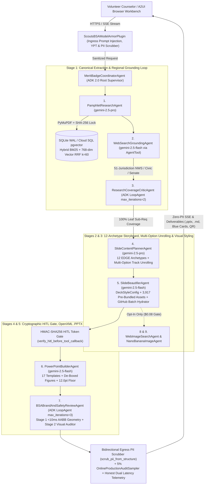
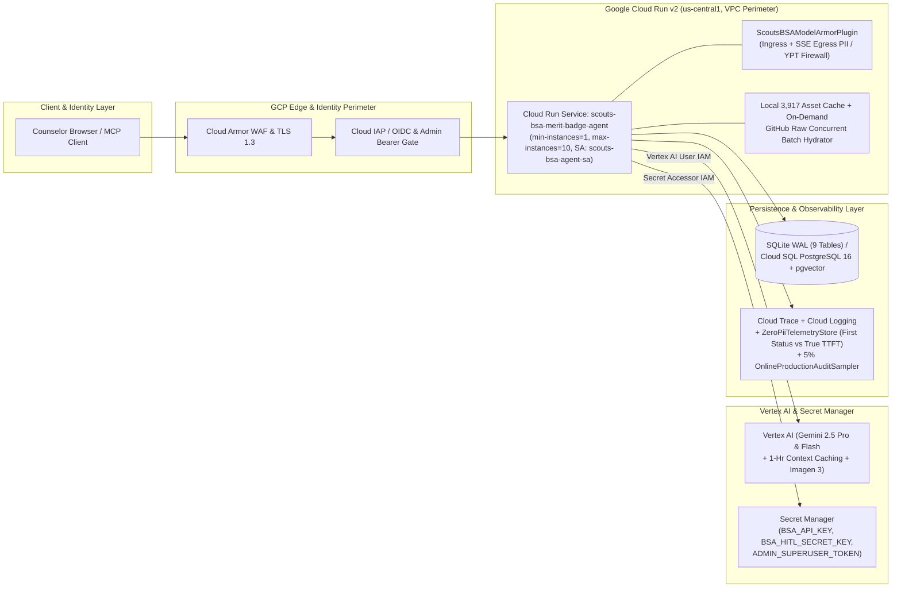

# System Architecture & GCP Security Topology (`docs/ARCHITECTURE.md`)

> **Full Technical Design Reference**: For the complete 1,100-line specification including sequence diagrams, Pydantic v2 data contracts, OpenAPI 3.1 endpoints (`123` paths), and 22-capability Model Context Protocol (MCP) tools, see [`docs/TDD.md`](TDD.md) and [`ARCHITECTURE_DECISIONS.md`](../ARCHITECTURE_DECISIONS.md).

---

## 1. Logical Multi-Agent Orchestration & Data Flow Diagram (Google ADK Pipeline)

The logical architecture separates **LLM curriculum reasoning** (`PamphletResearchAgent`, `WebSearchGroundingAgent`, `SlideContentPlannerAgent`, `SlideBeautifierAgent`) from **deterministic geometry, cryptographic verification, and retrieval tools** (`PersistentSessionStore` Hybrid Okapi BM25 + 768-dim Cosine Vector RRF `k=60`, `compute_canonical_pamphlet_hash()`, `verify_hitl_before_tool_callback()`, and `<10ms` AABB `check_pptx_conformance()`).

---

## 2. Physical GCP Infrastructure, IAM & Security Perimeter Diagram

The physical architecture runs on **Google Cloud Run v2** (`terraform/main.tf`, `min_instance_count = 1`, `max_instance_count = 10`, dedicated least-privilege service account `scouts-bsa-agent-sa`) behind **Cloud Armor WAF** and **Cloud IAP / OIDC** authentication, with secrets injected from **Google Cloud Secret Manager** and bidirectional **Google Cloud Model Armor + Cloud DLP / Regex PII scrubbing**.

---

## 3. Core Architectural Invariants & As-Built Verification

| Architectural Layer | Production Implementation in Repository | Verification Test / Script |
| :--- | :--- | :--- |
| **Multi-Agent Orchestration** | 9-Component / 7-Agent Google ADK hierarchy (`MeritBadgeCoordinatorAgent`, `SequentialAgent`, 2 bounded `LoopAgent` critics, `AgentTool` search isolation) | `src/agents/coordinator.py`, `tests/test_conformance_and_a2ui.py` |
| **Hybrid Retrieval & Grounding** | Okapi BM25 (`0.55`) + 768-dim Cosine Vector (`0.45`) fused via Reciprocal Rank Fusion (`k=60`, `Recall@3 = 1.0000`, `MRR = 1.0000` in `1.8ms`) + cryptographic SHA-256 requirement lock | `src/memory/session_store.py`, `scripts/run_eval.py` |
| **Security, YPT & Privacy** | Bidirectional `ScoutsBSAModelArmorPlugin` (ingress prompt + tool + response + outbound SSE egress scrubbing via `scrub_pii_from_structure()`), HMAC-SHA256 HITL gate, dedicated least-privilege IAM SA | `src/agents/guardrails.py`, `terraform/main.tf` |
| **Resilience & Observability** | 3-state circuit breaker (`CLOSED -> OPEN -> HALF_OPEN`), exponential backoff with jitter, `/health` and `/readiness` probes, Honest Dual Latency (`first_status_event_ms` vs. `true_first_content_token_ms`), 5% `OnlineProductionAuditSampler` | `src/observability/telemetry.py`, `src/observability/online_audit_sampler.py` |
| **FinOps & Asset Hydration** | `3,917` pre-bundled visual assets (`$0.00` runtime image cost, `$0.184` cold deck, `$192.50/mo` 500-counselor Council TCO), `$1.00` `FinOpsBudgetPlugin` hard cap, plus per-badge concurrent GitHub Raw batch asset hydrator for lightweight bundle checkouts | `scripts/cost_model.py`, `src/tools/asset_hydrator.py` |
