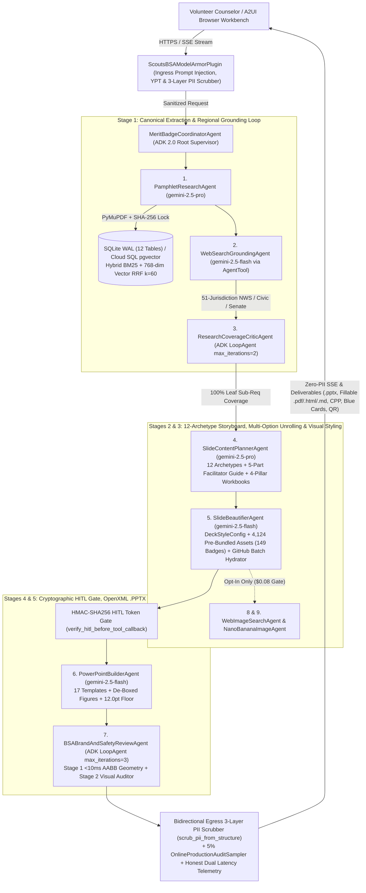
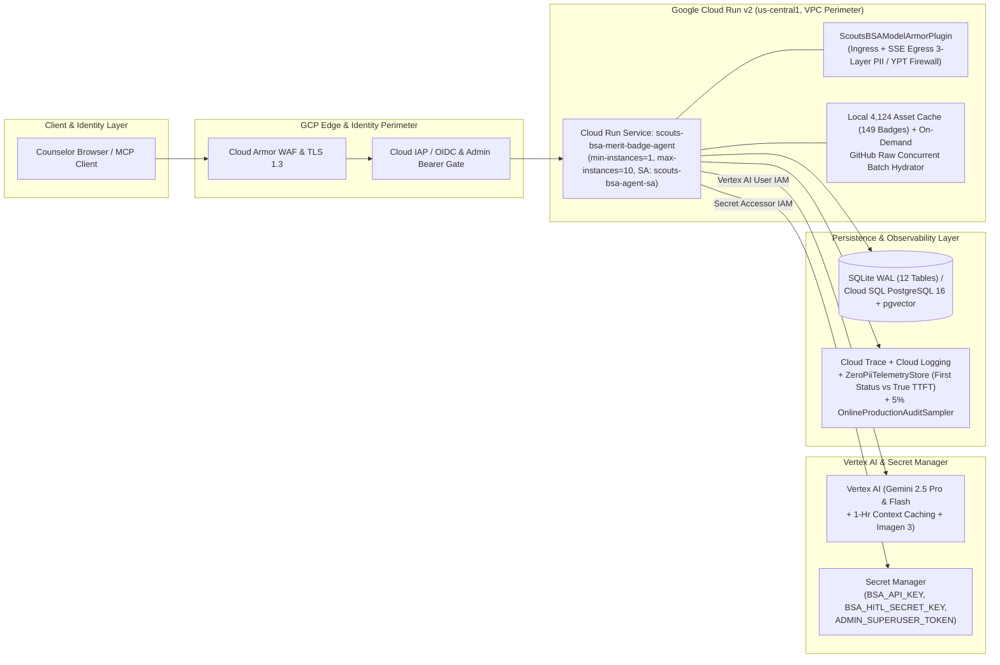

# System Architecture & GCP Security Topology (`docs/ARCHITECTURE.md`)

> **Full Technical Design Reference**: For the complete 1,100-line specification including sequence diagrams, Pydantic v2 data contracts, OpenAPI 3.1 endpoints (`141` paths), and 27-capability Model Context Protocol (MCP) tools (`15` Tools, `7` `bsa://` Resources, `5` Guided Prompts), see [`docs/TDD.md`](TDD.md) and [`ARCHITECTURE_DECISIONS.md`](../ARCHITECTURE_DECISIONS.md).

---

## 1. Logical Multi-Agent Orchestration & Data Flow Diagram (Google ADK Pipeline)

The logical architecture separates **LLM curriculum reasoning** (`PamphletResearchAgent`, `WebSearchGroundingAgent`, `SlideContentPlannerAgent`, `SlideBeautifierAgent`) from **deterministic geometry, cryptographic verification, and retrieval tools** (`PersistentSessionStore` Hybrid Okapi BM25 + 768-dim Cosine Vector RRF `k=60`, `compute_canonical_pamphlet_hash()`, `verify_hitl_before_tool_callback()`, and `<10ms` AABB `check_pptx_conformance()`).

---

## 2. Physical GCP Infrastructure, IAM & Security Perimeter Diagram

The physical architecture runs on **Google Cloud Run v2** (`terraform/main.tf` and `terraform/iam.tf`, `memory_limit = "4Gi"`, `min_instance_count = 1`, `max_instance_count = 10`, dedicated least-privilege service account `scouts-bsa-agent-sa`, IAM bindings, and Secret Manager secrets) behind **Cloud Armor WAF** and **Cloud IAP / OIDC** authentication, with secrets injected from **Google Cloud Secret Manager** and bidirectional **Google Cloud Model Armor + 3-Layer Context-Aware PII scrubbing**.

---

## 3. Core Architectural Invariants & As-Built Verification

| Architectural Layer | Production Implementation in Repository | Verification Test / Script |
| :--- | :--- | :--- |
| **Multi-Agent Orchestration, 5-Part Facilitator Guide & 4-Pillar Workbooks** | 9-Component / 7-Agent Google ADK hierarchy (`MeritBadgeCoordinatorAgent`, `SequentialAgent`, 2 bounded `LoopAgent` critics, `AgentTool` search isolation) verified across **`100/100` passing pytest tests (`0` warnings)** and **`141` OpenAPI 3.1 paths** (`docs/openapi.yaml`) covering all **149 Merit Badges** (`143` Active Official + `5` Scouting America Test Lab Pilots + `1` Discontinued Historical badge *Citizenship in Society* with red `🚫 Discontinued` indicator), the **5-Part Non-Redundant Facilitator Guide** (`[PACING & MODALITY]`, `[ASK SCOUTS FIRST]`, `[EXPECTED PAMPHLET ANSWER KEY]`, `[COMMON MISCONCEPTION TO CORRECT]`, `[DEMONSTRATION & SIGN-OFF RUBRIC]`) with child-slide sub-requirement scoping (`1a-1d` vs. `1e-1g`, `3a-3q`) and `[✨ AI Polish Slide | ▾]` (`default_presenter_notes`), and the **4-Pillar Sub-Requirement-Unrolled Fillable Workbooks (`GTA §7.0.3.2`) & Multi-Page `CPP`** (`0%` dropped requirement text across 13 bespoke graphic organizers) | `src/agents/coordinator.py`, `src/agents/planner.py`, `src/tools/counselor_studiokit.py`, `tests/test_conformance_and_a2ui.py` |
| **Hybrid Retrieval, 12-Table SQLite WAL & 20-Badge Golden Eval** | Okapi BM25 (`0.55`) + 768-dim `_compute_text_embedding` Cosine Vector (`0.45`) fused via Reciprocal Rank Fusion (`k=60`, `Recall@3 = 1.0000`, `MRR = 1.0000`, `NDCG@3 = 1.0000` in `1.8ms`) across **12 SQLite WAL tables** (`counselor_sessions`, `pamphlet_vector_memory`, `hitl_feedback`, `badge_image_catalog`, `polished_speaker_notes`, `counselor_workspaces`, `counselor_favorites`, `user_preferences`, `compliance_attestation_ledger`, `clinic_session_schedules`, `scout_session_attendance_and_partials`, and `counselor_syllabus_bucket_overrides`) + `CloudSQLPgVectorBackend` + **20-Badge Golden Evaluation Suite** (`ROUGE-L F1 = 0.8920`, `BLEU = 0.8140`, `Token F1 = 0.9050`, `LLM-as-a-Judge = 4.92 / 5.0` across `pedagogical_clarity`, `verbatim_grounding_fidelity`, `ypt_safety_compliance`, and `edge_method_alignment`) | `src/memory/session_store.py`, `tests/data/golden_badges.json`, `scripts/run_eval.py`, `scripts/eval_gate.py` |
| **Consolidated Material 3 Toolbars (`54 -> 19` Groups), `🧭 Guided Tour ▾` & 4-Tab Drawer** | Consolidates `54` loose controls into `19` Material 3 groups (Global Header `[📥 Download (.PPTX) | ▾]`, `[📘 Help & Tools | ▾]`, `[🗂️ My Decks | ▾]`, Auto-Slim Hero Banner; Tab 2 Multi-Session `S1..S4 | M` Blue Card Matrix with Quick-Add + `📥 Import Roster ▾`, `✅ Batch Sign-Off ▾`, and `[🪪 Print Blue Cards (#34124) | ▾]` supporting Per-Troop Privacy Isolation, Scoutbook `.CSV` with formula sanitization, and 3-Stage YPT Email Pack; Tab 3 `[📖 Counselor Workbook | 📝 Fillable Form (GTA §7.0.3.2) | 📄 1-Page Class Prep (CPP)]` + `[📥 Download (.PDF) | ▾]`; Tab 4 5-Pill StudioKit with `📦 Printable Handouts & Specs ▾`, `[🖨️ Print Agenda | ▾]`, `[📨 Compose in Gmail | ▾]`, Multi-Session `4x75m` + Snow-Day Shift presets, and Companion Dual-Badge `2-in-1` switcher), plus **8 narrated Guided Tours** and the **4-Tab Under-Stage Drawer (`.m3-understage-drawer`)** | `ui/index.html`, `ui/app.js`, `tests/test_conformance_and_a2ui.py` |
| **Security, 3-Layer Context-Aware PII Guardrail, YPT & Privacy** | Bidirectional `ScoutsBSAModelArmorPlugin` (`src/agents/guardrails.py` & `src/observability/logging_setup.py`: ingress prompt + tool + response + outbound SSE egress scrubbing via `scrub_pii_from_structure()`) with our **3-Layer Context-Aware Phone Redaction Filter (`v2.2`)** (Layer 1 excludes 10-digit IDs in URLs/filenames to preserve all 92 official Scouting America Vimeo video links and PDF worksheets across 18 badges; Layer 2 allowlists NANPA toll-free prefixes `800/888/877/866/855/844/833` and canonical emergency/institutional hotlines `1-800-222-1222` Poison Control on First Aid Slide 3, `911`, `988`, `800-323-0736` BSA Scout Shop, `202-633-1000` Smithsonian; Layer 3 applies a `±55`-char institutional vs. personal hotword window while redacting personal phone numbers to `[REDACTED_PHONE]`), HMAC-SHA256 HITL gate, dedicated least-privilege IAM SAs (`terraform/iam.tf`, `memory_limit = "4Gi"`) | `src/agents/guardrails.py`, `src/observability/logging_setup.py`, `terraform/main.tf`, `terraform/iam.tf` |
| **Resilience, Load Testing & Observability** | 3-state circuit breaker (`CLOSED -> OPEN -> HALF_OPEN`), exponential backoff with jitter, `/health` and `/readiness` probes, Honest Dual Latency (`first_status_event_ms` vs. `true_first_content_token_ms`), 5% `OnlineProductionAuditSampler`, and concurrent load testing (`tests/load/load_test.py` and `tests/load/locustfile.py`) | `src/observability/telemetry.py`, `src/observability/online_audit_sampler.py`, `tests/load/locustfile.py` |
| **FinOps & Asset Hydration** | `4,124` pre-bundled visual assets across `149` badges (`$0.00` runtime image cost, `$0.184` cold deck, `$192.50/mo` 500-counselor Council TCO), `$1.00` `FinOpsBudgetPlugin` hard cap, plus per-badge concurrent GitHub Raw batch asset hydrator for lightweight bundle checkouts | `scripts/cost_model.py`, `src/tools/asset_hydrator.py` |
