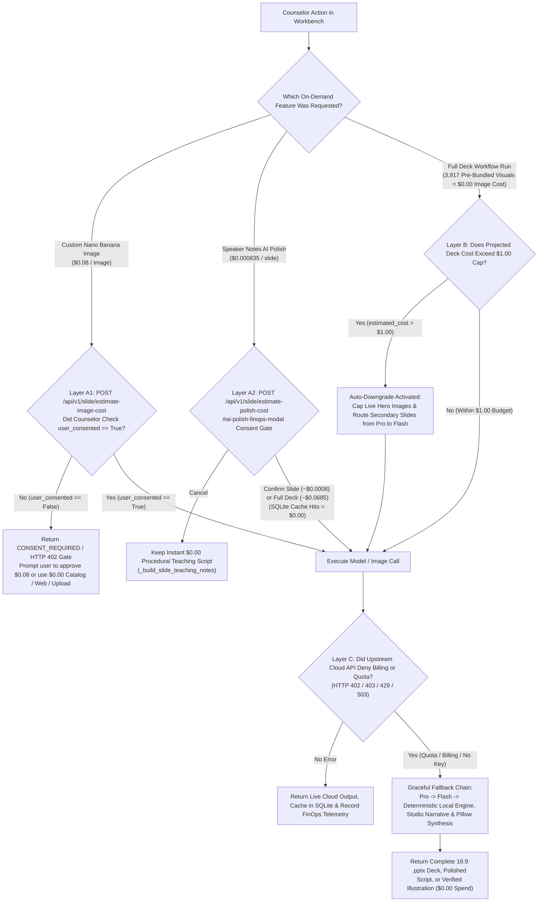

# Scouts BSA Merit Badge Counselor Workbench: FinOps, Token Billing, Deployment Modes, TCO & Cost-Denial Fallbacks (`docs/FINOPS_AND_TCO.md`)

**Author:** Eric Clayberg (Troop 19, Middleton MA)
**Repository:** `https://github.com/clayberg/scouts-bsa-merit-badge-agent`
**Code References:** `src/config.py`, `src/agents/guardrails.py`, `src/agents/coordinator.py`, `src/agents/image_studio.py`, `src/observability/online_audit_sampler.py`, `src/server.py`, `scripts/cost_model.py`, `terraform/main.tf`, `terraform/iam.tf`

> **Purpose of this guide:** The Scouts BSA Merit Badge Counselor Workbench displays token counts and dollar budgets in the UI for slide deck generation, on-demand **Nano Banana AI** custom illustrations (`$0.08/image`), and **AI Polish Speaker Notes** (`$0.000835/slide` via `gemini-2.5-flash` with `thinking_budget=0`). Run `.venv/bin/python3 scripts/cost_model.py` to reproduce all financial tables below programmatically. This document explains how the **Unified Pre-Bundled Visual Architecture** delivers all 3,917 curated visual assets across all 144 Merit Badges at `$0.00` runtime image cost, how per-deck unit economics and per-agent token budgets break down across our 9 ADK components, how a volunteer counselor pays or avoids paying when running the app locally, how billing works when a Council or Troop hosts the app on Google Cloud Run, and how the app recovers whenever a cost is denied or an API quota limit is reached.

## Executive summary: who pays for what across environments

The table below summarizes how model tokens, pre-bundled visuals, on-demand AI calls, and credentials work across the three ways this application runs.

| Environment | Who pays the cloud bill | Credentials required | Actual cost in default setup | What happens if billing fails or no key is present |
| :--- | :--- | :--- | :--- | :--- |
| **1. Current development environment** | Nobody (`$0.00` actual cloud spend) | None required (`GEMINI_API_KEY` unset by default) | **$0.00 USD** (UI displays FinOps shadow-ledger estimates for telemetry testing) | Runs the local deterministic curriculum engine, local `python-pptx` Warm Cream theme, 3,917 pre-bundled visual assets, Studio Narrative Synthesizer, Wikimedia Commons API, and Pillow illustration filters |
| **2A. Local install (Free / Offline mode)** | Nobody (`$0.00` actual cloud spend) | None required | **$0.00 USD** | Works out of the box with zero cloud account or credit card required |
| **2B. Local install (Bring-Your-Own-Key)** | The individual counselor's Google AI Studio or GCP account | Personal `GEMINI_API_KEY` in local `.env` file | **$0.00** on Google AI Studio Free Tier, or **`~$0.184/deck`** actual cold LLM spend (`$0.00` image spend) on Pay-As-You-Go | Automatically falls back from `gemini-2.5-pro` to `gemini-2.5-flash` to the local deterministic engine so deck generation never crashes |
| **3. GCP Cloud Run deployment** | The host Council, District, or Troop GCP Project's Cloud Billing Account | IAM Service Account (`scouts-bsa-agent-sa`) + Secret Manager (`USE_GCP_SECRET_MANAGER=true`) | **`~$0.184/deck`** actual cold LLM spend (capped at **$1.00 max** per deck + Cloud Armor rate limit) | Enforces a `$1.00/deck` pre-flight budget cap, requires explicit consent for `$0.08` AI images (`Layer A1`) and `$0.000835/slide` speaker-note polish (`Layer A2`), and falls back to local synthesis on `HTTP 429/503` |

### Per-deck unit economics across 4 operating modes (`scripts/cost_model.py`)

| Operating Mode | Gemini 2.5 Pro + Flash Input/Output Tokens | Runtime Image Generation Spend | Total Cost Per Deck | Typical Latency |
| :--- | :--- | :--- | :--- | :--- |
| **1. Golden Demo Cache (`First Aid`, `Camping`, `Weather`)** | `0` live tokens (pre-verified SQLite / disk cache) | `$0.000` (pre-bundled assets) | **`$0.000`** | `< 1.5s` |
| **2. Warm Cache Re-Generation (Template / Style Switch)** | `~18,000` cached tokens (`76%` hit rate on `gemini-2.5-flash`) | `$0.000` (pre-bundled assets) | **`$0.006`** | `3 to 6s` |
| **3. Cold Default Build (`WARM_CREAM` / `CRISP_WHITE`, Any of 144 Badges)** | `~112,000` input / `~14,500` output tokens across 7 ADK agents | `$0.000` (`3,917` pre-bundled PNGs + GitHub Raw hydrator) | **`$0.184`** (`$0.38` uncached ceiling) | `45 to 75s` |
| **4. Opt-In AI Image Studio (`DARK_SLATE` / Custom Slide Regeneration)** | Cold default build + `6 to 8` opt-in Nano Banana / Imagen 3 calls | `$0.480 to $0.520` (`$0.08` explicit counselor HITL gate) | **`$0.704`** (`<= $1.00` hard cap via `FinOpsBudgetPlugin`) | `65 to 95s` |

### Per-agent model routing and token cost breakdown (Cold Default Deck = `$0.184`)

| ADK Component / Agent | Assigned Model (`config/models.yaml`) | Why This Model Was Selected | Avg Tokens (In / Out) | Cost Contribution |
| :--- | :--- | :--- | :--- | :--- |
| **1. `PamphletResearchAgent`** | `gemini-2.5-pro` | High-precision extraction of multi-level requirement trees (`2a(5)(a)`) and SHA-256 baseline locking | `24K in / 3.2K out` | `$0.052` |
| **2. `WebSearchGroundingAgent`** | `gemini-2.5-flash` (`AgentTool`) | Fast regional NWS weather, state agency, and U.S. Senate synthesis | `16K in / 2.0K out` | `$0.008` |
| **3. `ResearchCoverageCriticAgent`** | `gemini-2.5-flash` (`LoopAgent`) | Deterministic leaf sub-requirement completeness verification | `10K in / 0.8K out` | `$0.004` |
| **4. `SlideContentPlannerAgent`** | `gemini-2.5-pro` | 12-archetype pedagogical storyboarding, multi-option unrolling, and Socratic script synthesis | `34K in / 6.5K out` | `$0.104` |
| **5. `SlideBeautifierAgent`** | `gemini-2.5-flash` | Mapping `DeckStyleConfig` palettes and matching `3,917` pre-bundled visual assets (`$0.00` image spend) | `14K in / 1.2K out` | `$0.006` |
| **6. `PowerPointBuilderAgent`** | `gemini-2.5-flash` | Deterministic `python-pptx` OpenXML compilation and font auto-fitting (`12.0pt` floor) | `8K in / 0.4K out` | `$0.005` |
| **7. `BSABrandAndSafetyReviewAgent`** | `gemini-2.5-flash` (`LoopAgent`) | Stage 1 `<10ms` AABB geometry QA (`$0.00`) + Stage 2 visual layout & safety verification | `6K in / 0.4K out` | `$0.005` |
| **8 & 9. `WebImageSearchAgent` / `NanoBananaImageAgent`** | `gemini-2.5-flash` / `gemini-2.5-flash-image` | On-demand Image Studio only (gated behind explicit `$0.08` counselor confirmation) | `Opt-in only` | `$0.000` default |

## 1. Unified pre-bundled visual architecture and `$0.00` development spend

When you run the workbench in the development workspace today, **actual cloud billing is `$0.00`**, and standard deck generation incurs **`$0.00` in runtime image generation charges** in every environment.

The workbench uses a **Dual-Path Hybrid Architecture** controlled by `src/config.py`:

```python
class AppConfig(BaseSettings):
    gemini_api_key: Optional[str] = Field(default=None, alias="GEMINI_API_KEY")
    use_gcp_secret_manager: bool = Field(default=False, alias="USE_GCP_SECRET_MANAGER")
    gcp_project_id: Optional[str] = Field(default=None, alias="GCP_PROJECT_ID")
    finops_max_cost_per_deck_usd: float = Field(default=1.00)
```

During development, neither `GEMINI_API_KEY` nor `USE_GCP_SECRET_MANAGER=true` is active in `.env`. Because no cloud billing credential is attached, the workbench runs its local execution path while exercising the **FinOps Cost & Token Ledger** (`estimate_workflow_finops_cost` in `src/agents/guardrails.py`):

* **Unified Warm Cream visual theme (`BEAUTIFIED` default) and 3,917 pre-bundled visual assets at `$0.00` runtime image cost**: The Counselor Setup Sidebar simplifies deck creation by using the **Warm Cream (`#FAF8F5`)** editorial theme with pre-populated **Pamphlet + AI Visuals** (`BEAUTIFIED`) as the unified default, while keeping the `beautification_tier` API parameter (`STANDARD`, `BEAUTIFIED`, `STUDIO`) backward-compatible for programmatic callers. All slide rendering runs locally via `python-pptx`, `matplotlib`, and `Pillow` inside `src/tools/pptx_builder.py` and `src/agents/beautifier.py`. Every deck attaches pre-populated visuals from the **3,917 built-in curated visual assets** bundled in the repository across **all 144 Merit Badges**:
  * **1,306 compressed 8-bit PNG Nano Banana illustrations (`~229 MB`)** in `assets/ai_illustrations/` (`1,123` requirement hero visuals `*_nano_hero.png`, `152` gap-filling topic visuals `*_topic_visual.png`, and `31` bespoke scientific diagrams).
  * **2,323 100%-Vision-verified BSA Pamphlet figures (`~197 MB`: `1,009` primary active + `1,314` requirement alternates)** in `assets/pamphlet_images/`.
  * **144 official Merit Badge emblems** in `assets/badge_emblems/` and **144 official Pamphlet covers** in `assets/pamphlet_covers/`.
  * All 3,917 assets are indexed across `assets/badge_image_catalog/<slug>/catalog.json` and SQLite (`badge_image_catalog`), so attaching illustrations during deck builds costs **`$0.00`** in runtime image synthesis and completes in `1.5-3.5s`.
* **On-demand Nano Banana AI Image Studio (`src/agents/image_studio.py`)**: When a counselor wants a brand-new custom graphic for a specific slide, they can open the Image Studio and choose from **10 UI visual style options** (plus 4 legacy style aliases), defaulting to **`✨ Auto (Content-Aware Mix)`**, which matches the slide's requirement text to the best style (`Photorealistic Image`, `4-Quadrant Concept Map`, `Line Drawing`, `Watercolor Field Sketch`, `Technical Diagram`, `3D Isometric Illustration`, `Editorial Vector Illustration`, `Cartoon Drawing`, or `Vintage Merit Badge Poster`) and sets whether to **Include Uniformed Scouts** (`include_humans=True` for active field/patrol skills in Class A uniform vs. `include_humans=False` for gear knolling, anatomy/kits, weather fronts, and astronomy charts). In offline/development mode without a live API key, `generate_nano_banana_slide_image()` expands the prompt, queries the free **Wikimedia Commons REST API**, applies a **Pillow (`PIL`) artistic filter pipeline**, and runs the post-generation **Prompt Alignment Verifier** (`verify_generated_image_matches_prompt`).
* **On-demand Speaker Notes AI Polish (`POST /api/v1/slide/estimate-polish-cost`, `/polish-notes`, `/polish-notes-batch`)**: Baseline `[SAY]` / `[DEMONSTRATE]` / `[ASK SCOUTS]` speaker scripts are compiled deterministically in `<5ms` at **`$0.00`** by `_build_slide_teaching_notes()` (`src/agents/planner.py`). When a counselor clicks **`✨ AI Polish Slide`** or **`✨ Polish Entire Deck`**, the workbench opens the **AI Polish FinOps Modal (`#ai-polish-finops-modal`)**, which queries `POST /api/v1/slide/estimate-polish-cost` to display the exact `gemini-2.5-flash` (`thinking_budget=0`) token and USD cost (`$0.000835/slide`: `~450` input tokens at `$0.30/1M` + `~280` output tokens at `$2.50/1M`, or `$0.00` for slides already cached in the SQLite `polished_speaker_notes` table). If no cloud key is present, it falls back to the deterministic Studio Narrative Synthesizer (`_synthesize_studio_narrative_script()`) at `$0.00`.
* **Why the UI displays shadow-ledger dollar numbers**: Even when running locally at `$0.00` actual spend, the FinOps ledger calculates and displays both the actual LLM token cost (`~$0.184` cold deck build) and the uncached shadow-ledger ceiling (`$0.38` for `BEAUTIFIED`, `$1.00` cap for `STUDIO`) so budget caps, model routing, and consent modals can be verified before deploying to a live billing account.

## 2. What happens when a user installs the app locally

If another Merit Badge Counselor or Scoutmaster clones the repository from GitHub (`git clone https://github.com/clayberg/scouts-bsa-merit-badge-agent.git`) and runs it on their laptop, they have two options.

### Option A: Zero-cost local mode (no API key, no credit card)

If the user installs the Python dependencies and starts the app (`./run_local.sh`) without modifying `.env`:

1. `get_effective_gemini_api_key()` in `src/config.py` returns `None`.
2. The app runs in **Deterministic Hybrid Mode** at **$0.00 cost**.
3. The user gets full access to all 144 Scouts BSA Merit Badges, the unified Warm Cream (`#FAF8F5`) slide theme (plus backward-compatible `STANDARD` Crisp White and `STUDIO` Dark Slate API tiers), all **3,917 built-in curated visual assets** across all 144 badges (`1,306` pre-populated Nano Banana illustrations + `2,323` Vision-verified BSA Pamphlet figures [`1,009` primary + `1,314` requirement alternates] + `144` emblems + `144` covers, with automatic EDGE Skill Concept Map fallbacks and on-demand per-badge GitHub Raw batch hydration via `src/tools/asset_hydrator.py` if cloned from a lightweight `< 30 MB` bundle), the on-stage **Easy Slide Image Switcher** (`◀` / `(1/3) ▾` / `▶`), local ZIP/city grounding for National Weather Service offices and state U.S. Senators, live Wikimedia Commons image search, local file uploads, and deterministic Studio Narrative speaker-note polishing.

### Option B: Bring-Your-Own-Key (BYOK) mode

If the local user wants live Gemini LLM synthesis (for example, live `gemini-2.5-flash` speaker-note polishing or live cloud `gemini-2.5-flash-image` / Imagen 3 custom slide illustrations), they provide their own API key or Vertex AI Application Default Credentials:

1. They sign in to **Google AI Studio** (`https://aistudio.google.com`) or configure a personal Google Cloud project (`gcloud auth application-default login`).
2. They copy `.env.example` to `.env` and set their key or project:

```bash
GEMINI_API_KEY=AIzaSyYourPersonalGeminiKeyHere
```

3. **How they pay**:
   * **Google AI Studio Free Tier**: Google provides a rate-limited free tier for Gemini API keys (`gemini-2.5-flash` and `gemini-2.5-pro`). For a counselor generating a couple of decks or polishing speaker notes on a weekend, this costs `$0.00`.
   * **Pay-As-You-Go Billing**: When linked to a Google Cloud Billing account, a complete cold Merit Badge deck costs roughly **`~$0.184`** in actual LLM tokens (`$0.00` runtime image spend because all 3,917 visual assets are pre-bundled on disk; uncached shadow ceiling `$0.38`), polishing a single slide's speaker notes with `gemini-2.5-flash` (`thinking_budget=0`) costs **`$0.000835`** (`~$0.0685` for an entire 82-slide Deep Dive deck, and **`$0.00`** on subsequent SQLite cache hits), and generating a brand-new custom Nano Banana image costs **`$0.08`**.

## 3. How billing works in a GCP project (Cloud Run)

When a Scouts BSA Council, District, or Troop deploys the workbench as a shared web application on **Google Cloud Run** using the included Terraform configuration (`terraform/main.tf`), individual counselors do not need their own API keys or Google Cloud accounts.

### Centralized billing on the host GCP project

In a Cloud Run deployment, all costs are paid by the **Cloud Billing Account attached to the host GCP Project**:

1. **Cloud Run compute and storage**: Billed to the host GCP Project based on container CPU/memory seconds while requests are active (scaling down to `min_instance_count = 0` in low-traffic environments so there is no idle server charge).
2. **Vertex AI / Gemini token and image usage**: Billed to the same host GCP Project whenever counselors generate decks, polish speaker notes, or request custom AI images.

### How credentials work in Cloud Run (`terraform/main.tf`, `terraform/iam.tf` + `src/config.py`)

Instead of storing an API key in a plain-text `.env` file, the Cloud Run service (`scouts-bsa-workbench` in `terraform/main.tf` and `terraform/iam.tf`, configured with `memory_limit = "4Gi"`) uses two Google Cloud security mechanisms:

* **Dedicated IAM Service Account (`scouts-bsa-agent-sa`)**: `terraform/iam.tf` provisions least-privilege service accounts and grants `roles/aiplatform.user` (allowing Vertex AI calls via Application Default Credentials) and `roles/secretmanager.secretAccessor`.
* **Google Cloud Secret Manager (`USE_GCP_SECRET_MANAGER=true`)**: When the container starts on Cloud Run, `AppConfig.get_effective_gemini_api_key()` in `src/config.py` fetches the API key directly from `projects/<PROJECT_ID>/secrets/scouts-bsa-gemini-api-key/versions/latest` in memory.

### Protecting the shared Council/Troop wallet and monitoring Zero-PII FinOps telemetry

Because any counselor visiting the Cloud Run URL spends from the host project's shared billing account, the deployment includes financial guardrails and an administrative telemetry dashboard:

* **Cloud Armor rate limiting (`terraform/main.tf`)**: A Google Cloud Armor security policy (`scouts-bsa-model-armor-edge-policy`) throttles any single IP address exceeding **120 requests per minute** with an automatic `HTTP 429` response and a 5-minute ban (`300s`).
* **Per-deck FinOps budget cap (`$1.00 USD`)**: Even if a user requests the largest badge in the catalog in `STUDIO` mode, `FinOpsBudgetPlugin` caps per-deck spend at `$1.00 USD`.
* **Super-User Admin Console Zero-PII FinOps, Honest Dual Latency, Online Production Trace Audit Sampling & Swap Telemetry ([`docs/ADMIN_GUIDE.md`](ADMIN_GUIDE.md))**: Council administrators can open **Tab 2 (`Zero-PII Usage, Latency & Image-Swap Telemetry`)** of the Super-User Admin Console (`GET /api/v1/admin/telemetry/summary` and `GET /api/v1/admin/telemetry/online-audit-samples`, backed by `ZeroPiiTelemetryStore` in `src/observability/telemetry_store.py` and `OnlineProductionAuditSampler` in `src/observability/online_audit_sampler.py` with recursive `scrub_pii_dict()` and SSE egress `scrub_pii_from_structure()` enforcement) to monitor total decks generated, cache hit rate (`%`), average FinOps spend per deck (`$ USD`), Honest Dual Latency (`first_status_event_ms` vs. `true_first_content_token_ms`), deterministic 5% (`0.05`) online production trace quality audits, and the **Easy Slide Image Switcher Swap Leaderboard** without storing any counselor or Scout PII.

### Three-tier monthly TCO projection (`scripts/cost_model.py`: Single Troop, Council, and National Scale)

You can execute `python3 scripts/cost_model.py` (or `python3 scripts/cost_model.py --json`) to compute the combined variable Vertex AI token spend and fixed GCP infrastructure charges across three deployment scales:

| Deployment Tier | Monthly Volume | Cold vs. Warm Builds | Variable Vertex AI Token Spend (`USD/mo`) | Fixed GCP Platform Spend (`USD/mo`) | Total Actual Monthly TCO (`USD/mo`) | Effective Cost per Deck |
| :--- | :--- | :--- | :--- | :--- | :--- | :--- |
| **Tier 1: Single Troop (`min_instances = 0` scale-to-zero)** | `50 decks/mo` (`~15` counselors) | `35 cold` (`$0.184`) + `15 warm` (`$0.030`) | `$6.89 / mo` | `$1.02 / mo` (scale-to-zero Cloud Run v2 + storage) | **`~$7.91 / month`** | **`~$0.16 / deck`** |
| **Tier 2: 500-Counselor Council (`min_instances = 1` warm)** | `1,500 decks/mo` (`500` counselors) | `450 cold` (`$0.184`) + `1,050 warm` (`$0.030`) | `$87.48 to $112.50 / mo` (`$202.50` uncached ceiling) | `$80.00 to $105.02 / mo` (`~$68.40` Cloud Run v2 `2 vCPU / 4 GiB` + Storage/Secret Manager/Trace) | **`$192.50 / month`** (`$282.50/mo` uncached ceiling) | **`$0.128 / deck`** (98% less than 500 `$30/mo` SaaS seats) |
| **Tier 3: National Scale (`85%` global semantic/deck cache hit rate)** | `100,000 decks/mo` (national merit badge clinics) | `15,000 cold` (`$0.184`) + `85,000 warm` (`$0.020`) | `$4,460.00 / mo` | `$940.00 / mo` (autoscaled Cloud Run v2 + Cloud Armor + CDN/GCS + Trace) | **`$5,400.00 / month`** | **`$0.054 / deck`** |

## 4. Cost-denial layers, explicit FinOps consent gates, and graceful fallbacks

The workbench enforces **four distinct financial and quota protection layers** (`Layer A1`, `Layer A2`, `Layer B`, and `Layer C`). Each layer prompts the counselor with exact token/dollar estimates before spending or downgrades gracefully so the counselor never loses their slide deck.



### Layer A1: Custom Nano Banana Image FinOps Consent Gate (`$0.08/image`, `CONSENT_REQUIRED` / `HTTP 402`)

While all 144 Merit Badges ship with 3,917 built-in curated visuals at `$0.00`, generating a brand-new custom AI illustration on demand via **Nano Banana (`NanoBananaImageAgent`)** carries an estimated FinOps budget of **`$0.08 USD` per image** (`$0.05` image synthesis + `$0.03` prompt expansion and post-generation visual alignment verification, ~`2,580` tokens via `POST /api/v1/slide/estimate-image-cost`).

If the backend receives a request to generate a Nano Banana image where `user_consented=False`:

* `generate_nano_banana_slide_image()` in `src/agents/image_studio.py` halts before calling any paid API and returns:

```python
{
    "status": "CONSENT_REQUIRED",
    "requires_user_consent": True,
    "estimated_cost_usd": 0.08,
    "message": (
        "FinOps Consent Required: Generating 1 custom AI image via NanoBananaImageAgent "
        "in 'Auto (Content-Aware Mix)' style will incur an estimated cost of $0.080 USD. "
        "Please confirm user consent (`user_consented=True`) or use the free Badge Image Catalog, "
        "WebImageSearchAgent, or File Upload ($0.00)."
    ),
}
```

* In the Material 3 Counselor Workbench (`:8080`), the `"🍌 Generate & Apply Nano Banana Image"` button requires the counselor to check `"✅ I approve the estimated $0.08 USD FinOps cost"`.

### Layer A2: Speaker Notes AI Polish FinOps Consent Gate (`$0.000835/slide`, `#ai-polish-finops-modal`)

Every slide in a generated deck immediately receives a complete `[SAY]` / `[DEMONSTRATE]` / `[ASK SCOUTS]` conversational teaching script compiled in `<5ms` at **`$0.00`** by `_build_slide_teaching_notes()` (`src/agents/planner.py`). When a counselor clicks **`✨ AI Polish Slide`** or **`✨ Polish Entire Deck`** in Sub-Tab 1 (`🎙️ Counselor Teaching Notes`) or inside the Split-Screen Presenter Console (`P`), the workbench opens the **AI Polish FinOps Modal (`#ai-polish-finops-modal`)** backed by `POST /api/v1/slide/estimate-polish-cost`:

* **Model and token pricing (`gemini-2.5-flash` with `thinking_budget=0`)**: Uses `$0.30 / 1M` input tokens and `$2.50 / 1M` output tokens. An average slide uses `~450` input tokens (`$0.000135`) and `~280` output tokens (`$0.000700`), totaling **`$0.000835 / slide`** (`~$0.0008` for a single slide, or `~$0.0685` for an uncached 82-slide Deep Dive deck).
* **SQLite cache-aware accounting (`polished_speaker_notes`)**: `POST /api/v1/slide/estimate-polish-cost` hashes each slide's content (`gemini_flash_v4` SHA-256 digest over badge, requirement number, title, archetype, bullets, visual caption, and audience level) and checks the SQLite `polished_speaker_notes` cache. Cached slides cost **`$0.00`** and return in `<10ms`, and the modal displays the exact count of `cached_slides_count` vs. `uncached_slides_count` before the counselor confirms.
* **Zero-cost manual text editing**: For manual edits (fixing a typo, customizing a title, or editing speaker notes by hand), counselors can use **Sub-Tab 3 (`✏️ Quick Edit Slide Text`, `$0.00 USD`)**, which updates the slide and rebuilds the `.pptx` in under 1 second without invoking any LLM.

### Layer B: Pre-flight deck budget cap (`$1.00 USD` auto-downgrade)

Before generating a slide deck, `estimate_workflow_finops_cost()` in `src/agents/guardrails.py` calculates the projected token and image cost across all requirements for the chosen badge.

If a counselor requests a large badge in `STUDIO` mode and the projected uncached cost exceeds `max_budget_usd` (`$1.00 USD`):

1. The app **does not fail or reject the deck**.
2. Instead, it sets `auto_downgraded = True` and `within_budget = True`.
3. It caps live uncached AI hero concept maps at **4 images max** (`max_ai_hero_images = 4`).
4. It routes secondary requirement slides from `gemini-2.5-pro` down to `gemini-2.5-flash` (roughly 16x lower per-token cost), clamping the total deck cost below `$1.00`.
5. The UI displays a yellow status pill (`"⚠️ Auto-Downgraded to Fit $1.00 Cap"`) in the FinOps Cost & Token Budget table so the counselor can see why model routing adjusted.

### Layer C: Upstream cloud billing or rate-limit denial (`HTTP 402 / 403 / 429 / 503`)

In a cloud deployment, an upstream Google Cloud API call can fail for financial or quota reasons:

* **`429 RESOURCE_EXHAUSTED`**: The user exceeded the Google AI Studio Free Tier rate limit or a project quota limit.
* **`403 PERMISSION_DENIED` / `Billing Not Enabled`**: The GCP project's Cloud Billing account was closed, a credit card expired, or an invalid `GEMINI_API_KEY` was entered.
* **`503 UNAVAILABLE`**: Transient model endpoint overload.

When any of these errors occur, the workbench executes a **three-step fallback chain** (`execute_resilient_storybook_pipeline` in `src/agents/coordinator.py`):

1. **Step 1 (Primary model with backoff)**: Attempts `gemini-2.5-pro` with up to 3 exponential-backoff retries (`0.05s`, `0.10s`, `0.20s`).
2. **Step 2 (Secondary model downgrade)**: If `gemini-2.5-pro` is denied or rate-limited, the coordinator logs a `MODEL_FALLBACK_TRIGGERED` event and retries on `gemini-2.5-flash`.
3. **Step 3 (Deterministic local engine)**: If `gemini-2.5-flash` also fails (for example, because billing is disabled across the GCP project or the laptop is offline at Scout camp), the coordinator falls back to `deterministic-local-curriculum-engine`. The counselor still receives a complete, requirement-verified `.pptx` slide deck, lesson plan, and parent welcome letter.

Similarly, if cloud `gemini-2.5-flash` is unavailable during `POST /api/v1/slide/polish-notes`, `_polish_single_slide_notes_core()` falls back to `_synthesize_studio_narrative_script()` (`PROCEDURAL_STUDIO_POLISH` at `$0.00`), and if cloud image synthesis fails inside `NanoBananaImageAgent`, `_synthesize_wikimedia_styled_image()` fetches a Wikimedia Commons reference photo and applies the requested artistic filter locally.

## 5. Merit Badge Image Studio and speaker-note customization options compared

The table below compares the four visual sourcing tabs in the **Merit Badge Image Catalog & AI Image Studio** modal alongside the speaker-note editing and live FinOps trace options in the **4-Tab Under-Stage Drawer (`.m3-understage-drawer`)**:

| Workbench feature | Source / engine tag | Cost | How it works | Preserved when clearing Web/AI cache? |
| :--- | :--- | :--- | :--- | :--- |
| **🗂️ Image Studio Tab 1: Badge Image Catalog & Easy Slide Image Switcher** | `OFFICIAL_PAMPHLET_FIGURE` + `NANO_BANANA_HERO` + cached items | **$0.00 USD** | Displays all **2,323 100%-Vision-verified BSA Pamphlet figures (`1,009` primary + `1,314` requirement alternates)**, the **1,306 verified Nano Banana illustrations across all 144 badges** (`*_nano_hero.png`, `*_topic_visual.png`), and previously saved images for the active badge (`3,917` total built-in visual assets including `144` emblems and `144` covers). Directly on the 16:9 slide stage, the **Easy Slide Image Switcher** (`◀` / `(1/3) ▾` / `▶` pill and thumbnail/caption popover) lets counselors cycle between the primary figure and up to 2 Vision-verified pamphlet alternates (`slide_image_choices`) at `$0.00` cost. Includes a **🗑️ Clear Web/AI Cache** button (`DELETE /api/v1/badge/images`). | **Yes**, both official `PAMPHLET` figures and pre-bundled `NANO_BANANA_HERO` illustrations are always preserved |
| **🌐 Image Studio Tab 2: Web Image Search Agent** | `WEB_IMAGE_SEARCH` | **$0.00 USD** | Queries the live **Wikimedia Commons API** (`POST /api/v1/slide/search-web-images`) for up to 16 real photographs or diagrams matching your search phrase. Clicking **Use & Cache Image** downloads the image into the badge catalog and applies it to the slide. | Removed when **Clear Web/AI Cache** is clicked |
| **🍌 Image Studio Tab 3: Nano Banana AI Image Generator** | `NANO_BANANA_AI` | **$0.08 USD** (Layer A1 Consent Gate) | Estimates cost via `POST /api/v1/slide/estimate-image-cost`, requires `user_consented=True`, generates a custom illustration (`POST /api/v1/slide/generate-nano-banana-image`) across **10 UI visual style options** (defaulting to **`✨ Auto (Content-Aware Mix)`**, plus an **`Include Uniformed Scouts`** checkbox), and runs `verify_generated_image_matches_prompt()`. | Removed when **Clear Web/AI Cache** is clicked |
| **📁 Image Studio Tab 4: File Upload** | `USER_UPLOAD` | **$0.00 USD** | Lets the counselor upload any local image (`PNG`, `JPG`, `JPEG`, `WEBP`, `GIF`, `<= 10 MB`) via `POST /api/v1/slide/upload-image`. Normalizes resolution (up to 1600px at 220 DPI), saves it to `assets/badge_image_catalog/<badge>/uploaded_<hash>.png`, and applies it to the slide. | **Yes**, user-uploaded local photos are preserved across cache clears |
| **🎙️ Drawer Sub-Tab 1: AI Polish Slide / Polish Entire Deck** | `GEMINI_FLASH` (or `PROCEDURAL_STUDIO_POLISH` fallback) | **`$0.000835 / slide`** (`$0.00` on SQLite cache hit; Layer A2 Consent Gate) | Opens `#ai-polish-finops-modal` (`POST /api/v1/slide/estimate-polish-cost`) showing single-slide (`~$0.0008`) vs. full-deck (`~$0.0685`) `gemini-2.5-flash` (`thinking_budget=0`) token cost, polishes `[SAY]` / `[DEMONSTRATE]` / `[ASK SCOUTS]` notes via `POST /api/v1/slide/polish-notes` or `/polish-notes-batch`, caches in SQLite `polished_speaker_notes`, and updates the `.pptx`. | **Yes**, persisted in SQLite `polished_speaker_notes` (`scouts_bsa_sessions.db`) |
| **✏️ Drawer Sub-Tab 3: Quick Edit Slide Text** | `POST /api/v1/slide/regenerate` | **$0.00 USD** | Edits slide title, visual caption, teaching card bullets, and speaker notes directly in the browser and rebuilds the `.pptx` in under 1 second with zero LLM calls. | **Yes** |
| **📊 Drawer Sub-Tab 4: Multi-Agent Workflow Trace & FinOps** | `#trace-telemetry-card` / `#workflow-trace-grid` / `#trace-finops-ledger-box` | **$0.00 USD** | Displays the 5-card Telemetry KPI strip (`First Status Event`, `True TTFT`, `SHA-256 Requirement Lock`, `0 Overlaps (<10ms)`, `Run Cost / Budget Ceiling`), the 7-Agent Google ADK Pipeline Timeline (`#workflow-trace-grid`), and the Live Run FinOps Token & Unit Economics Ledger (`#trace-finops-ledger-box`). | **Yes** |
