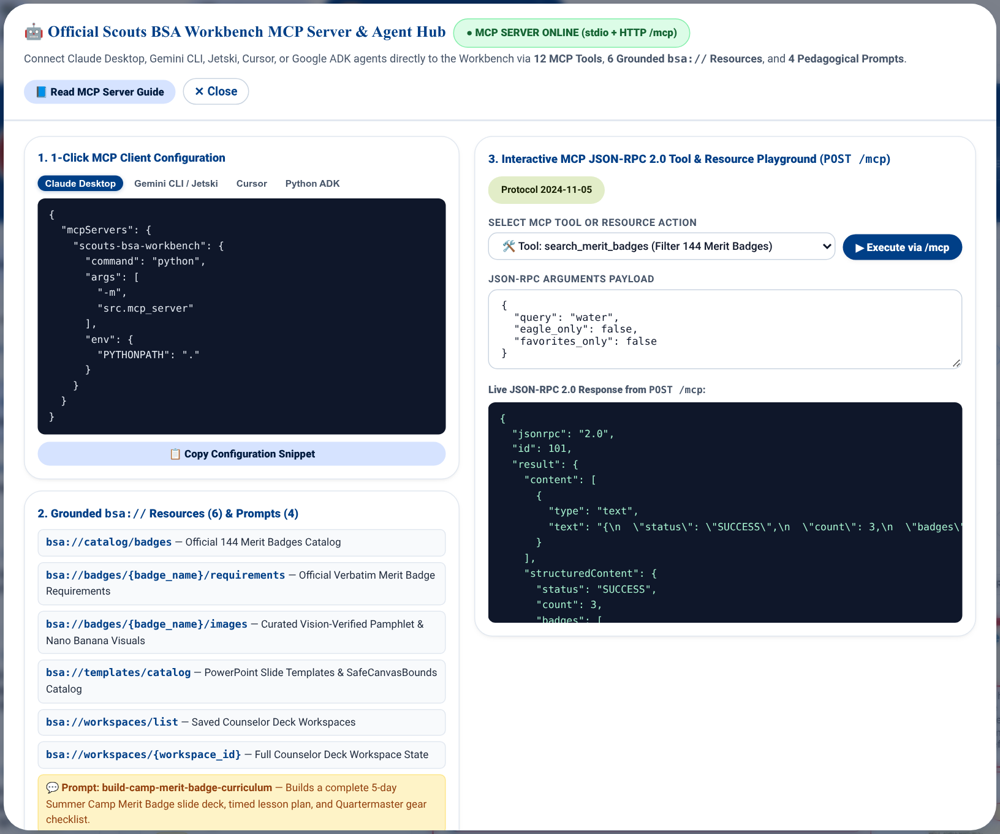
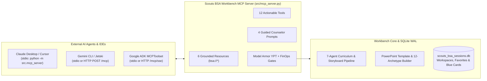

# Model Context Protocol (MCP) Server Integration Guide

This guide explains how to connect external AI coding assistants, desktop agents, and multi-agent orchestrators to the **Scouts BSA Merit Badge Counselor Workbench MCP Server** ([`src/mcp_server.py`](../src/mcp_server.py)).

The Workbench includes a built-in, dual-transport Model Context Protocol (`2024-11-05`) server (`scouts-bsa-merit-badge-workbench`) that exposes **12 MCP Tools**, **6 grounded `bsa://` MCP Resources**, and **4 guided Pedagogical Prompts** backed directly by the application's SQLite WAL database (`scouts_bsa_sessions.db`), hybrid BM25 + vector pamphlet search engine, and 12-archetype PowerPoint builder.



---

## 1. Architecture & Dual-Transport Modes

The MCP server supports two transport modes out of the box, sharing the same SQLite database (`counselor_workspaces`, `counselor_favorites`, `pamphlet_vector_memory`, `badge_image_catalog`) and asset directories:



| Transport Mode | Entrypoint / Endpoint | Best For |
| :--- | :--- | :--- |
| **1. Local `stdio` Transport** | `python -m src.mcp_server` (or `scouts-bsa-mcp` CLI script) | Claude Desktop, Gemini CLI, Jetski, Cursor, Windsurf, and local Python Google ADK `StdioServerParameters` agents. |
| **2. HTTP JSON-RPC 2.0 & SSE** | `POST /mcp`, `GET /mcp/info`, `GET /mcp/sse` (also aliased under `/api/v1/mcp*`) | Cloud Run deployments, remote agent orchestrators, browser-based testing, and the in-app **Interactive MCP Tool Playground** (`🤖 MCP Hub`). |

---

## 2. Client Setup & Configuration Snippets

You can copy pre-filled configuration snippets directly from the top-bar **`🤖 MCP Hub`** button inside the Workbench UI, or use the configurations below.

### 2.1 Claude Desktop (`claude_desktop_config.json`)

```json
{
  "mcpServers": {
    "scouts-bsa-workbench": {
      "command": "/path/to/scouts-bsa-merit-badge-agent/.venv/bin/python",
      "args": ["-m", "src.mcp_server"],
      "env": {
        "PYTHONPATH": "/path/to/scouts-bsa-merit-badge-agent"
      }
    }
  }
}
```

### 2.2 Gemini CLI / Jetski (`settings.json`)

```json
{
  "mcpServers": {
    "scouts-bsa-workbench": {
      "httpUrl": "http://localhost:8080/mcp",
      "command": "python",
      "args": ["-m", "src.mcp_server"]
    }
  }
}
```

### 2.3 Cursor (`.cursor/mcp.json`)

```json
{
  "mcpServers": {
    "scouts-bsa-workbench": {
      "url": "http://localhost:8080/mcp/sse"
    }
  }
}
```

### 2.4 Google ADK Python Agent (`MCPToolset`)

```python
from google.adk.agents import LlmAgent
from google.adk.tools.mcp_tool import MCPToolset, StdioServerParameters

bsa_mcp_toolset = MCPToolset(
    connection_params=StdioServerParameters(
        command=".venv/bin/python",
        args=["-m", "src.mcp_server"],
    )
)

counselor_assistant = LlmAgent(
    name="MeritBadgeCampAssistant",
    model="gemini-2.5-flash",
    instruction="Use the Scouts BSA Workbench MCP tools to build slide decks, apply templates, and manage Blue Card rosters.",
    tools=[bsa_mcp_toolset],
)
```

---

## 3. Grounded `bsa://` MCP Resources (6)

External agents can read structured catalog, requirement, template, and workspace state directly via `resources/read`:

| Resource URI | Name | Returned JSON Payload |
| :--- | :--- | :--- |
| `bsa://catalog/badges` | Official 144 Merit Badges Catalog | All 144 Merit Badges with `name`, `slug`, `category`, `is_eagle_required`, `is_favorite`, and `emblem_url`. |
| `bsa://badges/{badge_name}/requirements` | Official Verbatim Merit Badge Requirements | Official verbatim requirements tree and sub-requirements (`1a`, `1b`, ...) for any badge (e.g., `bsa://badges/First Aid/requirements`). |
| `bsa://badges/{badge_name}/images` | Curated Vision-Verified Pamphlet & Nano Banana Visuals | All pre-bundled Vision-verified pamphlet figures and Nano Banana illustrations for the badge. |
| `bsa://templates/catalog` | PowerPoint Slide Templates Catalog | All 8 built-in curated Scouting templates plus any custom uploaded/URL templates, including `SafeCanvasBounds` and brand palettes. |
| `bsa://workspaces/list` | Saved Counselor Deck Workspaces | Metadata list of all saved counselor deck workspaces (`workspace_id`, `workspace_title`, `badge_name`, `session_label`, `camp_bundle_tag`, `slide_count`, `scout_count`). |
| `bsa://workspaces/{workspace_id}` | Full Counselor Deck Workspace State | Complete storyboard slides, speaker notes, selected PowerPoint template, and Patrol Blue Card (`#34124`) Scout roster. |

---

## 4. Actionable MCP Tools (12)

All 12 tools can be invoked over `stdio` or via `POST /mcp` (`method: "tools/call"`):

| # | Tool Name | Purpose & Key Arguments |
| :--- | :--- | :--- |
| **1** | `search_merit_badges` | Filters the 144 official Merit Badges by `query`, `category`, `eagle_only`, or `favorites_only`. |
| **2** | `query_merit_badge_pamphlet` | Runs Hybrid Okapi BM25 + 768-dim Cosine RRF search across the official BSA Merit Badge pamphlet PDF (`badge_name`, `question`, `top_k`). |
| **3** | `create_merit_badge_slide_deck` | Builds a complete Merit Badge teaching slide deck, applies `template_id` (`scouting_america_250`, `scouting_america_forest_sunrise`, etc.) and `visual_theme` (`BEAUTIFIED`, `STANDARD`, `STUDIO`), saves a persistent workspace in `counselor_workspaces`, and returns `workspace_id` and `pptx_download_url`. |
| **4** | `get_slide_deck_workspace` | Loads a saved deck workspace (`workspace_id`), returning its full slide outline, template profile, and Patrol Blue Card (`#34124`) roster. |
| **5** | `update_slide_in_deck` | Surgically updates a slide (`workspace_id`, `slide_index`) with new `title`, `bullet_points`, `presenter_notes`, `archetype`, or `visual_caption`. |
| **6** | `polish_slide_teaching_notes` | Compiles or polishes conversational first-person `[SAY]`, `[DEMONSTRATE]`, and `[ASK SCOUTS]` counselor teaching scripts with inline stage cues (`workspace_id`, `slide_index`, `audience_level`). |
| **7** | `generate_or_select_slide_image` | Lists curated slide image choices (`action="list_choices"`), selects an alternate choice (`action="select_choice"`, `choice_index`), or generates a custom Nano Banana illustration (`action="generate_custom"`, `custom_prompt`, `include_slide_context`, `user_consented`). Enforces Model Armor YPT/safety checks and the `$0.08` FinOps consent gate. |
| **8** | `apply_powerpoint_template` | Switches a saved workspace (`workspace_id`) to any built-in or uploaded PowerPoint template (`template_id`, `visual_theme`, `accent_palette_key`) and rebuilds the `.pptx` deck using `SafeCanvasBounds`. |
| **9** | `export_slide_deck` | Exports a workspace (`workspace_id`) as a downloadable `.pptx` presentation (`export_format="pptx"`) or returns scannable ISO 18004 QR checklist links (`export_format="pocket_checklist"`). |
| **10** | `generate_class_prep_and_parent_letter` | Generates a timed counselor session agenda and Prerequisite Parent/Scoutmaster Letter (`workspace_id`, `session_mode`, `camp_or_location`). |
| **11** | `manage_patrol_blue_card_roster` | Manages Application for Merit Badge (`#34124`) Scout attendees (`action="list"`, `"add_or_update_scout"`, `"copy_roster_from_workspace"`, or `"export_scoutbook_csv"`). |
| **12** | `audit_deck_conformance` | Runs the deterministic Stage-1 AABB geometry verifier (`0` shape overlaps, `>= 12.0pt` font floor, `<= 8` paragraphs per card) on a workspace's `.pptx` deck. |

---

## 5. Guided Counselor MCP Prompts (4)

| Prompt Name | Arguments | Workflow Summary |
| :--- | :--- | :--- |
| `build-camp-merit-badge-curriculum` | `badge_name`, `template_id` | Reads official requirements, generates a Deep Dive deck with the chosen template, builds a 5-day Summer Camp lesson plan, and audits Stage-1 AABB conformance. |
| `prepare-merit-badge-midway-bundle` | `badge_names_csv`, `template_id` | Batch-creates harmonized slide decks and parent prerequisite letters across multiple badges for a Council Merit Badge Midway. |
| `review-scout-blue-card-signoffs` | `workspace_id` | Audits each Scout's completed requirements against the official requirement tree and exports a Scoutbook-ready CSV. |
| `customize-slide-deck-for-local-troop` | `workspace_id`, `state_code`, `city_or_camp` | Tailors a saved deck workspace and teaching scripts to local state weather, terrain, and council camp context. |

---

## 6. HTTP JSON-RPC 2.0 Examples (`POST /mcp`)

### 6.1 List Available MCP Tools
```bash
curl -s -X POST http://localhost:8080/mcp \
  -H "Content-Type: application/json" \
  -d '{"jsonrpc": "2.0", "id": 1, "method": "tools/list", "params": {}}'
```

### 6.2 Build a Deck with the `Scouting America | America 250™` Template
```bash
curl -s -X POST http://localhost:8080/mcp \
  -H "Content-Type: application/json" \
  -d '{
    "jsonrpc": "2.0",
    "id": 2,
    "method": "tools/call",
    "params": {
      "name": "create_merit_badge_slide_deck",
      "arguments": {
        "badge_name": "First Aid",
        "template_id": "scouting_america_250",
        "visual_theme": "BEAUTIFIED",
        "workspace_title": "First Aid - Morning Patrol",
        "session_label": "Period 1 (9:00 AM)"
      }
    }
  }'
```

### 6.3 Read the PowerPoint Template Catalog Resource
```bash
curl -s -X POST http://localhost:8080/mcp \
  -H "Content-Type: application/json" \
  -d '{
    "jsonrpc": "2.0",
    "id": 3,
    "method": "resources/read",
    "params": {
      "uri": "bsa://templates/catalog"
    }
  }'
```

---

## 7. Related Documentation

- [API Integration Guide](API_INTEGRATION_GUIDE.md) - REST (`/api/v1/*`), Server-Sent Events (SSE), and A2A 1.0 protocol reference.
- [User Guide](USER_GUIDE.md) - Counselor walkthrough for the Template Studio, Multi-Badge Deck Library, Favorites, and MCP Hub.
- [Admin Guide](ADMIN_GUIDE.md) - Super-User Admin Console, asset diagnostics, and Zero-PII telemetry.
