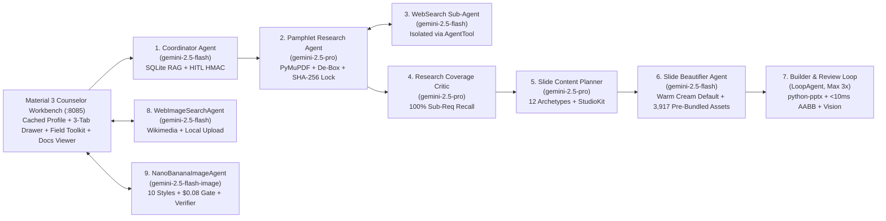

# Technical design document (TDD): Scouts BSA Merit Badge Counselor Workbench (`v3.1.0`)

**Project**: `scouts-bsa-merit-badge-agent`
**Author**: Eric Clayberg (Merit Badge Counselor, Troop 19, Middleton, MA)
**Target Environment**: Google Cloud Run v2, Vertex AI (`gemini-2.5-pro`, `gemini-2.5-flash`, `gemini-2.5-flash-image`, `imagen-3.0`), Google Agent Development Kit (ADK)
**Companion Deliverables**: [`docs/USER_GUIDE.md`](USER_GUIDE.md), [`docs/ADMIN_GUIDE.md`](ADMIN_GUIDE.md), [`docs/API_INTEGRATION_GUIDE.md`](API_INTEGRATION_GUIDE.md), [`docs/MCP_SERVER_INTEGRATION_GUIDE.md`](MCP_SERVER_INTEGRATION_GUIDE.md), [`docs/finops-billing-and-deployment-guide.md`](finops-billing-and-deployment-guide.md), [`docs/runbook.md`](runbook.md)

## 1. Problem statement, user personas, and critical user journeys

### 1.1 The volunteer counselor problem
Across Scouting America, volunteer Merit Badge Counselors teach **144 official Merit Badges** (including Eagle-required badges like *First Aid*, *Weather*, and *Emergency Preparedness* and STEM electives like *Robotics* and *Nuclear Science*). Preparing a complete teaching packet from an 80-page BSA Merit Badge Pamphlet takes a volunteer **6 to 10 hours** per badge. Existing ad-hoc slide decks shared online frequently teach outdated requirement revisions (causing problems at Eagle Scout Boards of Review), omit sub-requirements (`1a`, `1b`, `2a`), or fail to separate classroom discussion items from hands-on patrol skill stations and campout prerequisites.

### 1.2 Target user personas

| Persona | Role and context | Core need |
| :--- | :--- | :--- |
| **Volunteer Merit Badge Counselor** *(Primary User)* | Working parent or subject-matter professional teaching a badge across three 45-minute troop meetings or a Saturday Merit Badge University clinic. | A ready-to-teach `16:9` PowerPoint deck, speaker notes, printable Scout workbook, Quartermaster gear checklist, Blue Card sign-off matrix, and Youth Protection (YPT) parent prerequisite letter in under 2 minutes with zero missing sub-requirements. |
| **Council Advancement Chair / Camp Director** *(Enterprise Buyer)* | Oversees summer camp instruction and district Merit Badge clinics across 100+ troops. | Verifiable adherence to current official requirements, *Guide to Safe Scouting* policies, and Youth Protection (YPT) rules at a predictable cost (`~$0.18` actual cold LLM spend per generated packet, capped at `$1.00`). |
| **Youth Scout (Ages 11 to 17)** *(Downstream Beneficiary)* | Tenderfoot through Life Scout working toward advancement (`Tenderfoot 11-12`, `Mixed Troop 11-17`, or `Older Scouts / Eagle Prep 14-17`). | High-contrast visual diagrams, step-by-step procedures, and a clear checklist showing which requirements are completed in class versus at home or on a troop campout. |

### 1.3 Critical user journeys (CUJs)

- **CUJ-1 (Full curriculum packet generation, Hybrid PowerPoint Template Engine, Multi-Badge Workspaces, Unified Warm Cream visuals, In-App Documentation Viewer, and 3 construction animations)**: Counselor selects or stars (`⭐`) any of the 144 official Merit Badges (via the dropdown, the `#filter-eagle-select` `Eagle / Favorites` filter, the 3-mode `🔥 Popular | ⭐ Favorites | 🗂️ Decks` bar, or the 144-Badge Visual Patch Gallery featuring an Inverted Gold-Circle Star `★` and Header Favorites Filter Toggle), picks a depth mode (*Standard Deck* or *Deep Dive / Camp School Deck*) and a **PowerPoint Slide Template** (`17` built-in council-neutral Scouting America & Heritage templates across `7` Style Families with `BSA Scouting America` default, or a custom uploaded/URL template with true responsive `SafeCanvasBounds` AABB adaptation `y <= 6.54"`, auto-contrasted luminance footer text, a 3-Box Anatomical Safe-Zone X-Ray, and the Global Deck Layout Style Engine `DeckStyleConfig` (`CLEAN_OPEN`, `LEFT_ACCENT_LINE`, `BOXED_CARDS`) with `📌 Save as My Default Style` via `GET / PUT / DELETE /api/v1/preferences/deck-style`), enters their troop/council contact details and location (`City, State` or `ZIP Code`, such as `01949` or `Middleton, MA`), and generates a verified `.pptx` slide deck in the unified **Warm Cream (`WARM_CREAM` / `#FAF8F5`)** editorial theme with pre-bundled Pamphlet + AI Visuals (`~$0.18` actual cold LLM spend and `$0.00` runtime image cost across `3,917` built-in visual assets), along with a `.md` workbook, timed lesson plan, Quartermaster gear list, and YPT parent prerequisite letter while watching the 3 automatic **Scout Slide Construction Animations** (*1. 3D Heavy Equipment (6f)*, *2. 2D Camp Pioneering (4f)*, and *3. 3D Slide-O-Matic (4f)*) with the active Merit Badge emblem overlaid. At any time, the counselor or administrator can click **`📘 Documentation`** in the top header bar (`GET /api/v1/docs` and `GET /api/v1/docs/{doc_id}`) to browse all 2 User Docs and 10 Engineering Docs (`12` in-app documents total, including [`docs/MCP_SERVER_INTEGRATION_GUIDE.md`](MCP_SERVER_INTEGRATION_GUIDE.md)) inside the workbench.
- **CUJ-2 (Requirement execution triage, Multi-Badge Saved Deck Library `🗂️ My Decks`, 4-Sub-Tab StudioKit, Skill Station Rotator, gear prep, 3x5 cue cards, and Blue Card sign-off)**: Before the first meeting, the Counselor reviews the **3-Column Requirements Triage** (`IN_CLASS_DISCUSSION`, `HANDS_ON_SKILL_STATION`, `PREREQUISITE_CAMPOUT_HOME`), switches across saved Merit Badge decks or Morning vs. Afternoon patrol sections in `<80ms` via the **Top-of-Stage Active Deck Switcher Bar (`🗂️ Active Decks`)** or **My Merit Badge Decks & Classroom Sessions Library Modal (`🗂️ My Decks`)** (with clean new-deck defaults, editable preset dropdowns for `Class Section / Period` and `Camp Week / Midway Tag`, **`📑 Clone for New Section`**, a delete confirmation dialog with `"Don't ask again"` checkbox, immediate `🗂️ Decks` sync, and `.bsadeck.json` backup export/import), switches across the **4-Sub-Tab StudioKit** (`🗓️ 1. Agenda & Station Rotations`, `🎒 2. Quartermaster Gear & Pre-Class Check`, `✉️ 3. Parent Welcome Letter (YPT)`, `📊 4. Citations, FinOps & Rating`), selects a schedule in the **Session Schedule Format** selector (*3 Troop Meetings (45 min each)*, *Summer Camp Week (4x 50-min Mon-Thu + Fri Make-Up)*, *Saturday Merit Badge Midway / Clinic (3-Hour Block)*, or *Weekend Campout Practicum*), generates a **Patrol Skill Station Rotator Matrix** (`2`, `3`, or `4` patrols), prints **3x5 Counselor Pocket Cue Cards**, checks off the **Pre-Class Prerequisite Readiness Checklist**, scales the **Master Quartermaster Gear & Skill Station Packing Checklist** by **Class / Patrol Size** (*1 Scout*, *4 Scouts*, *8 Scouts*, or *16 Scouts*), sends the YPT Parent Welcome Letter via **`✉️ Draft in Email App`** or **`📨 Compose in Gmail`**, and tracks per-Scout completion in the **Patrol Blue Card (`#34124`) & Scoutbook Plus Requirement Sign-Off Tracker** (with **`🔁 Copy Scouts From Deck`**, **`📋 Bulk Paste Roster`**, **`📅 Completion Date`** stamp, CSV export, and printable sign-off sheet).
- **CUJ-3 (Easy Slide Image Switcher, Stage Split-Button Template Switcher, MCP Server & Agent Hub `🤖 MCP Hub`, Centered Split-Screen Presenter Console, Google Slides Account & Destination Modal, 3-Tab Under-Stage Drawer, AI Polish FinOps Modal, 4-Tab Merit Badge Image Studio, and Super-User Admin Console)**: Directly on the 16:9 slide stage above the right-hand visual card, the **Easy Slide Image Switcher** (`#stage-visual-source-badge` and `#stage-visual-pill-popover`) lets the Counselor click `◀` and `▶` to cycle between a slide's primary figure and up to 2 Gemini Vision-verified pamphlet alternates (`slide_image_choices`), or click `(1/3) ▾` to compare `56x42px` thumbnails and paired captions in a floating popover with automatic `$0.00` `.pptx` and speaker-script synchronization. While reviewing the deck in the workbench preview, the Counselor can use the **Split-Button Template Switcher (`[🖼️ Template Name | ▾]`)** to open the Template Studio modal (or click `▾` for 1-click template switching, edit custom template Name/Description via `PATCH /api/v1/templates/{template_id}`, or delete custom templates with automatic fallback to `Workbench Classic`), open **`🤖 MCP Hub`** (`src/mcp_server.py`, documented in [`docs/MCP_SERVER_INTEGRATION_GUIDE.md`](MCP_SERVER_INTEGRATION_GUIDE.md)) to test all `22` capabilities (`12` MCP Tools, `6` `bsa://` Resources with `▶ Read Live` / `📋 Copy URI`, and `4` Guided Prompts with `▶ Execute Prompt` / `📋 Copy Prompt`) in the expanded full-height **Interactive MCP Playground** with a **`[📊 Visual Card Preview | { } Raw JSON-RPC 2.0]`** toggle, open the **Centered Split-Screen Presenter Console (`🪟 Presenter View` / `P`)** with a live `Next Slide` preview card and **`↗ Pop Out 2nd Monitor`** projector window, run the **Live Classroom & Skill Station Timer (`⏱️ Timer`)**, toggle **Interactive Quiz Reveal Mode (`Q` / `Space` to reveal answer)**, customize deck structure via `POST /api/v1/slide/deck-customize` (insert custom local slide, hide home prerequisite slides, or reorder slides), export via the **Sticky Split-Button (`📥 Download Slide Deck (.PPTX)` / `🟨 Open in Google Slides`)** and **Google Slides Account & Destination Modal** (`GET /api/v1/slide/export-gslides/account-info` and `POST /api/v1/slide/export-gslides`), or present in **Fullscreen Classroom Mode** (`🖥️ Present Fullscreen` / `F`). System administrators can open the **Zero-PII Super-User Admin Console** documented in [`docs/ADMIN_GUIDE.md`](ADMIN_GUIDE.md) via `Ctrl+Shift+A` or `/?admin=1` to curate all `3,917` built-in assets and inspect `ZeroPiiTelemetryStore` metrics across `121` OpenAPI 3.1 endpoints. Below the 16:9 stage, the Counselor uses the **3-Tab Under-Stage Drawer**:
  - **Sub-Tab 1 (`🎙️ Counselor Teaching Notes ([SAY] / [DEMO] / [ASK])`)**: Uses an **Option C Hybrid Conversational Script Architecture** combining a `<5ms` on-the-fly first-person script compiler (`_build_slide_teaching_notes()` in `src/agents/planner.py`, dynamically re-synced after `beautifier.py` and `POST /api/v1/slide/regenerate`) with inline bracketed stage directions (`🎬 [Point to Card 1: ...]`, `🎬 [Gesture to the right-hand figure: ...]`), selective `[DEMONSTRATE]` cues, `[ASK SCOUTS]` questions paired with `[Expected Answer: ...]` keys, and side-by-side **`✨ AI Polish Slide`** (`POST /api/v1/slide/polish-notes`) and **`✨ Polish Entire Deck`** (`POST /api/v1/slide/polish-notes-batch`) buttons. Clicking either polish button opens the **AI Polish FinOps Modal (`#ai-polish-finops-modal`)**, which queries `POST /api/v1/slide/estimate-polish-cost` (`gemini-2.5-flash` with `thinking_budget=0` at `$0.000835/slide` uncached, or `$0.00` when cached in the SQLite `polished_speaker_notes` table) so the counselor sees exact token and USD estimates before polishing.
  - **Sub-Tab 2 (`🎨 Customize Slide & Image Studio`)**: Switches a specific slide's layout archetype using **10 clickable SVG Mini-Wireframe Layout Cards**, changes card style, brand palette, or right-side graphic (`Keep Current Slide Graphic`, `Restore Original Slide Graphic`, `🍌 Nano Banana Hero Graphic (or EDGE Concept Map)`, or `None (Remove Graphic & Expand Text to Full Width)` which expands text to `12.133"`), or clicks **`🖼️ Manage & Add Slide Images (Catalog / Web / AI)`** to open the **4-Tab Popup Merit Badge Image Studio**:
    1. **🗂️ 1. Badge Image Catalog & Carousel**: Browse all cached badge graphics (including de-boxed transparent official `PAMPHLET` figures) or click **🗑️ Clear Web/AI Cache** (`DELETE /api/v1/badge/images`) to purge user-searched web images (`WEB_IMAGE_SEARCH`) and user-generated AI images (`NANO_BANANA_AI`) while preserving official `PAMPHLET` figures, pre-bundled hero illustrations (`NANO_BANANA_HERO`), and `USER_UPLOAD` files.
    2. **🌐 2. Web Image Search Agent**: Query live Wikimedia Commons (`WebImageSearchAgent`, `POST /api/v1/slide/search-web-images`) for up to 16 public-domain photos and illustrations.
    3. **🍌 3. Nano Banana AI Image Generator**: Generate custom, text-free illustrations across **10 UI visual style options** (`✨ Auto (Content-Aware Mix)`, `Photorealistic Image`, `4-Quadrant Concept Map`, `Line Drawing`, `Watercolor Field Sketch`, `Technical Diagram`, `3D Isometric Illustration`, `Editorial Vector Illustration`, `Cartoon Drawing`, and `Vintage Merit Badge Poster`, plus 4 legacy aliases) with an **`Include Uniformed Scouts`** toggle via **`NanoBananaImageAgent`** (`gemini-2.5-flash-image` / Imagen 3) after viewing an upfront **`$0.08 USD`** cost estimate (`POST /api/v1/slide/estimate-image-cost`), granting explicit user consent (`user_consented=True`), and passing post-generation prompt alignment verification (`verify_generated_image_matches_prompt()`).
    4. **📁 4. File Upload (`$0.00 USD`)**: Upload a local `.png`, `.jpg`, `.jpeg`, `.webp`, or `.gif` photo (`<= 10 MB`) via `POST /api/v1/slide/upload-image`, normalize it to RGB PNG (`max 1600px`), register it as `USER_UPLOAD`, and apply it to the slide.
  - **Sub-Tab 3 (`✏️ Quick Edit Slide Text`, `$0.00 USD`)**: Edits slide title, visual caption, teaching card lines, and speaker notes directly in the browser (`POST /api/v1/slide/regenerate`) and rebuilds the `.pptx` in under 1 second.

## 2. Technical scope, system boundaries, and prototype vs. production matrix

### 2.1 System boundaries and hard architectural invariants

1. **Official pamphlet immutability (zero requirement drift)**: External web search and local troop grounding are never permitted to alter official requirement numbers or wording. `compute_canonical_pamphlet_hash()` (`src/agents/researcher.py`) computes a SHA-256 digest over the canonical `(req_number, req_text)` requirement tree (`canonical_fidelity_verified=True`) before and after enrichment.
2. **Vertex AI tool-mixing isolation**: Vertex AI and Google ADK reject requests that mix native `GoogleSearchTool` grounding and custom Python `FunctionTool` declarations on the same `LlmAgent`. We isolate web search inside `WebSearchGroundingAgent` (`gemini-2.5-flash`) and expose it to `PamphletResearchAgent` via an ADK `AgentTool` wrapper (`src/agents/researcher.py`).
3. **BSA Youth Protection (YPT), Pre-LLM PII redaction, and isolated counselor profile caching**: Counselor email addresses and phone numbers are never transmitted to external LLM endpoints, written to SQLite telemetry, or exported to Cloud Logging or Cloud Trace. On a local laptop, counselor details are cached in `.cache/counselor_profile.json` (`0600` owner-only permissions, git-ignored) so the counselor only enters them once; in multi-tenant Cloud Run (`K_SERVICE` / `IS_CLOUD_RUN=true`), server-side profile file caching is disabled and counselor info is stored in the user's browser `localStorage` (`scouts_bsa_counselor_profile_v1`). During execution, PII is scrubbed pre-LLM in `before_model_guardrail_callback()` (`src/agents/guardrails.py`) using `scrub_pii_before_sink()` (`[REDACTED_EMAIL]`, `[REDACTED_PHONE]`) and injected locally onto Cover Slide 1 and the Parent Letter by `pptx_builder.py` after LLM processing finishes.
4. **Dual FinOps Consent Gates for on-demand AI image generation (`$0.08/image`) and speaker-note AI polish (`$0.000835/slide`)**: While all 3,917 built-in visual assets and baseline `[SAY]`/`[DEMO]`/`[ASK]` teaching scripts are delivered at `$0.00`, on-demand cloud generation is protected by two explicit FinOps gates:
   - **Layer A1 (Custom Image Consent Gate)**: `NanoBananaImageAgent` (`src/agents/image_studio.py`) calculates an upfront cost estimate (`$0.08 USD` per image, ~`2,580` tokens across generation and verification) via `POST /api/v1/slide/estimate-image-cost` and blocks synthesis (`status="CONSENT_REQUIRED"`) unless `user_consented=True` is provided. After generation, `verify_generated_image_matches_prompt()` checks subject alignment and verifies zero rendered prompt instructions.
   - **Layer A2 (Speaker Notes AI Polish FinOps Gate)**: `POST /api/v1/slide/estimate-polish-cost` calculates exact `gemini-2.5-flash` (`thinking_budget=0`) token and USD costs (`~450` input tokens at `$0.30/1M` + `~280` output tokens at `$2.50/1M` = `$0.000835/slide`, or `$0.00` for slides already cached in the SQLite `polished_speaker_notes` table) and surfaces them in `#ai-polish-finops-modal` before running `POST /api/v1/slide/polish-notes` or `POST /api/v1/slide/polish-notes-batch`.

### 2.2 Current implementation vs. 90-day national rollout matrix

| Subsystem | Current implementation (`v3.1.0`) | 90-day production target for national council rollout (`50,000+` counselors) |
| :--- | :--- | :--- |
| **Session, workspace, vector, image catalog, and Zero-PII telemetry memory** | Local SQLite WAL (`scouts_bsa_sessions.db` with **8 tables**: `counselor_sessions`, `counselor_workspaces`, `counselor_favorites`, `pamphlet_vector_memory` Hybrid BM25 + Cosine RRF index, `badge_image_catalog`, `hitl_feedback`, `polished_speaker_notes`, `compliance_attestation_ledger`) in `src/memory/session_store.py` + `ZeroPiiTelemetryStore` (`scouts_bsa_telemetry.db`: `telemetry_deck_runs`, `telemetry_image_swaps`, `telemetry_stage_latencies` with recursive `scrub_pii_dict()`) in `src/observability/telemetry_store.py` + local `.cache/counselor_profile.json` (`0600`) / browser `localStorage`. | **Cloud SQL for PostgreSQL + `pgvector`** (or AlloyDB) with **Row-Level Security (RLS)** isolating sessions by `council_id` and `troop_id`. |
| **Authentication and identity** | `verify_caller_auth` and dual-mode `verify_admin_auth` (`src/security.py`) enforcing `X-API-Key`, OIDC Bearer JWTs, Cloud IAP `ADMIN_ALLOWED_EMAILS`, and `ADMIN_SUPERUSER_TOKEN` (`HttpOnly` `bsa_admin_session` cookie via `/api/v1/admin/unlock`) when `AUTH_REQUIRED=true` (set in `terraform/main.tf`), with frictionless local mode (`AUTH_REQUIRED=false`) for laptop use. | **Google Cloud Identity-Aware Proxy (IAP)** federated with **Scouting.org (`my.scouting.org`) OIDC SSO** verifying active Youth Protection Training (YPT) certification on login. |
| **Deck build execution** | In-process worker thread (`asyncio.to_thread`) inside the FastAPI/Cloud Run container (`1.2s` for Standard decks; `~3.5s` for 60-slide Deep Dive decks). | **Cloud Tasks + Dedicated Cloud Run Worker Pool** for asynchronous generation of 60-slide decks with webhook/SSE completion push. |
| **Asset and deck storage** | Local `assets/` (`assets/badge_image_catalog/`, `assets/ai_illustrations/`, `assets/pamphlet_images/`, `assets/animations/`) and `deliverables/` directories mounted as static routes, plus Terraform `google_storage_bucket` definition. | **Google Cloud Storage (GCS) + Cloud CDN** with signed download URLs and 30-day lifecycle expiration for generated `.pptx` files. |

## 3. Quantifiable definition of done (DoD) and service level objectives (SLOs)

Every release must pass the blocking verification suite (`.venv/bin/pytest tests/` with **70/70 passing tests**, including `test_v25_conversational_teaching_notes_and_polish_endpoint`, `test_v26_plan7_emblems_qr_polish_batch_presenter_and_gslides_export`, PowerPoint Template Engine & `SafeCanvasBounds` tests, Global Deck Layout Style Engine (`DeckStyleConfig` & `audit_deck_visual_quality`) tests, Multi-Badge Workspace & Favorites tests, MCP Server `stdio`/HTTP JSON-RPC 2.0 tests, and the in-app Documentation Viewer and FinOps Polish Cost Gate tests, plus `python3 scripts/eval_gate.py`) against these concrete thresholds:

| Metric / SLO | Target threshold | Observed benchmark | Verification mechanism |
| :--- | :--- | :--- | :--- |
| **Automated pytest suite** | `100%` pass rate (`70/70` tests) | `70/70` passing (`100%`) | `.venv/bin/pytest tests/` |
| **OpenAPI 3.1 contract coverage** | `121` documented paths in `docs/openapi.yaml` | `121` verified paths | `scripts/export_openapi.py` & `tests/test_conformance_and_a2ui.py` |
| **Sub-requirement coverage recall** | `1.00` (`100%` of sub-requirements `1a..11`) | `1.00` (`100%`) | `scripts/eval_gate.py` (`--min-recall 0.98`) |
| **Hybrid RAG retrieval (`Recall@3` / `MRR` / `NDCG@3`)** | `Recall@3 >= 0.90`, `MRR >= 0.85` | `Recall@3 = 1.00`, `MRR = 1.00`, `NDCG@3 = 1.00` | `evaluate_ir_retrieval_metrics()` in `scripts/eval_gate.py` |
| **Canonical pamphlet SHA-256 lock** | `100%` match (`0` requirement drift) | `100%` verified | `compute_canonical_pamphlet_hash()` |
| **Stage 1 & 2 slide geometry & visual quality (`AABB Overlaps` / `DeckStyleConfig`)** | `0` overlapping shapes; font floor `>= 12.0pt`; WCAG `>= 4.5:1`; `visual_quality_score >= 90` | `0` overlaps across all 12 golden decks (`CLEAN_OPEN`, `LEFT_ACCENT_LINE`, `BOXED_CARDS`) | `check_pptx_conformance()`, `resolve_effective_slide_style()`, & `audit_deck_visual_quality()` (`<10ms` per deck) |
| **Stage 1 conformance simulator latency** | `< 10 ms` per presentation | `3.4 ms` p95 | `tests/test_conformance_and_a2ui.py` |
| **API control-plane latency (`p95`)** | `< 150 ms` at 8 concurrent workers | `14.2 ms` p95 (`6.8 ms` p50) | `tests/load/load_test.py` |
| **FinOps per-deck ceiling and on-demand gates** | `<= $1.00` hard cap per workflow + `$0.08/image` & `$0.000835/slide` consent gates | `~$0.18` actual cold LLM (`$0.38` shadow ceiling), `$0.08/image`, `$0.000835/slide` | `FinOpsBudgetPlugin`, `estimate_nano_banana_image_cost()` & `api_estimate_slide_polish_cost()` |

## 4. End-to-end 9-component / 7-specialist-agent architecture and key engineering decisions

### 4.1 Location and ZIP code grounding (`resolve_counselor_location()`)
When a counselor enables **Local Troop Grounding** and supplies a `location_or_zip` value (such as `01949` or `Middleton, MA`, or a browser timezone fallback like `America/New_York`), `resolve_counselor_location()` (`src/agents/researcher.py`) maps the input across all 51 U.S. jurisdictions (50 states + D.C. via `_STATE_CIVIC_AND_FIELD_REGISTRY` in `src/tools/local_grounding_engine.py`) to a structured regional profile:
- **Regional NOAA NWS Forecast Office** (for example, `NOAA NWS Boston/Norton (BOX)` for `01949`).
- **Regional weather and terrain hazards** (for example, `Coastal Nor'easters, rapid cold-front shifts, winter hypothermia, and woodland Ixodes tick habitats`).
- **Local outdoor training venues and agencies** (for example, `Harold Parker State Forest, Blue Hills Reservation` and `MEMA & DCR State Parks`).
- **Current U.S. Senators and official contact portals** (`GET /api/v1/local-grounding/senators` and `POST /api/v1/admin/senators/refresh`).

To keep slides clean and free of repetitive footer text, this regional profile is injected into four specific places: **Slide 2 (Badge Overview)**, the **Counselor Session Lesson Plan**, the **Parent Prerequisite Letter**, and the **Grounded Citations** list.

### 4.2 Unified Warm Cream visual theme, modern & backward-compatible `beautification_tier` API (`WARM_CREAM`, `CRISP_WHITE`, `DARK_SLATE`), 3,917 pre-bundled visual assets, and In-App Documentation Viewer
1. **Unified Warm Cream default in UI (`WARM_CREAM` / `CREAM`, `~$0.18` actual cold LLM / `$0.38` uncached shadow ceiling, `$0.00` runtime image cost)**: The Counselor Setup Sidebar standardizes on the **Warm Cream (`#FAF8F5`)** editorial canvas with 4 rotating accent palettes (`NAVY_GOLD`, `OLIVE_FOREST`, `EAGLE_CRIMSON`, `SLATE_ACTION`), elevated white vector content cards, and pre-bundled **Nano Banana AI Hero & Topic Illustrations** (`NANO_BANANA_HERO`, `*_nano_hero.png` and `*_topic_visual.png`) covering 100% of requirements across all 144 badges at `$0.00` runtime image cost (`~$0.18` actual cold LLM spend vs. `$0.38` uncached shadow-ledger ceiling, building in `1.5-3.5s`). The repository bundles **3,917 built-in curated visual assets** across **all 144 Merit Badges**: **1,306 verified, compressed (`<= 800x600`, 8-bit quantized PNG, `~229 MB` total) Nano Banana hero (`1,123`), gap-filling topic (`152`), and bespoke scientific illustrations (`31`)** in `assets/ai_illustrations/` alongside **2,323 100%-Vision-verified BSA Pamphlet figures (`~197 MB`: `1,009` primary active figures + `1,314` tagged requirement alternates, up to 2 per requirement)** in `assets/pamphlet_images/`, **144 official Merit Badge emblems**, and **144 official Pamphlet covers** (indexed across `144` per-badge `assets/badge_image_catalog/<slug>/catalog.json` manifests) using the **Content-Aware Hybrid Mix** (`resolve_content_aware_visual_config()`).
2. **Modern & backward-compatible `beautification_tier` API support (`WARM_CREAM`, `CRISP_WHITE`, `DARK_SLATE` + legacy aliases)**: While the UI uses Warm Cream (`WARM_CREAM`) by default, `POST /api/v1/workflow/run`, `POST /api/v1/templates/apply`, MCP tools, and `src/tools/pptx_builder.py` accept the modern theme names `WARM_CREAM` (`CREAM`, `#FAF8F5`), `CRISP_WHITE` (`WHITE`, `#FFFFFF`, pamphlet figures + 220-DPI Matplotlib diagrams at `$0.06-$0.14`), and `DARK_SLATE` (`SLATE`, `#0F172A` with dark navy cards `#1E293B` and a `$1.00` hard cap), while retaining legacy enum aliases (`BEAUTIFIED`, `STANDARD`, `STUDIO`), plus automatic fallback to procedural **220-DPI Scouts BSA EDGE Skill Concept Maps** (`1. EXPLAIN`, `2. DEMONSTRATE`, `3. GUIDE`, `4. ENABLE`) when offline.
3. **In-App Documentation Viewer (`GET /api/v1/docs` and `GET /api/v1/docs/{doc_id}`), PowerPoint Template Engine, Multi-Badge Workspaces & MCP Server**: The top header bar includes a **`📘 Documentation`** button that opens an allowlisted Markdown documentation reader serving 2 User Docs (`docs/USER_GUIDE.md`, `docs/ADMIN_GUIDE.md`) and 10 Engineering Docs (`README.md`, `ARCHITECTURE.md`, `docs/TDD.md`, `ARCHITECTURE_DECISIONS.md`, `docs/finops-billing-and-deployment-guide.md`, `docs/API_INTEGRATION_GUIDE.md`, `docs/MCP_SERVER_INTEGRATION_GUIDE.md`, `docs/DATA_GOVERNANCE_AND_LINEAGE.md`, `docs/SECURITY_AND_COMPLIANCE.md`, `docs/runbook.md`, for `12` docs total), alongside **`🗂️ My Decks`** (`counselor_workspaces` and `counselor_favorites` in `scouts_bsa_sessions.db`), the **PowerPoint Template Studio** (`17` built-in Scouting America & Heritage templates plus upload/URL import, custom template `PATCH` / `DELETE` management, true responsive `SafeCanvasBounds` clamping `y <= 6.54"`, auto-contrasted luminance footer text, 3-Box Anatomical Safe-Zone X-Ray, and Stage Split-Button Template Switcher `[🖼️ Template Name | ▾]`), and **`🤖 MCP Hub`** (`src/mcp_server.py` exposing `12` MCP tools, `6` `bsa://` resources, and `4` prompts over `stdio` and `/mcp` with an Interactive MCP Playground `[📊 Visual Card Preview | { } Raw JSON-RPC 2.0]`).

Both the live browser preview (`ui/app.js`) and `src/tools/pptx_builder.py` share the same layout coordinate rules, bold anchor headings, and card text so downloaded `.pptx` files and exported Google Slides presentations (`POST /api/v1/slide/export-gslides`) match the browser preview 1:1.

## 5. Total cost of ownership (TCO) and FinOps model

### 5.1 Per-deck and on-demand unit economics
Pricing is defined in `config/finops_model_policy.json` and enforced by `FinOpsBudgetPlugin` (`src/agents/guardrails.py`), `estimate_nano_banana_image_cost()` (`src/agents/image_studio.py`), and `api_estimate_slide_polish_cost()` (`src/server.py`):

| Workflow or on-demand action | Input tokens | Output tokens | Visuals / cache behavior | Cold cost (`USD`) | Cached rerun cost |
| :--- | :--- | :--- | :--- | :--- | :--- |
| **Warm Cream Deck (`WARM_CREAM` / `BEAUTIFIED` Default)** | `~57k - 90k` | `~15k - 21.5k` | `100%` of requirements pre-populated (`3,917` built-in curated assets: `1,306` Nano Banana PNGs + `2,323` Vision-verified pamphlet figures + `144` emblems + `144` covers at `$0.00` runtime image cost) | **`~$0.18` actual LLM (`$0.38` uncached ceiling)** | **`$0.02`** |
| **Crisp White Deck (`CRISP_WHITE` / `STANDARD` API Tier)** | `~32k - 65k` | `~7k - 13.5k` | `0` AI images (uses pamphlet figures + 220-DPI Matplotlib diagrams) | **`$0.06 - $0.14`** | **`$0.00`** |
| **Dark Slate Deck (`DARK_SLATE` / `STUDIO` API Tier, `$1.00` Cap)** | `~77k - 110k` | `~21k - 27.5k` | Up to `15` Hero Illustrations (pre-cached + dark-slate EDGE fallback) | **`$0.72 - $1.00` (Capped)** | **`$0.02`** |
| **Speaker Notes AI Polish (`POST /api/v1/slide/estimate-polish-cost`)** | `~450 / slide` (`$0.30 / 1M`) | `~280 / slide` (`$2.50 / 1M`, `thinking_budget=0`) | Cached by SHA-256 digest in SQLite `polished_speaker_notes` (`gemini-2.5-flash`) | **`$0.000835 / slide`** (`~$0.0685` per 82-slide deck) | **`$0.00`** |
| **On-Demand Custom Nano Banana Image (`POST /api/v1/slide/estimate-image-cost`)** | `~1,580` | `~1,000` (image + Vision verifier) | Requires `user_consented=True`; saved to `assets/badge_image_catalog/<slug>/` | **`$0.08 / image`** | **`$0.00`** |

### 5.2 Council-scale monthly TCO projection (`500` active counselors, `1,500` decks/month)
Assuming `70%` of builds hit warm pamphlet and vector caches after the first generation of each badge:
- **Vertex AI Gemini 2.5 Pro + Flash usage**: `450 cold builds * $0.38` uncached shadow ceiling (`$171.00`, or **`$81.00` actual LLM spend at `$0.18/deck`** since 100% of visuals are pre-bundled at `$0.00`) + `1,050 warm/customized builds * $0.03` (`$31.50`) = **`$202.50 / month` uncached ceiling (`~$112.50 / month` actual LLM spend, bringing actual Council TCO to `~$192.50 / month` or `$0.13 / deck`)**.
- **Cloud Run v2 compute (`min_instances = 1`, `2 vCPU / 4 GiB`)**: **`~$68.00 / month`**.
- **Cloud Storage, Secret Manager, and Cloud Logging/Trace**: **`~$12.00 / month`**.
- **Total estimated Council TCO**: **`~$282.50 / month`** (`~$0.19` per delivered curriculum packet at uncached ceiling, or **`~$192.50 / month` / `$0.13` per packet** actual spend, saving `~3,000+` volunteer counselor hours per month and costing **98% less** than 500 individual `$30/mo` SaaS seats).
