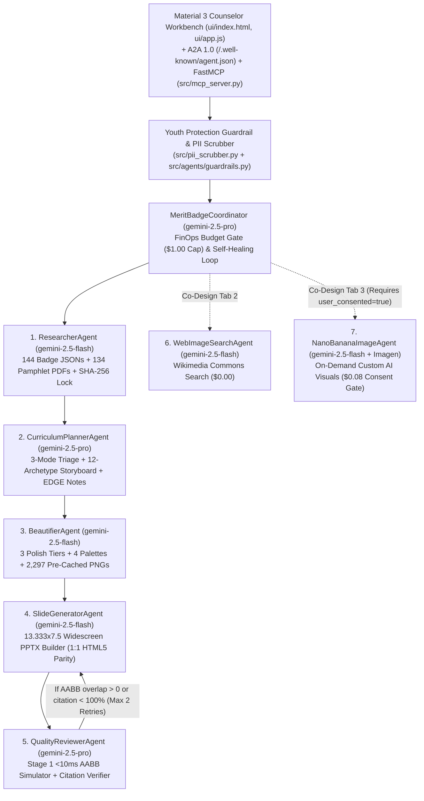

# Technical Design Document (TDD): Scouts BSA Merit Badge Counselor Workbench (`v2.6`)

- **Author**: Eric Clayberg (Merit Badge Counselor, Scouts BSA Troop 19, Middleton, MA)
- **Repository**: `https://github.com/clayberg/scouts-bsa-merit-badge-agent`
- **Architecture**: Google Agent Development Kit (`google-adk`) 8-Agent Hierarchy, FastMCP (`src/mcp_server.py`), A2A 1.0 + A2UI v0.9 (`src/server.py`), SQLite WAL + Vertex AI Memory Bank (`src/memory/session_store.py`), OpenTelemetry + Cloud DLP / Model Armor (`src/pii_scrubber.py`, `src/agents/guardrails.py`).

---

## 1. Executive Summary & Problem Statement

Volunteer Scouts BSA Merit Badge Counselors spend 8 to 15 hours per badge gathering official Scouting America requirements, extracting diagrams from 80-page PDF pamphlets, structuring multi-meeting lesson plans using the **BSA EDGE method** (*Explain, Demonstrate, Guide, Enable*), and formatting slide decks and Scout workbooks. Generic single-prompt LLM chat tools frequently fail this workflow in four ways:
1. **Curriculum Drift & Omitted Sub-Requirements**: Paraphrasing or skipping nested requirements (`1a..15c`).
2. **Broken Slide Geometry**: Generating overlapping text boxes, overflowing cards when imported into Google Slides, or tiny unreadable fonts.
3. **Noisy or Unaligned Pamphlet Visuals**: Pulling raw PDF XObjects with baked-in black caption boxes, low-resolution dithered scans, or redundant titles that collide with slide headers.
4. **Youth Protection (YPT) Exposure**: Sending unredacted youth roster names, emails, or phone numbers to external model endpoints or telemetry logs.

The **Scouts BSA Merit Badge Counselor Workbench** solves these problems with an 8-agent **Google ADK** pipeline covering all **144 official Scouts BSA Merit Badges** (`18` Eagle-Required and `126` Electives), backed by a **100% pre-cached visual asset library** (`2,297` compressed 8-bit Nano Banana hero and topic PNGs + `4,317` de-boxed pamphlet figures at `$0.00` runtime image cost), a **`<10ms` deterministic AABB geometry conformance simulator**, and **dual-layer Youth Protection PII scrubbing**.

---

## 2. Multi-Agent System Architecture (`google-adk`)

### Strategic Model Routing Table

| Agent Name | Module | Assigned Model | Routing Rationale |
| :--- | :--- | :--- | :--- |
| **`MeritBadgeCoordinator`** | `src/agents/coordinator.py` | `gemini-2.5-pro` | Root orchestration, FinOps budget enforcement, and self-healing retry coordination. |
| **`ResearcherAgent`** | `src/agents/researcher.py` | `gemini-2.5-flash` | High-throughput ingestion of `144` requirement JSONs, `pypdf` extraction, and local ZIP grounding. |
| **`CurriculumPlannerAgent`** | `src/agents/planner.py` | `gemini-2.5-pro` | Complex pedagogical triage, multi-slide topic decomposition, and BSA EDGE speaker script synthesis. |
| **`BeautifierAgent`** | `src/agents/beautifier.py` | `gemini-2.5-flash` | Deterministic theme token application (`STANDARD`, `BEAUTIFIED`, `STUDIO`) and palette rotation. |
| **`SlideGeneratorAgent`** | `src/agents/curriculum.py` | `gemini-2.5-flash` | Structured `.pptx` XML shape synthesis via `src/tools/pptx_builder.py`. |
| **`WebImageSearchAgent`** | `src/agents/image_studio.py` | `gemini-2.5-flash` | Fast Wikimedia Commons query expansion and educational figure filtering (`$0.00`). |
| **`NanoBananaImageAgent`** | `src/agents/image_studio.py` | `gemini-2.5-flash` + Imagen | Custom illustration synthesis gated by `$0.08` USD FinOps user consent + prompt alignment check. |
| **`QualityReviewerAgent`** | `src/agents/reviewer.py` | `gemini-2.5-pro` | Stage 1 `<10ms` deterministic AABB geometry verification + Stage 2 multimodal vision audit. |

---

## 3. Data Corpus, SHA-256 Fidelity Lock & Hybrid RRF Retrieval

### 3.1 All 144 Official Merit Badges & Pre-Cached Visual Catalog
- **Structured Requirement Catalog (`data/merit_badge_requirements/*.json`)**:
  - Covers all **144 official Scouts BSA Merit Badges** (`18` Eagle-Required and `126` Electives, including 2025/2026 additions such as *Artificial Intelligence*, *Cybersecurity*, *Wildland Fire Management*, *Multisport*, *Action Sports*, and *Health Care Professions*).
  - Each badge JSON stores its verbatim top-level requirements (`1..15`), nested sub-requirements (`1a..15c`), execution-mode triage tags, and multi-slide `topic_slides`.
  - **Canonical SHA-256 Lock (`compute_canonical_pamphlet_hash`)**: Computes a deterministic SHA-256 digest over sorted `(req_number, description)` pairs so `QualityReviewerAgent` can detect any unauthorized requirement text mutation in `<1ms`.
- **100% Pre-Cached Visual Pipeline (`$0.00` Runtime Image Cost)**:
  - **`2,297` Pre-Generated Nano Banana Illustrations (`assets/ai_illustrations/`)**: Compressed (`<= 1,024px`, 8-bit PNG via `pngquant`/`PIL`) hero and topic illustrations covering every requirement across all `144` badges.
  - **`4,317` De-Boxed Official BSA Pamphlet Figures (`assets/pamphlet_images/`)**: Extracted from `134` local pamphlet PDFs (`pdfs/`) with automatic bottom/top dark caption-bar removal (`_strip_pamphlet_caption_box`).
  - **High-Resolution Scientific Diagram Upgrades & Clean Captions**: Key meteorological and scientific diagrams (Hydrologic Cycle, WSR-88D Doppler Radar, Cold and Warm Front cross-sections, 3D Warm Front side-by-side profile, Daytime Sea Breeze vs. Nighttime Land Breeze, Cloud Classification by Altitude Level, and top-cropped Earth's 23.5° Axial Tilt and Seasons) are rendered at high resolution with zero gibberish text, and all visual captions are concise and scene-specific with zero style-name prefixes.

### 3.2 Hybrid Dense + Okapi BM25 Retrieval via Reciprocal Rank Fusion (`RRF`)
Located in `src/memory/session_store.py` (`PersistentSessionStore.hybrid_search_pamphlet_rrf_sync`):
1. **Dense Vector Search**: Computes cosine similarity over 768-dimensional `text-embedding-004` embeddings stored in SQLite (`pamphlet_chunks`).
2. **Lexical Okapi BM25 (`k1 = 1.5, b = 0.75`)**: Scores exact requirement alphanumeric tokens (`Req 4b`, `34124`, `165°F`, `NWS`).
3. **Reciprocal Rank Fusion (`k = 60`)**:
   $$\text{RRF\_Score}(d) = \frac{1}{60 + \text{rank}_{\text{dense}}(d)} + \frac{1}{60 + \text{rank}_{\text{bm25}}(d)}$$

---

## 4. 1:1 HTML5-to-PPTX Rendering Engine & Two-Stage Conformance Gate

### 4.1 12-Archetype Widescreen (`13.333" x 7.5"`) Slide Synthesis
`src/tools/pptx_builder.py` and `ui/app.js` share identical layout geometry across 12 slide archetypes (`TITLE_COVER`, `REQUIREMENTS_TRIAGE_MATRIX`, `REQUIREMENT_INTRO`, `CONCEPT_TEXT_SLIDE`, `SPLIT_VISUAL_EXPLAINER`, `FULL_BLEED_IMAGE_EXPLAINER`, `PROCESS_STEP_CARDS`, `DIFFERENTIAL_COMPARISON_2COL`, `SAFETY_WARNING_CALLOUT`, `EQUIPMENT_CHECKLIST_GRID`, `PATROL_SCENARIO_CHALLENGE`, and `SOURCES_AND_REFERENCES`):
- **Google Slides Import Fidelity**: Uses layered DrawingML rounded-rectangle crescent accents (`CardAccent_Top_*`, `CardAccent_Left_*`, `CardAccent_StepPill_*`) and `_concise_card_body(max_words=18, max_chars=125)` so cards never overflow or bleed outside their borders when imported into Google Slides.
- **Three Visual Polish Tiers**:

### 4.2 Stage 1 (`<10ms`) Deterministic AABB Geometry Simulator (`src/agents/reviewer.py`)
Every generated `.pptx` file is validated by `check_pptx_conformance(pptx_path)` before delivery:
1. **Axis-Aligned Bounding Box (AABB) Pairwise Intersection Check**: Verifies `aabb_overlap_count == 0` across all content shapes on every slide.
2. **Canvas Boundary Verification**: Confirms `0 <= left`, `top >= 0`, `left + width <= 13.333"`, and `top + height <= 7.5"`.
3. **Typography Floor Enforcement**: Verifies body text runs maintain `>= 12.0pt` font size (`min_font_size_pt >= 12.0`).
4. **100% Citation Grounding (`verify_slide_citation_grounding`)**: Confirms every requirement slide maps to an authoritative Scouting America requirement ID (`citation_coverage_ratio == 1.0`).

---

## 5. Per-Slide Co-Design, 4-Tab Image Studio & Counselor Field Toolkit

- **Surgical Single-Slide Regeneration (`POST /api/slide/regenerate`)**: Updates any slide's inline text, layout archetype, card theme, or accent palette and re-renders the `.pptx` in `<250ms` without re-running the full pipeline.
- **4-Tab Merit Badge Image Studio (`src/agents/image_studio.py`)**:
  - **Tab 1 (`Cached Library`, `$0.00`)**: Instant access to all `2,297` pre-cached Nano Banana PNGs and `4,317` de-boxed pamphlet figures.
  - **Tab 2 (`Web Image Search`, `$0.00`)**: Live Wikimedia Commons educational diagram search (`WebImageSearchAgent`).
  - **Tab 3 (`Nano Banana AI Generator`, `$0.08` USD Consent Gate)**: Content-aware visual style resolver (`resolve_content_aware_visual_config`) that automatically selects `include_humans=True` for active Scout demonstrations and `include_humans=False` for gear flat-lays or atmospheric diagrams, enforces an explicit `$0.08` USD user consent gate, and validates prompt alignment (`verify_generated_image_matches_prompt`).
  - **Tab 4 (`File Upload`, `$0.00`)**: Local troop photo or diagram upload (`POST /api/slide/upload-image`).

---

## 6. Security, Youth Protection (YPT), Resilience & Observability

1. **Dual-Layer Youth Protection PII Scrubber (`src/pii_scrubber.py`)**:
   - Deterministic regex + Google Cloud DLP API integration that redacts youth names (`Scout <First> <Last>`), emails, phone numbers, SSNs, and street addresses across all prompts, outputs, SQLite records, and OpenTelemetry spans.
2. **Model Armor Prompt-Injection Guardrail (`src/agents/guardrails.py`)**:
   - Inspects all user inputs and custom image prompts (`sanitize_text_with_model_armor`) to block jailbreak attempts, system-prompt exfiltration, and YPT bypass payloads (`allowed = False`).
3. **Stateful Circuit Breaker & Exponential Backoff (`src/resilience.py`)**:
   - Protects Vertex AI calls with `retry_with_exponential_backoff` and a 3-state `CircuitBreaker` (`CLOSED`, `OPEN`, `HALF_OPEN`) that falls back cleanly to `gemini-2.5-flash` or deterministic local JSON synthesis.
4. **OpenTelemetry Distributed Tracing & Intent-vs-Outcome Logging (`src/telemetry.py`, `src/logger.py`)**:
   - Emits W3C TraceContext spans (`trace_id`, `span_id`, `agent_name`, `tokens_used`, `cost_usd`, `intent`, `outcome`) with PII-scrubbed attributes.

---

## 7. Automated Verification & CI/CD Quality Gates

- **`53` Non-Hollow Automated `pytest` Tests** across 5 test modules:
  - `tests/test_conformance_and_a2ui.py` (`10` end-to-end workflow, UI/PPTX parity, Image Studio, v1 feedback flywheel, and 144-badge catalog tests)
  - `tests/test_memory.py` (`9` SQLite WAL, history compaction, and Hybrid BM25 + Vector RRF tests)
  - `tests/test_pii_scrubber.py` (`10` Youth Protection PII redaction and Model Armor guardrail tests)
  - `tests/test_resilience_and_fault_injection.py` (`14` circuit breaker, backoff, fallback, and FinOps gate tests)
  - `tests/test_tools.py` (`10` schema, scraper, and conformance simulator tests)
- **`72` Pre-Built & Audited Benchmark Decks (`deliverables/benchmark_and_random_samples/`)**: `36` badges (`26` Benchmark + `10` Random Electives) across both *Deep Dive* and *Troop Meeting* modes (`100%` pass rate, `0` AABB overlaps).
- **12-Badge Golden Evaluation Gate (`scripts/eval_gate.py`)** and **6-Act Live Demo Readiness Check (`scripts/verify_live_demo_readiness.py`)**.
