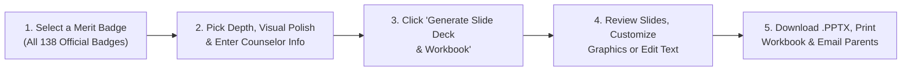
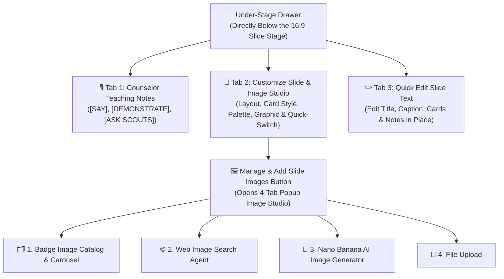

# Scouts BSA Merit Badge Counselor Workbench — User Guide

Welcome to the **Scouts BSA Merit Badge Counselor Workbench**. Whether you are preparing for three 45-minute troop meetings, a week of summer camp instruction, a Saturday Merit Badge Midway clinic, or a weekend campout practicum, this tool helps you prepare a complete, grounded teaching package for any of the **138 official Scouts BSA Merit Badges** in a few minutes.

Instead of spending an entire weekend formatting slides and typing up handouts from scratch, you can generate:
- A widescreen (`16:9`) **PowerPoint Slide Deck (`.pptx`)** with official requirement wording, clear teaching cards, diagrams, official pamphlet figures, and counselor speaker notes.
- A printable **Scout & Counselor Workbook (`.md` / PDF)** with fill-in-the-blank study sections and requirement sign-off checklists.
- A **Counselor Session Agenda & Lesson Plan** tailored to your meeting schedule.
- A **Master Quartermaster Gear & Skill Station Packing Checklist** scaled to the size of your patrol or class.
- A **Youth Protection (YPT) Prerequisite & Parent Welcome Letter** ready to open in your email app or Gmail.
- An interactive **Patrol Blue Card (`#34124`) & Scoutbook Plus Sign-Off Tracker** to record Scout progress during class.

---

## Table of Contents

1. [Getting Started in 60 Seconds](#1-getting-started-in-60-seconds)
2. [Tour of the Counselor Workbench Screen](#2-tour-of-the-counselor-workbench-screen)
3. [Step 1: Finding & Selecting a Merit Badge](#3-step-1-finding--selecting-a-merit-badge)
4. [Step 2: Choosing Your Deck Style & Saving Your Counselor Profile](#4-step-2-choosing-your-deck-style--saving-your-counselor-profile)
5. [Step 3: Watching the Scout Slide Construction Showcase](#5-step-3-watching-the-scout-slide-construction-showcase)
6. [Step 4: Previewing, Presenting & Navigating Your Slides](#6-step-4-previewing-presenting--navigating-your-slides)
7. [Step 5: Customizing Individual Slides, Graphics & Text](#7-step-5-customizing-individual-slides-graphics--text)
8. [Step 6: Tracking Requirements & Signing Off Blue Cards (`#34124`)](#8-step-6-tracking-requirements--signing-off-blue-cards-34124)
9. [Step 7: Using the Printable Workbook, Lesson Plan, Gear List & Parent Letter](#9-step-7-using-the-printable-workbook-lesson-plan-gear-list--parent-letter)
10. [Importing Your `.PPTX` Deck into PowerPoint or Google Slides](#10-importing-your-pptx-deck-into-powerpoint-or-google-slides)
11. [Frequently Asked Questions for Counselors](#11-frequently-asked-questions-for-counselors)

---

## 1. Getting Started in 60 Seconds

1. **Pick a Merit Badge**: In the left sidebar under **1. Find & Select Merit Badge**, search for any badge by name, filter by category or Eagle-Required status, or click one of the **Quick-Select Popular Badges** buttons (such as **★ First Aid**, **Weather**, or **★ Camping**).
2. **Choose Your Deck Settings**: Under **2. Deck Style & Counselor Info**, choose whether you want a **Deep Dive Teaching Deck (50 to 70+ Slides)** or a shorter **Standard Troop Meeting Deck (1 to 3 Slides / Req)**, pick a **Slide Visual Polish Mode**, and select your **Target Scout Audience Level**.
3. **Add Your Counselor & Troop Details (One Time)**: Click **👤 Counselor & Troop Profile (Saved) • Edit ▾** to enter your name, troop and council, city/state or ZIP code, optional email/phone, and optional troop logo. Your browser remembers these details automatically for future badges.
4. **Generate Your Package**: Click **Generate Slide Deck & Workbook**. While your slides are being built, you can watch the animated **Scout Slide Construction Showcase**.
5. **Present or Download**: Step through your slides on the **16:9 Slide Stage**, click **🖥️ Present Fullscreen** to teach directly from your browser, or click **Download Slide Deck (.PPTX)** and **Download Workbook (.MD)** in the top bar.

---

## 2. Tour of the Counselor Workbench Screen

The Workbench is organized into four main areas so you can set up your class on the left and review all of your teaching materials on the right without losing your place:

| Screen Area | Where to Find It | What You Use It For |
| :--- | :--- | :--- |
| **Top Application Bar** | Across the very top of the window | Displays your saved **Counselor Profile chip** (click it to jump straight to your profile settings), direct links to the **Official BSA Pamphlet** and **Resource Guide**, and one-click buttons for **Download Workbook (.MD)** and **Download Slide Deck (.PPTX)**. |
| **Left Setup Sidebar** | Left column (`1. Find & Select Merit Badge` and `2. Deck Style & Counselor Info`) | Lets you choose any of the 138 Merit Badges, set deck length and visual style, enter your local troop information, and click **Generate Slide Deck & Workbook**. You can collapse this sidebar anytime by clicking **Hide Setup** on the left side of the main tab bar. |
| **Blue Merit Badge Summary Banner** | Top of the right main stage | Shows the official Merit Badge patch emblem, whether the badge is **Eagle-Required** or **Elective**, the badge category, and three side-by-side summary boxes on the right: **TOTAL SLIDES**, **REQUIREMENTS**, and **VISUAL POLISH**. |
| **4 Main Workbench Tabs** | Directly below the blue summary banner | Switches the main workspace between: 1. **Slide Deck Preview** 2. **Requirements & Blue Card Sign-Off** 3. **Scout & Counselor Workbook** 4. **Lesson Plan, Gear List, Parent Letter & FinOps** |

> [!TIP]
> **Need More Screen Space for Your Projector?** Click **Hide Setup** on the far-left edge of the main tabs bar to fold away the left setup sidebar, and click **« Hide Outline** above the slide stage to fold away the slide list. Click **Show Setup** or **» Show Outline** whenever you want them back.

---

## 3. Step 1: Finding & Selecting a Merit Badge

In the upper-left card (**1. Find & Select Merit Badge**), you have four ways to locate the badge you are teaching:

| Control | How It Works | Practical Tip for Counselors |
| :--- | :--- | :--- |
| **Search Merit Badge Name** | Type any word (such as `First Aid`, `Weather`, `Canoeing`, `Robotics`, or `Citizenship`). | Narrows the dropdown list immediately as you type. |
| **Category** | Filter by Scouting subject area: *All Categories*, *Outdoor & Campcraft*, *Health & Public Safety*, *Citizenship & Personal Development*, *Nature & Environment*, *STEM & Science*, *Aquatics & Sports*, *Trades, Business & Careers*, or *Arts, Crafts & Hobbies*. | Helpful when planning a themed campout weekend (such as an Aquatics weekend or a STEM Merit Badge Midway). |
| **Eagle Status** | Choose **All Badges (138)**, **Eagle-Required Only (18)**, or **Elective Badges Only (120)**. | In the dropdown list, Eagle-Required badges are marked with a star (**★**). |
| **Quick-Select Popular Badges** | One-click buttons for **★ First Aid**, **Weather**, **★ Camping**, **★ Cit. in Nation**, **★ Cooking**, **★ Emergency Prep**, **★ Env. Science**, and **Robotics**. | Clicking a quick-select pill selects that badge and immediately starts building its slide deck and workbook. |

---

## 4. Step 2: Choosing Your Deck Style & Saving Your Counselor Profile

In the lower-left card (**2. Deck Style & Counselor Info**), you control how detailed the presentation should be, how it should look, and what local troop information should appear on the cover slide and handouts.

### Choosing Deck Depth, Visual Polish & Audience Age

| Setting | Options Available | When to Use Each Option |
| :--- | :--- | :--- |
| **Slide Deck Length & Depth** | • **Deep Dive Teaching Deck (Detailed — 50 to 70+ Slides)** • **Standard Troop Meeting Deck (Focused — 1 to 3 Slides / Req)** | Choose **Deep Dive** for multi-week troop classes, summer camp blocks, or Merit Badge Universities where you want dedicated slides for every sub-requirement (`1a`, `1b`, `2a`), worked examples, and review quizzes. Choose **Standard** for a compact overview deck. |
| **Slide Visual Polish Mode (Beautification Tier)** | • **Standard Fast Deck — Crisp White (~$0.14)** • **AI Beautified — Warm Cream + Hero Graphics (~$0.38)** *(Default)* • **AI Studio — Dark Slate + Hero Graphics ($1.00 Budget)** | **Standard** uses a clean white background (`#FFFFFF`) that prints well on office laser printers and works brightly in sunny outdoor pavilions. **AI Beautified** uses a warm cream background (`#FAF8F5`) with colored card accents and illustrated requirement intro graphics. **AI Studio** uses a high-contrast dark slate background (`#0F172A`) ideal for evening troop meetings and darkened auditoriums. |
| **Target Scout Audience Level** | • **All Scouts (Ages 11–17)** • **First-Year / Tenderfoot Focus (Ages 11–12)** • **Older Scouts / Eagle Prep (Ages 14–17)** | Adjusts the counselor speaker notes (`[SAY]`, `[DEMONSTRATE]`, `[ASK SCOUTS]`) so your explanations and check questions fit either younger crossovers or older Scouts preparing for Eagle Boards of Review. |
| **Enable Local Regional Grounding (NOAA / Terrain / Field Sites)** | Checked by default | Tailors your **Badge Overview slide (Slide 2)**, **Session Lesson Plan**, and **Parent Welcome Letter** to your local area—referencing your nearest National Weather Service office, local terrain and seasonal weather hazards, and nearby parks or field study sites. |

### Saving Your Counselor & Troop Profile

Click **👤 Counselor & Troop Profile (Saved) • Edit ▾** at the bottom of the left sidebar to open your contact fields:
- **Counselor Name**: Printed on your Cover Slide (Slide 1), Parent Welcome Letter, and Blue Card Sign-Off Sheet (for example, `Eric Clayberg` or `Scoutmaster Bob`).
- **Troop & Council Affiliation**: Your unit and council name (for example, `Troop 19, Spirit of Adventure Council`).
- **Location (City, State or ZIP Code)**: Enter your town or 5-digit ZIP code (such as `Middleton, MA` or `01949`) so local weather, terrain hazards, and field study locations match your troop's home area.
- **Contact Email & Contact Phone (Optional)**: Displayed in the counselor contact box on Slide 1 and in your Parent Welcome Letter so Scouts (copying a parent or guardian under Youth Protection rules) know how to reach you.
- **Optional Troop Custom Logo (`.png` / `.jpg`)**: Upload your troop numeral patch, patrol medallion, or council shoulder strip to display it in the lower-left counselor block on Slide 1.
- **↺ Reset Info**: Clears your saved profile and restores the default sample values anytime.

---

## 5. Step 3: Watching the Scout Slide Construction Showcase

Whenever a new Merit Badge deck is being assembled—or anytime you click **🏗️ Scout Construction Anim** in the toolbar above the slide stage—the Workbench displays an interactive **Scout Slide Construction Showcase** featuring your selected Merit Badge emblem:

1. **🏗️ 1. 3D Heavy Equipment (6f)**: Miniature Scouts in campaign hats and construction hardhats use a yellow mini-bulldozer, tower crane, forklift, scissor-lift, and twin-rotor cargo helicopter to erect a giant 16:9 slide and hoist your Merit Badge patch into the upper-right mounting ring.
2. **🪵 2. 2D Camp Pioneering (4f)**: A patrol at a pine forest campsite ties square and diagonal lashings on timber spars and uses an A-frame block-and-tackle pulley rig to hoist a canvas projection screen framed with your Merit Badge emblem.
3. **⚙️ 3. 3D Slide-O-Matic (4f)**: Stop-motion clay Scouts inside a log-cabin workshop feed Merit Badge pamphlets into a brass-and-oak *"Slide-O-Matic"* contraption before cutting a ceremonial red ribbon.

You can switch between the three animations using the top buttons, step backward or forward through individual frames with the **`◀`**, **`⏸`**, and **`▶`** controls in the bottom-right corner of the canvas, or click **✨ View Finished Slides** to return to your presentation.

---

## 6. Step 4: Previewing, Presenting & Navigating Your Slides

When **Slide Deck Preview** (Tab 1) is active, you have three fast ways to move around your presentation:

### 1. Slide Outline & Keyword Filter (Left Column of Tab 1)
- Type a requirement number (such as `2b` or `4a`) or a topic word (such as `CPR`, `tourniquet`, or `splint`) into **🔎 Filter slides by keyword or req...** to narrow the slide list.
- Click any card in the **Slide Filmstrip Outline** to display that slide on the 16:9 stage.
- Click **Details ▾** on the **Research & Generation Progress** card at the bottom of the outline column if you want to see the step-by-step progress log.

### 2. Requirement Quick-Jump Bar (`JUMP TO:`)
- Directly above the 16:9 slide canvas, the **JUMP TO:** bar lists clickable pills for **Cover**, **Overview**, every requirement (**Req 1**, **Req 2a**, **Req 2b**, ...), and **Sources**.
- Clicking any requirement pill jumps straight to the introductory slide for that requirement.

### 3. Presenting Fullscreen & Keyboard Shortcuts
- Click **🖥️ Present Fullscreen** in the toolbar above the slide stage (or press the **`F`** key on your keyboard) to expand the 16:9 slide canvas across your entire screen or classroom projector.
- While in fullscreen mode, a floating control bar at the bottom lets you click **◀ Prev**, **Next ▶**, or **✕ Exit Fullscreen** (or press **`Esc`**).
- **Keyboard Navigation**: Use your **`←` Left Arrow** and **`→` Right Arrow** keys anytime to step backward and forward through the deck.
- **Interactive Socratic Quiz Answer Keys**: When you land on a **Patrol Scenario & Checkpoint Quiz** slide, the counselor answer key stays hidden at first so you can ask the patrol to discuss the scenario. Click **👁️ Reveal Counselor Answer Key** on the slide to reveal the solution once Scouts have shared their answers.

---

## 7. Step 5: Customizing Individual Slides, Graphics & Text

Directly below the 16:9 slide stage sits the **3-Tab Under-Stage Drawer**, which gives you everything you need to teach or customize the active slide without scrolling down a long page:

### Drawer Tab 1: `🎙️ Counselor Teaching Notes ([SAY] / [DEMO] / [ASK])`
Displays your structured **EDGE Method** script for the current slide:
- **`[SAY]`**: Clear talking points to explain the concept in Scout-friendly language.
- **`[DEMONSTRATE]`**: Physical props to hold up or hands-on actions to show the patrol.
- **`[ASK SCOUTS]`**: Open-ended check questions to confirm Scouts understand the requirement before moving on.

### Drawer Tab 2: `🎨 Customize Slide & Image Studio`
Lets you change the layout, colors, or illustration on the active slide and automatically rebuilds your downloadable `.pptx` file:

| Control | Options Available | What It Does |
| :--- | :--- | :--- |
| **1. Slide Layout (Archetype)** | • *Stacked Cards + Right Visual (Standard)* • *2×2 Step Grid (Numbered Cards)* • *2-Column Side-by-Side Comparison* • *2-Column Inspection Checklist ([✓])* • *3-Column Triage (Theory / Skills / Field)* • *Worked Example & Counselor Pro-Tip* • *Patrol Scenario & Checkpoint Quiz* • *Full-Width Text Cards (Hide Right Graphic)* • *Full-Slide Large Diagram Spotlight* • *Requirement Intro Banner + Split Cards* | Rearranges how the teaching cards and visual graphic are positioned on the current slide. |
| **2. Card Style (Magazine Theme)** | • *Numbered Step Badges (01, 02, 03)* • *Bento Accent Cards (Top Color Bar ◆)* • *Editorial Callout Cards (Warm Gold ❝)* • *High-Contrast Dark Slate Cards (★)* • *Timeline Sequence Cards (STEP 1 ➔)* • *Safety Warning Highlight (Crimson ⚠️)* | Changes the visual style, numbered badges, and accent borders of the teaching cards on the slide. |
| **3. Brand Palette** | • *Scouts Navy & Eagle Gold* • *Outdoor Olive & Forest Green* • *Eagle Crimson & Navy* • *Executive Slate & Action Blue* | Updates the color scheme of the header bar and card borders on the active slide. |
| **4. Right-Side Graphic** | • *Keep Current Slide Graphic* • *Restore Original Slide Graphic* • *🍌 Nano Banana Hero Graphic (or EDGE Concept Map)* • *None (Remove Graphic & Expand Text to Full Width)* | Controls the right-hand picture. Choosing **None** removes the picture and expands your teaching cards across the full width of the slide; choosing **Restore Original Slide Graphic** brings back the default diagram or pamphlet figure. |
| **✨ Apply to Slide** | Primary action button | Applies your selected Layout, Card Style, Brand Palette, and Right-Side Graphic to the slide and updates the `.pptx` download. |
| **🖼️ Quick-Switch Slide Image** | Dropdown list + side-by-side **`◀`** and **`▶`** buttons | Lets you step through all images already saved for this Merit Badge and swaps the slide graphic immediately. |

### Using the 4-Tab Popup Image Studio (`🖼️ Manage & Add Slide Images`)
Click **🖼️ Manage & Add Slide Images (Catalog / Web / AI)** in the upper-right corner of the **Customize Slide & Image Studio** bar to open the popup Image Studio window:

1. **🗂️ 1. Badge Image Catalog & Carousel**:
   - Shows thumbnail cards for every image saved for the current Merit Badge (including official BSA pamphlet figures, requirement hero illustrations, diagrams, web search photos, and your own uploaded pictures).
   - Click **✅ Use on Slide** on any card to place that graphic onto your current slide.
   - Click **🗑️ Clear Web/AI Cache** in the upper right if you want to remove extra web-searched or custom AI-generated images while keeping all official pamphlet figures, default requirement hero graphics, and your own uploaded photos.
2. **🌐 2. Web Image Search Agent**:
   - Type a topic (such as `splint forearm`, `cumulonimbus cloud`, or `square lashing`) and click **🔎 Search Web & Commons** to search Wikimedia Commons for free educational photographs and diagrams (`$0.00` cost).
   - Click **Use on Slide** on any result to save it to the badge catalog and place it on the current slide.
3. **🍌 3. Nano Banana AI Image Generator**:
   - Creates a custom illustration tailored to your slide:
     - **1. Visual Illustration Style**: Choose **✨ Auto (Content-Aware Mix)** to let the tool pick the best style for the slide topic, or choose a specific style (*Photorealistic Image*, *4-Quadrant Concept Map*, *Line Drawing*, *Watercolor Field Sketch*, *Technical Diagram*, *3D Isometric Illustration*, *Editorial Vector Illustration*, *Cartoon Drawing*, or *Vintage Merit Badge Poster*).
     - **2. Human Presence & Uniform Directive**: Choose **✨ Auto-Detect**, **👕 Include Humans (Adult Scouts BSA Uniforms)**, or **🧰 No Humans (Pure Equipment / Environment)**, or toggle the **Include Uniformed Scouts** checkbox.
     - **3. Visual Scene Description**: Edit or refine the scene description you want illustrated.
   - Check the **$0.08 USD** cost consent box and click **🍌 Generate, Verify & Apply Custom AI Graphic ($0.08 USD)**.
4. **📁 4. File Upload**:
   - Click **1. Select Local Image File (PNG, JPG, WEBP, GIF)** to pick a photo from your own computer (such as a photo from a troop campout or your own training prop), enter an optional title and description, and click **📁 Upload, Cache & Apply Local Image to Slide ($0.00 USD)**.

### Drawer Tab 3: `✏️ Quick Edit Slide Text`
Want to tweak a slide title, reword a bullet card, or add a personal story to your speaker notes?
1. Click **✏️ Quick Edit Slide Text** below the slide stage.
2. Edit any of the four boxes:
   - **Slide Title**
   - **Visual Caption (Right Graphic)**
   - **Slide Teaching Cards (One card per line — use "Heading: Body text")**
   - **Counselor Teaching Script (`[SAY]`, `[DEMONSTRATE]`, `[ASK SCOUTS]`)**
3. Click **💾 Save Slide Edits & Rebuild .PPTX**. Your live slide preview and your downloadable PowerPoint deck update in less than a second at zero cost.

---

## 8. Step 6: Tracking Requirements & Signing Off Blue Cards (`#34124`)

Click the second main tab at the top of the screen—**Requirements & Blue Card Sign-Off**—to view how every official requirement is taught and to track Scout sign-offs during class.

### 3-Column Requirements Triage
At the top of the tab, every official requirement for the badge is sorted into one of three practical teaching columns:
- **Discussion & Core Knowledge**: Requirements you can cover through interactive patrol discussion, visual explainers, and Socratic Q&A.
- **Hands-On Skill Demonstrations**: Physical skills where each Scout must *demonstrate*, *build*, *treat*, or *perform* a task at a practice station.
- **Campout, Field & Home Projects**: Prerequisites, multi-week logs, field visits, or campout tasks that Scouts must complete outside of a regular troop classroom meeting.

Every requirement card lists the **exact official BSA requirement text**, the recommended **EDGE Method phase**, the **Counselor Sign-Off Criteria**, any **Youth Protection or Guide to Safe Scouting reminders**, and a **▶ Jump to Teaching Slides** button that takes you straight to that requirement's slides.

### Patrol Blue Card (`#34124`) & Scoutbook Plus Requirement Sign-Off Tracker
Below the requirement columns sits an interactive roster table saved automatically in your browser for each Merit Badge:
1. **Add Scouts to Your Class Roster**: Type a Scout's name (for example, `Alex Carter - Eagle Patrol`) into the box and click **➕ Add Scout** (or press `Enter`).
2. **Check Off Completed Requirements**: As each Scout demonstrates mastery of a requirement (`1`, `2a`, `2b`, `3`, ...), check the box in their row.
3. **Automatic `Partial` vs. `Complete` Blue Card Status**: The **Blue Card Status** column automatically shows `Partial (X/Y)` in amber while a Scout is still working, and switches to `Complete (Y/Y)` in green once all requirements are checked. You can also click **All ✓** in the **Quick** column to check or uncheck an entire row at once.
4. **Export or Print Your Records**:
   - Click **📥 Export Scoutbook CSV** to download a `.csv` spreadsheet listing every Scout, unit, requirement status, completion date, and counselor name for easy entry into **Scoutbook Plus** or troop advancement records.
   - Click **🖨️ Print Sign-Off Sheet** to open a clean, printable **Application for Merit Badge (`#34124`) Patrol Sign-Off Record** complete with a Counselor signature and date line.

---

## 9. Step 7: Using the Printable Workbook, Lesson Plan, Gear List & Parent Letter

### Top Tab 3: `Scout & Counselor Workbook`
Click **Scout & Counselor Workbook** to preview the complete printable workbook for the active Merit Badge.
- Includes a Scout name/troop header block, a requirement sign-off checklist table, verbatim requirement text, key vocabulary and concepts, fill-in-the-blank Scout note boxes, and hands-on verification checklists.
- Use the three buttons in the upper right of the card:
  - **📋 Copy Text**: Copies the entire workbook to your clipboard.
  - **🖨️ Print / Save PDF**: Opens a clean, black-and-white print view formatted for standard `8.5" × 11"` paper or **Save as PDF**.
  - **Download Workbook (.MD)**: Downloads the Markdown file to your computer.

### Top Tab 4: `Lesson Plan, Gear List, Parent Letter & FinOps`
Click **Lesson Plan, Gear List, Parent Letter & FinOps** to access your classroom preparation toolkit:

| Toolkit Card | Key Controls & Options | How Counselors Use It |
| :--- | :--- | :--- |
| **Counselor Session Agenda & Lesson Plan** | • **🗓️ Session Schedule Format** dropdown:   1. *3 Troop Meetings (45 min each)*   2. *Summer Camp Week (4× 50-min Mon–Thu + Fri Make-Up)*   3. *Saturday Merit Badge Midway / Clinic (3-Hour Block)*   4. *Weekend Campout Practicum (Fri Eve + Sat Field + Sun Sign-Off)* • **📋 Copy**, **🖨️ Print**, and **📥 .MD** buttons | Regroups the badge requirements into a timed, minute-by-minute teaching plan that matches how your troop or camp schedules classes. |
| **Prerequisite & Parent Welcome Letter (YPT-Compliant)** | • **📋 Copy** • **✉️ Draft in Email App** • **📨 Compose in Gmail** • **🖨️ Print** • **📥 .MD** | Generates a ready-to-send welcome letter for parents, guardians, and Scoutmasters listing prerequisites to finish before class, what gear to bring, local field study context, and **Scouting America Youth Protection (Two-Deep Leadership / no one-on-one digital contact)** reminders. Clicking **✉️ Draft in Email App** or **📨 Compose in Gmail** opens a pre-addressed email draft with the subject and body filled in (and copies the letter text to your clipboard). |
| **Master Quartermaster Gear & Skill Station Packing Checklist** | • **🏕️ Class / Patrol Size** dropdown:   - *1 Scout (Individual)*   - *4 Scouts (Buddy Teams)*   - *8 Scouts (Full Patrol)*   - *16 Scouts (Troop Clinic)* • Interactive checkboxes per item • **📋 Copy Packing List** and **🖨️ Print Checklist** buttons | Collects every physical prop, training supply, and worksheet needed across all hands-on skill stations for the badge and multiplies quantities automatically based on how many Scouts are in your class. |
| **Grounded Deep Research Citations & Local Troop Grounding** | Reference cards with clickable source links | Lists the official BSA pamphlet and authoritative public references (such as NOAA National Weather Service, USGS, National Park Service, and American Red Cross) used to enrich your slides and local notes. |
| **FinOps Cost & Token Budget ($1.00 Max Cap)** | Cost & usage summary table | Shows the estimated generation cost for the current deck (always kept within the `$1.00` per-deck ceiling) along with cached rerun savings. |
| **Counselor Sign-Off & Continuous Learning Flywheel** | • **1. Counselor Quality Rating** (`1` to `5` stars) • **✅ Requirement Accuracy Verified** checkbox • **2. Counselor Sign-Off Notes** • **🌟 Submit Rating & Promote to Golden Dataset** button | Lets you record your quality rating and counselor feedback after reviewing a generated Merit Badge package. |

---

## 10. Importing Your `.PPTX` Deck into PowerPoint or Google Slides

When you click **Download Slide Deck (.PPTX)** in the top bar, the Workbench saves a standard widescreen (`16:9`) PowerPoint presentation named `<Badge>_<PolishMode>_<Depth>_Merit_Badge_Deck.pptx`. Every title, teaching card, caption, and speaker note is a native editable text box.

### Opening in Microsoft PowerPoint or Apple Keynote
1. Double-click the downloaded `.pptx` file on your laptop.
2. Switch to **Presenter View** during class so your Scouts see the 16:9 visual slides on the projector while you read the **`[SAY]` / `[DEMONSTRATE]` / `[ASK SCOUTS]`** teaching script on your laptop screen.

### Importing into Google Slides for Google Drive Sharing
1. Open [Google Slides](https://slides.google.com) or your troop's shared Google Drive folder.
2. Click **File → Import slides** (or **File → Open → Upload**) and drag in your downloaded `.pptx` file.
3. Click **View → Show speaker notes** to see your EDGE teaching script below each slide, or click **Slideshow → Presenter view** when teaching.

---

## 11. Frequently Asked Questions for Counselors

### Can I use the Workbench at summer camp where Wi-Fi is spotty or unavailable?
Yes. All 138 Merit Badge requirement outlines, badge emblems, pamphlet figures, pre-generated requirement hero illustrations, and technical diagrams are stored locally when running on your laptop. Any Merit Badge decks, pamphlets, or extra images you generate before camp stay saved on your machine for instant offline use.

### How do I remove an image from a slide if I just want larger text cards?
Select the slide in **Slide Deck Preview**, click the second tab below the slide (**🎨 Customize Slide & Image Studio**), change **4. Right-Side Graphic** to **None (Remove Graphic & Expand Text to Full Width)**, and click **✨ Apply to Slide**. The picture is removed and the text cards expand across the full width of the slide.

### How do I switch a slide back to its original diagram or pamphlet illustration?
In **🎨 Customize Slide & Image Studio**, set **4. Right-Side Graphic** to **Restore Original Slide Graphic** and click **✨ Apply to Slide**.

### How do I add my own troop photos to a slide?
Click **🎨 Customize Slide & Image Studio** below the slide stage, click **🖼️ Manage & Add Slide Images (Catalog / Web / AI)** in the upper-right corner, select the fourth tab (**📁 4. File Upload**), pick any `.png`, `.jpg`, `.webp`, or `.gif` photo from your computer, and click **📁 Upload, Cache & Apply Local Image to Slide ($0.00 USD)**.

### Is my contact information kept private?
Yes. Your Counselor Name, Troop, Location/ZIP, Email, and Phone are saved locally in your browser (and in a private local cache file when running on your own laptop) so you don't have to retype them. They are placed directly onto your Cover Slide, Parent Welcome Letter, and Blue Card Sign-Off Sheet, and are never shared with outside services.
