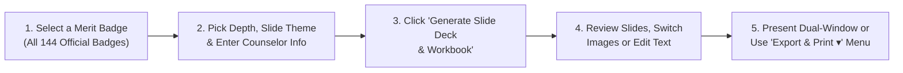
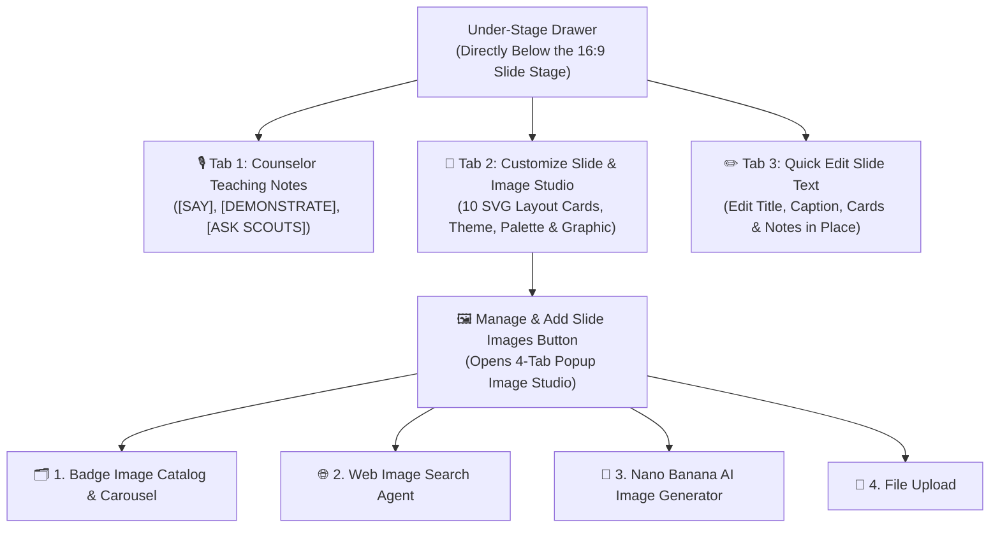

# Scouts BSA Merit Badge Counselor Workbench: User Guide

Welcome to the **Scouts BSA Merit Badge Counselor Workbench**. Whether you are preparing for three 45-minute troop meetings, a week of summer camp instruction, a Saturday Merit Badge Midway clinic, or a weekend campout practicum, this tool helps you prepare a complete, grounded teaching package for any of the **144 official Scouts BSA Merit Badges** in a few minutes.

Instead of spending an entire weekend formatting slides and typing up handouts from scratch, you can generate:
- A widescreen (`16:9`) **PowerPoint Slide Deck (`.pptx`)** with official requirement wording, clear teaching cards, diagrams, official pamphlet figures, and counselor speaker notes.
- A **Dual-Window Presenter View (`🪟 Presenter View`)**, **Fullscreen Teleprompter Notes Drawer (`🎙️ Notes (N)`)**, **Interactive Patrol Scoreboard (`🏆 Patrol Scoreboard`)**, and **Live Classroom & Skill Station Timer (`⏱️ Timer`)** so you can project slides to your patrol while reading your `[SAY]`, `[DEMONSTRATE]`, and `[ASK SCOUTS]` script.
- A **Slide Deck Customizer** directly in the left outline so you can insert custom local camp slides (`➕ Insert Slide`), hide home-prerequisite slides (`👁️ Hide Prereqs`), or reorder and skip individual slides (`▲` / `▼` / `👁`) before exporting your `.pptx`.
- A printable **Scout & Counselor Workbook (`.md` / PDF)** with section filters, fill-in-the-blank study boxes, and requirement sign-off checklists.
- **Printable 3x5 Counselor Pocket Cue Cards** (4 cards per page) and a **1-Page Printable Pocket Field Checklist & QR Handout** for outdoor field instruction away from a screen.
- A **Counselor Session Agenda & Patrol Skill Station Rotator Matrix** tailored to your meeting schedule and patrol count.
- A **Master Quartermaster Gear Checklist** and **Pre-Class Prerequisite Readiness Checklist** scaled to the size of your patrol or class.
- A **Youth Protection (YPT) Prerequisite & Parent Welcome Letter** ready to open in your email app or Gmail.
- An interactive **Patrol Blue Card (`#34124`) & Scoutbook Plus Sign-Off Tracker** with Scoutbook `.csv` import (`📤 Import CSV`), bulk roster paste, 1-click column header sign-off, completion date stamping, and **Printable 3-Panel Blue Cards (`#34124`)**.

> [!NOTE]
> **System Administrators & Curriculum Maintainers**: Looking for the Zero-PII Super-User Admin Console (144-badge image and caption curation studio, aggregated usage/latency/image-swap telemetry, and system diagnostics)? Read the dedicated **[Super-User Admin Guide (`docs/ADMIN_GUIDE.md`)](ADMIN_GUIDE.md)**.

---

## Table of Contents

1. [Getting Started in 60 Seconds](#1-getting-started-in-60-seconds)
2. [Tour of the Counselor Workbench Screen](#2-tour-of-the-counselor-workbench-screen)
3. [Step 1: Finding & Selecting a Merit Badge](#3-step-1-finding--selecting-a-merit-badge)
4. [Step 2: Choosing Your Deck Style & Saving Your Counselor Profile](#4-step-2-choosing-your-deck-style--saving-your-counselor-profile)
5. [Step 3: Watching the Scout Slide Construction Showcase](#5-step-3-watching-the-scout-slide-construction-showcase)
6. [Step 4: Previewing, Presenting, Timing & Switching Slide Images](#6-step-4-previewing-presenting-timing--switching-slide-images)
7. [Step 5: Customizing Individual Slides, Layouts, Graphics & Text](#7-step-5-customizing-individual-slides-layouts-graphics--text)
8. [Step 6: Tracking Requirements & Signing Off Blue Cards (`#34124`)](#8-step-6-tracking-requirements--signing-off-blue-cards-34124)
9. [Step 7: Using the Workbook, 4-Tab Classroom Toolkit, Cue Cards & Station Rotator](#9-step-7-using-the-workbook-4-tab-classroom-toolkit-cue-cards--station-rotator)
10. [Importing Your `.PPTX` Deck into PowerPoint or Google Slides](#10-importing-your-pptx-deck-into-powerpoint-or-google-slides)
11. [Frequently Asked Questions for Counselors](#11-frequently-asked-questions-for-counselors)

---

## 1. Getting Started in 60 Seconds

1. **Pick a Merit Badge**: In the left sidebar under **1. Find & Select Merit Badge**, search for any badge by name, filter by category or Eagle-Required status, or click one of the **Quick-Select Popular Badges** buttons (such as **★ First Aid**, **Weather**, or **★ Camping**).
2. **Choose Your Deck Settings**: Under **2. Deck Style & Counselor Info**, choose whether you want a **Deep Dive Teaching Deck (50 to 70+ Slides)** or a shorter **Standard Troop Meeting Deck (1 to 3 Slides / Req)**, pick a **Slide Theme & Visuals** mode (**Crisp White — Pamphlet Figures Only**, **Warm Cream — Pamphlet + AI Visuals**, or **Dark Slate — Pamphlet + AI Visuals**), and select your **Target Scout Audience Level**.
3. **Add Your Counselor & Troop Details (One Time)**: Click **👤 Counselor & Troop Profile (Saved) • Edit ▾** to enter your name, troop and council, city/state or ZIP code, optional email/phone, and optional troop logo. Your browser remembers these details automatically for future badges.
4. **Generate Your Package**: Click **Generate Slide Deck & Workbook**. While your slides are being built, you can watch the animated **Scout Slide Construction Showcase**.
5. **Present, Export, or Print**: Step through your slides on the **16:9 Slide Stage**, click **🪟 Presenter View** or **🖥️ Present Fullscreen** to teach from your browser, or open the **📥 Export & Print ▾** menu in the top bar to download your `.pptx` slide deck, `.md` workbook, `3x5` pocket cue cards, prerequisite checklist, or Blue Card CSV.

---

## 2. Tour of the Counselor Workbench Screen

The Workbench is organized into four main areas so you can set up your class on the left and review all of your teaching materials on the right without losing your place:

| Screen Area | Where to Find It | What You Use It For |
| :--- | :--- | :--- |
| **Top Application Bar** | Across the very top of the window | Displays your saved **Counselor Profile chip** (click it to jump straight to your profile settings), direct links to the **Official BSA Pamphlet** and **Resource Guide**, the **🪟 Presenter View** button, the **📥 Export & Print ▾** dropdown menu (with 7 download and print actions including the 1-Page Field & QR Handout), the **☀️ Sunlight** high-contrast outdoor mode toggle, and the **`?` Keyboard Shortcuts** button. |
| **Left Setup Sidebar** | Left column (`1. Find & Select Merit Badge` and `2. Deck Style & Counselor Info`) | Lets you choose any of the 144 Merit Badges, set deck length and visual style, enter your local troop information, and click **Generate Slide Deck & Workbook**. You can collapse this sidebar anytime by clicking **Hide Setup** on the left side of the main tab bar. |
| **Blue Merit Badge Summary Banner** | Top of the right main stage | Shows the official Merit Badge patch emblem, whether the badge is **Eagle-Required** or **Elective**, the badge category, and three side-by-side summary boxes on the right: **TOTAL SLIDES**, **REQUIREMENTS**, and **SLIDE THEME** (`Crisp White`, `Warm Cream`, or `Dark Slate`). |
| **4 Main Workbench Tabs** | Directly below the blue summary banner | Switches the main workspace between: 1. **Slide Deck Preview** 2. **Requirements & Blue Card Sign-Off** 3. **Scout & Counselor Workbook** 4. **Lesson Plan, Gear List, Parent Letter & FinOps** |

> [!TIP]
> **Need More Screen Space for Your Projector?** Click **Hide Setup** on the far-left edge of the main tabs bar to fold away the left setup sidebar, and click **« Hide Outline** above the slide stage to fold away the slide list. Click **Show Setup** or **» Show Outline** whenever you want them back.

---

## 3. Step 1: Finding & Selecting a Merit Badge

In the upper-left card (**1. Find & Select Merit Badge**), you have four ways to locate the badge you are teaching:

| Control | How It Works | Practical Tip for Counselors |
| :--- | :--- | :--- |
| **Search Merit Badge Name** | Type any word (such as `First Aid`, `Weather`, `Canoeing`, `Robotics`, or `Citizenship`). | Narrows the dropdown list immediately as you type. |
| **Category** | Filter by Scouting subject area: *All Categories*, *Outdoor & Campcraft*, *Health & Public Safety*, *Citizenship & Personal Development*, *Nature & Environment*, *STEM & Science*, *Aquatics & Sports*, *Trades, Business & Careers*, or *Arts, Crafts & Hobbies*. | Helpful when planning a themed campout weekend (such as an Aquatics weekend or a STEM Merit Badge Midway). |
| **Eagle Status** | Choose **All Badges (144)**, **Eagle-Required (18)**, or **Electives (126)**. | In the dropdown list, Eagle-Required badges are marked with a star (**★**). |
| **Quick-Select Popular Badges** | One-click buttons for **★ First Aid**, **Weather**, **★ Camping**, **★ Cit. in Nation**, **★ Cooking**, **★ Emergency Prep**, **★ Env. Science**, and **Robotics**. | Clicking a quick-select pill selects that badge and immediately starts building its slide deck and workbook. |
| **⚜️ Browse Visual Patch Gallery (144)** | Opens an interactive 144-badge visual patch grid modal displaying all 144 authentic `400x400` Scout Shop emblems (`assets/badge_emblems/`), with search, **All / Eagle-Required / Electives** filter, **Category** filter (matching the 7 Scouting categories in the left sidebar), and a live badge count indicator (`144 / 144 badges`). | Click any Merit Badge patch card in the gallery to load that badge and view its official emblem and category. |

---

## 4. Step 2: Choosing Your Deck Style & Saving Your Counselor Profile

In the lower-left card (**2. Deck Style & Counselor Info**), you control how detailed the presentation should be, how it should look, and what local troop information should appear on the cover slide and handouts.

### Choosing Deck Depth, Slide Theme & Audience Age

| Setting | Options Available | When to Use Each Option |
| :--- | :--- | :--- |
| **Slide Deck Length & Depth** | • **Deep Dive Teaching Deck (3 to 8 Slides / Req • 30 to 100+ Slides)** • **Standard Troop Meeting Deck (1 to 4 Slides / Req • 18 to 48 Slides)** | Choose **Deep Dive** for multi-week troop classes, summer camp blocks, or Merit Badge Universities where you want dedicated slides for every sub-requirement (`1a`, `1b`, `2a`), worked examples, and review quizzes. Choose **Standard** for a compact overview deck. |
| **Slide Theme & Visuals** | • **Crisp White — Pamphlet Figures Only** *(`~$0.14` cold / `$0.00` cached)* • **Warm Cream — Pamphlet + AI Visuals** *(Default, `~$0.18` actual cold LLM / `$0.02` cached)* • **Dark Slate — Pamphlet + AI Visuals** *(`$1.00` Max Budget Cap)* | **Crisp White** uses a clean white background (`#FFFFFF`) with official pamphlet figures and diagrams that prints well on office laser printers and works brightly in sunny outdoor pavilions. **Warm Cream** uses a warm editorial cream background (`#FAF8F5`) with colored card accents and pre-bundled pamphlet + AI requirement intro and topic visuals. **Dark Slate** uses a high-contrast dark slate background (`#0F172A`) with pamphlet + AI visuals ideal for evening troop meetings and darkened auditoriums. |
| **Target Scout Audience Level** | • **All Scouts (Ages 11 to 17)** • **First-Year / Tenderfoot Focus (Ages 11 to 12)** • **Older Scouts / Eagle Prep (Ages 14 to 17)** | Adjusts the counselor speaker notes (`[SAY]`, `[DEMONSTRATE]`, `[ASK SCOUTS]`) so your explanations and check questions fit either younger crossovers or older Scouts preparing for Eagle Boards of Review. |
| **Enable Local Regional Grounding (NOAA / Terrain / Field Sites)** | Checked by default | Tailors your **Badge Overview slide (Slide 2)**, **Session Lesson Plan**, and **Parent Welcome Letter** to your local area, referencing your nearest National Weather Service office, local terrain and seasonal weather hazards, and nearby parks or field study sites. |

### Saving Your Counselor & Troop Profile

Click **👤 Counselor & Troop Profile (Saved) • Edit ▾** at the bottom of the left sidebar to open your contact fields:
- **Counselor Name**: Printed on your Cover Slide (Slide 1), Parent Welcome Letter, and Blue Card Sign-Off Sheet (for example, `Scoutmaster Bob`).
- **Troop & Council Affiliation**: Your unit and council name (for example, `Troop 19, Spirit of Adventure Council`).
- **Location (City, State or ZIP Code)**: Enter your town or 5-digit ZIP code (such as `Middleton, MA` or `01949`) so local weather, terrain hazards, and field study locations match your troop's home area.
- **Contact Email & Contact Phone (Optional)**: Displayed in the counselor contact box on Slide 1 and in your Parent Welcome Letter so Scouts (copying a parent or guardian under Youth Protection rules) know how to reach you.
- **Optional Troop Custom Logo (`.png` / `.jpg`)**: Upload your troop numeral patch, patrol medallion, or council shoulder strip to display it in the lower-left counselor block on Slide 1.
- **↺ Reset Info**: Clears your saved profile and restores the default sample values anytime.

---

## 5. Step 3: Watching the Scout Slide Construction Showcase

Whenever a new Merit Badge deck is being assembled, or anytime you click **Merit Badge Construction Animation** in the **Research & Generation Progress** card in the left outline column, the Workbench displays an interactive **Scout Slide Construction Showcase** featuring your selected Merit Badge emblem:

1. **🏗️ 1. 3D Heavy Equipment (6f)**: Miniature Scouts in campaign hats and construction hardhats use a yellow mini-bulldozer, tower crane, forklift, scissor-lift, and twin-rotor cargo helicopter to erect a giant 16:9 slide and hoist your Merit Badge patch into the upper-right mounting ring.
2. **🪵 2. 2D Camp Pioneering (4f)**: A patrol at a pine forest campsite ties square and diagonal lashings on timber spars and uses an A-frame block-and-tackle pulley rig to hoist a canvas projection screen framed with your Merit Badge emblem.
3. **⚙️ 3. 3D Slide-O-Matic (4f)**: Stop-motion clay Scouts inside a log-cabin workshop feed Merit Badge pamphlets into a brass-and-oak *"Slide-O-Matic"* contraption before cutting a ceremonial red ribbon.

You can switch between the three animations using the top buttons, step backward or forward through individual frames with the **`◀`**, **`⏸`**, and **`▶`** controls in the bottom-right corner of the canvas, or click **✨ View Finished Slides** to return to your presentation.

---

## 6. Step 4: Previewing, Presenting, Timing & Switching Slide Images

When **Slide Deck Preview** (Tab 1) is active, you have fast controls for navigating slides, switching visuals, timing your class, and projecting to a patrol:

### 1. Slide Outline, Mini Thumbnails, Deck Customizer & Keyword Filter (Left Column of Tab 1)
- Type a requirement number (such as `2b` or `4a`) or a topic word (such as `CPR`, `tourniquet`, or `splint`) into **🔎 Filter slides by keyword or req...** to narrow the slide list.
- Each card in the **Slide Filmstrip Outline** displays a **`32x32` miniature visual thumbnail** alongside a color-coded visual source badge (`[🍌 Hero]`, `[📘 Pamphlet]`, `[📊 Diagram]`, `[📁 Custom]`, or `[📝 Text]`) and a **`🖼️ 3`** multi-choice count badge whenever the slide has multiple curated image options.
- **Slide Deck Customizer (`➕ Insert Slide`, `👁️ Hide Prereqs`, `▲` / `▼` / `👁`)**:
  - Click **`➕ Insert Slide`** at the top of the outline to insert a custom local camp slide (such as local waterfront buddy-board rules, trading post schedule, or troop campsite map) right after the active slide.
  - Click **`👁️ Hide Prereqs`** to automatically toggle off home-prerequisite slides (such as 30-day chore logs or family budgets) during a short summer camp block.
  - Use the per-slide **`▲`**, **`▼`**, and **`👁`** micro-buttons on any filmstrip card to reorder slides or hide/skip a slide. Hidden slides are dimmed in the outline, skipped during fullscreen presentation, and automatically excluded from your rebuilt `.pptx` file.

### 2. Requirement Quick-Jump Bar (`JUMP TO:`)
- Directly above the 16:9 slide canvas, the **JUMP TO:** bar lists clickable pills for **Cover**, **Overview**, every requirement (**Req 1**, **Req 2a**, **Req 2b**, ...), and **Sources**.
- Clicking any requirement pill (or clicking **`▶ Jump to Teaching Slides`** on a requirement card in Tab 2) jumps straight to the introductory slide for that requirement and automatically scrolls the left **Slide Filmstrip Outline** so the active slide card is centered in view.

### 3. Easy Slide Image Switcher (On-Stage Visual Pill & Popover)
- Look at the source pill above the image on the right side of the 16:9 slide stage:
  - When a slide has a single visual (such as a Requirement Intro slide with one Nano Banana hero illustration), the pill shows a static label (`🍌 NANO BANANA AI ILLUSTRATION`).
  - When a slide has multiple visual choices (such as the primary pamphlet figure plus up to 2 Gemini Vision-verified BSA pamphlet alternates for that requirement, or custom images you uploaded for that slide), the pill shows **`◀`** and **`▶`** arrows and a **`(1/3) ▾`** counter.
  - Click **`◀`** or **`▶`** (or press **`[`** and **`]`** on your keyboard) to switch between the slide's image options in one click, or click **`(1/3) ▾`** to open a popover showing each option's thumbnail, role label (`Primary Pamphlet Figure`, `Pamphlet Alternate #1`, `Pamphlet Alternate #2`), and Vision-verified caption. Picking any option updates the slide image, its caption, and your `[SAY]` / `[DEMONSTRATE]` teaching script right away and rebuilds your `.pptx` file in the background at `$0.00` cost. You can also click **`+ Upload / Add Custom Image for This Slide...`** at the bottom of the popover to open the 4-Tab Image Studio.

### 4. Split-Screen Presenter Console (`P`), 2nd-Monitor Window, Fullscreen Teleprompter (`N`), Classroom Timer & Patrol Scoreboard (`Space`)
- **🪟 Split-Screen Presenter Console (`🪟 Presenter View` or press `P`) & 2nd-Monitor Popup (`↗ Pop Out 2nd Monitor`)**: Clicking **`🪟 Presenter View`** (or pressing **`P`**) in either normal preview mode or Fullscreen mode (`F`) toggles an **In-Stage Split-Screen Presenter Console** directly beside the 16:9 slide canvas. The left side (`62%`) shows the current 16:9 slide, while the right side (`38%`) displays a high-contrast dark Presenter Console with a live **Session Elapsed Clock**, **Next Slide Preview Card**, and large-type **`[SAY]` / `[DEMONSTRATE]` / `[ASK SCOUTS]`** script cards with highlighted `🎬 [Stage Cues]` and `✓ Expected Answer:` boxes. Teaching multi-monitor? Click **`↗ Pop Out 2nd Monitor`** inside the Presenter Console header to open a synchronized standalone speaker-notes window (`scouts_bsa_presenter_sync_v1`).
- **🖥️ Present Fullscreen (`🖥️ Present Fullscreen` or press `F`) & Teleprompter Notes (`🎙️ Notes (N)`)**: Expands the 16:9 slide canvas across your entire screen with a floating bottom control bar (**◀ Prev**, **Next ▶**, **🎙️ Notes (N)**, **✕ Exit Fullscreen**). Clicking **`🎙️ Notes (N)`** (or pressing **`N`**) slides up a semi-transparent bottom teleprompter drawer displaying your **`[SAY]` / `[DEMONSTRATE]` / `[ASK SCOUTS]`** script right inside Fullscreen mode, or press **`P`** in Fullscreen for the side-by-side split-screen Presenter Console.
- **⏱️ Live Classroom Session & Skill Station Timer (`⏱️ Timer`)**: Click the timer pill in the stage toolbar to start a countdown for **`45m Troop`**, **`50m Camp`**, **`10m Station`**, or **`+5m`**. The timer pill turns amber at 5 minutes remaining and crimson at 1 minute remaining so your patrol stays on schedule without an alarm interrupting your talk.
- **❓ Interactive Quiz Reveal Mode (`Q`), `Space` Bar Reveal & 🏆 Patrol Scoreboard**: On Socratic Checkpoint & Scenario slides (or whenever **Hide Quiz Answers (Scout Mode)** is checked), pressing the **`Space`** bar (or clicking a masked quiz card or the **`👁️ Reveal Answer & Coaching Tip (Space)`** button) reveals the counselor answer key and coaching tip on the spot, paired with an interactive **🏆 Patrol Scoreboard** (`🦅 Eagle`, `🦊 Fox`, `🐺 Wolf`, `🐻 Bear` with `+1` / `-1` / `↺ Reset` buttons) so patrols can compete during checkpoint reviews.
- **`?` Keyboard Shortcuts Cheat-Sheet Modal**: Click **`?`** in the top bar (or press `?` on your keyboard) to view all stage and image shortcuts:

| Key | Action |
| :--- | :--- |
| **`←` / `→`** | Previous / Next slide |
| **`Space`** | Reveal / hide quiz answer on Socratic Checkpoint slides (or when Scout Quiz Mode is active) |
| **`[` / `]`** | Cycle previous / next image choice in the Easy Slide Image Switcher |
| **`F`** | Toggle Fullscreen classroom projector mode |
| **`N`** | Toggle Fullscreen Teleprompter Notes Drawer (`[SAY]` / `[DEMO]` / `[ASK]`) |
| **`P`** | Toggle Split-Screen Presenter Console (in Preview or Fullscreen) + `↗ Pop Out 2nd Monitor` |
| **`Q`** | Toggle Quiz Answer Hide/Reveal mode (`Scout Mode`) |
| **`?`** | Open Keyboard Shortcuts Cheat-Sheet modal |
| **`Esc`** | Close active popover, modal, or Fullscreen view |

---

## 7. Step 5: Customizing Individual Slides, Layouts, Graphics & Text

Directly below the 16:9 slide stage sits the **3-Tab Under-Stage Drawer**, which gives you everything you need to teach or customize the active slide without scrolling down a long page:

### Drawer Tab 1: `🎙️ Counselor Teaching Notes ([SAY] / [DEMO] / [ASK])`
Displays your ready-to-speak **EDGE Method** script for the current slide, compiled on the fly (`<5ms` per deck) directly from the slide's teaching cards, official requirement text, and active visual caption:
- **`[SAY]`**: A conversational first-person speaking script that teaches the actual material on the slide and includes highlighted inline stage directions (`🎬 [Point to Card 1: ...]`, `🎬 [Gesture to the right-hand figure: ...]`, `🎬 [Pause for hands]`).
- **`[DEMONSTRATE]`**: Included selectively when the slide calls for a hands-on skill demonstration, gear inspection, worked-example walkthrough, or diagram trace.
- **`[ASK SCOUTS]`**: A specific patrol or field check question followed by a highlighted **`✓ Expected Answer:`** key so you have the exact BSA pamphlet answer in front of you.
- **`✨ AI Polish Slide`, `✨ Polish Entire Deck` & `📋 Copy Script` Buttons**: Click **`✨ AI Polish Slide`** (`POST /api/v1/slide/polish-notes`) in the upper-right header of the notes card to upgrade the active slide's notes with a Studio narrative opening hook, card-to-card transitions, and EDGE coaching cues, or click **`✨ Polish Entire Deck`** (`POST /api/v1/slide/polish-notes-batch`) to batch-polish every slide across the presentation in parallel (cached in SQLite `polished_speaker_notes` and synced into your downloadable `.pptx` file). Click **`📋 Copy Script`** anytime to copy the active slide's script to your clipboard. Whenever you switch a slide's image or edit its cards, the teaching script updates automatically to match.

### Drawer Tab 2: `🎨 Customize Slide & Image Studio`
Lets you change the layout, colors, or illustration on the active slide and automatically rebuilds your downloadable `.pptx` file:

| Control | Options Available | What It Does |
| :--- | :--- | :--- |
| **1. Slide Layout (10 Clickable SVG Mini-Wireframe Cards)** | • *Split + Visual* (`SPLIT_VISUAL_EXPLAINER`) • *2x2 Step Grid* (`PROCESS_STEP_GRID`) • *2-Col Compare* (`TWO_COLUMN_COMPARISON`) • *Checklist (`[✓]`)* (`SAFETY_CHECKLIST_GRID`) • *3-Col Triage* (`REQUIREMENT_TRIAGE_MATRIX`) • *Worked Example* (`WORKED_EXAMPLE_CARD`) • *Patrol Quiz* (`SOCRATIC_CHECKPOINT`) • *Full-Width Text* (`CONCEPT_TEXT_SLIDE`) • *Large Diagram* (`FULL_BLEED_IMAGE_EXPLAINER`) • *Req Intro* (`REQUIREMENT_INTRO_BANNER`) | Click any visual mini-wireframe card (or select from the dropdown) to rearrange how the teaching cards and right-side visual are positioned on the current slide. |
| **2. Card Style (Magazine Theme)** | • *Numbered Step Badges (01, 02, 03)* • *Bento Accent Cards (Top Color Bar ◆)* • *Editorial Callout Cards (Warm Gold ❝)* • *High-Contrast Dark Slate Cards (★)* • *Timeline Sequence Cards (STEP 1 ➔)* • *Safety Warning Highlight (Crimson ⚠️)* | Changes the visual style, numbered badges, and accent borders of the teaching cards on the slide. |
| **3. Brand Palette** | • *Scouts Navy & Eagle Gold* • *Outdoor Olive & Forest Green* • *Eagle Crimson & Navy* • *Executive Slate & Action Blue* | Updates the color scheme of the header bar and card borders on the active slide. |
| **4. Right-Side Graphic** | • *Keep Current Slide Graphic* • *Restore Original Slide Graphic* • *🍌 Nano Banana Hero Graphic (or EDGE Concept Map)* • *None (Remove Graphic & Expand Text to Full Width)* | Controls the right-hand picture. Choosing **None** removes the picture and expands your teaching cards across the full width of the slide; choosing **Restore Original Slide Graphic** brings back the default diagram or pamphlet figure. |
| **✨ Apply to Slide** | Primary action button | Applies your selected Layout, Card Style, Brand Palette, and Right-Side Graphic to the slide and updates the `.pptx` download. |

### Using the 4-Tab Popup Image Studio (`🖼️ Manage & Add Slide Images`)
Click **🖼️ Manage & Add Slide Images (Catalog / Web / AI)** in the upper-right corner of the **Customize Slide & Image Studio** bar to open the popup Image Studio window:

1. **🗂️ 1. Badge Image Catalog & Carousel**:
   - Shows thumbnail cards for every image saved for the current Merit Badge (including official BSA pamphlet figures, requirement hero illustrations, diagrams, web search photos, and your own uploaded pictures).
   - Click **✅ Use on Slide** on any card to place that graphic onto your current slide.
   - Click **🗑️ Clear Web/AI Cache** in the upper right if you want to remove extra web-searched or custom AI-generated images while keeping all official pamphlet figures, default requirement hero graphics, and your own uploaded photos.
2. **🌐 2. Web Image Search Agent**:
   - Type a topic (such as `splint forearm`, `cumulonimbus cloud`, or `square lashing`) and click **🔎 Search Web & Commons** to search Wikimedia Commons for free educational photographs and diagrams (`$0.00` cost).
   - Click **Use on Slide** on any result to save it to the badge catalog and place it on the current slide.
3. **🍌 3. Nano Banana AI Image Generator**:
   - Creates a custom illustration tailored to your slide:
     - **1. Visual Illustration Style**: Choose **✨ Auto (Content-Aware Mix)** to let the tool pick the best style for the slide topic, or choose a specific style (*Photorealistic Image*, *4-Quadrant Concept Map*, *Line Drawing*, *Watercolor Field Sketch*, *Technical Diagram*, *3D Isometric Illustration*, *Editorial Vector Illustration*, *Cartoon Drawing*, or *Vintage Merit Badge Poster*).
     - **2. Human Presence & Uniform Directive**: Choose **✨ Auto-Detect**, **👕 Include Humans (Adult Scouts BSA Uniforms)**, or **🧰 No Humans (Pure Equipment / Environment)**, or toggle the **Include Uniformed Scouts** checkbox.
     - **3. Visual Scene Description**: Edit or refine the scene description you want illustrated.
   - Check the **`$0.08 USD`** cost consent box and click **🍌 Generate, Verify & Apply Custom AI Graphic (`$0.08 USD`)**.
4. **📁 4. File Upload**:
   - Click **1. Select Local Image File (PNG, JPG, WEBP, GIF)** to pick a photo from your own computer (such as a photo from a troop campout or your own training prop), enter an optional title and description, and click **📁 Upload, Cache & Apply Local Image to Slide (`$0.00 USD`)**.

### Drawer Tab 3: `✏️ Quick Edit Slide Text`
Want to tweak a slide title, reword a bullet card, or add a personal story to your speaker notes?
1. Click **✏️ Quick Edit Slide Text** below the slide stage.
2. Edit any of the four boxes:
   - **Slide Title**
   - **Visual Caption (Right Graphic)**
   - **Slide Teaching Cards (One card per line: use "Heading: Body text")**
   - **Counselor Teaching Script (`[SAY]`, `[DEMONSTRATE]`, `[ASK SCOUTS]`)**
3. Click **💾 Save Slide Edits & Rebuild .PPTX**. Your live slide preview and your downloadable PowerPoint deck update in less than a second at zero cost.

---

## 8. Step 6: Tracking Requirements & Signing Off Blue Cards (`#34124`)

Click the second main tab at the top of the screen (**Requirements & Blue Card Sign-Off**) to view how every official requirement is taught and to track Scout sign-offs during class.

### 3-Column Requirements Triage & Header Action Buttons
At the top of the **Official BSA Merit Badge Pamphlet & Digital Resource Guides** card, three single-line action buttons let you jump directly to **`↓ Blue Card Tracker`**, open the **`Official BSA Pamphlet (PDF)`**, or open the **`Scouting.org Resource Guide`**. Directly below, every official requirement for the badge is sorted into one of three practical teaching columns:
- **Discussion & Core Knowledge**: Requirements you can cover through interactive patrol discussion, visual explainers, and Socratic Q&A.
- **Hands-On Skill Demonstrations**: Physical skills where each Scout must *demonstrate*, *build*, *treat*, or *perform* a task at a practice station.
- **Campout, Field & Home Projects**: Prerequisites, multi-week logs, field visits, or campout tasks that Scouts must complete outside of a regular troop classroom meeting.

Every requirement card lists the **exact official BSA requirement text**, the recommended **EDGE Method phase**, the **Counselor Sign-Off Criteria**, any **Youth Protection or Guide to Safe Scouting reminders**, and a **▶ Jump to Teaching Slides** button that takes you straight to that requirement's slides.

### Patrol Blue Card (`#34124`) & Scoutbook Plus Requirement Sign-Off Tracker
Below the requirement columns sits an interactive roster table saved automatically in your browser for each Merit Badge:
1. **Add Scouts Individually, via Bulk Paste, or via Scoutbook `.CSV` Import**:
   - Type a Scout's name (for example, `Alex Carter - Eagle Patrol`) into the box and click **➕ Add Scout** (or press `Enter`).
   - Click **📋 Bulk Paste Roster** to paste an entire patrol or class list from a spreadsheet (one Scout per line, such as `Name, Patrol / Unit`).
   - Or click **📤 Import CSV** to upload a standard `.csv` roster exported from **Scoutbook Plus** or **TroopWebHost** (`Scout Name`, `BSA Member ID`, `Unit`, `Patrol`, and existing requirement checkmarks).
2. **Check Off Completed Requirements, Bulk Sign Off Columns & Stamp Dates**:
   - As each Scout demonstrates mastery of a requirement (`1`, `2a`, `2b`, `3`, ...), check the box in their row.
   - Click any **Requirement Column Header (`1 ✓`, `2a ✓`, ...)** to toggle that requirement for the entire patrol in one click after a group demonstration.
   - Pick a date in the **📅 Completion Date** field and click **Stamp Checked** to record the completion date across all checked cells (included automatically in your Scoutbook CSV export and printed Sign-Off Sheet).
3. **Automatic `Partial` vs. `Complete` Blue Card Status**: The **Blue Card Status** column automatically shows `Partial (X/Y)` in amber while a Scout is still working, and switches to `Complete (Y/Y)` in green once all requirements are checked. You can also click **All ✓** in the **Quick** column to check or uncheck an entire row at once.
4. **Export Scoutbook CSV, Print Patrol Sheet, or Print 3-Panel Blue Cards (`#34124`)**:
   - Click **📥 Export Scoutbook CSV** to download a `.csv` spreadsheet listing every Scout, unit, requirement status, completion date, and counselor name for easy entry into **Scoutbook Plus** or troop advancement records.
   - Click **🖨️ Print Sign-Off Sheet** to open a clean, printable **Application for Merit Badge (`#34124`) Patrol Sign-Off Record** complete with a Counselor signature and date line.
   - Click **🪪 Print 3-Panel Blue Cards (#34124)** to generate printable 3-column tri-fold Blue Cards (*Applicant's Record*, *Application for Merit Badge*, and *Counselor's Record*) pre-populated with each Scout's name, unit, completed requirement initials/dates, and your counselor signature block.

---

## 9. Step 7: Using the Workbook, 4-Tab Classroom Toolkit, Cue Cards & Station Rotator

### Top Tab 3: `Scout & Counselor Workbook` (with Section Filter Pills)
Click **Scout & Counselor Workbook** to preview the complete printable workbook for the active Merit Badge:
- Use the sticky **Section Filter Bar** at the top of the workbook card (**`All Sections`**, **`Checklist Table`**, **`Requirement Notes`**, and **`Instructor Guide`**) to jump straight to the section you want to review or print.
- Use the action buttons in the upper right of the card:
  - **📋 Copy Text**: Copies the entire workbook to your clipboard.
  - **🖨️ Print / Save PDF**: Opens a clean, black-and-white print view formatted for standard `8.5" x 11"` paper or **Save as PDF**.
  - **🖨️ Print 3x5 Pocket Cue Cards**: Generates a 2x2 printable grid of `3x5` counselor index cards containing each requirement's number, verbatim summary, **`[SAY]`**, **`[DEMONSTRATE]`**, and **`[ASK SCOUTS]`** prompts so you can teach outdoors at camp without carrying a laptop.

### Top Tab 4: `Lesson Plan, Gear List, Parent Letter & FinOps` (Organized into 4 Sub-Tabs)
Click **Lesson Plan, Gear List, Parent Letter & FinOps** to access your classroom preparation toolkit, organized into four focused sub-tabs so you never have to scroll down a long page:

| Sub-Tab | Key Controls & Options | How Counselors Use It |
| :--- | :--- | :--- |
| **🗓️ 1. Agenda & Station Rotations** | • **🗓️ Session Schedule Format** dropdown:   1. *3 Troop Meetings (45 min each)*   2. *Summer Camp Week (4x 50-min Mon-Thu + Fri Make-Up)*   3. *Saturday Merit Badge Midway / Clinic (3-Hour Block)*   4. *Weekend Campout Practicum (Fri Eve + Sat Field + Sun Sign-Off)* • **🔄 Patrol Skill Station Rotator Matrix** (`2`, `3`, or `4` Patrols; `15`, `20`, or `25` min/station) • **🖨️ Print 3x5 Pocket Cue Cards** button | Regroups the badge requirements into a timed, minute-by-minute teaching plan, builds a **Round-Robin Patrol Skill Station Rotation Schedule** across all `HANDS_ON_SKILL_STATION` requirements so patrols never bottleneck on the same equipment, and prints pocket cue cards. |
| **🎒 2. Quartermaster Gear & Pre-Class Check** | • **🏕️ Class / Patrol Size** dropdown (*1 Scout*, *4 Scouts*, *8 Scouts*, or *16 Scouts*) • **📋 Pre-Class Prerequisite Readiness Checklist** (`PREREQUISITE_CAMPOUT_HOME` table + **🖨️ Print Prerequisite Check Sheet**) • Interactive checkboxes, **📋 Copy Packing List**, and **🖨️ Print Checklist** | Multiplies physical prop and supply quantities based on your class size, and builds a Day-1 **Prerequisite Readiness Check Sheet** listing every home log, multi-week chart, or campout task Scouts must bring to class before receiving full Blue Card sign-off. |
| **✉️ 3. Parent Welcome Letter (YPT)** | • **📋 Copy**, **✉️ Draft in Email App**, **📨 Compose in Gmail**, **🖨️ Print**, and **📥 .MD** | Generates a ready-to-send welcome letter for parents, guardians, and Scoutmasters listing prerequisites to finish before class, what gear to bring, local field study context, and **Scouting America Youth Protection (Two-Deep Leadership / no one-on-one digital contact)** reminders. |
| **📊 4. Citations, FinOps & Rating** | • **Grounded Deep Research Citations & Local Troop Grounding** • **FinOps Cost & Token Budget (`$1.00 Max Cap`)** • **Counselor Sign-Off & Continuous Learning Flywheel** (`1` to `5` stars + **✅ Requirement Accuracy Verified**) | Lists the official BSA pamphlet and authoritative public references (NOAA, USGS, NPS, American Red Cross), displays the estimated generation cost and cache savings, and lets you submit your counselor quality rating. |

---

## 10. Exporting Your Slide Deck to PowerPoint (`.PPTX`) or Direct Google Slides

In the Top Application Bar (and inside **`📥 Export & Print ▾`**), the Workbench provides a **Sticky Export Split-Button** (`scouts_bsa_preferred_deck_export_mode_v1` in `localStorage`) that remembers your preferred slide deck format across sessions:
- **Mode 1: `📥 Download Slide Deck (.PPTX)` (Default)**: Downloads a widescreen (`16:9`) PowerPoint presentation named `<Badge>_<PolishMode>_<Depth>_Merit_Badge_Deck.pptx` where every title, teaching card, caption, and speaker note is a native editable text box.
- **Mode 2: `🟨 Open in Google Slides` (Direct Google Drive Conversion via `POST /api/v1/slide/export-gslides`)**: Converts your generated deck directly into a native Google Slides presentation (`mimeType: application/vnd.google-apps.presentation`) using your Google Drive credentials (supporting local Google Application Default Credentials, `gcloud auth`, or a user OAuth 2.0 `drive.file` token) and opens `https://docs.google.com/presentation/d/<id>/edit` in a new browser tab.
- Click the **`▾`** caret on the right edge of the split-button anytime to switch your default export action between **`.PPTX`** and **Google Slides**.
- Also in **`📥 Export & Print ▾`**, clicking **`📱 Print 1-Page Field & QR Handout`** opens a printable 1-page pocket reference featuring **standard-compliant, phone-camera-scannable ISO/IEC 18004 QR codes** (`/api/v1/qr.svg`) that resolve directly to the official BSA Merit Badge Pamphlet PDF (`filestore.scouting.org`) and the Scouting.org Digital Resource Guide.

### Opening in Microsoft PowerPoint or Apple Keynote
1. Double-click the downloaded `.pptx` file on your laptop.
2. Switch to **Presenter View** during class so your Scouts see the 16:9 visual slides on the projector while you read the **`[SAY]` / `[DEMONSTRATE]` / `[ASK SCOUTS]`** teaching script on your laptop screen.

### Importing into Google Slides for Google Drive Sharing
1. Open [Google Slides](https://slides.google.com) or your troop's shared Google Drive folder.
2. Click **File -> Import slides** (or **File -> Open -> Upload**) and drag in your downloaded `.pptx` file.
3. Click **View -> Show speaker notes** to see your EDGE teaching script below each slide, or click **Slideshow -> Presenter view** when teaching.

---

## 11. Frequently Asked Questions for Counselors

### Can I use the Workbench at summer camp where Wi-Fi is spotty or unavailable?
Yes. All 144 Merit Badge requirement outlines and all **3,917 built-in curated visual assets** (**2,323 100%-Vision-verified BSA Pamphlet figures** [`1,009` primary active + `1,314` requirement alternates], **1,306 pre-generated Nano Banana requirement hero & topic illustrations**, **144 badge emblems**, and **144 pamphlet covers**) are stored locally when running on your laptop (`1.5 to 3.5s` offline build speed). Any Merit Badge decks, pamphlets, or extra images you generate before camp stay saved on your machine for instant offline use.

### How do I remove an image from a slide if I just want larger text cards?
Select the slide in **Slide Deck Preview**, click the second tab below the slide (**🎨 Customize Slide & Image Studio**), change **4. Right-Side Graphic** to **None (Remove Graphic & Expand Text to Full Width)**, and click **✨ Apply to Slide**. The picture is removed and the text cards expand across the full width of the slide.

### How do I switch a slide back to its original diagram or pamphlet illustration?
In **🎨 Customize Slide & Image Studio**, set **4. Right-Side Graphic** to **Restore Original Slide Graphic** and click **✨ Apply to Slide**.

### How do I add my own troop photos to a slide?
Click **🎨 Customize Slide & Image Studio** below the slide stage, click **🖼️ Manage & Add Slide Images (Catalog / Web / AI)** in the upper-right corner, select the fourth tab (**📁 4. File Upload**), pick any `.png`, `.jpg`, `.webp`, or `.gif` photo from your computer, and click **📁 Upload, Cache & Apply Local Image to Slide (`$0.00 USD`)**.

### Is my contact information kept private?
Yes. Your Counselor Name, Troop, Location/ZIP, Email, and Phone are saved locally in your browser (and in a private local cache file when running on your own laptop) so you don't have to retype them. They are placed directly onto your Cover Slide, Parent Welcome Letter, and Blue Card Sign-Off Sheet, and are never shared with outside services or telemetry logs.
