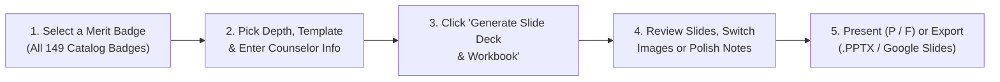
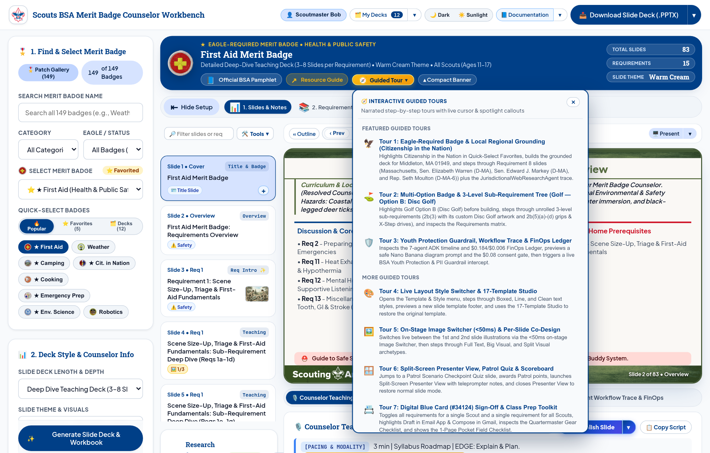
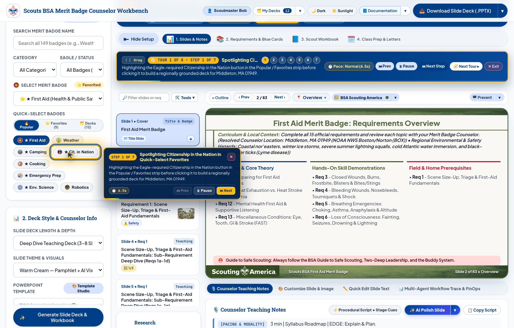
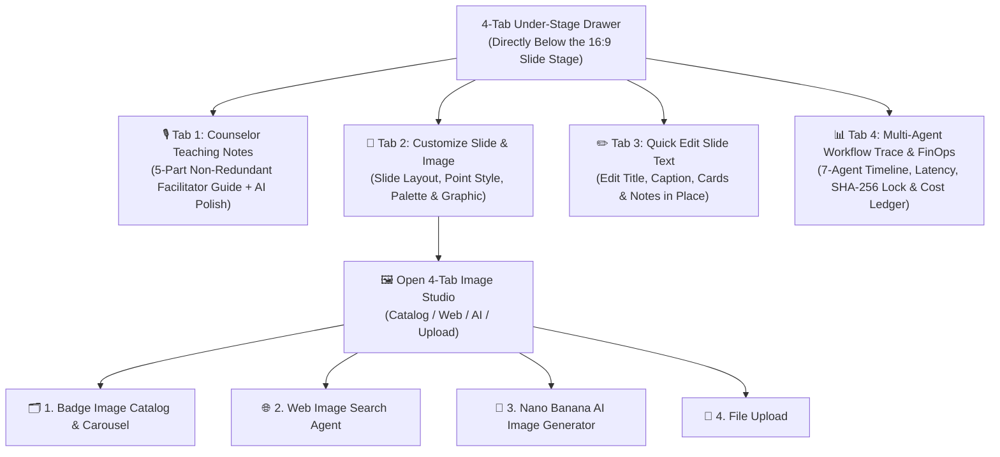
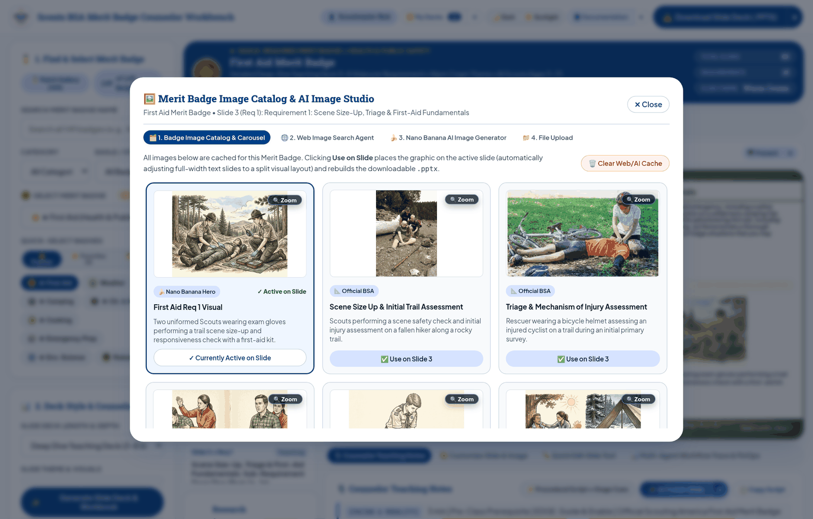
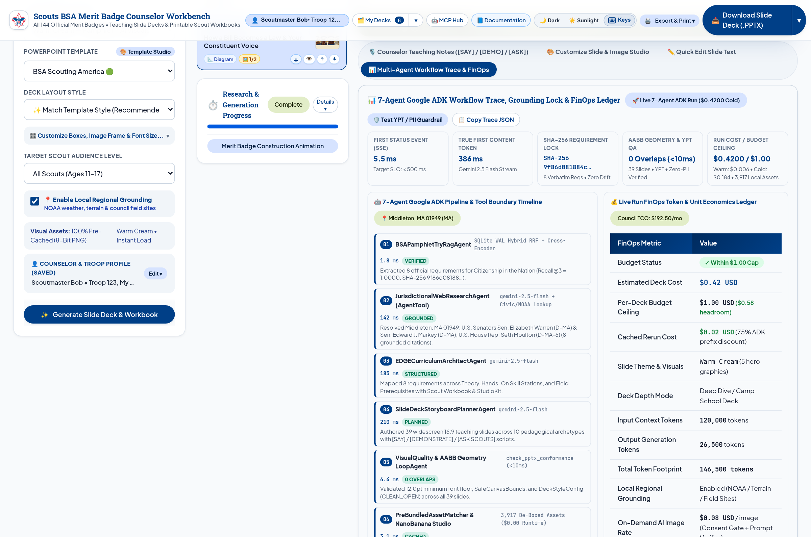

# Scouts BSA Merit Badge Counselor Workbench: User Guide

Welcome to the **Scouts BSA Merit Badge Counselor Workbench**. Whether you are preparing for three 45-minute troop meetings, a week of summer camp instruction, a 4-session Saturday Merit Badge College clinic, or a weekend campout practicum, this tool helps you prepare a complete teaching package for any of the **149 Scouts BSA Merit Badges** (`143` Active Official Merit Badges, `5` Scouting America Test Lab Pilots including *Auctioneering*, *Dance*, *Physics*, *Psychology*, and *Wildland Fire Management* plus *Sewing and Needlework*, and `1` Discontinued Historical reference badge, *Citizenship in Society*, annotated with a red `🚫 Discontinued` indicator in the Patch Gallery) in a few minutes.

Instead of spending an entire weekend formatting slides and typing up handouts from scratch, you can generate:
- A widescreen (`16:9`) **PowerPoint Slide Deck (`.pptx`)** or **Google Slides presentation** with official requirement wording, clear teaching points, a **Single Unified Bottom Misconception Bar** (`⚠️ Myth vs. ✓ Pamphlet Fact`), diagrams, official pamphlet figures, **Archetype-Differentiated 5-Part Non-Redundant Facilitator Guide** speaker notes (`[PACING & MODALITY]`, `[ASK SCOUTS FIRST]`, `[EXPECTED PAMPHLET ANSWER KEY]`, `[COMMON MISCONCEPTION TO CORRECT]`, `[DEMONSTRATION & SIGN-OFF RUBRIC]`) with sub-requirement-scoped child slides and **`[✨ AI Polish Slide | ▾]`**, **17 built-in Scouting America and Heritage templates across 8 style families**, and flexible **Deck Layout Styles** (*Clean & Borderless*, *Editorial Left-Accent Line*, and *Boxed Cards*).
- A **My Decks Library** and **Starred Favorites** so you can switch between multiple Merit Badges or separate morning and afternoon patrol sections in an instant, each with its own Scout roster.
- A **Split-Screen Presenter View** with color-coded 5-Part Facilitator Guide speaking cards, a **2nd Monitor** speaker window, a **Fullscreen Mode** with a slide-up **Notes Drawer**, a **Patrol Scoreboard**, and a **Classroom Session Timer**.
- An **In-App Documentation Viewer** and **MCP Hub** (`27` capabilities: `15` Tools, `7` Resources, `5` Prompts) in the top bar so you can read this guide or connect external AI assistants without leaving your active slide deck.
- A **Slide Deck Customizer** directly in the slide outline so you can insert custom local camp slides, inject **Opt-In Class Opening (`overview-logistics`) & Closing (`homework-checkout`) Slides**, hide home-prerequisite slides, or reorder and skip individual slides before downloading your presentation.
- A **4-Pillar Sub-Requirement-Unrolled Fillable Scout Workbook (`GTA §7.0.3.2`)** across interactive browser-fillable HTML (`contenteditable`), copyable Markdown (`📋 Copy Markdown`), and graphically branded downloadable AcroForm `.PDF` with official Merit Badge emblem medallion headers and dynamic multi-page PyMuPDF text wrapping (`0%` dropped requirement text across all 149 badges), 13 clause-driven bespoke graphic organizers (`HAZARD_5COL`, `SYMPTOMS_FIRST_AID_PREVENTION_3COL`, `CAMPING_LOG_20NIGHT`, `FITNESS_ASSESSMENT_4STAGE`, `FITNESS_LOG_12WK`, `MEAL_PLANNER_AND_COST_TABLE`, `CITIZENSHIP_CIVIC_ORGANIZER`, `SCIENTIFIC_EXPERIMENT_SHEET`, `SENSORY_OBSERVATION_LOG`, `ENGINEERING_DESIGN_NOTEBOOK`, `CAREER_EXPLORATION_CARD`, `SKETCH_AND_OBSERVATION_CANVAS`, `PHYSICAL_SKILL_VERIFICATION_RUBRIC`), interactive `gear_checklist` checkboxes, Counselor Pre-Approval signature gates, and a **Multi-Page Printable Class Preparation Page (CPP)** plus **Organizer Catalog Spec Sheet**.
- **Printable 3x5 Counselor Pocket Cue Cards** and a **1-Page Field Checklist & QR Handout** for outdoor field instruction away from a screen.
- A **Counselor Session Agenda & Patrol Skill Station Rotator** tailored to your meeting schedule (`4-Session MBC Clinic`, `2-Session Bi-Weekly`, `Double-Block Companion`, `Summer Camp Week`, or `3 Troop Meetings`) with interactive **5-Tier Syllabus Bucket Overrides** and **Snow-Day / Rain-Out Session Re-Balancer**.
- A **Master Quartermaster Gear Checklist** and **Pre-Class Prerequisite Readiness Checklist** scaled to the size of your class.
- A **3-Stage Youth Protection (YPT) Two-Deep Communication Pack** (Stage 1 Welcome & Prereq, Stage 2 Mid-Clinic Progress, Stage 3 Final Partial & Sign-Off Report) ready to open in your email app or Gmail with mandatory Two-Deep CC enforcement.
- An interactive **Multi-Session (`S1|S2|S3|S4|M`) & Multi-Troop Patrol Blue Card (`#34124`) & Scoutbook Plus Sign-Off Tracker** with **Smart Partial Differentiation** (*Actionable Make-Up* vs. *Expected Home-Troop Prereq*), **Per-Troop Privacy Isolation** (`Troop 19` vs. `Troop 114`), Scoutbook `.csv` import and formula-sanitized `.csv` export, cross-deck roster copy, bulk roster paste, one-click column sign-off, completion date stamping, and **Printable 3-Panel Blue Cards**.
- **Consolidated Material 3 Toolbars (`54` loose controls grouped into `19` split-buttons and segmented switchers, including `37` toolbar actions consolidated into `14` across the `5` primary toolbars in `v2.2`/`v2.3`)** across the Global Header, Single-Row Compact Hero Banner, Stage Toolbar, Tab 2 Blue Card Matrix, Tab 3 3-Segment Scout Workbook Switcher, and Tab 4 StudioKit, plus aesthetic 2-line slide footer wrapping (`3.5pt` top rule and `11pt` centered footer text).

> [!NOTE]
> **System Administrators & AI Agent Integrators**: For the Super-User Admin Console covering the 149-badge image curation studio, usage telemetry, and system diagnostics, see the **[Super-User Admin Guide](ADMIN_GUIDE.md)**. To connect Claude Desktop, Gemini CLI, Cursor, or Google ADK agents to the built-in Model Context Protocol server, see the **[MCP Server Integration Guide](MCP_SERVER_INTEGRATION_GUIDE.md)**.

---

## Table of Contents

1. [Getting Started in 60 Seconds](#1-getting-started-in-60-seconds)
2. [Tour of the Counselor Workbench Screen](#2-tour-of-the-counselor-workbench-screen)
3. [Step 1: Finding & Selecting a Merit Badge](#3-step-1-finding--selecting-a-merit-badge)
4. [Step 2: Choosing Your Deck Style & Saving Your Counselor Profile](#4-step-2-choosing-your-deck-style--saving-your-counselor-profile)
5. [Step 3: Watching the Scout Slide Construction Animations](#5-step-3-watching-the-scout-slide-construction-animations)
6. [Step 4: Previewing, Presenting, Timing & Switching Slide Images](#6-step-4-previewing-presenting-timing--switching-slide-images)
7. [Step 5: Customizing Individual Slides, Layouts, Graphics & Text](#7-step-5-customizing-individual-slides-layouts-graphics--text)
8. [Step 6: Tracking Requirements & Signing Off Blue Cards (`#34124`)](#8-step-6-tracking-requirements--signing-off-blue-cards-34124)
9. [Step 7: Using the Workbook, Classroom Toolkit, Cue Cards & Station Rotator](#9-step-7-using-the-workbook-classroom-toolkit-cue-cards--station-rotator)
10. [Exporting Your Slide Deck to PowerPoint or Google Slides](#10-exporting-your-slide-deck-to-powerpoint-or-google-slides)
11. [Frequently Asked Questions for Counselors](#11-frequently-asked-questions-for-counselors)

---

## 1. Getting Started in 60 Seconds

1. **Pick a Merit Badge**: In the left sidebar under **1. Find & Select Merit Badge**, search for any badge by name, filter by category, Eagle-Required status, or Test Lab Pilot status, open **⚜️ Patch Gallery (149)**, or click one of the **Quick-Select Badges** buttons such as **★ First Aid**, **Weather**, or **★ Camping**.
2. **Choose Your Deck Settings**: Under **2. Deck Style & Counselor Info**, choose whether you want a **Deep Dive Teaching Deck** or a shorter **Standard Troop Meeting Deck**, pick your **Slide Theme & Visuals** (*Warm Cream*, *Crisp White*, or *Dark Slate*), choose a **PowerPoint Template** and **Deck Layout Style**, and select your **Target Scout Audience Level**. All **4,124** visual assets (`2,425` Vision-verified BSA Pamphlet figures, `1,401` Nano Banana illustrations, `149` emblems, and `149` covers) are pre-bundled so images load immediately at zero extra cost.
3. **Add Your Counselor & Troop Details**: Click **👤 Counselor & Troop Profile (Saved) • Edit ▾** to enter your name, troop and council, city and state or ZIP code, optional email and phone, and optional troop logo. The Workbench remembers these details automatically for future badges.
4. **Generate Your Package**: Click **✨ Generate Slide Deck & Workbook**. While your slides are being built, you can watch the animated **Scout Slide Construction Animations**.
5. **Present, Export, or Print**: Step through your slides on the **16:9 Slide Stage**, click **🖥️ Present** or press **`P`** for **Split-Screen Presenter View** to teach from your browser, use the top-right **`[📥 Download (.PPTX) | ▾]`** split-button to **Download Slide Deck (.PPTX)**, **Open in Google Slides**, or export your workbook, `3x5` pocket cue cards, 1-page QR field handout, prerequisite checklist, or Blue Card CSV.

---

## 2. Tour of the Counselor Workbench Screen

The Workbench is organized into four main areas plus a bottom footer, consolidating **54** loose controls into **19** Material 3 split-buttons and segmented switchers so you can set up your class on the left and review all of your teaching materials on the right without clutter:

| Screen Area | Where to Find It | What You Use It For |
| :--- | :--- | :--- |
| **Top Application Bar** | Across the very top of the window | Shows your **Counselor Profile Pill**, the **`[🗂️ My Decks | ▾]`** split-button for opening your saved decks library or switching active decks in one click, **`[📘 Help & Tools | ▾]`** (bundling **Documentation** `D`, **8 Guided Tours**, **Keyboard Shortcuts** `?`, and **MCP Inspector**), **`🌙 Dark`** and **`☀️ Sunlight`** display modes, and the unified **`[📥 Download (.PPTX) | ▾]`** split-button (Download `.PPTX`, Open in Google Slides, Print `3x5` Cue Cards, Print 1-Page QR Field Handout, and Export Backup). |
| **Left Setup Sidebar** | Left column (`1. Find & Select Merit Badge` and `2. Deck Style & Counselor Info`) | Lets you choose or star any of the 149 Merit Badges (`143` Active Official, `5` Test Lab Pilots, and `1` Discontinued Historical), switch the **Quick-Select Badges** bar between **🔥 Popular**, **⭐ Favorites**, and **🗂️ Decks**, open the **149-Badge Patch Gallery**, pick a **PowerPoint Template** and **Deck Layout Style**, set deck length and target Scout age group, enter your local troop information, and click **✨ Generate Slide Deck & Workbook**. You can fold this sidebar away anytime by clicking **⬅ Hide Setup** on the left side of the main tab bar. |
| **Blue Merit Badge Summary Banner (Auto-Slim Hero Banner)** | Top of the right main workspace | Shows the official Merit Badge patch emblem, whether the badge is **Eagle-Required**, **Elective**, **Test Lab Pilot**, or **Discontinued**, the badge category, direct links to the **📘 Official BSA Pamphlet** and **↗ Resource Guide**, the **`🧭 Guided Tour ▾`** interactive tour launcher, and three clickable summary pills on the right (**TOTAL SLIDES** jumps to the Slide Outline Filmstrip, **REQUIREMENTS** opens Tab 2 *Requirements & Blue Cards*, and **SLIDE THEME** opens the *17-Template & Layout Style Studio*). Automatically slims down after deck generation to maximize vertical stage room. |
| **Main Workbench Tabs** | Directly below the blue summary banner | Switches the main workspace between: 1. **📊 1. Slides & Notes** 2. **📚 2. Requirements & Blue Cards** 3. **📘 3. Scout Workbook** 4. **🗓️ 4. Class Prep & Letters** |
| **Application Footer** | Bottom of the window | Displays creator credits, **LinkedIn Profile**, the **GitHub** repository link, feedback email, and the **🔒 Admin** Console link. |

### Launching an Interactive Narrated Guided Tour (`🧭 Guided Tour ▾`)

Want to see the Workbench's key features in action right away? Click the gold **`🧭 Guided Tour ▾`** button in the Blue Merit Badge Summary Banner (right next to **📘 Official BSA Pamphlet** and **↗ Resource Guide**) to choose from **8 interactive, narrated step-by-step tours**:

- **Draggable & Auto-Bottom-Docking Guided Tour Bar**: Appears directly below the main navigation tabs and narrates every step with a clear 1 to 2 line description, interactive step-number pills (`1`, `2`, `3`, ...), a **`⋮⋮ Drag`** handle (drag the bar anywhere on screen or double-click **`⋮⋮ Drag`** to re-dock), and playback controls (**`⏱️ Pace`**, **`⏮ Prev`**, **`⏸ Pause / ▶ Resume`**, **`⏭ Next Step`**, **`🧭 Next Tour ▸`**, and **`✕ Exit`**). Whenever a full-screen modal (such as **Documentation**, **MCP Hub**, **Template Studio**, or **Image Studio**) is open, the Guided Tour bar automatically docks at the bottom of the screen so it never covers modal headers or collides with the floating callout.
- **Smart Intentional-Movement Pause & Idempotent `⏮ Prev` / `⏭ Next` Navigation**: Moving your mouse cursor inside the floating callout or tour bar to click a control pauses the step countdown for `1.8 seconds`, while a cursor simply resting stationary inside the window lets the tour proceed without interruption. Clicking **`⏮ Prev`** or any step dot cleanly closes modals from later steps and restores the exact slide, tab, and context of the earlier step.
- **Live Virtual Cursor, Glowing Spotlight Ring & Floating Callout Bubble**: Each tour step glides an animated virtual pointer cursor to the active control, frames the target area with a glowing gold and navy spotlight ring, and positions the floating callout card with automatic collision avoidance so it never overlaps the tour bar. After the final step, the spotlight ring and callout fade out and the Workbench scrolls smoothly back to the top.
- **8 Built-In Guided Tours**:
  1. **🦅 Tour 1: Eagle-Required Badge & Local Regional Grounding (*Citizenship in the Nation*)**: Spotlights *Citizenship in the Nation* in **Quick-Select Favorites** before clicking it to build the deck, grounds the deck dynamically to your resolved location, steps through the **Requirement 8** slides showing your state name, both U.S. Senators, your local U.S. House Representative, and the **Worked Example Constituent Letter** template, and finishes by highlighting the **`JurisdictionalWebResearchAgent (AgentTool)`** grounding box in the 7-Agent Workflow Trace.
  2. **⛳ Tour 2: Multi-Option Badge & 3-Level Sub-Requirement Tree (*Golf: Option B Disc Golf*)**: Spotlights *Golf* and *Option B: Disc Golf* in the left sidebar before building the deck, jumps to Slide 13 (**Requirement 2b(3)**) and highlights its custom **Disc Golf** illustration (four beveled disc profiles above a metal chain basket), advances to **`2b(5)(a)-(d)`** grips and X-Step backhand drives, and opens the **Requirements & Blue Cards** matrix.
  3. **🛡️ Tour 3: Youth Protection Guardrail, Workflow Trace & FinOps Ledger**: Opens the **📊 Multi-Agent Workflow Trace & FinOps** drawer tab to inspect the 7-agent execution timeline and unit economics ledger, opens the **4-Tab Image Studio** in its clean initial state, clicks **`✨ Sample Safe Diagram`** to preview a safe prompt, highlights the **`$0.08 USD`** FinOps consent gate at the bottom of the dialog, and then clicks **`🛡️ Test YPT / PII Safety Guardrail`** to demonstrate a live **BSA Youth Protection (YPT) & Zero-PII Guardrail** intercept.
  4. **🎨 Tour 4: Live Layout Style Switcher & 17-Template Studio**: Opens the Stage Toolbar **`[🖼️ Template | ▾]`** dropdown, steps through all three text container styles in reverse order (**`🗂️ Boxed`**, **`📏 Line`**, and **`📖 Clean`**) showing the live effect on slide text, switches to another slide template to show the updated slide footer, highlights the **`🖼️ Template`** button, and uses the **17-Template Studio** modal to restore the original template.
  5. **🖼️ Tour 5: On-Stage Image Switcher (`<50ms`) & Per-Slide Co-Design**: Establishes a known starting point on *First Aid* Slide 6 (`1/2`) and hovers over the on-stage Easy Image Switcher pill to reveal the **`◀ (1/2) ▾ ▶`** controls, switches to the 2nd slide image (`2/2`) and back to the primary image (`1/2`) in under `50ms`, and then opens the Co-Design drawer to step through **Full Text**, **Big Visual**, and **Split Visual** layouts.
  6. **🪟 Tour 6: Split-Screen Presenter View, Patrol Quiz & Scoreboard**: Jumps to a Patrol Scenario Checkpoint Quiz slide, clicks **`👁️ Reveal Verified Answer & Explanation`** to highlight the correct option and verified BSA Pamphlet explanation, reveals the **4-Patrol Scoreboard** to award Patrol points, launches **Split-Screen Presenter View** (`P`), and ends by closing Presenter View and restoring normal slide mode (the Patrol Scoreboard also turns off automatically whenever you switch Merit Badges).
  7. **📇 Tour 7: Digital Blue Card (`#34124`) Sign-Off & Class Prep Toolkit**: Opens Tab 2 to toggle all requirements ON (`All ✓`) for a single Scout in Step 1, toggles them back OFF (`Clear`) in Step 2, toggles a single requirement across all Scouts by column, switches to Tab 4 to click **🗓️ 1. Agenda & Parent Letter** and highlight **✉️ Draft in Email App** and **📨 Compose in Gmail**, clicks **🎒 2. Gear & Buddy Rotator** to show the **Master Quartermaster Gear & Skill Station Packing Checklist**, and highlights **`🧭 Print 1-Page Pocket Field Checklist`**.
  8. **🔌 Tour 8: 27-Capability MCP Playground & 12-Doc Reference Studio**: Spotlights **`🔌 MCP Hub`** before opening the modal, previews the **Claude Desktop** and **Gemini CLI / AGY** configurations, selects and clicks **`▶ Read`** on **`bsa://catalog/badges: Official 149 Merit Badges Catalog`** (the first item in Section 2), executes the first Guided Prompt in **📊 Visual Card Preview**, runs the first Tool (`search_merit_badges`) in both **📊 Visual Card Preview** and **`{ } Raw JSON-RPC 2.0`** views, closes MCP Hub, spotlights **`📘 Documentation`**, and steps through the **User Guide**, **Admin Guide**, and **Engineering Docs (`README`)**.

> [!TIP]
> **Need More Screen Space for Your Projector?** Click **⬅ Hide Setup** on the left edge of the main tabs bar to fold away the left setup sidebar, and click **« Outline** above the slide stage to fold away the slide list. Click **➡ Show Setup** or **» Outline** whenever you want them back.

---

## 3. Step 1: Finding & Selecting a Merit Badge

In the upper-left card (**1. Find & Select Merit Badge**), you have five ways to locate the badge you are teaching:

| Control | How It Works | Practical Tip for Counselors |
| :--- | :--- | :--- |
| **Search Merit Badge Name** | Type any word such as `First Aid`, `Weather`, `Canoeing`, `Robotics`, `Wildland Fire Management`, or `Citizenship`. | Narrows the dropdown list immediately as you type. |
| **Category** | Filter by Scouting subject area: *All Categories*, **Multi-Option Badges (18)**, **Test Lab Pilots (5)**, *Outdoor & Campcraft*, *Health & Public Safety*, *Citizenship & Personal Development*, *Nature & Environment*, *STEM & Science*, *Aquatics & Sports*, *Trades, Business & Careers*, or *Arts, Crafts & Hobbies*. | Helpful when planning a themed campout weekend or finding all 18 multi-discipline badges and 5 Test Lab Pilots in one click. |
| **Eagle / Favorites** | Choose **All Badges (149)**, **Eagle-Required (14)**, **Multi-Option Badges (18)**, **Test Lab Pilots (5)**, **Active Official (143)**, or **★ Favorites**. | Eagle-Required badges are marked with a star (**★**) in the dropdown list, Test Lab Pilots are marked with **`🧪 Test Lab`**, and the discontinued historical badge (*Citizenship in Society*) is marked with a red **`🚫 Discontinued`** badge. Choosing **★ Favorites** narrows the Merit Badge dropdown directly to your starred badges. |
| **Starred Favorites & Quick-Select Bar (`🔥 Popular \| ⭐ Favorites \| 🗂️ Decks`)** | Click the **`⭐ Favorited`** button above the Merit Badge dropdown, or click the star in the corner of any patch in the gallery, to save a badge to your favorites list. Switch the Quick-Select bar between **🔥 Popular** (8 top badges), **⭐ Favorites** (your starred badges), and **🗂️ Decks** (your saved class decks plus **💾 Save**, **📑 Clone**, and **🗂️ Library** buttons). Every badge pill includes its circular Merit Badge patch icon. | Lets counselors who teach several Merit Badges at troop meetings or summer camp access their personal badge lineup and saved patrol decks in one click. |
| **🔀 Option Track & Quick-Select Pills** *(Multi-Option Badges)* | Appears automatically beneath **Select Merit Badge** whenever you select one of the **18 Multi-Option ("Two-Badges-in-One") Merit Badges** such as **Golf** (*Option A: Traditional Golf* vs. *Option B: Disc Golf*), **Skating** (*Ice*, *Roller*, *In-Line*, *Skateboarding*), **Cycling** (*Road Biking* vs. *Trail or Mixed Surface Biking*), **Athletics**, **Archery**, **Animal Science**, **Snow Sports**, **Rifle Shooting**, or **Shotgun Shooting**. Picking a multi-option badge in the dropdown reveals 1-click option pills (`Opt A`, `Opt B`, ..., `ALL`) without pre-generating the entire combined deck first. | Click any single option pill (such as **Opt B Roller Skating** or **Opt B Disc Golf**) to generate just that option track with a dedicated Option Subhead on Slide 1 and unrolled sub-requirement slides, or choose **ALL** to build the combined multi-option deck. Switching badges or options mid-generation immediately aborts the prior stream. |
| **⚜️ Patch Gallery (149) & Interactive `A\|B ▾` Menu** | Opens a visual grid of all 149 Merit Badge patches (`143` Active Official Merit Badges including *Sewing and Needlework*, `5` Scouting America Test Lab Pilots: *Auctioneering*, *Dance*, *Physics*, *Psychology*, and *Wildland Fire Management*, and `1` Discontinued Historical badge: *Citizenship in Society* annotated with a red **`🚫 Discontinued`** indicator), featuring an upper-right **`✕ Close`** button and a concise legend (`Gold-bordered = Eagle-Required | A|B = Multi-Option | 🧪 = Test Lab Pilot | 🚫 = Discontinued`). Multi-option badges display an interactive **`A\|B ▾`** badge in the upper-right corner: hovering or clicking **`A\|B ▾`** (or clicking a multi-option patch card) opens a smart-positioned option menu (`Opt A`, `Opt B`, ..., `ALL`) that automatically adjusts for left-column cards (`.drop-right`), bottom-row cards (`.drop-up`), and single-card filtered views (such as *Multi-Option Badges* + *Eagle-Required* showing **★ Cycling**). | Click any single option inside the **`A\|B ▾`** popover to launch that single option track directly from the Patch Gallery, or click the gold star on any card to add or remove it from your favorites. |

### Managing Multiple Merit Badge Decks & Patrol Sections (`🗂️ My Decks`)

Counselors who teach multiple Merit Badges at summer camp or run separate **Morning Patrol** and **Afternoon Patrol** sections of the same badge can manage all of their active decks in three places: the **🗂️ Decks** tab under **Quick-Select Badges** in the left sidebar, the **`🗂️ My Decks | ▾`** split-button in the top bar, and the **My Merit Badge Decks & Classroom Sessions Library** window:

- **Saved Storyboards, Templates & Patrol Rosters**: Every saved deck preserves its full slide storyboard, custom slide edits, speaker notes, selected PowerPoint template and layout style, session label (such as `Period 1 - Morning Patrol`), camp or event tag (such as `Summer Camp Week 1`), and its own separate **Patrol Blue Card (`#34124`)** Scout roster. Each card in the library shows its Merit Badge patch, slide count, Scout roster count, and active template name with a color dot indicator.
- **Hybrid Preview-and-Pin Persistence (Browse Free, Auto-Save on Edit or Regenerate)**: Selecting a new Merit Badge from the dropdown, **🔥 Popular**, **⭐ Favorites**, or the **🎖️ Patch Gallery** opens the deck in **Preview mode** (`👁️ <Badge> (Preview • 📌 Pin)`) without cluttering your saved **🗂️ Decks** list. Whenever you click **✨ Generate Slide Deck & Workbook** / **🔄 Regenerate Deck**, edit any slide's text, layout, image, template, or speaker notes, update a Blue Card roster, or click the **`📌 Pin`** / **`💾 Save`** button, the Workbench automatically promotes and saves that deck into **🗂️ My Decks**.
- **Unified 2-Row Classroom Session & Deck Schedule Builder (with `▴ Collapse Builder` Toggle & Live Blue Card / Workbook Sync)**: At the top of the **My Merit Badge Decks & Classroom Sessions Library**, a unified schedule builder card replaces duplicate title and logistics bars:
  - **Compact Collapse Chevron (`▴ Collapse Builder` / `▾ Expand Schedule Builder`)**: Click **`▴ Collapse Builder`** in the top-right header when you want to collapse the 2-row form and browse your saved deck cards while keeping the **Live Computed Schedule Preview Strip** visible.
  - **1-Click Venue Preset Chips (7 Popular Formats Across 2 Clean Rows)**: Click **`🏫 Merit Badge College (4x 75m Sat + Makeup)`**, **`🏕️ Summer Camp (4x 50m Mon-Thu + Fri Makeup)`**, **`⚜️ Evening Troop Meeting (3x 60m Weekly)`**, **`🎯 Saturday Midway (1x 180m)`**, **`🥾 Weekend Campout (2x 120m Sat-Sun)`**, **`🧭 Trail to Eagle Clinic (3x 90m Sat)`**, or **`🔬 STEM / Trade Lab (2x 90m Weekly)`** to pre-populate the entire schedule in one click. (When **Add DMBC & HVSC Customizations** is enabled in the Admin Console, the first two chips display **Danvers MBC** and **Camp Hidden Valley**.)
  - **Active Deck Title & `✨ Auto-Title`**: Enter a custom title or click **`✨ Auto-Title`** to synthesize a structured title from your badge, section name/number, start time, and room/tag (for example, `First Aid • Period 1 (8:00-9:15 AM) • Main School Building - Room 107 (MBC)`).
  - **Class Section Name & Section `#` (`1-9` or `None`)**: Choose a section label (*Session*, *Period*, *Morning Session*, *Afternoon Session*, *Evening Troop Meeting*, *First-Year Camper / Trailblazer*, *Older Scouts / Eagle Prep Section*, *Double-Block Clinic*, *Twilight / Open Bonus Session*, or *Weekend Campout Practicum*) and optional section number (`1` through `9` or `None` for single-section classes).
  - **Starting Date, Frequency (`Once` / `Daily` / `Weekly` / `Monthly`), `# Sessions` (`1-5`) & `+1 Makeup`**: Pick your starting date from the calendar (which displays a live Day-of-Week badge such as `📅 Saturday`), choose how often the class meets, set `1` to `5` sessions, and check **`+1 Makeup`** to append an `N+1` make-up date automatically. Changing `# Sessions` or `+1 Makeup` dynamically updates the **Patrol Blue Card (`#34124`) & Scoutbook Plus Requirement Sign-Off Tracker** (`S1..SN` plus optional `M` attendance pills, hover date tooltips, and `✅ Batch Sign-Off ▾` session options) as well as the `Schedule:` line in the **Fillable Form (`GTA §7.0.3.2`)** Scout Workbook.
  - **Start Time & Duration (`60` min default in `5`-min increments)**: Pick your class start time and duration (`30`, `45`, `50`, `60`, `75`, `80`, `90`, `120`, `180`, or `240` minutes) to display the live computed **`Ends <Time>`** badge.
  - **Classroom / Location & Camp Week / Midway Tag with `+` Custom Persistence & `✕` Item Deletion**: Select from curated **Merit Badge College** rooms (`Main School Building - Room 104`, `Room 107`, `Room 112 Science Lab`), **Summer Camp** program areas (*Main Waterfront & Aquatics Dock*, *Emergency Skills & First Aid Lodge*, *Scoutcraft Pavilion*), or troop venues (or **Danvers MBC** and **Camp Hidden Valley** locations when enabled in the Admin Console), or type your own location/tag and click **`+`** to save it permanently and float your custom entries to the top of the dropdown (`★ Saved Custom Presets`) with a right-aligned **`✕`** delete button on each saved row.
  - **Live Computed Schedule Preview Strip & Branded Opt-In Logistics Slide Injection**: Displays the full computed session calendar and room summary on a single live strip, and lets you inject or remove **Optional Slide 2 (`overview-logistics`)** and **Optional Final Slide (`homework-checkout`)** via **`➕ Insert / Update Slides in Deck`** and **`🗑️ Remove Logistics Slides`**. Injected logistics slides inherit the active slide template (`template_id`) and `BEAUTIFIED` visual tier automatically.
- **Instant Deck Switching & Smart `📑 Clone Next Period`**: Click any saved deck pill under **Quick-Select Badges -> 🗂️ Decks** or **`🗂️ My Decks | ▾`** to switch immediately. Clicking **`📑 Clone Next Period`** automatically increments the section number (`1 -> 2`), advances the start time by your class duration plus a 10-minute passing buffer, updates the deck title, and creates a fresh Blue Card roster.
- **Safe Deletion**: Clicking **`🗑️`** on a saved deck asks for confirmation before deleting, with a **Don't ask again** option if you are cleaning up multiple old sessions.
- **Backup Export & Import**: Click **📤 Export Backup (.JSON)** in the library window to save a portable backup file to your laptop, or click **📥 Import Backup** to restore a saved deck and Blue Card roster on another computer.

---

## 4. Step 2: Choosing Your Deck Style & Saving Your Counselor Profile

In the lower-left card (**2. Deck Style & Counselor Info**), you control how detailed the presentation should be, how slides and templates are styled, which Scout age group you are teaching, and what local troop information appears on the cover slide and handouts.

### Choosing Deck Depth, Slide Theme, Template & Layout Style

| Setting | Options Available | When to Use Each Option |
| :--- | :--- | :--- |
| **Slide Deck Length & Depth** | • **Deep Dive Teaching Deck (3-8 Slides / Req • 30-100+ Slides)** • **Standard Troop Meeting Deck (1-4 Slides / Req • 18-48 Slides)** | Choose **Deep Dive** for multi-week troop classes, summer camp blocks, or Merit Badge Universities where you want dedicated slides for every sub-requirement, worked examples, and review quizzes. Choose **Standard** for a shorter overview deck. |
| **Slide Theme & Visuals** | • **Warm Cream: Pamphlet + AI Visuals** *(Default)* • **Crisp White: Pamphlet Figures Only** • **Dark Slate: Pamphlet + AI Visuals** | Sets the background canvas and text contrast across your slides. **Warm Cream** provides a soft editorial cream background with pamphlet figures and AI visuals, **Crisp White** uses a bright white background with official pamphlet figures, and **Dark Slate** uses a deep navy-slate background with high-contrast white and gold text for darkened rooms. Changing this dropdown updates a loaded deck immediately. |
| **PowerPoint Template (`🎨 Template Studio`)** | • **17 Built-In Scouting America & Heritage Templates Across 8 Style Families**:   - *Standard Workbench*: **Workbench Classic**   - *1. Brushed Banner Series*: **BSA Scouting America** (*Green*, *Blue*, *Red*)   - *2. Horizon Silhouette Series*: **BSA Outdoor Adventure** (*Blue*, *Green*, *Red*)   - *3. Forest Sunrise & Camp Series*: **BSA Forest Sunrise** (*Blue*, *Green*, *Red*)   - *4. Topographic Contour Series*: **BSA Topographic** (*Blue*, *Green*, *Tan*)   - *5. Fleur-de-Lis Crest Series*: **BSA Fleur-de-Lis Crest** (*Red*, *Blue*)   - *6. Special & Action Editions*: **BSA America 250™**, **BSA High Adventure** • **Custom Upload & URL Import**: Upload your own `.pptx`, `.ppt`, `.png`, `.jpg`, or `.webp` template, import a template from a web link, or rename and delete custom templates. | Applies header and footer banners, outdoor horizon silhouettes, and corner logos across your presentation. Slide content and safety callouts automatically adjust their vertical spacing so they stay clear of footer banners and corner emblems. |
| **Deck Layout Style** | • **✨ Match Template Style (Recommended: Clean on BSA, Boxed on Classic)** • **📖 Clean & Borderless (No Boxes: Largest Text & Visuals)** • **📏 Editorial Left-Accent Line (Minimal Vertical Rule)** • **🗂️ Boxed Cards (Classic Bento Containers)** | Controls how teaching points and requirement overviews are framed across both the live web stage and your downloaded `.pptx` file. **Match Template Style** uses an open, unboxed layout on all 16 branded BSA templates and uses boxed teaching cards on **Workbench Classic**. |
| **🎛️ Customize Boxes, Image Frame & Font Size...** | Expandable customizer directly under **Deck Layout Style** with five fine-grained controls: • **Text Points Style**: *Auto (Follow Layout Style)*, *Clean & Borderless*, *Left Vertical Accent Line*, or *Boxed Cards* • **Right Image Frame**: *Auto (Frameless Image + Caption)*, *Frameless Image + Caption*, *Frameless + Soft Drop Shadow*, or *Boxed Image Card* • **Top Header & Requirement Strip**: *Auto (Unboxed Left-Accent Strip)*, *Unboxed Left-Accent Requirement Strip*, or *Full Solid Navy Header Banner* • **Body Font Size Scale**: *Comfortable Large (+2.5pt Unboxed)*, *Large Projector (+4pt Extra Legible)*, or *Compact (Standard Density)* • **Bottom Safety Strip**: *Acute Physical/Medical Hazards Only*, *Compact Bottom Accent Line*, or *Show on Every Slide with Warnings* • **📌 Save as My Default Style** and **↺ Reset** buttons | Lets you fine-tune text cards and image frames independently. For example, choosing **Boxed Cards** under **Text Points Style** puts boxes around your teaching points while keeping the right-hand illustration frameless unless you specifically choose **Boxed Image Card** under **Right Image Frame**. Full requirement wording is always shown without truncation. Clicking **📌 Save as My Default Style** remembers your favorite template, theme, and layout settings for all future sessions. |
| **Target Scout Audience Level** | • **All Scouts (Ages 11-17)** • **First-Year / Tenderfoot Focus (Ages 11-12)** • **Older Scouts / Eagle Prep (Ages 14-17)** | Adjusts the **5-Part Non-Redundant Facilitator Guide** (`[PACING & MODALITY]`, `[ASK SCOUTS FIRST]`, `[EXPECTED PAMPHLET ANSWER KEY]`, `[COMMON MISCONCEPTION TO CORRECT]`, `[DEMONSTRATION & SIGN-OFF RUBRIC]`) so your Socratic questions, pamphlet answer keys, and sign-off rubrics fit either younger crossovers or older Scouts preparing for Eagle Boards of Review. |
| **📍 Enable Local Regional Grounding** | Checked by default | Tailors your **Requirements Overview slide (Slide 2)**, **Session Lesson Plan**, and **Parent Welcome Letter** to your local area, referencing your nearest National Weather Service office, state U.S. Senators for civic badges, local terrain hazards, and nearby parks or field study sites. |

### PowerPoint Template & Custom Slide Theme Studio

Click **`🎨 Template Studio`** in the left sidebar or use the **`[🖼️ Template Name | ▾]`** split-button in the stage toolbar. Clicking the main button opens the **PowerPoint Template & Custom Slide Theme Studio**, while clicking the **`▾`** arrow opens a quick-switch menu on top of the slide stage:

- **Quick-Switch Menu in the Stage Toolbar (`[🖼️ Template Name | ▾]`)**: The top section, **Switch Slide Template (17 Across 8 Styles)**, lists all 8 style families in full view without scrolling, with one-click color pills (**Green**, **Blue**, **Red**, **Tan**) right on each row. Directly below the template list, **Deck Layout Style (Live Stage + .PPTX)** lets you toggle between **✨ Auto**, **📖 Clean**, **📏 Line**, and **🗂️ Boxed** in one click, followed by a button to open the full Template Studio.
- **Style Family Cards in the Template Studio**: Inside the Template Studio window, each style family card shows a 16:9 miniature preview with interactive color pills underneath. Clicking any card or color pill applies that template to your active deck right away.
- **Global Deck Layout Style Bar, `📌 Set as My Default` & `↺ Reset`**: At the top of the Template Studio window, you can change the **Deck Layout Style**, click **📌 Set as My Default** to save your current template and layout preferences, or click **↺ Reset** to return to the factory default (**BSA Scouting America • Green** with **Match Template Style**).
- **Automatic Footer Clearance & High-Contrast Text**: When you pick a template with a bottom branding bar, outdoor horizon silhouette, or corner logo, both the live slide stage and the exported `.pptx` presentation automatically keep teaching points and the **Guide to Safe Scouting** bar clear of the footer artwork and choose high-contrast footer text.
- **3-Tab Segmented Navigation inside Template Studio**:
  1. **`🗂️ 1. Curated & Saved Template Gallery`** *(Default)*: Displays the council-neutral Scouting America and Heritage templates across 8 style families (plus **Camp Hidden Valley** and **Danvers Merit Badge College** when **Add DMBC & HVSC Customizations** is checked in the Admin Console) alongside any custom or Nano Banana AI template families you have generated, each with interactive color variant pills and a **`🍌 + Create AI Template`** quick-launch button in the Tab 1 header that jumps directly to Tab 2 and resets the form for a new template family.
  2. **`🍌 2. Nano Banana AI Template Studio`**: Lets you generate unlimited coordinated 1-to-3 color variant slide template families (named by their closest hue, such as `Green (Primary)`, `Blue (Secondary)`, `Gold (Accent)`, or `Crimson (Primary)`) tailored to your Summer Camp, Merit Badge College, or Troop:
     - **6 Template Visual Styles with Photorealistic 16:9 DSLR Washed Cover Backdrops (`cover_bg_url`)**: *Pinewood, Lake & Campfire Silhouette* (`pinewood_campfire`), *Topographic High Adventure & Contour Map* (`topographic_adventure`), *Heritage Embroidery & Merit Badge Sash* (`heritage_embroidery`), *Collegiate / Merit Badge University Crest* (`collegiate_mbc`), *Aquatics, Nautical & Waterfront Chart* (`aquatics_nautical`), and *STEM Blueprint & Engineering Grid* (`stem_blueprint`). Every style includes a high-resolution 16:9 DSLR photorealistic Slide 1 cover photograph (`assets/templates/overlays/nano_base_*.jpg`, color-graded toward your chosen brand palette and washed at `22%–26%` opacity across Slide 1 to match built-in templates like *BSA High Adventure* and *BSA Forest Sunrise*), and switching styles automatically updates the default **Header & Footer Frame Geometry** and **Brand Color Palette**.
     - **4 Header & Footer Frame Geometries**: *Open Header + Scenic Horizon Silhouette Footer*, *Top Brushed Header + Bottom Accent Footer Bar*, *Full Perimeter Heritage Frame + Corner Medallion*, and *Split Header Band + Minimalist Footer Rule*.
     - **Up to 3 Brand Colors (1, 2, or 3 Switchable Color Variants), 1-Click Scouting Palettes & 6 Cycling Sample Prompts (`1/6..6/6`)**: Enable 1, 2, or 3 brand colors (`Primary`, optional `Secondary`, optional `Accent`), click a preset palette chip (*Pinewood & Lake Shore*, *BSA Navy, Crimson & Gold*, *MBC Crimson & Slate*, *High Adventure Canyon*, *STEM Cyber Teal*), or click **`✨ Sample Camp / MBC Prompt`** to cycle through 6 distinct camp, Merit Badge College, High Adventure, Aquatics, STEM, and Eagle Court of Honor prompt variations (`(1/6)` through `(6/6)`).
     - **16 Curated Scouting Washed Background Images (`#tpl-ai-backdrop-select`), Prompt-Driven AI Synthesis & Custom Photo Upload (`POST /api/v1/templates/synthesize-backdrop`)**: Directly above the **Live 16:9 Preview** canvas, choose **`✨ Auto (Match Custom Prompt or Visual Style)`**, **`🍌 Synthesize New AI Backdrop from Prompt`**, **`📤 Uploaded Custom Background Image`**, or any of **16 built-in Scouting washed backgrounds** (*Pinewood Lake & Campfire Sunset*, *Granite Mountain Summit*, *Timber Council Ring*, *Collegiate Brick Campus*, *Coastal Lighthouse & Waterfront Dock*, *STEM Robotics & Observatory*, *Large Washed Color BSA Universal Emblem* `bsa_emblem_color`, *Space Exploration & Apollo Rocket Launch* `apollo_rocket_launch`, *Archery & Target Sports Range*, *Pioneering Lashed Signal Tower*, *Whitewater Kayaking Rapids*, *Wilderness First Aid & Search-and-Rescue*, *Eagle Scout Court of Honor Amphitheater*, *Environmental Science Wetland Boardwalk*, *Aviation Sailplane Glider Airfield*, and *Campfire Dutch Oven Cooking*). Entering any custom prompt (such as `"Distance shot of an Apollo rocket launch"`) or clicking **`🍌 Match / Generate from Prompt`** (`✨ Synthesize from Prompt`) matches or synthesizes a washed 16:9 backdrop for that prompt, and clicking **`📤 Upload Background Image`** (`📤 Upload Image`) lets you upload your own camp or troop photograph with an optional description to process it into a duotone-washed Slide 1 backdrop.
     - **Live 16:9 Mini-Canvas Preview with 3 Preview Choices (`🖼️ Washed Background`, `🖼️ Slide 1`, and `📊 Slide 2-N`)**: Switch between **`🖼️ Washed Background`** (full-bleed 16:9 inspection of the washed cover backdrop), **`🖼️ Slide 1`** (your washed cover photograph behind the translucent Slide 1 title card), and **`📊 Slide 2-N`** (`SafeCanvasBounds` header/footer bands and 5% watermark).
     - **Optional Camp / Council / Troop Logo Upload**: Upload any `.png`, `.jpg`, `.webp`, or `.svg` logo with **`[✓] Auto-remove white background`** and choose corner placement (*Bottom-Left*, *Bottom-Right*, *Top-Right*, or *Cover Slide Only*), with `SafeCanvasBounds` automatically adjusted so slide text never collides with your logo.
     - **YPT / Zero-PII Guardrail, FinOps Consent Gate & Multi-Template Creation**: Test the bidirectional Youth Protection & Zero-PII Model Armor guardrail (`🛡️ Test YPT / PII Safety Guardrail`), preview your 1, 2, or 3 variants immediately at `$0.00` (`⚡ Instant Procedural Preview`), or check the `$0.08 USD` consent box to generate and save the color-named `.pptx` family (`🍌 Generate & Save N-Variant AI Template Family ($0.08 USD)`, which dynamically updates between `1-Variant`, `2-Variant`, and `3-Variant` based on your enabled brand colors). After saving, the studio automatically clears the draft cache and increments the suggested template family name (`#2`, `#3`, ...) so you can create a second or third template family immediately.
  3. **`📤 3. Upload .PPTX or Import URL`**: Upload your own `.pptx`, `.ppt`, `.png`, `.jpg`, or `.webp` template or paste a direct web URL.
- **Compact 2-Line Slide Footer & Page Indicator**: On both the live 16:9 stage and exported `.pptx` slides, the left footer displays `Scouts BSA <Badge> Merit Badge • 📖 Pamphlet (p. X, p. Y)` on Line 1 and `📝 Workbook Requirement N • <Organizer Title>` on Line 2, while the right footer stacks `Slide X of Y` above `Requirement N` with zero mid-phrase wrapping.
- **📐 Preview Safe-Zone X-Ray on Stage**: Check **📐 Preview Safe-Zone X-Ray on Stage** in the Template Studio header to overlay dashed guide boxes on the live slide canvas showing the **Header & Requirement Banner**, the **Pedagogical Content & Safety Safe-Box**, and the **Reserved Template Branding & Footer Safe Zone**.

### Saving Your Counselor & Troop Profile

Click **👤 Counselor & Troop Profile (Saved) • Edit ▾** at the bottom of the left sidebar to open your contact fields:
- **Counselor Name**: Printed on your Cover Slide (Slide 1), Parent Welcome Letter, and Blue Card Sign-Off Sheet (for example, `Scoutmaster Bob`).
- **Troop & Council Affiliation**: Your unit and council name (for example, `Troop 19, Spirit of Adventure Council`).
- **Location (City, State or ZIP Code)**: Enter your town or 5-digit ZIP code (such as `Middleton, MA` or `01949`) so local weather, terrain hazards, and field study locations match your troop's home area.
- **Contact Email & Contact Phone (Optional)**: Displayed in the counselor contact box on Slide 1 and in your Parent Welcome Letter so Scouts, copying a parent or guardian under Youth Protection rules, know how to reach you.
- **Optional Troop Custom Logo (`.png` / `.jpg`) & `🗑️` Remove Button**: Upload your troop numeral patch, patrol medallion, or council shoulder strip to display it in the lower-left counselor block on Slide 1. Whenever a custom logo is loaded, a red **`🗑️`** delete button appears next to the file field so you can remove the logo in one click without clearing the rest of your contact profile.
- **↺ Reset Info**: Clears your saved profile and restores the default sample values anytime.

---

## 5. Step 3: Watching the Scout Slide Construction Animations

Whenever a new Merit Badge deck is being assembled, or anytime you click **Merit Badge Construction Animation** in the **Research & Generation Progress** card at the bottom of the slide outline column, the Workbench displays three interactive **Scout Slide Construction Animations** featuring your selected Merit Badge emblem:

1. **🏗️ 1. 3D Heavy Equipment (6f)**: Miniature Scouts in campaign hats and hardhats use a yellow mini-bulldozer, tower crane, forklift, scissor-lift, and twin-rotor cargo helicopter to erect a giant 16:9 slide and hoist your Merit Badge patch into the upper-right mounting ring.
2. **🪵 2. 2D Camp Pioneering (4f)**: A patrol at a pine forest campsite ties square and diagonal lashings on timber spars and uses an A-frame block-and-tackle pulley rig to hoist a canvas projection screen framed with your Merit Badge emblem.
3. **⚙️ 3. 3D Slide-O-Matic (4f)**: Stop-motion clay Scouts inside a log-cabin workshop feed Merit Badge pamphlets into a brass-and-oak *"Slide-O-Matic"* contraption before cutting a ceremonial red ribbon.

You can switch between the three animations using the top buttons, step backward or forward through individual frames with the **`◀`**, **`⏸`**, and **`▶`** controls in the bottom-right corner of the canvas, or click **✨ View Finished Slides** to return to your presentation.

---

## 6. Step 4: Previewing, Presenting, Timing & Switching Slide Images

When **📊 1. Slides & Notes** is active, you have fast controls for navigating slides, switching visuals, timing your class, and projecting to a patrol:

### 1. Slide Outline Filter, Active-Slide Quick Buttons (`+`, `👁️`, `↑`, `↓`) & `[🛠️ Tools ▾]` Menu
- At the top of the **Slide Filmstrip Outline**, the **🔎 Filter slides or req...** search box and the **`[🛠️ Tools ▾]`** dropdown button sit side by side on a single compact row.
- Type a requirement number (such as `2b` or `4a`) or a topic word (such as `CPR`, `tourniquet`, or `splint`) into **🔎 Filter slides or req...** to narrow the slide list immediately.
- **Quick Customizer Buttons on the Active Slide (`+`, `👁️`, `↑`, `↓`)**:
  - In the lower-right corner of the active slide card in the outline, four small circular buttons appear:
    * **`+`**: Insert a custom local camp or troop slide right after this slide.
    * **`👁️`**: Hide this slide from the presentation and exported `.pptx`, or unhide it so it is included again.
    * **`↑`**: Move the active slide earlier in the deck.
    * **`↓`**: Move the active slide later in the deck.
  - **Steady Cursor Position While Reordering**: Clicking **`↑`** or **`↓`** moves the slide immediately and adjusts the outline scroll position so the active slide card and its **`↑`** / **`↓`** buttons stay right under your mouse pointer. This lets you click **`↑`** or **`↓`** several times in a row without chasing the card up or down the list. Your downloadable `.pptx` file automatically updates in the background a moment after you finish reordering.
- Click **`[🛠️ Tools ▾]`** to access three grouped sections in one menu:
  1. **Filter Slide Outline**: Toggle **⚡ Quiz Slides Only** or **🏠 Hide Home-Prereqs**. Whenever a filter is active, the Tools button highlights in amber and shows a count badge (**`🛠️ Tools • 1 ▾`**).
  2. **Slide Deck Customizer**: Click **➕ Insert Slide**, **👁️ Hide Slide**, or **↑ / ↓** to customize the deck from the menu.
  3. **Classroom Quiz & Patrol Game**: Toggle **🎯 Quiz Reveal: Off** or open the **🏆 Patrol Scoreboard**.
- Each card in the slide outline also displays a miniature visual thumbnail, a source badge (`Hero`, `Pamphlet`, `Diagram`, `Custom`, or `Text`), and a **`🖼️ 1/2`** badge when multiple image choices are available for that slide.

### 2. Stage Toolbar & Requirement Quick-Jump Menu (`[📍 Overview ▾]` / `[📍 Req X ▾]`)
- Above the 16:9 slide stage sits a single compact toolbar with **« Outline**, **‹ Prev / Next ›**, the **Requirement Quick-Jump** button (**`[📍 Cover Slide ▾]`**, **`[📍 Overview ▾]`**, or **`[📍 Req 2b ▾]`**), the **Template Switcher** (**`[🖼️ BSA Scouting America 🟢 | ▾]`**), and **`[🖥️ Present | ▾]`**.
- Clicking the **Requirement Quick-Jump** button opens a two-column menu listing the **Cover Slide**, **Overview**, and every requirement (**Req 1** through **Req 15**) with slide ranges and a **`✓`** checkmark on the current section. Clicking any requirement jumps straight to its introductory slide and scrolls the left outline to match.

### 3. Easy Slide Image Switcher (On-Stage Visual Pill & Popover)
- Hover over the illustration on the right side of the 16:9 slide stage to reveal the zoom and image-source controls at the top of the visual:
  - When a slide has a single visual, the pill shows its source label (such as `🍌 NANO BANANA AI ILLUSTRATION`).
  - When a slide has multiple visual choices, such as the primary pamphlet figure plus alternate BSA pamphlet figures for that requirement or custom photos you uploaded, the pill shows **`◀`** and **`▶`** arrows and a **`(1/2) ▾`** counter.
  - Click **`◀`** or **`▶`**, or press **`[`** and **`]`** on your keyboard, to cycle between the slide's image options. Click **`(1/2) ▾`** to open a menu showing each option's thumbnail, role label, and caption. Picking any option updates the slide image, its caption, and your `[SAY]` / `[DEMONSTRATE]` teaching script right away and updates your `.pptx` download at zero cost. You can also click **+ Upload / Add Custom Image for This Slide...** at the bottom of the menu to open the 4-Tab Image Studio.

### 4. Split-Screen Presenter View (`P`), 2nd Monitor Window, Fullscreen Mode (`F`), Classroom Timer & Patrol Scoreboard (`Space`)

- **🪟 Split-Screen Presenter View (`P`), Draggable `🪟 Float` Mode & `↗ 2nd Monitor` Window**: Selecting **🪟 Split-Screen Presenter View** from the **`[🖥️ Present | ▾]`** menu, or pressing **`P`**, opens the **Presenter Console** directly to the right of the 16:9 slide stage:
  - **Full-Size Slide Stage**: When opened in normal preview mode, the Workbench automatically folds away the left setup sidebar and slide outline so your 16:9 slide stays large and easy to read while the Presenter Console sits to its right. Exiting Presenter View restores your sidebars automatically.
  - **Window Controls & Up Next Preview**:
    * **Top Header Bar**: Shows the gold **PRESENTER VIEW** badge and clickable **MM:SS** session timer on the left, and **🪟 Float** (which switches to **📌 Dock** when floating so you can drag the console anywhere on screen), **↗ 2nd Monitor**, and the red **`✕`** close button on the right.
    * **Up Next Card**: Shows the upcoming slide number, full title, and a **⏱ ~2 min** pacing estimate.
    * **Navigation & Font Size Row**: Places **◀ Prev Slide**, **Next Slide ▶**, and the **A−** / **A+** teleprompter font-size buttons on a dedicated bar right above your speaking notes.
  - **5-Part Facilitator Guide Speaking Cards**: Displays the **Archetype-Differentiated 5-Part Non-Redundant Facilitator Guide** (`[PACING & MODALITY]`, `[ASK SCOUTS FIRST]`, `[EXPECTED PAMPHLET ANSWER KEY]`, `[COMMON MISCONCEPTION TO CORRECT]`, and `[DEMONSTRATION & SIGN-OFF RUBRIC]`) in color-coded cards with bold emphasis and highlighted `🎬 [Stage Cues]`, while still supporting legacy `[SAY] / [DEMONSTRATE] / [ASK SCOUTS]` notes on imported decks.
- **↗ 2nd Monitor Speaker Window**: Teaching with a projector or dual display? Click **↗ 2nd Monitor** inside the Presenter Console header, or choose **↗ Pop-Out Presenter (2nd Window)** inside the **`[🖥️ Present | ▾]`** menu, to open a synchronized speaker window that you can drag onto your laptop screen while the projector shows only the 16:9 slide.
- **🖥️ Present Fullscreen (`F`) & Slide-Up Notes Drawer (`N`)**: Clicking **`🖥️ Present`** in the stage toolbar, or pressing **`F`**, expands the 16:9 slide stage to fill your screen with a floating bottom control bar (**◀ Prev**, **Next ▶**, **🎙️ Notes (N)**, **✕ Exit Fullscreen**). Clicking **🎙️ Notes (N)** or pressing **`N`** slides up a bottom teleprompter drawer inside Fullscreen mode, or you can press **`P`** in Fullscreen for the side-by-side Presenter Console. Exiting Fullscreen returns to the normal stage with the toolbar button kept cleanly labeled **🖥️ Present**.
- **⏱️ Classroom Session Timer**: Click the **`▾`** arrow on **`[🖥️ Present | ▾]`** to access the **Classroom Session Timer** (or press **`T`** to start or pause). Pick a preset (**`⏱️ 45m`**, **`⏱️ 50m`**, **`⏱️ 15m`**, or **`⏱️ 90m`**) and click **`▶`** to start. While the timer is idle, it stays tucked inside the menu; as soon as it is running or paused mid-session, a live countdown pill (**`⏱️ 44:59 ⏸`**) appears on the stage toolbar next to **🖥️ Present**, turning amber at 5 minutes remaining and red at 1 minute remaining.
- **❓ Curated Patrol Scenario Quizzes, `Space` Bar Reveal (`Q`) & 🏆 Patrol Scoreboard**: Patrol Scenario Quiz slides (`SOCRATIC_CHECKPOINT_QUIZ`) are selectively placed on high-impact field safety, first aid, and decision-making requirements (such as `Req 1` heatstroke triage on *Athletics* or lightning safety on *Weather*, rather than forced onto every physical skill event) with realistic patrol distractors and verified pamphlet explanations. Pressing the **`Space`** bar or clicking an option card reveals the highlighted correct answer and explanation on the spot. When you turn on the **🏆 Patrol Scoreboard** (**Eagle**, **Fox**, **Wolf**, **Raven** with **`+`** / **`−`** and **↺ Reset** buttons), it appears in a dedicated bar cleanly above the 16:9 slide stage so it never covers slide text or graphics.
- **⌨️ Keys Cheat-Sheet**: Click **⌨️ Keys** in the top bar, or press **`?`** on your keyboard, to view all keyboard shortcuts:

| Key | Action |
| :--- | :--- |
| **`←` / `→`** | Previous / Next slide |
| **`Space`** | Reveal or hide the quiz answer on Socratic Checkpoint slides |
| **`[` / `]`** or **`Alt + ← / →`** | Cycle previous or next image choice in the Easy Slide Image Switcher |
| **`F`** | Toggle Fullscreen classroom projector mode |
| **`N`** | Toggle Fullscreen Teleprompter Notes Drawer (`[SAY]` / `[DEMO]` / `[ASK]`) |
| **`P`** | Toggle Split-Screen Presenter View |
| **`T`** | Start or pause the Classroom Session Countdown Timer |
| **`Q`** | Toggle Quiz Answer Masking mode |
| **`D`** | Open or close the In-App Documentation Viewer |
| **`Ctrl + Shift + A`** | Open the Super-User Admin Console |
| **`?`** | Open Keyboard Shortcuts Cheat-Sheet |
| **`Esc`** | Close active menu, popup window, or Fullscreen view |

---

## 7. Step 5: Customizing Individual Slides, Layouts, Graphics & Text

Directly below the 16:9 slide stage sits the **4-Tab Under-Stage Drawer**, which gives you everything you need to teach, customize, or inspect the active slide and multi-agent workflow without scrolling down a long page:

### Drawer Tab 1: `🎙️ Counselor Teaching Notes` & `[✨ AI Polish Slide | ▾]`

Displays your ready-to-speak **Archetype-Differentiated 5-Part Non-Redundant Facilitator Guide** for the current slide, compiled in `<5ms` at `$0.00` without repeating the visible slide bullets word-for-word:
- **`[PACING & MODALITY]`**: Recommended timing (`~2-4 min`), EDGE phase (`Explain`, `Demonstrate`, `Guide`, `Enable`), and classroom or field station setup.
- **`[ASK SCOUTS FIRST]`**: An archetype-differentiated Socratic prompt (`SPLIT_VISUAL_EXPLAINER`, `STEP_BY_STEP_PROCEDURE_4CARD`, `SOCRATIC_CHECKPOINT_QUIZ`, `SAFETY_CHECKLIST_GRID`, `WORKED_EXAMPLE_CASE_STUDY`, `THREE_COLUMN_TRIAGE_MATRIX`) that draws out Scout reasoning before lecturing.
- **`[EXPECTED PAMPHLET ANSWER KEY]`**: Grounded BSA Merit Badge Pamphlet facts, technical terminology, and concrete metrics that are **not** already printed on the visible slide cards.
- **`[COMMON MISCONCEPTION TO CORRECT]`**: The specific Scout myth vs. pamphlet fact for the requirement (`common_misconception_pair`), giving the counselor a real-world coaching correction.
- **`[DEMONSTRATION & SIGN-OFF RUBRIC]`**: Exact physical props, buddy-station observation checks, and Guide to Advancement (`§7.0.3.2`) verification criteria required before initialing the Scout's Blue Card (`#34124`).
- **Sub-Requirement-Scoped Child Slides (`v2.2`)**: When a broad requirement splits across multiple deep-dive slides (`Sub-Requirement Deep Dive Part k`, `SPLIT_VISUAL_EXPLAINER`, `STEP_BY_STEP_PROCEDURE_4CARD`, `SOCRATIC_CHECKPOINT_QUIZ`), each slide's 5-part facilitator guide is scoped strictly to the sub-requirements (`1a-1d` vs. `1e-1g`, `3a-3q`) on that slide and rotates across distinct `pamphlet_excerpts` so consecutive slides never repeat boilerplate notes.
- **`[✨ AI Polish Slide | ▾]` Split-Button (`✨ AI Polish Slide`, `✨ Polish Entire Deck`, `↺ Restore Default Script`)**:
  - Clicking **`✨ AI Polish Slide`** or selecting **`✨ Polish Entire Deck`** from the **`▾`** menu opens a cost preview window comparing two side-by-side options:
    1. **Option 1 • Current Slide Only (`~$0.0008`, or `$0.0000` if already cached)**
    2. **Option 2 • Entire Deck (`~$0.068` for an uncached 83-slide deck, or only the uncached slides)**
  - **What AI Polish Adds (`v2.2`)**: Transforms and expands the concise `<5ms` deterministic 5-part baseline notes into a rich, conversational facilitator script tailored to your `local_context` (town, council camp, terrain, and weather), adding concrete physical stage directions (`🎬 [Hold up prop...]`, `🎬 [Trace diagram arrow...]`), spoken Socratic dialogue with follow-up probes, synthesized visual-card answer keys, field-trap coaching in `[COMMON MISCONCEPTION TO CORRECT]`, and observable sign-off rubrics while preserving all 5 structural headers.
  - **Session Controls & 1-Click Restore**: Check **Force fresh Gemini Flash generation** if you want to re-polish slides that were already cached, or check **Don't show this FinOps cost popup again during this browser session** for one-click polishing during the rest of your session. Before polishing, the original deterministic script is saved in `default_presenter_notes` so clicking **`↺ Restore Default Script`** in the **`[✨ AI Polish Slide | ▾]`** dropdown restores the baseline notes immediately at `$0.00`. Whenever you switch a slide's image or edit its text points, the teaching script updates automatically to match.

### Drawer Tab 2: `🎨 Customize Slide & Image`

In **🎨 Slide Layout, Point Style & Palette**, any change you make updates the live slide stage immediately and rebuilds your downloadable `.pptx` file in the background:

| Control | Options Available | What It Does |
| :--- | :--- | :--- |
| **Visual Layout Wireframe Row & `Slide Layout`** | • **Split Visual** (*Stacked Cards + Right Visual*) • **2x2 Steps** (*4-Step Procedure Grid*) • **2-Col Compare** (*Two-Column Comparison*) • **Checklist** (*Safety & Gear Checklist Grid*) • **Patrol Quiz** (*Interactive Socratic Quiz*) • **Full Text** (*Full-Width Concept Text, No Image*) • **Big Visual** (*Large Diagram Spotlight*) • Plus dropdown options for *3-Column Triage Matrix*, *Worked Example / Case Study*, and *Requirement Intro Banner* | Rearranges how the teaching points and visual are positioned on the current slide. Switching from **Split Visual** to **Full Text** expands your text across the slide, and switching back to **Split Visual** or **Big Visual** automatically restores the slide's illustration. |
| **`Marker Style`** | • **Numbered Step Badges (01, 02, 03)** • **Key Concept Diamonds (◆ Accent)** • **Sequential Action Steps (STEP 1 ➔)** • **Counselor Quote & Callout (❝)** • **Safety & Caution Callout (⚠️ SAFETY)** • **Key Takeaway Spotlight (★ Gold Star)** | Changes the callout marker prefix (`01`, `◆`, `STEP 1 ➔`, `❝`, `⚠️ SAFETY`, or `★`) and accent styling on each teaching point across **Clean**, **Line**, and **Boxed** container modes. |
| **`Brand Palette`** | • **🎯 Match PowerPoint Template Palette** • **Scouts Navy & Eagle Gold** • **Outdoor Olive & Forest Green** • **Eagle Crimson & Navy** • **Executive Slate & Action Blue** | Updates the accent color scheme of the header bar, callout markers, and borders on the active slide. |
| **`Visual Mode`** | • **Keep Current Slide Graphic** • **Restore Original Slide Graphic** • **🍌 Nano Banana Hero Graphic (or EDGE Concept Map)** • **None (Remove Graphic & Expand Text)** | Controls the right-hand picture. You can also click **↺ Restore Original** at the top of the panel anytime to reset the slide's graphic and layout. |
| **`Container Style`** | • **Inherit Deck Style** • **📖 Clean & Borderless (No Boxes)** • **📏 Editorial Left-Accent Line** • **🗂️ Boxed Cards** | Lets you override the text point container style on just the current slide while the rest of the presentation follows your deck-wide **Deck Layout Style**. |

### Using the 4-Tab Image Studio (`🖼️ Open 4-Tab Image Studio`)

Click **🖼️ Open 4-Tab Image Studio** near the top of the **Customize Slide & Image** panel to open the popup Image Studio window:

1. **🗂️ 1. Badge Image Catalog & Carousel**:
   - Shows thumbnail cards for every image saved for the current Merit Badge, including official BSA pamphlet figures, requirement hero illustrations, diagrams, web search photos, and your own uploaded pictures.
   - Click **✅ Use on Slide** on any card to place that graphic onto your current slide.
   - Click **🗑️ Clear Web/AI Cache** in the upper right if you want to remove extra web-searched or custom AI-generated images while keeping all official pamphlet figures, default requirement hero graphics, and your own uploaded photos.
2. **🌐 2. Web Image Search Agent**:
   - Type a topic (such as `splint forearm`, `cumulonimbus cloud`, or `square lashing`) and click **🔎 Search Web & Commons** to search Wikimedia Commons for free educational photographs and diagrams at zero cost.
   - Click **Use on Slide** on any result to save it to the badge catalog and place it on the current slide.
3. **🍌 3. Nano Banana AI Image Generator**:
   - Creates a custom illustration tailored to your slide:
     - **1. Visual Illustration Style**: Choose **✨ Auto (Content-Aware Mix)** to let the tool pick the best style for the slide topic, or choose a specific style (*Photorealistic Image*, *4-Quadrant Concept Map*, *Line Drawing*, *Watercolor Field Sketch*, *Technical Diagram*, *3D Isometric Illustration*, *Editorial Vector Illustration*, *Cartoon Drawing*, or *Vintage Merit Badge Poster*).
     - **2. Human Presence & Uniform Directive**: Choose **✨ Auto-Detect**, **👕 Include Humans (Adult Scouts BSA Uniforms)**, or **🧰 No Humans (Pure Equipment / Environment)**, or toggle the **Include Uniformed Scouts** checkbox.
     - **3. Visual Scene Description**: Edit or refine the scene description you want illustrated, or click the **`✨ Sample Safe Diagram`** or **`🛡️ Test YPT / PII Safety Guardrail`** quick-fill buttons above the prompt box to preview how the bidirectional **Scouts BSA Model Armor & Youth Protection (Two-Deep Leadership + Zero-PII) Guardrail** blocks unsafe one-on-one youth scenarios and redacts personal information before any external AI call (`$0.00` charged).
   - Check the **`$0.08 USD`** cost consent box and click **🍌 Generate, Verify & Apply Custom AI Graphic (`$0.08 USD`)**.
4. **📁 4. File Upload**:
   - Click **1. Select Local Image File (PNG, JPG, WEBP, GIF)** to pick a photo from your own computer (such as a photo from a troop campout or your own training prop), enter an optional title and description, and click **📁 Upload, Cache & Apply Local Image to Slide (`$0.00 USD`)**.

### Drawer Tab 3: `✏️ Quick Edit Slide Text`

Want to tweak a slide title, reword a teaching point, or add a personal story to your speaker notes?
1. Click **✏️ Quick Edit Slide Text** below the slide stage.
2. Edit any of the four boxes:
   - **Slide Title**
   - **Visual Caption (Right Graphic)**
   - **Slide Teaching Cards (One card per line: use "Heading: Body text")**
   - **Counselor Teaching Script (`[SAY]`, `[DEMONSTRATE]`, `[ASK SCOUTS]`)**
3. Click **💾 Save Slide Edits & Rebuild .PPTX**. Your live slide preview and your downloadable PowerPoint deck update in less than a second at zero cost.

### Drawer Tab 4: `📊 Multi-Agent Workflow Trace & FinOps`

Click **📊 Multi-Agent Workflow Trace & FinOps** on the right side of the Under-Stage Drawer to inspect how your Merit Badge package was grounded, verified, and budgeted:

- **5-Metric Telemetry & Conformance Strip**: Shows **First Status Event (SSE)** latency (`<500ms` SLO), **True First Content Token (TTFT)** latency, **SHA-256 Requirement Lock** (`100%` verbatim pamphlet verification with zero requirement drift), **AABB Geometry & YPT QA** (`0` bounding-box overlaps in `<10ms` plus bidirectional Zero-PII verification), and **Run Cost / Budget Ceiling** (`$0.006` warm cache vs. `$0.184` cold default under the `$1.00` hard cap).
- **🤖 7-Agent Google ADK Pipeline & Tool Boundary Timeline**: Lists all 7 execution stages (`01 BSAPamphletTryRagAgent`, `02 JurisdictionalWebResearchAgent`, `03 EDGECurriculumArchitectAgent`, `04 SlideDeckStoryboardPlannerAgent`, `05 VisualQuality & AABB Geometry LoopAgent`, `06 PreBundledAssetMatcher & NanoBanana Studio`, and `07 ScoutsBSAModelArmor & ComplianceLedger`) with per-stage latency, model tier, and resolved local civic/NOAA citations.
- **💰 Live Run FinOps Token & Unit Economics Ledger**: Displays the active run's token and cost breakdown alongside a **`🛡️ Test YPT / PII Guardrail`** button and a **`📋 Copy Trace JSON`** button.

---

## 8. Step 6: Tracking Requirements & Signing Off Blue Cards (`#34124`)

Click the second main tab at the top of the screen (**📚 2. Requirements & Blue Cards**) to track Scout sign-offs during class and review how every official requirement is taught.

### Multi-Session (`S1..S4 | M`), Multi-Troop Blue Card (`#34124`) & Scoutbook Plus Matrix

At the top of the **Official BSA Merit Badge Pamphlet & Digital Resource Guides** card, three buttons let you jump straight to **`↓ Requirements`**, open the **Official BSA Pamphlet (PDF)**, or open the **Scouting.org Resource Guide**. Directly below that header bar sits your interactive **Multi-Session (`S1|S2|S3|S4|M`) & Multi-Troop Patrol Blue Card (`#34124`) & Scoutbook Plus Requirement Sign-Off Matrix**, consolidated into three clean Material 3 control groups (`Quick-Add + 📥 Import Roster ▾`, `✅ Batch Sign-Off ▾`, and `[🪪 Print Blue Cards (#34124) | ▾]`):
1. **Quick-Add Scouts or Use `📥 Import Roster ▾` (CSV, Bulk Paste, or Copy From Deck)**:
   - Type a Scout's name and unit (for example, `Alex Carter - Troop 19 - Eagle Patrol`) into the Quick-Add box and click **➕ Add Scout** or press `Enter`.
   - Open **`📥 Import Roster ▾`** to choose **📤 Import Scoutbook / MBC `.CSV` Roster**, **📋 Bulk Paste Patrol Roster**, or **🔁 Copy Scouts From Another Saved Deck** in **🗂️ My Decks**.
2. **Multi-Session Attendance (`S1..S4 | M`), High-Contrast `Patrol All:` Header Toggles, `✅ Batch Sign-Off ▾` & Column Toggles**:
   - Track attendance across up to four clinic sessions plus a make-up block (`S1`, `S2`, `S3`, `S4`, `M`). In the column header directly under **Smart Partial & Session Attendance**, high-contrast **`Patrol All:`** pill buttons (**`✓S1`**, **`✓S2`**, **`✓S3`**, **`✓S4`**, **`✓M`**; dark forest green `#064E3B` on emerald mint `#DCFCE7` when all Scouts are present, or dark crimson `#881337` on rose `#FFE4E6` when any Scout is absent, with zero strikethrough) let you toggle an entire session's attendance across the whole patrol in a single click.
   - Open **`✅ Batch Sign-Off ▾`** to stamp all **In-Class Discussion (`IN_CLASS_CORE`)** or **Session `S1..S4`** requirements across your attended Scouts at once, or click any **Requirement Column Header (`Req 1`, `Req 2a`, ...)** to toggle that requirement for the entire patrol after a group demonstration.
   - Pick a date in the **📅 Sign-Off Date** field to record the completion date across your Scoutbook CSV export and printed Blue Cards.
3. **Smart Partial Differentiation (`Partial` vs. `Complete`)**: The **Blue Card Status** column distinguishes **Actionable Make-Up Partials** (in-class requirements missed due to an absent session `S1-S4`) from **Expected Home-Troop Prerequisites** (multi-week logs, 20-night camping logs, or family projects meant to be finished with the home Troop), and switches to `Complete (Y/Y)` in green once all requirements are checked.
4. **Unified `[🪪 Download 3-Panel Blue Cards (.PDF) | ▾]` Split-Button & Per-Troop Privacy Isolation**:
   - **🪪 Download 3-Panel Blue Cards (`.PDF`)**: Generates a branded PyMuPDF three-column perforated Application for Merit Badge (`#34124`) Blue Card PDF (*Applicant's Record*, *Application for Merit Badge*, and *Counselor's Record*) filled in with each Scout's name, troop unit, completed requirement initials and dates, and your counselor signature block.
   - **📥 Download Sign-Off Sheet (`.PDF`)**: Downloads a branded Patrol Blue Card (`#34124`) & Scoutbook Plus Requirement Sign-Off Matrix Sheet PDF.
   - **🏘️ Per-Troop Isolated Packets (`Troop 19` vs. `Troop 114`)**: Filters and generates separate unit-isolated Blue Card packets and partial reports per Troop so Scoutmaster and parent packets never leak PII across different units at a multi-troop Merit Badge College or Summer Camp midway.
   - **📥 Export Scoutbook Plus `.CSV` (Formula-Sanitized)**: Downloads a `.csv` spreadsheet listing every Scout, unit, BSA Member ID, requirement status, completion date, and counselor name with RFC 4180 quoting and leading formula-injection sanitization (`=`, `+`, `-`, `@`).
   - **✉️ 3-Stage Two-Deep YPT Email Pack**: Launches the Stage 1 Welcome & Prereq, Stage 2 Mid-Clinic Progress, or Stage 3 Final Partial & Sign-Off Report email composer with mandatory Two-Deep Youth Protection CC enforcement.

### 5-Tier Syllabus Bucket Overrides & 3-Column Requirements Triage

Below the Blue Card Sign-Off Matrix (or one click away via the **`📋 ↓ Requirements`** button at the top of the page), every official requirement for the badge is classified into one of five **Syllabus Buckets** (`1. IN_CLASS_CORE`, `2. PRE_WORK_VERIFY`, `3. HOMEWORK_LOG`, `4. FIELD_PRACTICUM`, `5.HOMETROOP_BOUNDARY`) and organized across three practical teaching columns (`💬 Discussion & Core Knowledge`, `🛠️ Hands-On Skill Demonstrations`, and `🥾 Campout, Field & Home Projects`). Counselors can override any requirement's bucket inline (`POST /api/v1/triage/bucket-override`), which dynamically updates the Class Preparation Page (`CPP`), session agenda, and Smart Partial classification.

Every requirement card lists the **exact official BSA requirement text**, the recommended **EDGE Method phase**, the **Counselor Sign-Off Criteria**, any **Youth Protection or Guide to Safe Scouting reminders**, and a **▶ Jump to Teaching Slides** button that takes you straight to that requirement's slides.

---

## 9. Step 7: Using the Workbook, Classroom Toolkit, Cue Cards & Station Rotator

### Top Tab 3: `📘 3. Scout Workbook` (`3-Segment View Mode Pill Switcher` + `[📥 Download Fillable Workbook (.PDF) | ▾]`)

Click **📘 3. Scout Workbook** to switch between three integrated workbook views using the **3-Segment View Mode Pill Switcher**:
1. **`📖 Counselor Workbook`**: The complete reference workbook with counselor answer keys, teaching notes, and section search (`🔎 Filter workbook sections...`).
2. **`📝 Fillable Form (GTA §7.0.3.2)`**: The **4-Pillar Sub-Requirement-Unrolled Fillable Scout Workbook**, which opens with a **Page-1 Parent-Requirement Grouped Completion & Counselor Verification Matrix** (`Req 1`, `Req 2`, ..., `Req 15` cards, each showing the parent requirement badge, topic title, syllabus mode pill, sub-requirement checkboxes `☐ Req 1a`, `☐ Req 1b`, a live completion counter `0/M`, and a **`▴ Compact Summary View` / `▾ Expand All Sub-Requirements`** toggle, plus dynamic `Schedule:` dates synced from your active 2-Row Session Builder) and unrolls every nested sub-requirement (`1a..15d`, `3a..3q`, `2b1`) into its own labeled section with its official requirement text across interactive browser-fillable HTML (`contenteditable` fields with `localStorage` auto-save), copyable Markdown (`📋 Copy Workbook Markdown`), and downloadable multi-column AcroForm `.PDF` workbooks (`AcroForm` text fields, multi-column table cells, and checkboxes). Each sub-requirement places its `📖 Official Scouting America <Badge> Merit Badge Pamphlet (p. ...)` citation on a dedicated second header line so requirement badges never wrap mid-phrase, and renders a clause-driven bespoke graphic organizer (`HAZARD_5COL`, `SYMPTOMS_FIRST_AID_PREVENTION_3COL`, `CAMPING_LOG_20NIGHT`, `FITNESS_ASSESSMENT_4STAGE`, `FITNESS_LOG_12WK`, `MEAL_PLANNER_AND_COST_TABLE`, `CITIZENSHIP_CIVIC_ORGANIZER`, `SCIENTIFIC_EXPERIMENT_SHEET`, `SENSORY_OBSERVATION_LOG`, `ENGINEERING_DESIGN_NOTEBOOK`, `CAREER_EXPLORATION_CARD`, `SKETCH_AND_OBSERVATION_CANVAS` dot-grid and Moon-circle sketch boxes, or `PHYSICAL_SKILL_VERIFICATION_RUBRIC`), plus interactive `gear_checklist` checkboxes and Counselor Pre-Approval signature gates. Dynamic multi-page PyMuPDF text wrapping guarantees **0% dropped requirement text** across all 149 badges.
3. **`📄 1-Page Class Prep (CPP)`**: The **Multi-Page Printable Class Preparation Page (`CPP`)** with scannable ISO 18004 SVG QR codes, 5-Tier Syllabus Bucket table, prerequisite readiness summary, and supplies checklist.

Use the unified **`[📥 Download Fillable Workbook (.PDF) | ▾]`** split-button in the upper right of Tab 3 for all Scout-facing workbook and checklist downloads (with zero duplicate links in Tab 4):
- **`📥 Download Fillable Workbook (.PDF)`** *(Primary)*: Downloads the branded multi-column AcroForm `.PDF` Scout Workbook.
- **`📖 Download Counselor Guide (.PDF)`**: Downloads the multi-page Counselor Instructor Guide & Answer Key `.PDF`.
- **`📄 Download 1-Page CPP (.PDF)`**: Downloads the branded Class Preparation Page `.PDF`.
- **`🧭 Download 1-Page Field & QR Handout (.PDF)`**: Downloads the pocket field checklist `.PDF` featuring real scannable ISO/IEC 18004 vector QR codes with a centered Scouting America emblem and full wrapped URLs.
- **`📋 Copy Workbook Markdown`**: Copies the full workbook text to your clipboard.

### Top Tab 4: `🗓️ 4. Class Prep & Letters` (`5-Pill Sub-Navigation` + Direct Branded `.PDF` Deliverables)

Click **🗓️ 4. Class Prep & Letters** to access your counselor-facing teaching, logistics, and communication toolkit across a **5-Pill Sub-Navigation Bar** (`📋 All Sections` plus 4 focused sub-tabs) and de-duplicated `.PDF` download menus (**`[🃏 Download 3x5 Cue Cards (.PDF) | ▾]`**, **`[📥 Download Agenda (.PDF) | ▾]`**, and **`[📨 Compose in Gmail | ▾]`**):

| Sub-Tab | Key Controls & Options | How Counselors Use It |
| :--- | :--- | :--- |
| **🗓️ 1. Agenda & Parent Letter** | • **🗓️ Session Schedule Format** dropdown (*3 Troop Meetings*, *Summer Camp Week*, *Saturday Midway / Clinic*, *Weekend Campout Practicum*, *4-Session MBC Clinic*, *2-Session Bi-Weekly Clinic*, *Companion Dual-Badge Track*) • **`[📥 Download Agenda (.PDF) | ▾]`** (`📥 Download Agenda (.PDF)`, `📋 Copy Agenda`) • **3-Stage Parent Letter Switcher (`1️⃣ Welcome`, `2️⃣ Mid-Clinic`, `3️⃣ Final`)** & **`[📨 Compose in Gmail | ▾]`** (`📨 Compose in Gmail`, `✉️ Draft in Email App`, `📥 Download Letter (.PDF)`, `📋 Copy Letter`) | Displays your timed **Counselor Session Agenda & Lesson Plan** on the left alongside three distinct, stage-appropriate **Youth Protection (YPT) Two-Deep Letters** on the right: 1. **`1️⃣ Welcome`**: *Pre-Class Welcome & Prerequisite Guide* 2. **`2️⃣ Mid-Clinic`**: *Mid-Session Progress, Homework & Make-Up Alert* 3. **`3️⃣ Final`**: *Final Completion, Blue Card (`#34124`) Sign-Off & Partial Transfer Guide* All three stages use a multi-troop salutation (`Dear <Badge> Merit Badge Scouts, Parents/Guardians, and Unit Leaders,`) while placing the counselor's unit (`Troop 19, Middleton, MA`) strictly in the bottom signature block. |
| **🎒 2. Gear & Buddy Rotator** | • **🏕️ Class / Patrol Size** dropdown (*1 Scout*, *4 Scouts*, *8 Scouts*, or *16 Scouts*) with interactive checkboxes, **📋 Copy**, and **📥 Download Checklist (.PDF)** • **🔄 Patrol & Buddy Skill Station Rotator Schedule** (`2`, `3`, or `4` Patrols; `10 min`, `12 min`, `15 min`, or `20 min` per station) with **📥 Download Station Matrix (.PDF)** | Multiplies physical prop and supply quantities based on your class size on the left, and builds a **Round-Robin Patrol Skill Station Rotation Schedule** on the right, with direct `.PDF` downloads via `/api/v1/studiokit/gear-rotator.pdf`. |
| **✅ 3. Pre-Class Readiness** | • **📋 Pre-Class Scout Prerequisite & Home Project Readiness Checklist** • **`[🃏 Download 3x5 Cue Cards (.PDF) | ▾]`** (`🃏 Download 3x5 Cue Cards (.PDF)`, `🏛️ Download Organizer Spec Sheet (.PDF)`, `🎒 Download Gear & Station Rotator (.PDF)`) | Provides counselor-facing printable `3x5` pocket teaching cue cards (`2` cards per page with dashed cut lines and `[SAY] / [DEMONSTRATE] / [ASK SCOUTS]` prompts), the 1-Page MBC Dean & Summer Camp Registrar Course Catalog Spec Sheet `.PDF`, and the Day-1 Prerequisite Readiness Check Sheet. |
| **📚 4. Grounded Citations & Counselor Rating** | • **`↓ Counselor Rating`** jump button in the header of **Grounded Research Citations & Local Troop References** • **🏅 Rate This Merit Badge Teaching Package** (`1` to `5` stars + **✅ Official 2026 BSA Requirement Wording Verified** + optional teaching notes) | Lists the official BSA pamphlet and regional references (such as NOAA, USGS, NPS, and the American Red Cross), verifies canonical requirement wording, and lets you submit anonymous counselor quality feedback. |

---

## 10. Exporting Your Slide Deck to PowerPoint or Google Slides

In the Top Application Bar (and inside **`📥 Export & Print ▾`**), the primary export split-button remembers your preferred slide deck format across sessions:
- **Mode 1: `📥 Download Slide Deck (.PPTX)` (Default)**: Downloads a widescreen (`16:9`) PowerPoint presentation where every title, teaching point, caption, and speaker note is a native editable text box.
- **Mode 2: `🟨 Open in Google Slides`**:
  - Clicking **🟨 Open in Google Slides** opens the **Open in Google Slides: Account & Destination** window displaying two options:
    1. **1. Active Workstation Google Drive Account**: Shows your active Google Drive account, which uploads and converts your `.pptx` directly into a native Google Slides deck in **My Drive** and opens it in a new browser tab.
    2. **2. Share / Open with Personal Gmail or Secondary Account (Optional)**: Lets you enter a personal `@gmail.com` or secondary Google account so the exported presentation automatically grants Editor access and opens under that account.
  - **Bottom Window Actions**: Click **🔑 Pick Google Account (OAuth)** to sign in with a specific Google account, or click **🟨 Create & Open in New Tab ↗** to create and open your Google Slides deck right away.
- Click the **`▾`** arrow on the right edge of the top-right export button anytime to switch your default action between **Download Slide Deck (.PPTX)** and **Open in Google Slides**.
- Inside **`📥 Export & Print ▾`**, clicking **📱 Print 1-Page Field & QR Handout** opens a printable one-page pocket reference featuring phone-scannable QR codes that open the official BSA Merit Badge Pamphlet PDF and the Scouting.org Digital Resource Guide.

### Opening in Microsoft PowerPoint or Apple Keynote
1. Double-click the downloaded `.pptx` file on your laptop.
2. Switch to **Presenter View** during class so your Scouts see the 16:9 visual slides on the projector while you read the **`[SAY]` / `[DEMONSTRATE]` / `[ASK SCOUTS]`** teaching script on your laptop screen.

### Importing Manually into Google Slides
1. Open [Google Slides](https://slides.google.com) or your troop's shared Google Drive folder.
2. Click **File -> Import slides** (or **File -> Open -> Upload**) and drag in your downloaded `.pptx` file.
3. Click **View -> Show speaker notes** to see your EDGE teaching script below each slide, or click **Slideshow -> Presenter view** when teaching.

### Connecting AI Assistants via the Built-In MCP Hub (`🤖 MCP Hub`)

Click **`🤖 MCP Hub`** in the Top Application Bar if you use AI desktop tools such as **Claude Desktop**, **Gemini CLI**, or **Cursor** and want them to work directly with your Merit Badge decks:

- **One-Click Setup Snippets**: Copy ready-to-use connection settings for **Claude Desktop**, **Gemini CLI**, **Cursor**, or **Google ADK**.
- **Built-In Actions & Guided Prompts**: Connected AI assistants can search all 149 Merit Badges (`143` Active Official, `5` Test Lab Pilots, and `1` Discontinued Historical), look up official requirement text, build slide decks with any of the 17 PowerPoint templates and layout styles, switch slide visuals, generate 4-pillar fillable workbooks and 1-page Class Preparation Pages (`CPP`), and help manage multi-session Patrol Blue Card (`#34124`) rosters.
- **Interactive Playground**: You can also test any of the 27 built-in tools, resources, and guided prompts right inside the modal's visual preview cards. For technical setup details, see the **[MCP Server Integration Guide](MCP_SERVER_INTEGRATION_GUIDE.md)**.

---

## 11. Frequently Asked Questions for Counselors

### Can I use the Workbench at summer camp where Wi-Fi is spotty or unavailable?
Yes. All 149 Merit Badge requirement outlines (`143` Active Official, `5` Test Lab Pilots, and `1` Discontinued Historical) and all **4,124 built-in visual assets** (including **2,425 Vision-verified official BSA Pamphlet figures**, **1,401 requirement hero and topic illustrations**, **149 badge emblems**, and **149 pamphlet covers**) are stored locally when running on your laptop. Any Merit Badge decks, workbooks, or extra images you generate before camp stay saved on your computer for offline use.

### How do I remove an image from a slide if I just want full-width text?
Select the slide in **📊 1. Slides & Notes**, click the second tab below the slide (**🎨 Customize Slide & Image**), and click the **Full Text** wireframe button (or set **Visual Mode** to **None**). The picture is removed and your teaching points expand across the full width of the slide.

### How do I switch a slide back to its original diagram or pamphlet illustration?
In **🎨 Customize Slide & Image**, click the **Split Visual** or **Big Visual** wireframe button (or click **↺ Restore Original** at the top of the panel). The slide's original pamphlet figure or illustration is restored automatically.

### How do I add my own troop photos to a slide?
Click **🎨 Customize Slide & Image** below the slide stage, click **🖼️ Open 4-Tab Image Studio (Catalog / Web / AI / Upload)**, select the fourth tab (**📁 4. File Upload**), pick any `.png`, `.jpg`, `.webp`, or `.gif` photo from your computer, and click **📁 Upload, Cache & Apply Local Image to Slide (`$0.00 USD`)**.

### Is my contact information kept private?
Yes. Your Counselor Name, Troop, Location or ZIP code, Email, and Phone are saved locally in your browser and on your own computer so you do not have to retype them. They are placed only onto your Cover Slide, Parent Welcome Letter, and Blue Card Sign-Off Sheet, and are never shared with outside services or usage logs.
