# Scouts BSA Merit Badge Counselor Workbench: User Guide

Welcome to the **Scouts BSA Merit Badge Counselor Workbench**. Whether you are preparing for three 45-minute troop meetings, a week of summer camp instruction, a Saturday Merit Badge Midway clinic, or a weekend campout practicum, this tool helps you prepare a complete teaching package for any of the **144 official Scouts BSA Merit Badges** in a few minutes.

Instead of spending an entire weekend formatting slides and typing up handouts from scratch, you can generate:
- A widescreen (`16:9`) **PowerPoint Slide Deck (`.pptx`)** or **Google Slides presentation** with official requirement wording, clear teaching points, diagrams, official pamphlet figures, counselor speaker notes, **17 built-in Scouting America and Heritage templates across 8 style families**, and flexible **Deck Layout Styles** (*Clean & Borderless*, *Editorial Left-Accent Line*, and *Boxed Cards*).
- A **My Decks Library** and **Starred Favorites** so you can switch between multiple Merit Badges or separate morning and afternoon patrol sections in an instant, each with its own Scout roster.
- A **Split-Screen Presenter View** with color-coded `[SAY]`, `[DEMONSTRATE]`, and `[ASK SCOUTS]` speaking cards, a **2nd Monitor** speaker window, a **Fullscreen Mode** with a slide-up **Notes Drawer**, a **Patrol Scoreboard**, and a **Classroom Session Timer**.
- An **In-App Documentation Viewer** and **MCP Hub** in the top bar so you can read this guide or connect external AI assistants without leaving your active slide deck.
- A **Slide Deck Customizer** directly in the slide outline so you can insert custom local camp slides, hide home-prerequisite slides, or reorder and skip individual slides before downloading your presentation.
- A printable **Scout & Counselor Workbook** with keyword section search, fill-in-the-blank study boxes, and requirement sign-off checklists.
- **Printable 3x5 Counselor Pocket Cue Cards** and a **1-Page Field Checklist & QR Handout** for outdoor field instruction away from a screen.
- A **Counselor Session Agenda & Patrol Skill Station Rotator** tailored to your meeting schedule and patrol count.
- A **Master Quartermaster Gear Checklist** and **Pre-Class Prerequisite Readiness Checklist** scaled to the size of your class.
- A **Youth Protection Prerequisite & Parent Welcome Letter** ready to open in your email app or Gmail.
- An interactive **Patrol Blue Card (`#34124`) & Scoutbook Plus Sign-Off Tracker** with Scoutbook `.csv` import, cross-deck roster copy, bulk roster paste, one-click column sign-off, completion date stamping, and **Printable 3-Panel Blue Cards**.

> [!NOTE]
> **System Administrators & AI Agent Integrators**: For the Super-User Admin Console covering the 144-badge image curation studio, usage telemetry, and system diagnostics, see the **[Super-User Admin Guide](ADMIN_GUIDE.md)**. To connect Claude Desktop, Gemini CLI, Cursor, or Google ADK agents to the built-in Model Context Protocol server, see the **[MCP Server Integration Guide](MCP_SERVER_INTEGRATION_GUIDE.md)**.

---

## Table of Contents

1. [Getting Started in 60 Seconds](#1-getting-started-in-60-seconds)
2. [Tour of the Counselor Workbench Screen](#2-tour-of-the-counselor-workbench-screen)
3. [Step 1: Finding & Selecting a Merit Badge](#3-step-1-finding--selecting-a-merit-badge)
4. [Step 2: Choosing Your Deck Style & Saving Your Counselor Profile](#4-step-2-choosing-your-deck-style--saving-your-counselor-profile)
5. [Step 3: Watching the Scout Slide Construction Showcase](#5-step-3-watching-the-scout-slide-construction-showcase)
6. [Step 4: Previewing, Presenting, Timing & Switching Slide Images](#6-step-4-previewing-presenting-timing--switching-slide-images)
7. [Step 5: Customizing Individual Slides, Layouts, Graphics & Text](#7-step-5-customizing-individual-slides-layouts-graphics--text)
8. [Step 6: Tracking Requirements & Signing Off Blue Cards (`#34124`)](#8-step-6-tracking-requirements--signing-off-blue-cards-34124)
9. [Step 7: Using the Workbook, Classroom Toolkit, Cue Cards & Station Rotator](#9-step-7-using-the-workbook-classroom-toolkit-cue-cards--station-rotator)
10. [Exporting Your Slide Deck to PowerPoint or Google Slides](#10-exporting-your-slide-deck-to-powerpoint-or-google-slides)
11. [Frequently Asked Questions for Counselors](#11-frequently-asked-questions-for-counselors)

---

## 1. Getting Started in 60 Seconds

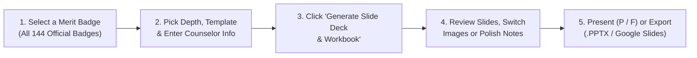

1. **Pick a Merit Badge**: In the left sidebar under **1. Find & Select Merit Badge**, search for any badge by name, filter by category or Eagle-Required status, open **⚜️ Patch Gallery (144)**, or click one of the **Quick-Select Badges** buttons such as **★ First Aid**, **Weather**, or **★ Camping**.
2. **Choose Your Deck Settings**: Under **2. Deck Style & Counselor Info**, choose whether you want a **Deep Dive Teaching Deck** or a shorter **Standard Troop Meeting Deck**, pick your **Slide Theme & Visuals** (*Warm Cream*, *Crisp White*, or *Dark Slate*), choose a **PowerPoint Template** and **Deck Layout Style**, and select your **Target Scout Audience Level**. All 3,917 pamphlet figures and illustrations are pre-bundled so images load immediately at zero extra cost.
3. **Add Your Counselor & Troop Details**: Click **👤 Counselor & Troop Profile (Saved) • Edit ▾** to enter your name, troop and council, city and state or ZIP code, optional email and phone, and optional troop logo. The Workbench remembers these details automatically for future badges.
4. **Generate Your Package**: Click **✨ Generate Slide Deck & Workbook**. While your slides are being built, you can watch the animated **Scout Slide Construction Showcase**.
5. **Present, Export, or Print**: Step through your slides on the **16:9 Slide Stage**, click **🖥️ Present** or press **`P`** for **Split-Screen Presenter View** to teach from your browser, use the top-right export button to **Download Slide Deck (.PPTX)** or **Open in Google Slides**, or open the **📥 Export & Print ▾** menu to download your workbook, `3x5` pocket cue cards, 1-page QR field handout, prerequisite checklist, or Blue Card CSV.

---

## 2. Tour of the Counselor Workbench Screen

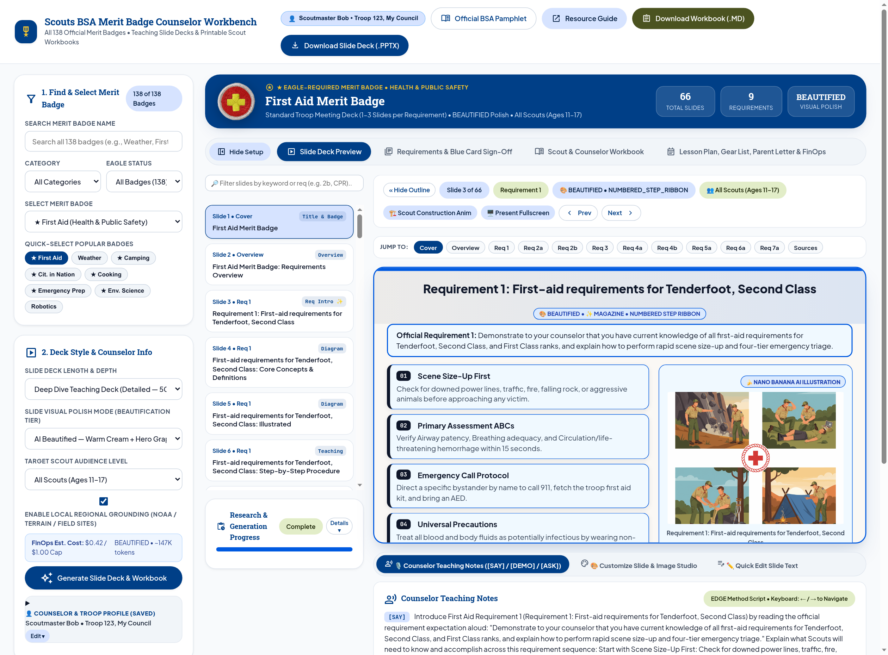

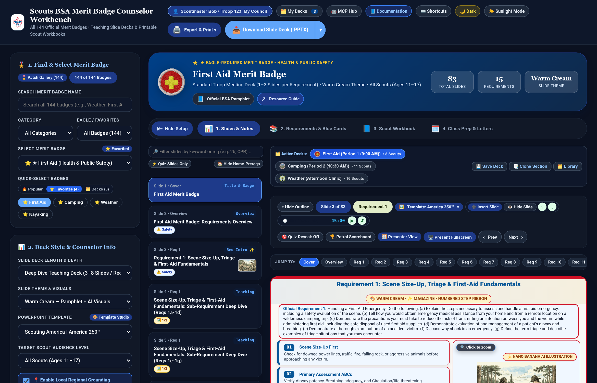

The Workbench is organized into four main areas plus a bottom footer so you can set up your class on the left and review all of your teaching materials on the right without losing your place:

| Screen Area | Where to Find It | What You Use It For |
| :--- | :--- | :--- |
| **Top Application Bar** | Across the very top of the window | Shows your **Counselor Profile Pill**, the **`🗂️ My Decks | ▾`** button for opening your saved decks library or switching active decks in one click, **`🤖 MCP Hub`**, **`📘 Documentation`** (shortcut `D`), **`🌙 Dark`** and **`☀️ Sunlight`** display modes, **`⌨️ Keys`** keyboard shortcuts, **`📥 Export & Print ▾`**, and the primary **Download Slide Deck (.PPTX) / Open in Google Slides** split-button. |
| **Left Setup Sidebar** | Left column (`1. Find & Select Merit Badge` and `2. Deck Style & Counselor Info`) | Lets you choose or star any of the 144 Merit Badges, switch the **Quick-Select Badges** bar between **🔥 Popular**, **⭐ Favorites**, and **🗂️ Decks**, open the **144-Badge Patch Gallery**, pick a **PowerPoint Template** and **Deck Layout Style**, set deck length and target Scout age group, enter your local troop information, and click **✨ Generate Slide Deck & Workbook**. You can fold this sidebar away anytime by clicking **⬅ Hide Setup** on the left side of the main tab bar. |
| **Blue Merit Badge Summary Banner** | Top of the right main workspace | Shows the official Merit Badge patch emblem, whether the badge is **Eagle-Required** or **Elective**, the badge category, direct links to the **📘 Official BSA Pamphlet** and **↗ Resource Guide**, and three summary pills on the right showing **TOTAL SLIDES**, **REQUIREMENTS**, and **SLIDE THEME**. |
| **Main Workbench Tabs** | Directly below the blue summary banner | Switches the main workspace between: 1. **📊 1. Slides & Notes** 2. **📚 2. Requirements & Blue Cards** 3. **📘 3. Scout Workbook** 4. **🗓️ 4. Class Prep & Letters** |
| **Application Footer** | Bottom of the window | Displays creator credits, **LinkedIn Profile**, the **GitHub** repository link, feedback email, and the **🔒 Admin** Console link. |

> [!TIP]
> **Need More Screen Space for Your Projector?** Click **⬅ Hide Setup** on the left edge of the main tabs bar to fold away the left setup sidebar, and click **« Outline** above the slide stage to fold away the slide list. Click **➡ Show Setup** or **» Outline** whenever you want them back.

---

## 3. Step 1: Finding & Selecting a Merit Badge

In the upper-left card (**1. Find & Select Merit Badge**), you have five ways to locate the badge you are teaching:

| Control | How It Works | Practical Tip for Counselors |
| :--- | :--- | :--- |
| **Search Merit Badge Name** | Type any word such as `First Aid`, `Weather`, `Canoeing`, `Robotics`, or `Citizenship`. | Narrows the dropdown list immediately as you type. |
| **Category** | Filter by Scouting subject area: *All Categories*, **Multi-Option Badges (18)**, *Outdoor & Campcraft*, *Health & Public Safety*, *Citizenship & Personal Development*, *Nature & Environment*, *STEM & Science*, *Aquatics & Sports*, *Trades, Business & Careers*, or *Arts, Crafts & Hobbies*. | Helpful when planning a themed campout weekend or finding all 18 multi-discipline badges in one click. |
| **Eagle / Favorites** | Choose **All Badges (144)**, **Eagle-Required (18)**, **Multi-Option Badges (18)**, **Electives (126)**, or **★ Favorites**. | Eagle-Required badges are marked with a star (**★**) in the dropdown list. Choosing **★ Favorites** narrows the Merit Badge dropdown directly to your starred badges. |
| **Starred Favorites & Quick-Select Bar (`🔥 Popular \| ⭐ Favorites \| 🗂️ Decks`)** | Click the **`⭐ Favorited`** button above the Merit Badge dropdown, or click the star in the corner of any patch in the gallery, to save a badge to your favorites list. Switch the Quick-Select bar between **🔥 Popular** (8 top badges), **⭐ Favorites** (your starred badges), and **🗂️ Decks** (your saved class decks plus **💾 Save**, **📑 Clone**, and **🗂️ Library** buttons). Every badge pill includes its circular Merit Badge patch icon. | Lets counselors who teach several Merit Badges at troop meetings or summer camp access their personal badge lineup and saved patrol decks in one click. |
| **🔀 Option Track & Quick-Select Pills** *(Multi-Option Badges)* | Appears automatically beneath **Select Merit Badge** whenever you select one of the **18 Multi-Option ("Two-Badges-in-One") Merit Badges** such as **Golf** (*Option A: Traditional Golf* vs. *Option B: Disc Golf*), **Skating** (*Ice*, *Roller*, *In-Line*, *Skateboarding*), **Cycling** (*Road Biking* vs. *Trail or Mixed Surface Biking*), **Athletics**, **Archery**, **Animal Science**, **Snow Sports**, **Rifle Shooting**, or **Shotgun Shooting**. Picking a multi-option badge in the dropdown reveals 1-click option pills (`Opt A`, `Opt B`, ..., `ALL`) without pre-generating the entire combined deck first. | Click any single option pill (such as **Opt B Roller Skating** or **Opt B Disc Golf**) to generate just that option track with a dedicated Option Subhead on Slide 1 and unrolled sub-requirement slides, or choose **ALL** to build the combined multi-option deck. Switching badges or options mid-generation immediately aborts the prior stream. |
| **⚜️ Patch Gallery (144) & Interactive `A\|B ▾` Menu** | Opens a visual grid of all 144 official Merit Badge patches. Multi-option badges display an interactive **`A\|B ▾`** badge in the upper-right corner: hovering or clicking **`A\|B ▾`** (or clicking a multi-option patch card) opens a smart-positioned option menu (`Opt A`, `Opt B`, ..., `ALL`) that automatically adjusts for left-column cards (`.drop-right`), bottom-row cards (`.drop-up`), and single-card filtered views (such as *Multi-Option Badges* + *Eagle-Required* showing **★ Cycling**). | Click any single option inside the **`A\|B ▾`** popover to launch that single option track directly from the Patch Gallery, or click the gold star on any card to add or remove it from your favorites. |

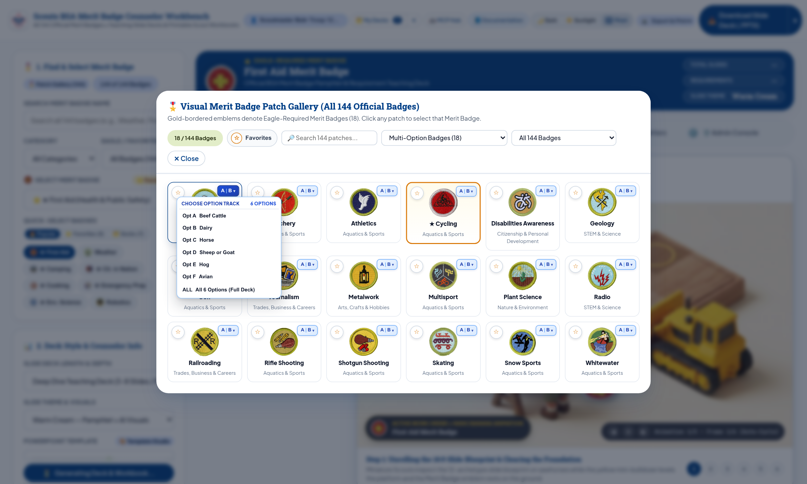

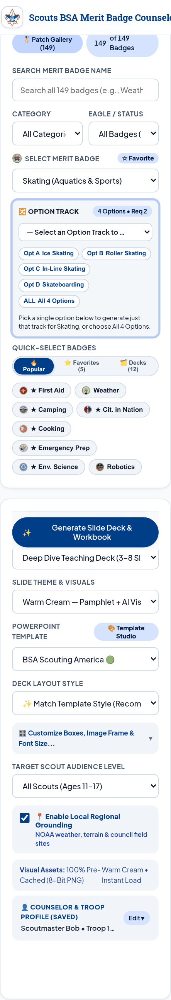

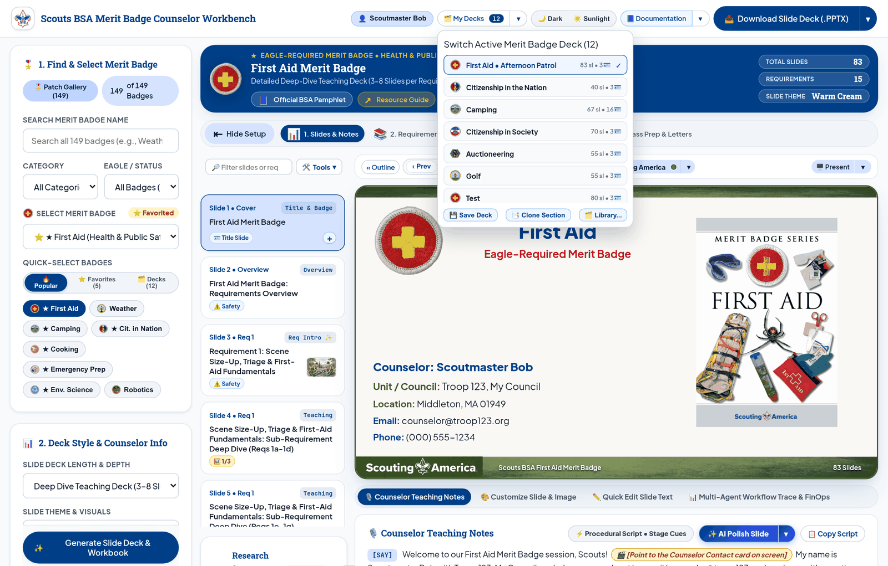

### Managing Multiple Merit Badge Decks & Patrol Sections (`🗂️ My Decks`)

Counselors who teach multiple Merit Badges at summer camp or run separate **Morning Patrol** and **Afternoon Patrol** sections of the same badge can manage all of their active decks in three places: the **🗂️ Decks** tab under **Quick-Select Badges** in the left sidebar, the **`🗂️ My Decks | ▾`** split-button in the top bar, and the **My Merit Badge Decks & Classroom Sessions Library** window:

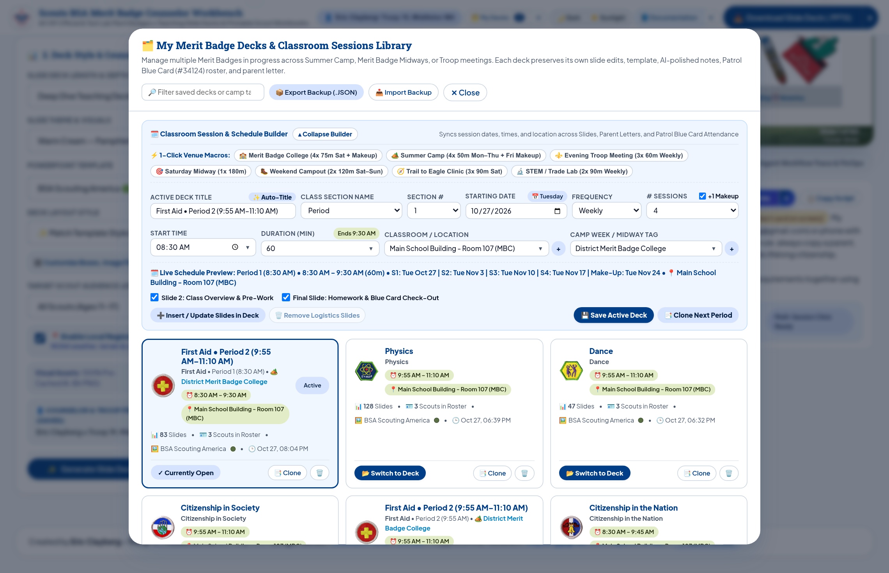

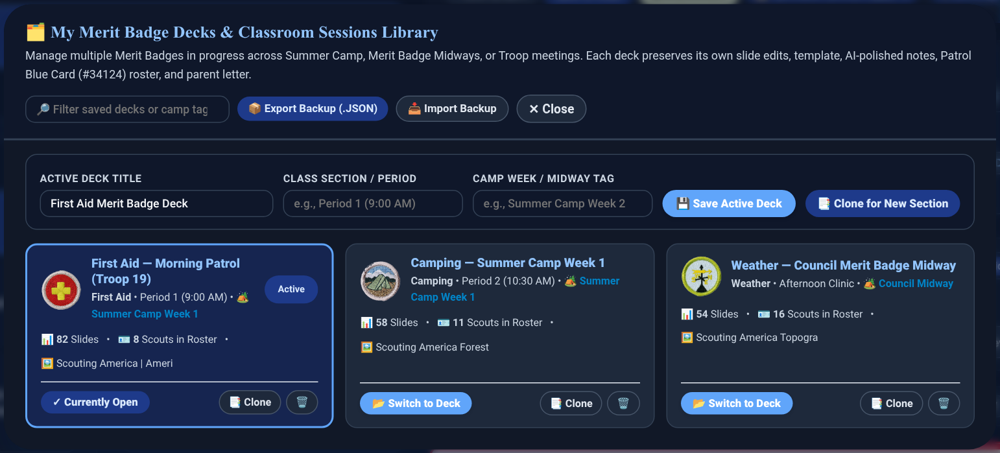

- **Saved Storyboards, Templates & Patrol Rosters**: Every saved deck preserves its full slide storyboard, custom slide edits, speaker notes, selected PowerPoint template and layout style, session label (such as `Period 1 - Morning Patrol`), camp or event tag (such as `Summer Camp Week 1`), and its own separate **Patrol Blue Card (`#34124`)** Scout roster. Each card in the library shows its Merit Badge patch, slide count, Scout roster count, and active template name with a color dot indicator.
- **Hybrid Preview-and-Pin Persistence (Browse Free, Auto-Save on Edit or Regenerate)**: Selecting a new Merit Badge from the dropdown, **🔥 Popular**, **⭐ Favorites**, or the **🎖️ Patch Gallery** opens the deck in **Preview mode** (`👁️ <Badge> (Preview • 📌 Pin)`) without cluttering your saved **🗂️ Decks** list. Whenever you click **✨ Generate Slide Deck & Workbook** / **🔄 Regenerate Deck**, edit any slide's text, layout, image, template, or speaker notes, update a Blue Card roster, or click the **`📌 Pin`** / **`💾 Save`** button, the Workbench automatically promotes and saves that deck into **🗂️ My Decks**.
- **Simple Session Labels & Preset Dropdowns**: When saving a deck, **Active Deck Title** defaults to the Merit Badge name while **Class Section / Period** and **Camp Week / Midway Tag** start blank so you only add labels when you need them. You can either pick a common preset from the dropdown or type your own custom label.
- **Instant Deck Switching**: Click any saved deck pill under **Quick-Select Badges -> 🗂️ Decks**, or click the **`▾`** arrow on **`🗂️ My Decks | ▾`** in the top bar when the left sidebar is hidden, to switch your slide stage, workbook, and Blue Card roster immediately without rebuilding the deck.
- **📑 Clone for New Section**: Click **📑 Clone** in the Quick-Select bar, in the top-bar **`🗂️ My Decks | ▾`** menu, or on any card in the library window to duplicate your customized slides, template, and speaker notes into a fresh session with an empty Blue Card roster for your next patrol or class period.
- **Safe Deletion**: Clicking **`🗑️`** on a saved deck asks for confirmation before deleting, with a **Don't ask again** option if you are cleaning up multiple old sessions.
- **Backup Export & Import**: Click **📤 Export Backup (.JSON)** in the library window to save a portable backup file to your laptop, or click **📥 Import Backup** to restore a saved deck and Blue Card roster on another computer.

---

## 4. Step 2: Choosing Your Deck Style & Saving Your Counselor Profile

In the lower-left card (**2. Deck Style & Counselor Info**), you control how detailed the presentation should be, how slides and templates are styled, which Scout age group you are teaching, and what local troop information appears on the cover slide and handouts.

### Choosing Deck Depth, Slide Theme, Template & Layout Style

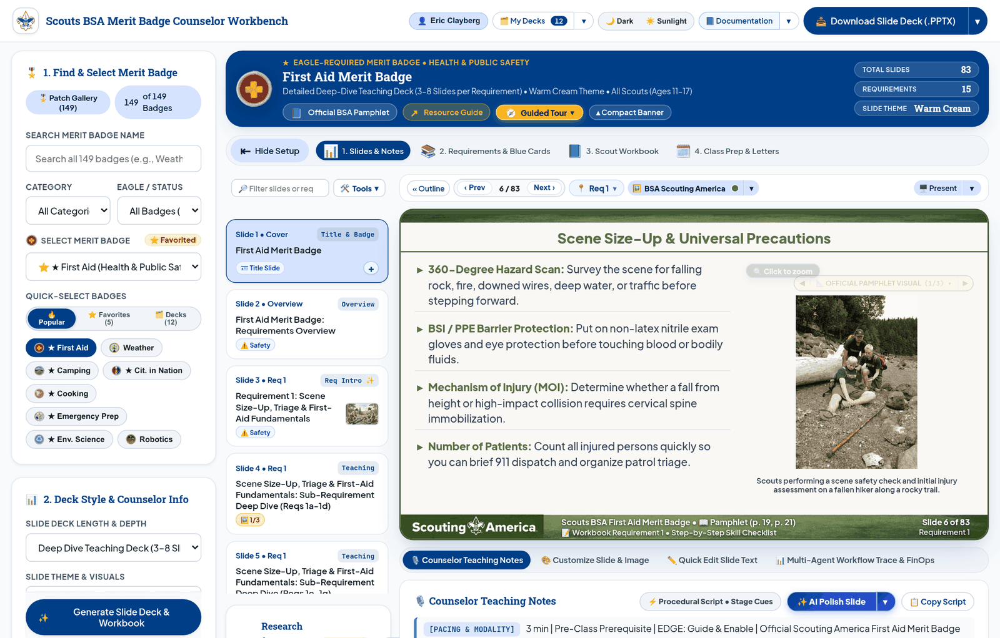

| Setting | Options Available | When to Use Each Option |
| :--- | :--- | :--- |
| **Slide Deck Length & Depth** | • **Deep Dive Teaching Deck (3-8 Slides / Req • 30-100+ Slides)** • **Standard Troop Meeting Deck (1-4 Slides / Req • 18-48 Slides)** | Choose **Deep Dive** for multi-week troop classes, summer camp blocks, or Merit Badge Universities where you want dedicated slides for every sub-requirement, worked examples, and review quizzes. Choose **Standard** for a shorter overview deck. |
| **Slide Theme & Visuals** | • **Warm Cream: Pamphlet + AI Visuals** *(Default)* • **Crisp White: Pamphlet Figures Only** • **Dark Slate: Pamphlet + AI Visuals** | Sets the background canvas and text contrast across your slides. **Warm Cream** provides a soft editorial cream background with pamphlet figures and AI visuals, **Crisp White** uses a bright white background with official pamphlet figures, and **Dark Slate** uses a deep navy-slate background with high-contrast white and gold text for darkened rooms. Changing this dropdown updates a loaded deck immediately. |
| **PowerPoint Template (`🎨 Template Studio`)** | • **17 Built-In Scouting America & Heritage Templates Across 8 Style Families**:   - *Standard Workbench*: **Workbench Classic**   - *1. Brushed Banner Series*: **BSA Scouting America** (*Green*, *Blue*, *Red*)   - *2. Horizon Silhouette Series*: **BSA Outdoor Adventure** (*Blue*, *Green*, *Red*)   - *3. Forest Sunrise & Camp Series*: **BSA Forest Sunrise** (*Blue*, *Green*, *Red*)   - *4. Topographic Contour Series*: **BSA Topographic** (*Blue*, *Green*, *Tan*)   - *5. Fleur-de-Lis Crest Series*: **BSA Fleur-de-Lis Crest** (*Red*, *Blue*)   - *6. Special & Action Editions*: **BSA America 250™**, **BSA High Adventure** • **Custom Upload & URL Import**: Upload your own `.pptx`, `.ppt`, `.png`, `.jpg`, or `.webp` template, import a template from a web link, or rename and delete custom templates. | Applies header and footer banners, outdoor horizon silhouettes, and corner logos across your presentation. Slide content and safety callouts automatically adjust their vertical spacing so they stay clear of footer banners and corner emblems. |
| **Deck Layout Style** | • **✨ Match Template Style (Recommended: Clean on BSA, Boxed on Classic)** • **📖 Clean & Borderless (No Boxes: Largest Text & Visuals)** • **📏 Editorial Left-Accent Line (Minimal Vertical Rule)** • **🗂️ Boxed Cards (Classic Bento Containers)** | Controls how teaching points and requirement overviews are framed across both the live web stage and your downloaded `.pptx` file. **Match Template Style** uses an open, unboxed layout on all 16 branded BSA templates and uses boxed teaching cards on **Workbench Classic**. |
| **🎛️ Customize Boxes, Image Frame & Font Size...** | Expandable customizer directly under **Deck Layout Style** with five fine-grained controls: • **Text Points Style**: *Auto (Follow Layout Style)*, *Clean & Borderless*, *Left Vertical Accent Line*, or *Boxed Cards* • **Right Image Frame**: *Auto (Frameless Image + Caption)*, *Frameless Image + Caption*, *Frameless + Soft Drop Shadow*, or *Boxed Image Card* • **Top Header & Requirement Strip**: *Auto (Unboxed Left-Accent Strip)*, *Unboxed Left-Accent Requirement Strip*, or *Full Solid Navy Header Banner* • **Body Font Size Scale**: *Comfortable Large (+2.5pt Unboxed)*, *Large Projector (+4pt Extra Legible)*, or *Compact (Standard Density)* • **Bottom Safety Strip**: *Acute Physical/Medical Hazards Only*, *Compact Bottom Accent Line*, or *Show on Every Slide with Warnings* • **📌 Save as My Default Style** and **↺ Reset** buttons | Lets you fine-tune text cards and image frames independently. For example, choosing **Boxed Cards** under **Text Points Style** puts boxes around your teaching points while keeping the right-hand illustration frameless unless you specifically choose **Boxed Image Card** under **Right Image Frame**. Full requirement wording is always shown without truncation. Clicking **📌 Save as My Default Style** remembers your favorite template, theme, and layout settings for all future sessions. |
| **Target Scout Audience Level** | • **All Scouts (Ages 11-17)** • **First-Year / Tenderfoot Focus (Ages 11-12)** • **Older Scouts / Eagle Prep (Ages 14-17)** | Adjusts the counselor speaker notes (`[SAY]`, `[DEMONSTRATE]`, `[ASK SCOUTS]`) so your explanations and check questions fit either younger crossovers or older Scouts preparing for Eagle Boards of Review. |
| **📍 Enable Local Regional Grounding** | Checked by default | Tailors your **Requirements Overview slide (Slide 2)**, **Session Lesson Plan**, and **Parent Welcome Letter** to your local area, referencing your nearest National Weather Service office, state U.S. Senators for civic badges, local terrain hazards, and nearby parks or field study sites. |

### PowerPoint Template & Custom Slide Theme Studio

Click **`🎨 Template Studio`** in the left sidebar or use the **`[🖼️ Template Name | ▾]`** split-button in the stage toolbar. Clicking the main button opens the **PowerPoint Template & Custom Slide Theme Studio**, while clicking the **`▾`** arrow opens a quick-switch menu on top of the slide stage:

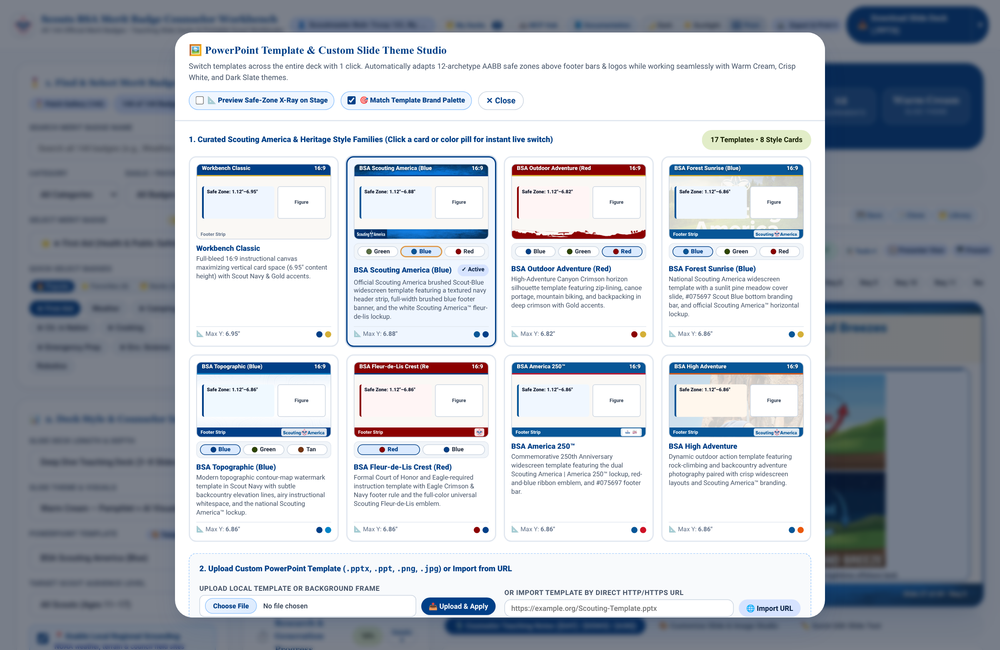

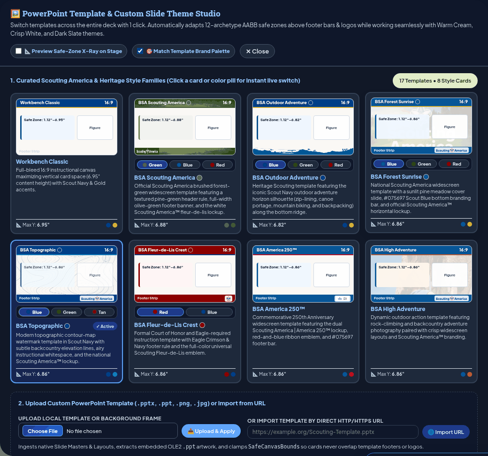

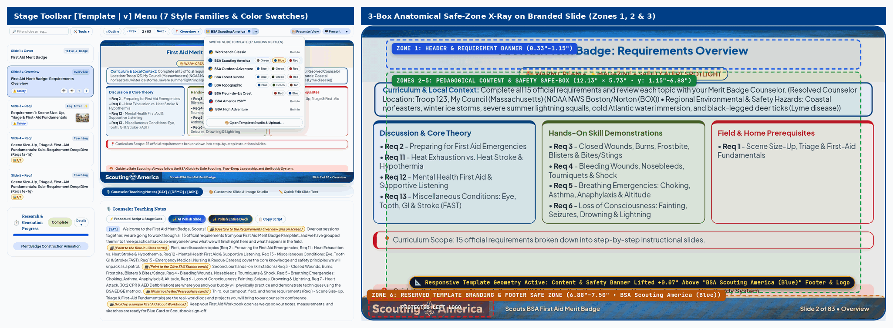

- **Quick-Switch Menu in the Stage Toolbar (`[🖼️ Template Name | ▾]`)**: The top section, **Switch Slide Template (17 Across 8 Styles)**, lists all 8 style families in full view without scrolling, with one-click color pills (**Green**, **Blue**, **Red**, **Tan**) right on each row. Directly below the template list, **Deck Layout Style (Live Stage + .PPTX)** lets you toggle between **✨ Auto**, **📖 Clean**, **📏 Line**, and **🗂️ Boxed** in one click, followed by a button to open the full Template Studio.
- **Style Family Cards in the Template Studio**: Inside the Template Studio window, each style family card shows a 16:9 miniature preview with interactive color pills underneath. Clicking any card or color pill applies that template to your active deck right away.
- **Global Deck Layout Style Bar, `📌 Set as My Default` & `↺ Reset`**: At the top of the Template Studio window, you can change the **Deck Layout Style**, click **📌 Set as My Default** to save your current template and layout preferences, or click **↺ Reset** to return to the factory default (**BSA Scouting America • Green** with **Match Template Style**).
- **Automatic Footer Clearance & High-Contrast Text**: When you pick a template with a bottom branding bar, outdoor horizon silhouette, or corner logo, both the live slide stage and the exported `.pptx` presentation automatically keep teaching points and the **Guide to Safe Scouting** bar clear of the footer artwork and choose high-contrast footer text.
- **Upload Custom Templates or Import by Web Link**: At the bottom of the Template Studio, you can upload your own `.pptx`, `.ppt`, `.png`, `.jpg`, or `.webp` template or paste a direct web link. Custom templates include a **`✏️`** edit button to update their name and description and a **`🗑️`** delete button to remove them.
- **📐 Preview Safe-Zone X-Ray on Stage**: Check **📐 Preview Safe-Zone X-Ray on Stage** in the Template Studio header to overlay dashed guide boxes on the live slide canvas showing the **Header & Requirement Banner**, the **Pedagogical Content & Safety Safe-Box**, and the **Reserved Template Branding & Footer Safe Zone**.

### Saving Your Counselor & Troop Profile

Click **👤 Counselor & Troop Profile (Saved) • Edit ▾** at the bottom of the left sidebar to open your contact fields:
- **Counselor Name**: Printed on your Cover Slide (Slide 1), Parent Welcome Letter, and Blue Card Sign-Off Sheet (for example, `Scoutmaster Bob`).
- **Troop & Council Affiliation**: Your unit and council name (for example, `Troop 19, Spirit of Adventure Council`).
- **Location (City, State or ZIP Code)**: Enter your town or 5-digit ZIP code (such as `Middleton, MA` or `01949`) so local weather, terrain hazards, and field study locations match your troop's home area.
- **Contact Email & Contact Phone (Optional)**: Displayed in the counselor contact box on Slide 1 and in your Parent Welcome Letter so Scouts, copying a parent or guardian under Youth Protection rules, know how to reach you.
- **Optional Troop Custom Logo (`.png` / `.jpg`) & `🗑️` Remove Button**: Upload your troop numeral patch, patrol medallion, or council shoulder strip to display it in the lower-left counselor block on Slide 1. Whenever a custom logo is loaded, a red **`🗑️`** delete button appears next to the file field so you can remove the logo in one click without clearing the rest of your contact profile.
- **↺ Reset Info**: Clears your saved profile and restores the default sample values anytime.

---

## 5. Step 3: Watching the Scout Slide Construction Showcase

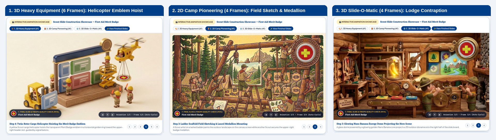

Whenever a new Merit Badge deck is being assembled, or anytime you click **Merit Badge Construction Animation** in the **Research & Generation Progress** card at the bottom of the slide outline column, the Workbench displays an interactive **Scout Slide Construction Showcase** featuring your selected Merit Badge emblem:

1. **🏗️ 1. 3D Heavy Equipment (6f)**: Miniature Scouts in campaign hats and hardhats use a yellow mini-bulldozer, tower crane, forklift, scissor-lift, and twin-rotor cargo helicopter to erect a giant 16:9 slide and hoist your Merit Badge patch into the upper-right mounting ring.
2. **🪵 2. 2D Camp Pioneering (4f)**: A patrol at a pine forest campsite ties square and diagonal lashings on timber spars and uses an A-frame block-and-tackle pulley rig to hoist a canvas projection screen framed with your Merit Badge emblem.
3. **⚙️ 3. 3D Slide-O-Matic (4f)**: Stop-motion clay Scouts inside a log-cabin workshop feed Merit Badge pamphlets into a brass-and-oak *"Slide-O-Matic"* contraption before cutting a ceremonial red ribbon.

You can switch between the three animations using the top buttons, step backward or forward through individual frames with the **`◀`**, **`⏸`**, and **`▶`** controls in the bottom-right corner of the canvas, or click **✨ View Finished Slides** to return to your presentation.

---

## 6. Step 4: Previewing, Presenting, Timing & Switching Slide Images

When **📊 1. Slides & Notes** is active, you have fast controls for navigating slides, switching visuals, timing your class, and projecting to a patrol:

### 1. Slide Outline Filter, Active-Slide Quick Buttons (`+`, `👁️`, `↑`, `↓`) & `[🛠️ Tools ▾]` Menu
- At the top of the **Slide Filmstrip Outline**, the **🔎 Filter slides or req...** search box and the **`[🛠️ Tools ▾]`** dropdown button sit side by side on a single compact row.
- Type a requirement number (such as `2b` or `4a`) or a topic word (such as `CPR`, `tourniquet`, or `splint`) into **🔎 Filter slides or req...** to narrow the slide list immediately.
- **Quick Customizer Buttons on the Active Slide (`+`, `👁️`, `↑`, `↓`)**:
  - In the lower-right corner of the active slide card in the outline, four small circular buttons appear:
    * **`+`**: Insert a custom local camp or troop slide right after this slide.
    * **`👁️`**: Hide this slide from the presentation and exported `.pptx`, or unhide it so it is included again.
    * **`↑`**: Move the active slide earlier in the deck.
    * **`↓`**: Move the active slide later in the deck.
  - **Steady Cursor Position While Reordering**: Clicking **`↑`** or **`↓`** moves the slide immediately and adjusts the outline scroll position so the active slide card and its **`↑`** / **`↓`** buttons stay right under your mouse pointer. This lets you click **`↑`** or **`↓`** several times in a row without chasing the card up or down the list. Your downloadable `.pptx` file automatically updates in the background a moment after you finish reordering.
- Click **`[🛠️ Tools ▾]`** to access three grouped sections in one menu:
  1. **Filter Slide Outline**: Toggle **⚡ Quiz Slides Only** or **🏠 Hide Home-Prereqs**. Whenever a filter is active, the Tools button highlights in amber and shows a count badge (**`🛠️ Tools • 1 ▾`**).
  2. **Slide Deck Customizer**: Click **➕ Insert Slide**, **👁️ Hide Slide**, or **↑ / ↓** to customize the deck from the menu.
  3. **Classroom Quiz & Patrol Game**: Toggle **🎯 Quiz Reveal: Off** or open the **🏆 Patrol Scoreboard**.
- Each card in the slide outline also displays a miniature visual thumbnail, a source badge (`Hero`, `Pamphlet`, `Diagram`, `Custom`, or `Text`), and a **`🖼️ 1/2`** badge when multiple image choices are available for that slide.

### 2. Stage Toolbar & Requirement Quick-Jump Menu (`[📍 Overview ▾]` / `[📍 Req X ▾]`)
- Above the 16:9 slide stage sits a single compact toolbar with **« Outline**, **‹ Prev / Next ›**, the **Requirement Quick-Jump** button (**`[📍 Cover Slide ▾]`**, **`[📍 Overview ▾]`**, or **`[📍 Req 2b ▾]`**), the **Template Switcher** (**`[🖼️ BSA Scouting America 🟢 | ▾]`**), and **`[🖥️ Present | ▾]`**.
- Clicking the **Requirement Quick-Jump** button opens a two-column menu listing the **Cover Slide**, **Overview**, and every requirement (**Req 1** through **Req 15**) with slide ranges and a **`✓`** checkmark on the current section. Clicking any requirement jumps straight to its introductory slide and scrolls the left outline to match.

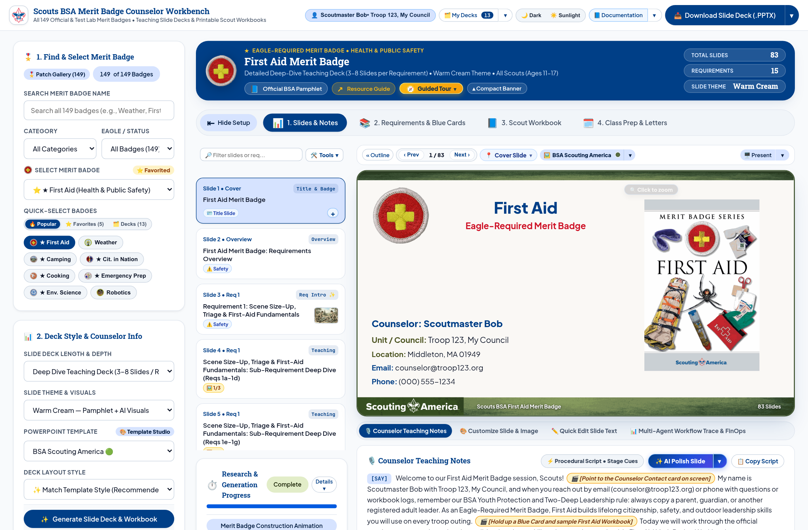

### 3. Easy Slide Image Switcher (On-Stage Visual Pill & Popover)
- Hover over the illustration on the right side of the 16:9 slide stage to reveal the zoom and image-source controls at the top of the visual:
  - When a slide has a single visual, the pill shows its source label (such as `🍌 NANO BANANA AI ILLUSTRATION`).
  - When a slide has multiple visual choices, such as the primary pamphlet figure plus alternate BSA pamphlet figures for that requirement or custom photos you uploaded, the pill shows **`◀`** and **`▶`** arrows and a **`(1/2) ▾`** counter.
  - Click **`◀`** or **`▶`**, or press **`[`** and **`]`** on your keyboard, to cycle between the slide's image options. Click **`(1/2) ▾`** to open a menu showing each option's thumbnail, role label, and caption. Picking any option updates the slide image, its caption, and your `[SAY]` / `[DEMONSTRATE]` teaching script right away and updates your `.pptx` download at zero cost. You can also click **+ Upload / Add Custom Image for This Slide...** at the bottom of the menu to open the 4-Tab Image Studio.

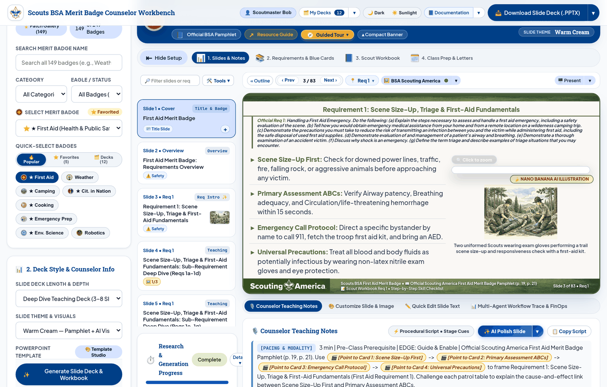

### 4. Split-Screen Presenter View (`P`), 2nd Monitor Window, Fullscreen Mode (`F`), Classroom Timer & Patrol Scoreboard (`Space`)

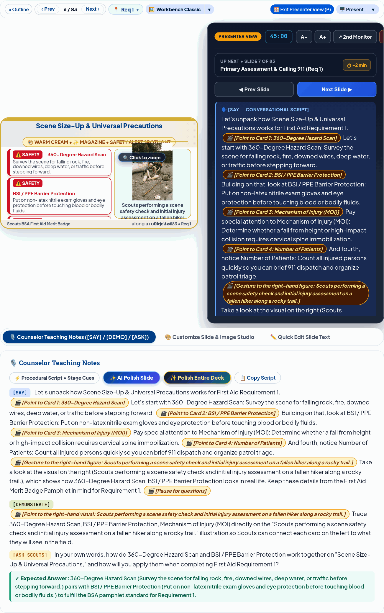

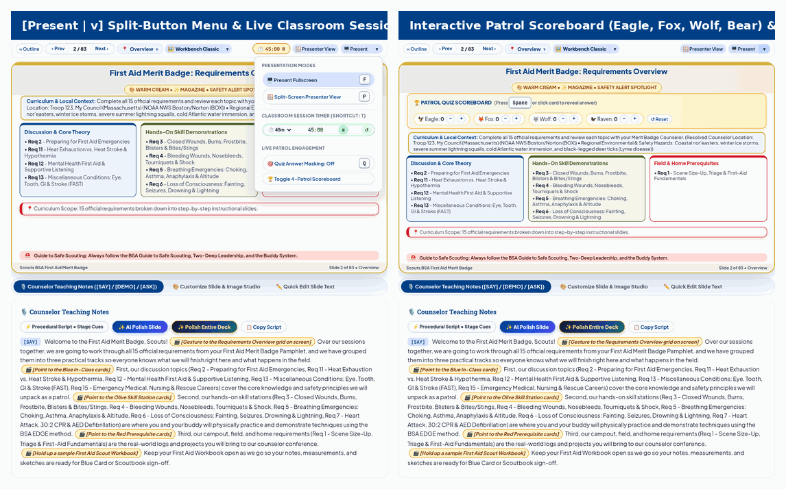

- **🪟 Split-Screen Presenter View (`P`), Draggable `🪟 Float` Mode & `↗ 2nd Monitor` Window**: Selecting **🪟 Split-Screen Presenter View** from the **`[🖥️ Present | ▾]`** menu, or pressing **`P`**, opens the **Presenter Console** directly to the right of the 16:9 slide stage:
  - **Full-Size Slide Stage**: When opened in normal preview mode, the Workbench automatically folds away the left setup sidebar and slide outline so your 16:9 slide stays large and easy to read while the Presenter Console sits to its right. Exiting Presenter View restores your sidebars automatically.
  - **Window Controls & Up Next Preview**:
    * **Top Header Bar**: Shows the gold **PRESENTER VIEW** badge and clickable **MM:SS** session timer on the left, and **🪟 Float** (which switches to **📌 Dock** when floating so you can drag the console anywhere on screen), **↗ 2nd Monitor**, and the red **`✕`** close button on the right.
    * **Up Next Card**: Shows the upcoming slide number, full title, and a **⏱ ~2 min** pacing estimate.
    * **Navigation & Font Size Row**: Places **◀ Prev Slide**, **Next Slide ▶**, and the **A−** / **A+** teleprompter font-size buttons on a dedicated bar right above your speaking notes.
  - **3 Color-Coded Speaking Cards**: Displays **`🗣️ [SAY]`** in a blue card, **`🛠️ [DEMONSTRATE]`** in an amber card, and **`❓ [ASK SCOUTS]`** (with its **✓ Expected Answer:** key) in a green card, complete with bold emphasis and highlighted `🎬 [Stage Cues]`.
- **↗ 2nd Monitor Speaker Window**: Teaching with a projector or dual display? Click **↗ 2nd Monitor** inside the Presenter Console header, or choose **↗ Pop-Out Presenter (2nd Window)** inside the **`[🖥️ Present | ▾]`** menu, to open a synchronized speaker window that you can drag onto your laptop screen while the projector shows only the 16:9 slide.
- **🖥️ Present Fullscreen (`F`) & Slide-Up Notes Drawer (`N`)**: Clicking **`🖥️ Present`** in the stage toolbar, or pressing **`F`**, expands the 16:9 slide stage to fill your screen with a floating bottom control bar (**◀ Prev**, **Next ▶**, **🎙️ Notes (N)**, **✕ Exit Fullscreen**). Clicking **🎙️ Notes (N)** or pressing **`N`** slides up a bottom teleprompter drawer inside Fullscreen mode, or you can press **`P`** in Fullscreen for the side-by-side Presenter Console. Exiting Fullscreen returns to the normal stage with the toolbar button kept cleanly labeled **🖥️ Present**.
- **⏱️ Classroom Session Timer**: Click the **`▾`** arrow on **`[🖥️ Present | ▾]`** to access the **Classroom Session Timer** (or press **`T`** to start or pause). Pick a preset (**`⏱️ 45m`**, **`⏱️ 50m`**, **`⏱️ 15m`**, or **`⏱️ 90m`**) and click **`▶`** to start. While the timer is idle, it stays tucked inside the menu; as soon as it is running or paused mid-session, a live countdown pill (**`⏱️ 44:59 ⏸`**) appears on the stage toolbar next to **🖥️ Present**, turning amber at 5 minutes remaining and red at 1 minute remaining.
- **❓ Curated Patrol Scenario Quizzes, `Space` Bar Reveal (`Q`) & 🏆 Patrol Scoreboard**: Patrol Scenario Quiz slides (`SOCRATIC_CHECKPOINT_QUIZ`) are selectively placed on high-impact field safety, first aid, and decision-making requirements (such as `Req 1` heatstroke triage on *Athletics* or lightning safety on *Weather*, rather than forced onto every physical skill event) with realistic patrol distractors and verified pamphlet explanations. Pressing the **`Space`** bar or clicking an option card reveals the highlighted correct answer and explanation on the spot. When you turn on the **🏆 Patrol Scoreboard** (**Eagle**, **Fox**, **Wolf**, **Raven** with **`+`** / **`−`** and **↺ Reset** buttons), it appears in a dedicated bar cleanly above the 16:9 slide stage so it never covers slide text or graphics.
- **⌨️ Keys Cheat-Sheet**: Click **⌨️ Keys** in the top bar, or press **`?`** on your keyboard, to view all keyboard shortcuts:

| Key | Action |
| :--- | :--- |
| **`←` / `→`** | Previous / Next slide |
| **`Space`** | Reveal or hide the quiz answer on Socratic Checkpoint slides |
| **`[` / `]`** or **`Alt + ← / →`** | Cycle previous or next image choice in the Easy Slide Image Switcher |
| **`F`** | Toggle Fullscreen classroom projector mode |
| **`N`** | Toggle Fullscreen Teleprompter Notes Drawer (`[SAY]` / `[DEMO]` / `[ASK]`) |
| **`P`** | Toggle Split-Screen Presenter View |
| **`T`** | Start or pause the Classroom Session Countdown Timer |
| **`Q`** | Toggle Quiz Answer Masking mode |
| **`D`** | Open or close the In-App Documentation Viewer |
| **`Ctrl + Shift + A`** | Open the Super-User Admin Console |
| **`?`** | Open Keyboard Shortcuts Cheat-Sheet |
| **`Esc`** | Close active menu, popup window, or Fullscreen view |

---

## 7. Step 5: Customizing Individual Slides, Layouts, Graphics & Text

Directly below the 16:9 slide stage sits the **3-Tab Under-Stage Drawer**, which gives you everything you need to teach or customize the active slide without scrolling down a long page:

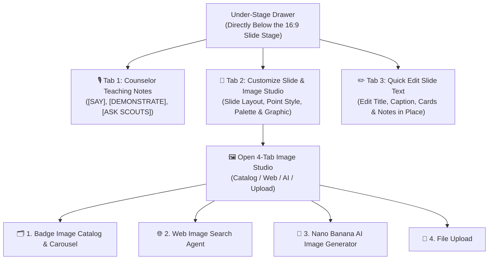

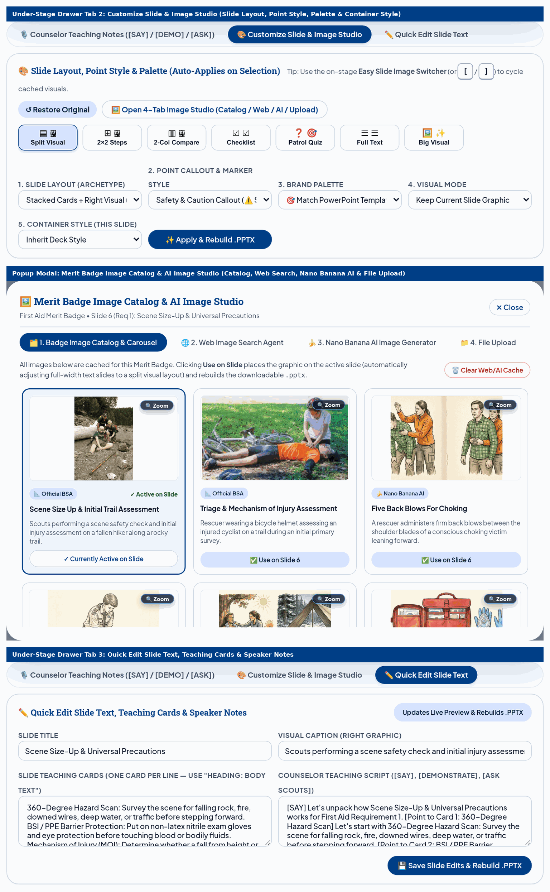

### Drawer Tab 1: `🎙️ Counselor Teaching Notes ([SAY] / [DEMO] / [ASK])` & AI Polish

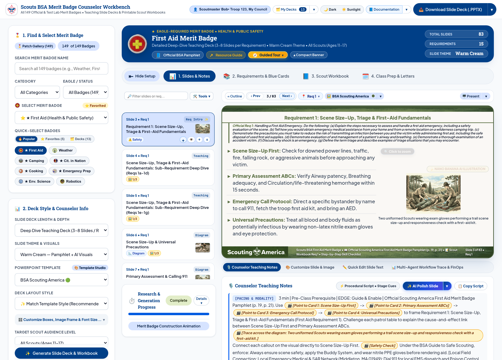

Displays your ready-to-speak **EDGE Method** script for the current slide, built directly from the slide's teaching points, official requirement text, and active visual caption:
- **`[SAY]`**: A conversational first-person speaking script that teaches the material on the slide and includes highlighted stage cues such as `🎬 [Point to Card 1: ...]`, `🎬 [Gesture to the right-hand figure: ...]`, and `🎬 [Pause for questions]`.
- **`[DEMONSTRATE]`**: Included when the slide calls for a hands-on skill demonstration, gear inspection, worked-example walkthrough, or diagram trace.
- **`[ASK SCOUTS]`**: A patrol check question followed by a highlighted **✓ Expected Answer:** key so you have the exact BSA pamphlet answer in front of you.
- **✨ AI Polish Slide & ✨ Polish Entire Deck**:
  - Clicking **✨ AI Polish Slide** or **✨ Polish Entire Deck** opens a cost preview window comparing two side-by-side options:
    1. **Option 1 • Current Slide Only (`~$0.0008`, or `$0.0000` if already cached)**
    2. **Option 2 • Entire Deck (`~$0.068` for an uncached 83-slide deck, or only the uncached slides)**
  - **Session Controls**: Check **Force fresh Gemini Flash generation** if you want to re-polish slides that were already cached, or check **Don't show this FinOps cost popup again during this browser session** for one-click polishing during the rest of your session.
  - **Live Progress & Restore Default**: Click **✨ Polish This Slide** or **✨ Polish All Slides** to generate warm, natural coaching scripts with bold key phrases and a live progress counter. Polished slides display an **✨ AI-Polished** badge, sync into your downloadable `.pptx` file, and include a **↺ Restore Default** button next to **📋 Copy Script**. Whenever you switch a slide's image or edit its text points, the teaching script updates automatically to match.

### Drawer Tab 2: `🎨 Customize Slide & Image Studio`

In **🎨 Slide Layout, Point Style & Palette (Auto-Applies on Selection)**, any change you make updates the live slide stage immediately and rebuilds your downloadable `.pptx` file in the background:

| Control | Options Available | What It Does |
| :--- | :--- | :--- |
| **Visual Layout Wireframe Row & `1. Slide Layout (Archetype)`** | • **Split Visual** (*Stacked Cards + Right Visual*) • **2x2 Steps** (*4-Step Procedure Grid*) • **2-Col Compare** (*Two-Column Comparison*) • **Checklist** (*Safety & Gear Checklist Grid*) • **Patrol Quiz** (*Interactive Socratic Quiz*) • **Full Text** (*Full-Width Concept Text, No Image*) • **Big Visual** (*Large Diagram Spotlight*) • Plus dropdown options for *3-Column Triage Matrix*, *Worked Example / Case Study*, and *Requirement Intro Banner* | Rearranges how the teaching points and visual are positioned on the current slide. Switching from **Split Visual** to **Full Text** expands your text across the slide, and switching back to **Split Visual** or **Big Visual** automatically restores the slide's illustration. |
| **2. Point Callout & Marker Style** | • **Numbered Step Badges (01, 02, 03)** • **Key Concept Diamonds (◆ Accent)** • **Sequential Action Steps (STEP 1 ➔)** • **Counselor Quote & Callout (❝)** • **Safety & Caution Callout (⚠️ SAFETY)** • **Key Takeaway Spotlight (★ Gold Star)** | Changes the callout marker prefix (`01`, `◆`, `STEP 1 ➔`, `❝`, `⚠️ SAFETY`, or `★`) and accent styling on each teaching point across **Clean**, **Line**, and **Boxed** container modes. |
| **3. Brand Palette** | • **🎯 Match PowerPoint Template Palette** • **Scouts Navy & Eagle Gold** • **Outdoor Olive & Forest Green** • **Eagle Crimson & Navy** • **Executive Slate & Action Blue** | Updates the accent color scheme of the header bar, callout markers, and borders on the active slide. |
| **4. Visual Mode** | • **Keep Current Slide Graphic** • **Restore Original Slide Graphic** • **🍌 Nano Banana Hero Graphic (or EDGE Concept Map)** • **None (Remove Graphic & Expand Text)** | Controls the right-hand picture. You can also click **↺ Restore Original** at the top of the panel anytime to reset the slide's graphic and layout. |
| **5. Container Style (This Slide)** | • **Inherit Deck Style** • **📖 Clean & Borderless (No Boxes)** • **📏 Editorial Left-Accent Line** • **🗂️ Boxed Cards** | Lets you override the text point container style on just the current slide while the rest of the presentation follows your deck-wide **Deck Layout Style**. |

### Using the 4-Tab Image Studio (`🖼️ Open 4-Tab Image Studio (Catalog / Web / AI / Upload)`)

Click **🖼️ Open 4-Tab Image Studio (Catalog / Web / AI / Upload)** near the top of the **Customize Slide & Image Studio** panel to open the popup Image Studio window:

1. **🗂️ 1. Badge Image Catalog & Carousel**:
   - Shows thumbnail cards for every image saved for the current Merit Badge, including official BSA pamphlet figures, requirement hero illustrations, diagrams, web search photos, and your own uploaded pictures.
   - Click **✅ Use on Slide** on any card to place that graphic onto your current slide.
   - Click **🗑️ Clear Web/AI Cache** in the upper right if you want to remove extra web-searched or custom AI-generated images while keeping all official pamphlet figures, default requirement hero graphics, and your own uploaded photos.
2. **🌐 2. Web Image Search Agent**:
   - Type a topic (such as `splint forearm`, `cumulonimbus cloud`, or `square lashing`) and click **🔎 Search Web & Commons** to search Wikimedia Commons for free educational photographs and diagrams at zero cost.
   - Click **Use on Slide** on any result to save it to the badge catalog and place it on the current slide.
3. **🍌 3. Nano Banana AI Image Generator**:
   - Creates a custom illustration tailored to your slide:
     - **1. Visual Illustration Style**: Choose **✨ Auto (Content-Aware Mix)** to let the tool pick the best style for the slide topic, or choose a specific style (*Photorealistic Image*, *4-Quadrant Concept Map*, *Line Drawing*, *Watercolor Field Sketch*, *Technical Diagram*, *3D Isometric Illustration*, *Editorial Vector Illustration*, *Cartoon Drawing*, or *Vintage Merit Badge Poster*).
     - **2. Human Presence & Uniform Directive**: Choose **✨ Auto-Detect**, **👕 Include Humans (Adult Scouts BSA Uniforms)**, or **🧰 No Humans (Pure Equipment / Environment)**, or toggle the **Include Uniformed Scouts** checkbox.
     - **3. Visual Scene Description**: Edit or refine the scene description you want illustrated.
   - Check the **`$0.08 USD`** cost consent box and click **🍌 Generate, Verify & Apply Custom AI Graphic (`$0.08 USD`)**.
4. **📁 4. File Upload**:
   - Click **1. Select Local Image File (PNG, JPG, WEBP, GIF)** to pick a photo from your own computer (such as a photo from a troop campout or your own training prop), enter an optional title and description, and click **📁 Upload, Cache & Apply Local Image to Slide (`$0.00 USD`)**.

### Drawer Tab 3: `✏️ Quick Edit Slide Text`

Want to tweak a slide title, reword a teaching point, or add a personal story to your speaker notes?
1. Click **✏️ Quick Edit Slide Text** below the slide stage.
2. Edit any of the four boxes:
   - **Slide Title**
   - **Visual Caption (Right Graphic)**
   - **Slide Teaching Cards (One card per line: use "Heading: Body text")**
   - **Counselor Teaching Script (`[SAY]`, `[DEMONSTRATE]`, `[ASK SCOUTS]`)**
3. Click **💾 Save Slide Edits & Rebuild .PPTX**. Your live slide preview and your downloadable PowerPoint deck update in less than a second at zero cost.

---

## 8. Step 6: Tracking Requirements & Signing Off Blue Cards (`#34124`)

Click the second main tab at the top of the screen (**📚 2. Requirements & Blue Cards**) to track Scout sign-offs during class and review how every official requirement is taught.

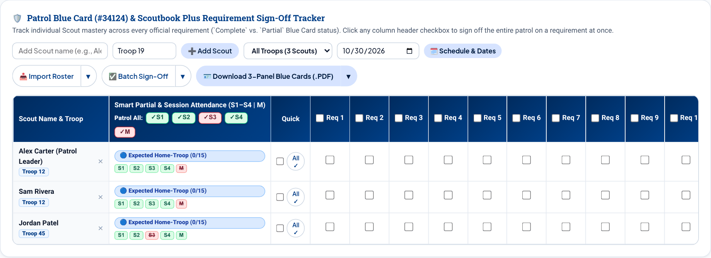

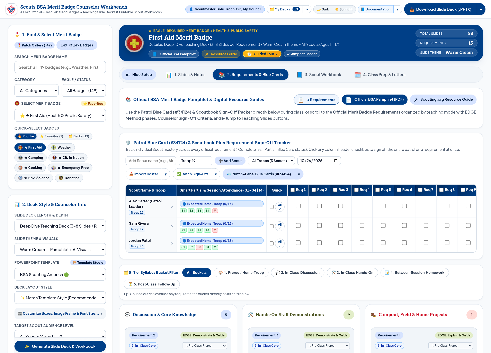

### Patrol Blue Card (`#34124`) & Scoutbook Plus Requirement Sign-Off Tracker

At the top of the **Official BSA Merit Badge Pamphlet & Digital Resource Guides** card, three buttons let you jump straight to **`↓ Requirements`**, open the **Official BSA Pamphlet (PDF)**, or open the **Scouting.org Resource Guide**. Directly below that header bar sits your interactive **Patrol Blue Card (`#34124`) & Scoutbook Plus Requirement Sign-Off Tracker**, saved automatically for each Merit Badge deck:
1. **Add Scouts Individually, Copy From Another Deck, Bulk Paste, or Import `.CSV`**:
   - Type a Scout's name (for example, `Alex Carter - Eagle Patrol`) into the box and click **➕ Add Scout** or press `Enter`.
   - Click **🔁 Copy Scouts From Deck** to copy the Scout roster (names, units, and patrols with fresh unchecked requirement boxes) from any of your other saved Merit Badge decks in **🗂️ My Decks**.
   - Click **📋 Paste Roster** to paste an entire patrol or class list from a spreadsheet, one Scout per line.
   - Or click **📤 Import .CSV Roster** to upload a standard `.csv` roster exported from **Scoutbook Plus** or **TroopWebHost**.
2. **Check Off Completed Requirements, Bulk Sign Off Columns & Stamp Dates**:
   - As each Scout demonstrates mastery of a requirement (`1`, `2a`, `2b`, `3`, ...), check the box in their row.
   - Click **✅ Mark In-Class Done** to check off all **Discussion & Core Knowledge** requirements for every Scout in the roster at once, or click any **Requirement Column Header (`Req 1`, `Req 2a`, ...)** to toggle that requirement for the entire patrol after a group demonstration.
   - Pick a date in the **📅 Sign-Off Date** field to record the completion date across your Scoutbook CSV export and printed Blue Cards.
3. **Automatic `Partial` vs. `Complete` Blue Card Status**: The **Blue Card Status** column shows `Partial (X/Y)` in amber while a Scout is still working, and switches to `Complete (Y/Y)` in green once all requirements are checked. You can also click **All ✓** in the **Quick** column to check or uncheck an entire row at once.
4. **Export Scoutbook CSV, Print Patrol Sheet, or Print 3-Panel Blue Cards (`#34124`)**:
   - Click **📥 Export Scoutbook CSV** to download a `.csv` spreadsheet listing every Scout, unit, requirement status, completion date, and counselor name for easy entry into **Scoutbook Plus** or troop advancement records.
   - Click **🪪 Print 3-Panel Blue Cards (#34124)** to generate printable three-column tri-fold Blue Cards (*Applicant's Record*, *Application for Merit Badge*, and *Counselor's Record*) filled in with each Scout's name, unit, completed requirement initials and dates, and your counselor signature block.
   - Click **🖨️ Print Sign-Off Sheet** to open a clean, printable **Application for Merit Badge (`#34124`) Patrol Sign-Off Record** complete with a Counselor signature and date line.

### 3-Column Requirements Triage & Quick Links

Below the Blue Card Sign-Off Tracker (or one click away via the **`📋 ↓ Requirements`** button at the top of the page), every official requirement for the badge is sorted into one of three practical teaching columns:
- **💬 Discussion & Core Knowledge**: Requirements you can cover through interactive patrol discussion, visual explainers, and Socratic Q&A.
- **🛠️ Hands-On Skill Demonstrations**: Physical skills where each Scout must *demonstrate*, *build*, *treat*, or *perform* a task at a practice station.
- **🥾 Campout, Field & Home Projects**: Prerequisites, multi-week logs, field visits, or campout tasks that Scouts complete outside of a regular troop classroom meeting.

Every requirement card lists the **exact official BSA requirement text**, the recommended **EDGE Method phase**, the **Counselor Sign-Off Criteria**, any **Youth Protection or Guide to Safe Scouting reminders**, and a **▶ Jump to Teaching Slides** button that takes you straight to that requirement's slides.

---

## 9. Step 7: Using the Workbook, Classroom Toolkit, Cue Cards & Station Rotator

### Top Tab 3: `📘 3. Scout Workbook` (with Section Search, QR Handout & 3x5 Cue Cards)

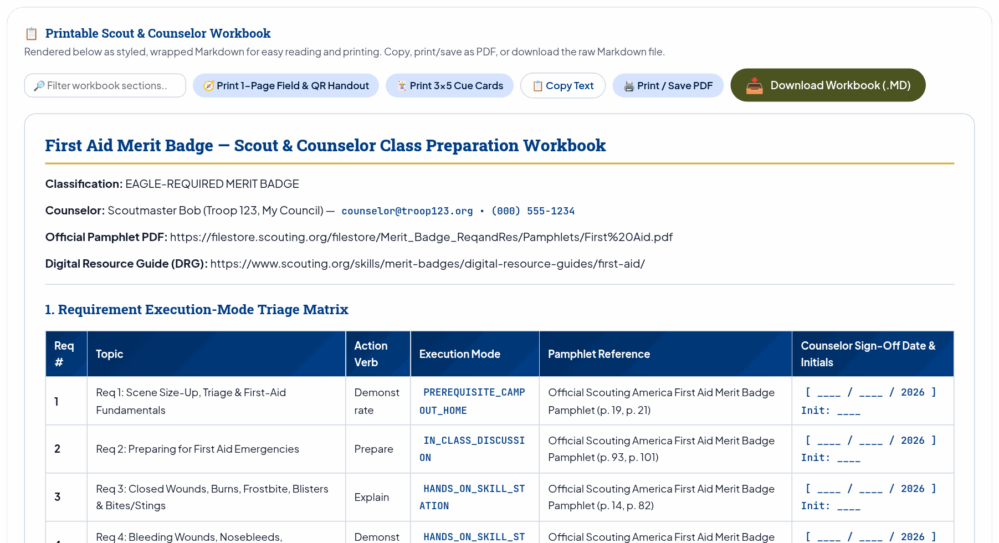

Click **📘 3. Scout Workbook** to preview the complete printable workbook for the active Merit Badge:
- Use the **`🔎 Filter workbook sections...`** search box at the top of the workbook card to filter by requirement number or keyword (such as `Requirement 4`, `CPR`, or `Checklist`).
- Use the action buttons in the upper right of the card:
   - **🧭 Print 1-Page Field & QR Handout**: Opens a printable one-page pocket field reference with phone-scannable QR codes for the official BSA Merit Badge Pamphlet PDF and Scouting.org Digital Resource Guide.
   - **🃏 Print 3x5 Cue Cards**: Generates a printable grid of `3x5` counselor index cards containing each requirement's number, verbatim summary, **`[SAY]`**, **`[DEMONSTRATE]`**, and **`[ASK SCOUTS]`** prompts so you can teach outdoors at camp without carrying a laptop.
   - **📋 Copy Text**: Copies the entire workbook to your clipboard.
   - **🖨️ Print / Save PDF**: Opens a clean, black-and-white print view formatted for standard `8.5" x 11"` paper or **Save as PDF**.
   - **📥 Download Workbook (.MD)**: Downloads the complete Markdown workbook file to your computer.

### Top Tab 4: `🗓️ 4. Class Prep & Letters` (`📋 All Sections` + 4 Focused Sub-Tabs)

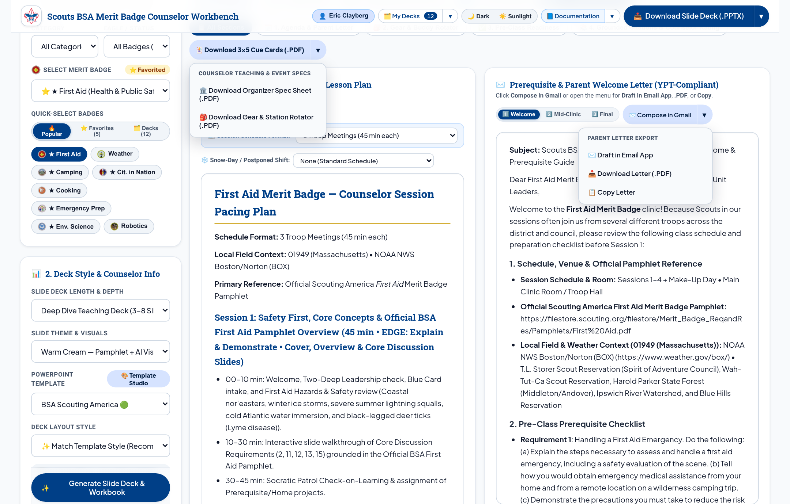

Click **🗓️ 4. Class Prep & Letters** to access your classroom preparation toolkit. You can view **`📋 All Sections`** on a single scrollable page, click **`🧭 Print 1-Page Pocket Field Checklist & QR Handout`** on the right of the sub-tab bar, or switch across four focused sub-tabs:

| Sub-Tab | Key Controls & Options | How Counselors Use It |
| :--- | :--- | :--- |
| **🗓️ 1. Agenda & Parent Letter** | • **🗓️ Session Schedule Format** dropdown:   1. *3 Troop Meetings (45 min each)*   2. *Summer Camp Week (4x 50-min Mon-Thu + Fri Make-Up)*   3. *Saturday Merit Badge Midway / Clinic (3-Hour Block)*   4. *Weekend Campout Practicum (Fri Eve + Sat Field + Sun Sign-Off)* • **✉️ Prerequisite & Parent Welcome Letter (YPT-Compliant)** with **📋 Copy**, **✉️ Draft in Email App**, **📨 Compose in Gmail**, **🖨️ Print**, and **📥 .MD** | Displays your timed, minute-by-minute **Counselor Session Agenda & Lesson Plan** on the left alongside a ready-to-send **Parent Welcome Letter** on the right covering prerequisites, required gear, local field study context, and **Scouting America Youth Protection** reminders (Two-Deep Leadership and copying a parent or guardian on all digital communication). |
| **🎒 2. Gear & Buddy Rotator** | • **🏕️ Class / Patrol Size** dropdown (*1 Scout*, *4 Scouts*, *8 Scouts*, or *16 Scouts*) with interactive checkboxes, **📋 Copy**, and **🖨️ Print** • **🔄 Patrol & Buddy Skill Station Rotator Schedule** (`2`, `3`, or `4` Patrols; `10 min`, `12 min`, `15 min`, or `20 min` per station) with **🖨️ Print Station Matrix** | Multiplies physical prop and supply quantities based on your class size on the left, and builds a **Round-Robin Patrol Skill Station Rotation Schedule** on the right across all hands-on skill requirements so patrols never bottleneck on the same equipment. |
| **✅ 3. Pre-Class Readiness** | • **📋 Pre-Class Scout Prerequisite & Home Project Readiness Checklist** • **✉️ Copy Pre-Class Reminder Snippet** and **🖨️ Print Readiness Table** | Builds a Day-1 **Prerequisite Readiness Check Sheet** listing every home log, multi-week chart, or campout task Scouts must bring to class before receiving full Blue Card sign-off. |
| **📚 4. Grounded Citations & Counselor Rating** | • **`↓ Counselor Rating`** jump button in the header of **Grounded Research Citations & Local Troop References** • **🏅 Rate This Merit Badge Teaching Package** (`1` to `5` stars + **✅ Official 2026 BSA Requirement Wording Verified** + optional teaching notes) | Lists the official BSA pamphlet and regional references (such as NOAA, USGS, NPS, and the American Red Cross), verifies canonical requirement wording, and lets you submit anonymous counselor quality feedback. |

---

## 10. Exporting Your Slide Deck to PowerPoint or Google Slides

In the Top Application Bar (and inside **`📥 Export & Print ▾`**), the primary export split-button remembers your preferred slide deck format across sessions:
- **Mode 1: `📥 Download Slide Deck (.PPTX)` (Default)**: Downloads a widescreen (`16:9`) PowerPoint presentation where every title, teaching point, caption, and speaker note is a native editable text box.
- **Mode 2: `🟨 Open in Google Slides`**:
  - Clicking **🟨 Open in Google Slides** opens the **Open in Google Slides: Account & Destination** window displaying two options:
    1. **1. Active Workstation Google Drive Account**: Shows your active Google Drive account, which uploads and converts your `.pptx` directly into a native Google Slides deck in **My Drive** and opens it in a new browser tab.
    2. **2. Share / Open with Personal Gmail or Secondary Account (Optional)**: Lets you enter a personal `@gmail.com` or secondary Google account so the exported presentation automatically grants Editor access and opens under that account.
  - **Bottom Window Actions**: Click **🔑 Pick Google Account (OAuth)** to sign in with a specific Google account, or click **🟨 Create & Open in New Tab ↗** to create and open your Google Slides deck right away.
- Click the **`▾`** arrow on the right edge of the top-right export button anytime to switch your default action between **Download Slide Deck (.PPTX)** and **Open in Google Slides**.
- Inside **`📥 Export & Print ▾`**, clicking **📱 Print 1-Page Field & QR Handout** opens a printable one-page pocket reference featuring phone-scannable QR codes that open the official BSA Merit Badge Pamphlet PDF and the Scouting.org Digital Resource Guide.

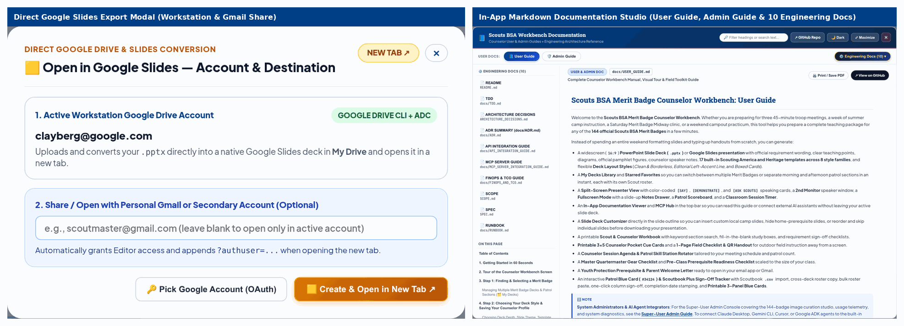

### Opening in Microsoft PowerPoint or Apple Keynote
1. Double-click the downloaded `.pptx` file on your laptop.
2. Switch to **Presenter View** during class so your Scouts see the 16:9 visual slides on the projector while you read the **`[SAY]` / `[DEMONSTRATE]` / `[ASK SCOUTS]`** teaching script on your laptop screen.

### Importing Manually into Google Slides
1. Open [Google Slides](https://slides.google.com) or your troop's shared Google Drive folder.
2. Click **File -> Import slides** (or **File -> Open -> Upload**) and drag in your downloaded `.pptx` file.
3. Click **View -> Show speaker notes** to see your EDGE teaching script below each slide, or click **Slideshow -> Presenter view** when teaching.

### Connecting AI Assistants via the Built-In MCP Hub (`🤖 MCP Hub`)

Click **`🤖 MCP Hub`** in the Top Application Bar if you use AI desktop tools such as **Claude Desktop**, **Gemini CLI**, or **Cursor** and want them to work directly with your Merit Badge decks:

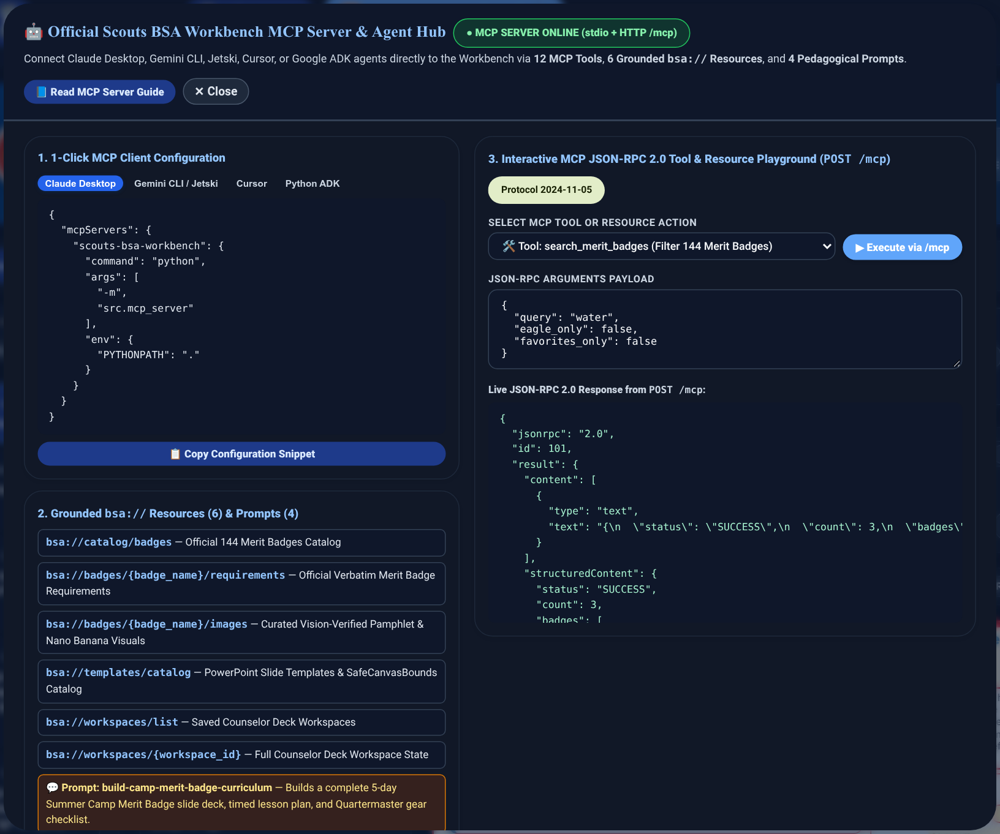

- **One-Click Setup Snippets**: Copy ready-to-use connection settings for **Claude Desktop**, **Gemini CLI**, **Cursor**, or **Google ADK**.
- **Built-In Actions & Guided Prompts**: Connected AI assistants can search all 144 Merit Badges, look up official requirement text, build slide decks with any of the 17 PowerPoint templates and layout styles, switch slide visuals, and help manage Patrol Blue Card (`#34124`) rosters.
- **Interactive Playground**: You can also test any of the built-in tools, resources, and guided prompts right inside the modal's visual preview cards. For technical setup details, see the **[MCP Server Integration Guide](MCP_SERVER_INTEGRATION_GUIDE.md)**.

---

## 11. Frequently Asked Questions for Counselors

### Can I use the Workbench at summer camp where Wi-Fi is spotty or unavailable?
Yes. All 144 Merit Badge requirement outlines and all **3,917 built-in visual assets** (including **2,323 official BSA Pamphlet figures**, **1,306 requirement hero and topic illustrations**, **144 badge emblems**, and **144 pamphlet covers**) are stored locally when running on your laptop. Any Merit Badge decks, workbooks, or extra images you generate before camp stay saved on your computer for offline use.

### How do I remove an image from a slide if I just want full-width text?
Select the slide in **📊 1. Slides & Notes**, click the second tab below the slide (**🎨 Customize Slide & Image Studio**), and click the **Full Text** wireframe button (or set **4. Visual Mode** to **None**). The picture is removed and your teaching points expand across the full width of the slide.

### How do I switch a slide back to its original diagram or pamphlet illustration?
In **🎨 Customize Slide & Image Studio**, click the **Split Visual** or **Big Visual** wireframe button (or click **↺ Restore Original** at the top of the panel). The slide's original pamphlet figure or illustration is restored automatically.

### How do I add my own troop photos to a slide?
Click **🎨 Customize Slide & Image Studio** below the slide stage, click **🖼️ Open 4-Tab Image Studio (Catalog / Web / AI / Upload)**, select the fourth tab (**📁 4. File Upload**), pick any `.png`, `.jpg`, `.webp`, or `.gif` photo from your computer, and click **📁 Upload, Cache & Apply Local Image to Slide (`$0.00 USD`)**.

### Is my contact information kept private?
Yes. Your Counselor Name, Troop, Location or ZIP code, Email, and Phone are saved locally in your browser and on your own computer so you do not have to retype them. They are placed only onto your Cover Slide, Parent Welcome Letter, and Blue Card Sign-Off Sheet, and are never shared with outside services or usage logs.
